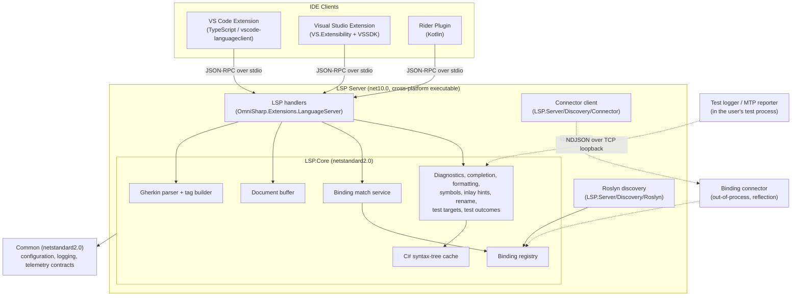

# Architecture Reference

**Status:** Implemented. This is the entry point to the architecture documents; the detail is in the linked documents.
**Audience:** Maintainers and agents who need the shape of the system and where to find the detail.

## 1. Purpose and scope

A shared language server (`Reqnroll.IdeSupport.LSP.Server`) does the Gherkin work; one thin client per IDE launches it,
bridges the IDE's project system to it, and renders what it returns. This hub gives the module map, the repository
layout, the rule for where code goes, and an index of the detailed documents. For goals and scope see the
[Overview](LSP-IDE-Support-Overview.md); for how a feature works see the [feature designs](features/README.md).

## 2. Overview

All three clients communicate with the server over **stdio**; the server is launched as a child process by the IDE
extension. Clients are not libraries that reference the server.

## 3. Flows

The main flows are documented where they belong:

- Editing a feature file and the diagnostics fan-out: [architecture/server-pipeline.md](architecture/server-pipeline.md).
- Project load, membership and ownership: [architecture/workspace-and-membership.md](architecture/workspace-and-membership.md).
- Bindings entering the registry: [architecture/binding-discovery.md](architecture/binding-discovery.md).
- Startup and activation per IDE: [architecture/ide-clients.md](architecture/ide-clients.md) and the client documents.

## 4. Glossary

| Term | Meaning here |
|---|---|
| **Server** | `Reqnroll.IdeSupport.LSP.Server`, the executable all clients launch. |
| **Core** | `Reqnroll.IdeSupport.LSP.Core`, protocol-agnostic Reqnroll logic (`netstandard2.0`). |
| **Common** | `Reqnroll.IdeSupport.Common`, contracts shared by server and hosts (`netstandard2.0`). |
| **Connector** | Out-of-process reflection scanner producing binding discovery results. |
| **Client** | The per-IDE extension or plugin. |
| **Tier (OOB / Glue / Custom)** | How a client delivers a feature; see [architecture/ide-clients.md](architecture/ide-clients.md). |
| **Registry / match set / tag tree** | Defined in [architecture/server-pipeline.md](architecture/server-pipeline.md). |

## 5. Key projects and layout

| Path | Contents |
|---|---|
| `src/Core/Reqnroll.IdeSupport.Common` | Configuration loaders, logging, project-system abstractions, telemetry contracts, shared method names, test-outcome parsing. Each IDE host owns its concrete telemetry transmitter. |
| `src/Core/Reqnroll.IdeSupport.TestLogger`, `…TestReporter.Common`, `…TestReporter.MTP` | The VSTest logger and MTP reporter that run in the user's test process. |
| `src/LSP/Reqnroll.IdeSupport.LSP.Core` | Parser, tag builder, binding registry, matching, scope handling, and one folder per capability (completions, formatting, inlay hints, folding, diagnostics, document outline, commenting, rename, scaffolding, test targets, test outcomes, …). |
| `src/LSP/Reqnroll.IdeSupport.LSP.Server` | OmniSharp host: `Features/` (handlers with their params/response types), `Pipeline/` (MediatR handlers), `Hosting/`, `Discovery/Roslyn` and `Discovery/Connector`, `Workspace/`, `Concurrency/`, `Performance/`, `Telemetry/`, and per-concern support. |
| `src/LSP/Reqnroll.IdeSupport.LSP.Connector` | Reflection-based discovery executable (with .NET Framework variants). |
| `src/VisualStudio/*` | `Extension` (VS.Extensibility, net481), `VSSDKIntegration`, `Wizards{,.Core,.UI}`, `ItemTemplates`, `ProjectTemplate`. |
| `src/VSCode`, `src/Rider` | The VS Code extension (npm) and Rider plugin (Gradle). |
| `tests/{Core,LSP,VisualStudio,Performance}` | Unit tests, specs, fixtures and benchmarks mirroring `src`. |

Project folders are named for their capability and are flat (no `Editor/` grouping). The clients are top-level siblings of
`Core` and `LSP`; they are not nested under a `clients` folder.

### Where code goes: `LSP.Core` versus `LSP.Server`

The rule is about **plumbing**, not size:

- `LSP.Core` gets whatever implements Reqnroll functionality **without** the plumbing: hosting, OmniSharp, MediatR, DI
  registration, process lifetime. If a type can be written and unit tested knowing only Reqnroll concepts (bindings,
  features, matching, project scopes, IDE behaviour switches), it belongs in Core.
- `LSP.Server` gets the plumbing and what is inseparable from it: OmniSharp handlers, MediatR notifications and handlers,
  hosting and DI wiring, and the timing and scheduling semantics of LSP operations (the debouncers, `ParseCoordinator`),
  even when those files compile without OmniSharp. A handler's `Params`/`Response`/`Options` types stay beside it in
  `Features/<capability>/`.
- Dependency is **one way**: Server references Core, never the reverse. A type Core needs therefore moves to Core even if
  it looks like a protocol DTO (the `reqnroll/projectLoaded|Unloaded|Files` params live in `LSP.Core/Workspace`).

Before placing a type: (1) does it reference OmniSharp, MediatR, `Microsoft.Extensions.DependencyInjection/Hosting` or any
Server type that does? Then Server. (2) Does it need an API not available on `netstandard2.0` (for example
`System.Text.Json`, `ToHashSet`)? Then Server, unless adding the dependency to Core is deliberate. (3) Otherwise Core, in
the folder named for the capability. A Core type that Server consumes must be `public`. Tests follow their subject.

Naming convention: `*.Tests` are unit tests; `*.Specs` are integration/BDD tests.

## 6. Architecture documents

| Document | Read it to learn |
|---|---|
| [server-protocol.md](architecture/server-protocol.md) | How the server uses LSP: capability registration, `--ide` and behaviours, custom methods, priority and debounce |
| [server-pipeline.md](architecture/server-pipeline.md) | The parse-and-match pass, internal events, handlers, the C# syntax-tree cache |
| [workspace-and-membership.md](architecture/workspace-and-membership.md) | Projects, the `path → {projects}` index, linked, excluded and shared files, dialects |
| [binding-discovery.md](architecture/binding-discovery.md) | Roslyn and reflection discovery, the Connector, error and scope parity |
| [ide-clients.md](architecture/ide-clients.md) | What every client does, and the per-feature cross-IDE matrix |
| [client-visualstudio.md](architecture/client-visualstudio.md), [client-vscode.md](architecture/client-vscode.md), [client-rider.md](architecture/client-rider.md) | Each client in detail |
| [telemetry.md](architecture/telemetry.md), [performance.md](architecture/performance.md), [operations.md](architecture/operations.md), [testing-strategy.md](architecture/testing-strategy.md) | Cross-cutting concerns |
| [design-decisions.md](architecture/design-decisions.md) | Why the architecture looks like this, and what was rejected |
| [complexity-hotspots.md](architecture/complexity-hotspots.md) | Measured complexity hot spots in the code |

## 7. Pitfalls and design decisions

The cross-cutting ones live in [architecture/design-decisions.md](architecture/design-decisions.md) and the Open Questions
register. The one worth repeating here: **keep Reqnroll logic in Core and plumbing in Server**, because that boundary is
what makes the logic unit-testable and the framework replaceable.

## 8. Known limitations

See the accepted-limitations part of the [Open Questions register](LSP-IDE-Support-Open-Questions.md#2-accepted-limitations-and-standing-risks).

## 9. Testing

See [architecture/testing-strategy.md](architecture/testing-strategy.md).
