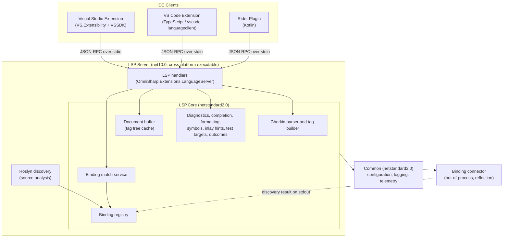
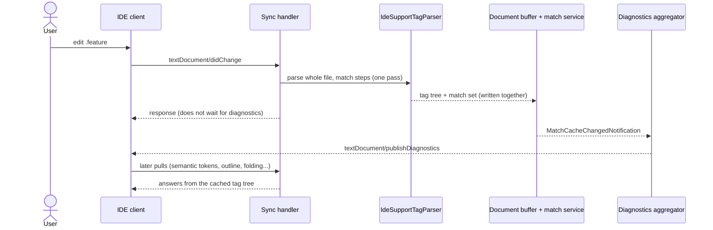
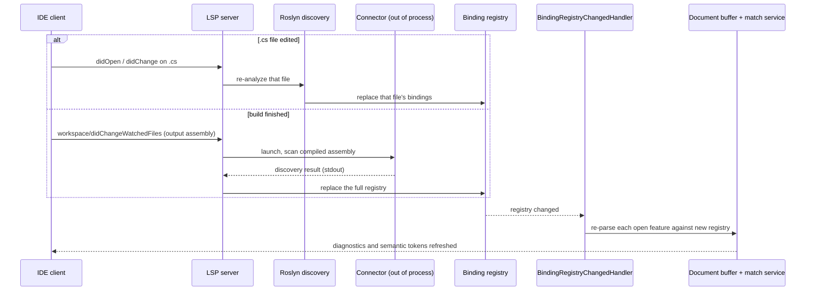

# Reqnroll IDE Support: Overview

**Status:** Implemented in Preview. Describes the system as it is; detail lives in the documents linked below.
**Audience:** Anyone new to the repository, and maintainers deciding where to look.

## 1. Purpose and scope

Reqnroll IDE Support provides Gherkin editing intelligence for [Reqnroll](https://reqnroll.net/) projects in
**Visual Studio 2022/2026, VS Code and JetBrains Rider** from one shared language server. It targets Reqnroll
only, and uses the `OmniSharp.Extensions.LanguageServer` package as its LSP framework. Where a feature can be
delivered through a generic LSP capability it is; where an IDE needs plugin code, the design documents say so.

**Goals**

- Parity with the legacy `Reqnroll.VisualStudio` extension, in all three IDEs.
- Every feature backed by automated tests, including measured latency against defined targets (see the
  performance verification section of the [Architecture reference](LSP-IDE-Support-Architecture.md#performance-verification)).
- A "Preview" release alongside the legacy extension during the transition.

**Non-goals**

- SpecFlow or plain Cucumber compatibility.
- Step definitions written in F#; VB.NET templates.
- Migrating the legacy VSIX (it continues unchanged until the new one reaches parity).

## 2. Architecture at a glance

Each client is a thin shell: it launches the server, forwards editor and project-system events, and renders
results with the IDE's own UI. Everything language-specific is in the server. The server is client-agnostic
apart from a small number of per-IDE capability decisions made at `initialize`, driven by the `--ide` flag.

## 3. Flows

### 3.1 Editing a feature file

### 3.2 Bindings change (C# edit or build)

## 4. Glossary

| Term | Meaning here |
|---|---|
| **Binding** | A C# method with a Reqnroll step or hook attribute (`[Given]`, `[BeforeScenario]`, …). |
| **Step definition** | A binding for a step (as opposed to a hook). |
| **Binding registry** | The server's per-project store of discovered bindings. |
| **Match set** | The result of matching a feature's steps against the registry. |
| **Tag tree** | `IdeSupportTag[]`: the parsed file annotated with structure and match results; the basis of nearly every feature. |
| **Roslyn discovery** | Source-level binding discovery from `.cs` text: immediate, no build required. |
| **Reflection discovery / connector** | Binding discovery from the compiled assembly by an out-of-process helper: authoritative, needs a build. |
| **Project membership index** | `path → {projects}` map that decides which project's registry a file belongs to, including linked and excluded files. |
| **`reqnroll/*` methods** | Custom LSP requests and notifications for things LSP has no vocabulary for (project information, test targets, outcomes). |
| **`--ide` flag** | Server argument naming the client; drives static versus dynamic capability registration. |
| **Preview** | The release designation of the new extensions while they coexist with the legacy one. |

## 5. Key components

| Component | Location | Responsibility |
|---|---|---|
| `Reqnroll.IdeSupport.LSP.Server` | `src/LSP` | The executable: handler registration, hosting, per-IDE capability decisions, Roslyn discovery, connector client. |
| `Reqnroll.IdeSupport.LSP.Core` | `src/LSP` | Parser, tag tree, registry, matching, and the feature services (diagnostics, completion, formatting, symbols, inlay hints, test targets, test outcomes). |
| `Reqnroll.IdeSupport.LSP.Connector` | `src/LSP` | Out-of-process reflection scan producing the discovery result. |
| `Reqnroll.IdeSupport.Common` | `src/Core` | Configuration loading, logging, telemetry contracts, shared custom method names. |
| Visual Studio extension | `src/VisualStudio` | VS.Extensibility language client plus VSSDK integration (classifiers, CodeLens bridge, navigation bar, wizards, templates). |
| VS Code extension | `src/VSCode` | `vscode-languageclient` shell, commands, project evaluation. |
| Rider plugin | `src/Rider` | Kotlin plugin: generic LSP client with Rider-specific code vision and actions. |

## 6. Features

Each feature has a design in [Feature Designs](LSP-IDE-Support-Feature-Designs.md).

| ID | Feature | ID | Feature |
|---|---|---|---|
| F1 | [Syntax highlighting](LSP-IDE-Support-Feature-Designs.md#f1--gherkin-syntax-highlighting) | F15 | [Find unused step definitions](LSP-IDE-Support-Feature-Designs.md#f15--find-unused-step-definitions) |
| F2 | [Binding discovery](LSP-IDE-Support-Feature-Designs.md#f2--binding-discovery) | F16 | [Step rename](LSP-IDE-Support-Feature-Designs.md#f16--step-rename-refactoring) |
| F3 | [File diagnostics](LSP-IDE-Support-Feature-Designs.md#f3--gherkin-file-diagnostics) | F17 | [Hook navigation](LSP-IDE-Support-Feature-Designs.md#f17--hook-navigation) |
| F4 | [Parse error display](LSP-IDE-Support-Feature-Designs.md#f4--gherkin-parse-error-display) | F18 | [CodeLens: step usage counts](LSP-IDE-Support-Feature-Designs.md#f18--code-lens-step-usage-counts) |
| F5 | [Go to step definition](LSP-IDE-Support-Feature-Designs.md#f5--go-to-step-definition) | F19 | [New project / item wizards](LSP-IDE-Support-Feature-Designs.md#f19--new-project--item-wizards) |
| F6 | [Define steps (scaffolding)](LSP-IDE-Support-Feature-Designs.md#f6--define-steps-scaffolding) | F20 | [Installation and upgrade](LSP-IDE-Support-Feature-Designs.md#f20--installation--upgrade-experience) |
| F7 | [Keyword completion](LSP-IDE-Support-Feature-Designs.md#f7--keyword-completion) | F23 | [Inlay hints](LSP-IDE-Support-Feature-Designs.md#f23--inlay-hints-step-binding-info) |
| F8 | [Step completion](LSP-IDE-Support-Feature-Designs.md#f8--step-completion) | F24 | [Hook match CodeLens](LSP-IDE-Support-Feature-Designs.md#f24--hook-match-codelens-featurescenariostep) |
| F9 | [Document outline](LSP-IDE-Support-Feature-Designs.md#f9--document-outline) | F25 | [Hook match count CodeLens](LSP-IDE-Support-Feature-Designs.md#f25--hook-match-count-codelens-hook-bindings) |
| F10 | [Code folding](LSP-IDE-Support-Feature-Designs.md#f10--code-folding) | F26 | [Test runner integration](LSP-IDE-Support-Feature-Designs.md#f26--test-runner-integration-rundebug--failed-step-highlight) |
| F11 | [Document formatting](LSP-IDE-Support-Feature-Designs.md#f11--document-auto-formatting) | F27 | [C# binding validation diagnostics](LSP-IDE-Support-Feature-Designs.md#f27--c-binding-validation-diagnostics) |
| F12 | [Table formatting](LSP-IDE-Support-Feature-Designs.md#f12--table-auto-formatting) | F28 | [Clickable tags](LSP-IDE-Support-Feature-Designs.md#f28--clickable-tags-traceability-links) |
| F13 | [Comment / uncomment](LSP-IDE-Support-Feature-Designs.md#f13--comment--uncomment) | | |
| F14 | [Find step usages](LSP-IDE-Support-Feature-Designs.md#f14--find-step-definition-usages) | | |

F21 and F22 are not used. Test-runner and outcome flows are detailed in
[Test-Runner-Integration-Design.md](Test-Runner-Integration-Design.md) and
[Test-Outcomes-Pipeline.md](Test-Outcomes-Pipeline.md).

## 7. Distribution and the legacy extension

**Naming.** The extensions are published as "Reqnroll Extension for {IDE} (Preview)" on the Visual Studio,
VS Code and JetBrains marketplaces, each under its own identifier.

**Coexistence.** The legacy `Reqnroll.VisualStudio` extension continues unchanged throughout Preview. Both can
be installed in Visual Studio at once (different GUIDs, no shared in-process components). There is no automatic
migration. VS Code and Rider have no earlier Reqnroll extension to replace.

**Settings.** Existing `reqnroll.json` files work unchanged. Settings specific to the legacy extension are not
migrated; users reconfigure through the IDE's own settings.

**Promotion criteria.** The Preview label is lifted, and the new extension recommended over the legacy one,
when: feature parity with the legacy extension is reached (F1–F20 plus inlay hints); the end-to-end suite passes
on the supported IDE versions; and the core team has used it for at least one release cycle. After promotion the
legacy extension is marked deprecated, points users at the new one, receives critical fixes for one more release
cycle, then goes to maintenance only.

**Client differences to be aware of.** Some features are richer in some clients:

- *Rename change annotations* (grouped, labelled rename preview): VS Code and Rider negotiate the LSP 3.16
  `changeAnnotationSupport` capability. Visual Studio does not advertise it and gets the legacy edit shape, so
  renames apply silently.
- *Inlay hints* are a standard pull feature all three clients support. Visual Studio additionally needs the user
  to enable inline hints in Tools → Options → Text Editor; the extension does not force that setting.

## 8. Where to go next

| To learn about | Read |
|---|---|
| Module design, server internals, each IDE client, cross-cutting concerns | [Architecture & Implementation Reference](LSP-IDE-Support-Architecture.md) |
| How a specific feature works | [Feature Designs](LSP-IDE-Support-Feature-Designs.md) |
| Custom `reqnroll/*` methods | [LSP-Protocol-Extensions.md](LSP-Protocol-Extensions.md) |
| What is open, accepted or settled | [Open Questions register](LSP-IDE-Support-Open-Questions.md) |
