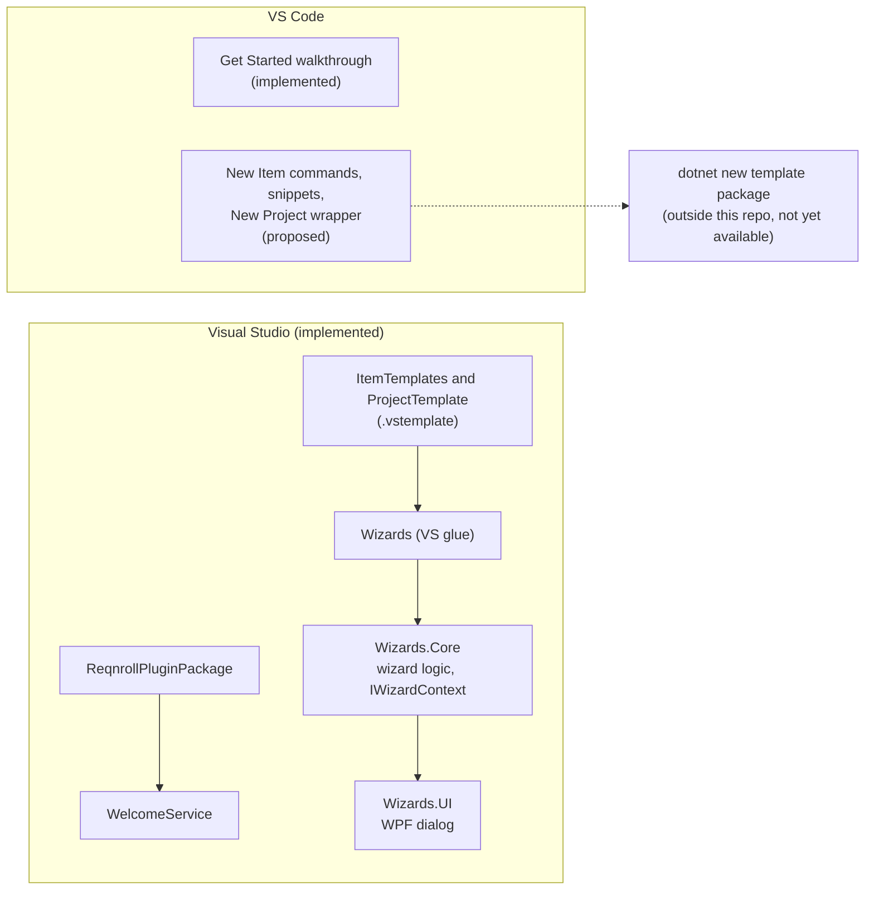
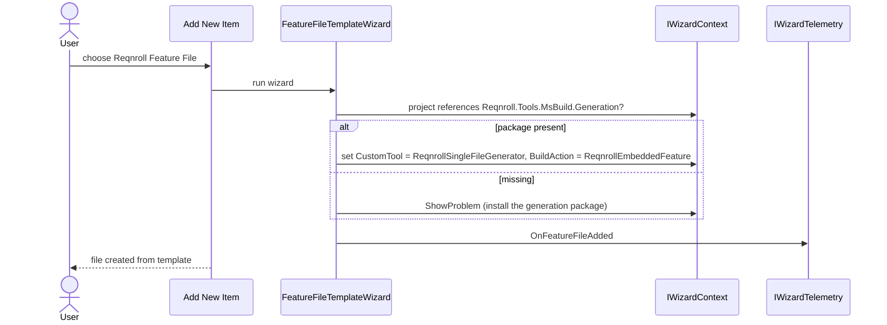
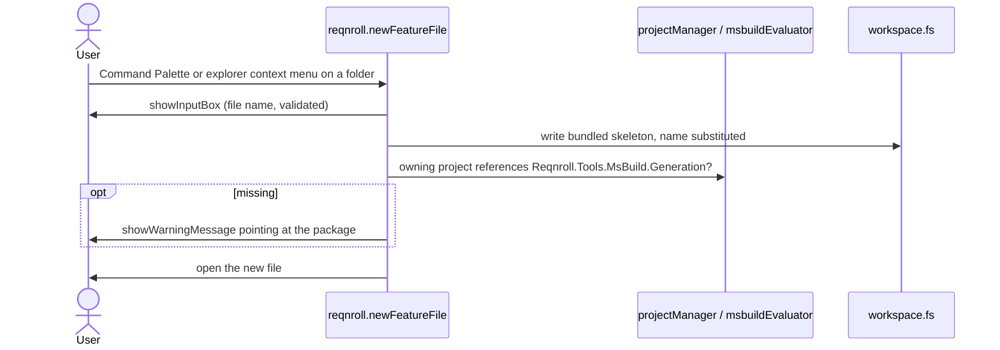
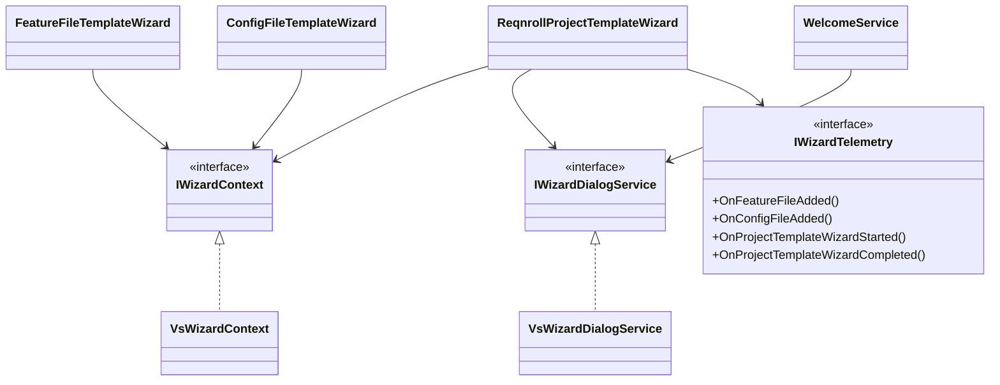

# Onboarding and Scaffolding

**Status:** Visual Studio: Implemented. VS Code: the Get Started walkthrough is Implemented; everything else in §7 is Proposed and not built. Rider: out of scope.
**Audience:** Maintainers working on first-run experience, New Project / New Item creation, or bringing VS Code to parity with Visual Studio.

## 1. Purpose and scope

"Guided setup" is what a user sees before they have written a scenario: a welcome on first install or
upgrade, a way to create a Reqnroll project, and a way to add a feature file or configuration file correctly.
This document records what each IDE does today and the proposed design for what VS Code still lacks.

Rider uses its own mechanisms (live templates, plugin "What's New") and is not covered.

## 2. Overview

## 3. Flows

### 3.1 Adding a feature file in Visual Studio

### 3.2 Proposed: adding a feature file in VS Code

## 4. Glossary

| Term | Meaning here |
|---|---|
| **Walkthrough** | VS Code's multi-step Get Started page, contributed through `contributes.walkthroughs`. |
| **Welcome flow** | Visual Studio's first-install and upgrade experience (`WelcomeService`). |
| **Wizard** | A Visual Studio template wizard that gathers choices and sets template replacement tokens or item metadata. |
| **Replacement token** | A `$name$` value a `.vstemplate` substitutes into the created files (for example `$dotnetframework$`, `$unittestframework$`). |
| **CustomTool / BuildAction** | MSBuild item metadata the feature-file wizard sets. They have no VS Code analogue. |
| **Generation package** | `Reqnroll.Tools.MsBuild.Generation`, which produces the `.feature.cs` code-behind at build time. |
| **Template package** | A `dotnet new` template pack for Reqnroll projects. Does not yet exist in this organization. |

## 5. Key classes

| Class | Location | Responsibility |
|---|---|---|
| `ReqnrollProjectTemplateWizard` | `src/VisualStudio/…Wizards.Core/Core` | Gathers target framework and unit-test framework; sets `$dotnetframework$`, `$unittestframework$` and the .NET Framework flag. |
| `FeatureFileTemplateWizard` | same | Sets `CustomTool` and `BuildAction`; warns when the generation package is missing. |
| `ConfigFileTemplateWizard` | same | Scaffolds `reqnroll.json`. |
| `IWizardContext`, `IWizardDialogService`, `IWizardTelemetry` | `…Wizards.Core/Abstractions` | IDE-independent seams, so wizard logic is unit-testable without Visual Studio. |
| `VsWizardContext`, `VsWizardDialogService`, `WelcomeService` | `src/VisualStudio/…Wizards/VsIntegration` | Visual Studio implementations; `WelcomeService` runs from `ReqnrollPluginPackage` after solution load. |
| WPF dialog and view models | `src/VisualStudio/…Wizards.UI` | The wizard window. |
| Item and project templates | `…ItemTemplates` (FeatureFile, Hooks, ReqnrollConfig), `…ProjectTemplate` | VSIX template packaging. |
| `walkthrough.ts`, `media/walkthroughs/welcome.md` | `src/VSCode` | VS Code walkthrough contribution and its single page. |

## 6. Implemented behaviour

**Visual Studio.** The layering is deliberate: `Wizards` (VS SDK glue) → `Wizards.Core` (logic, no VS
dependency) → `Wizards.UI` (WPF). Telemetry events are named `OnFeatureFileAdded`, `OnConfigFileAdded`,
`OnProjectTemplateWizardStarted` and `OnProjectTemplateWizardCompleted`. `WelcomeService` handles the
first-install welcome and the version-gated upgrade/changelog flow.

**VS Code.** One walkthrough, `reqnroll.getStarted`, containing a single page that introduces the extension and
links to the end-user documentation. It opens once automatically on first activation per profile
(`showWalkthroughOnFirstActivation`, recorded under the `reqnroll.walkthroughShown` global-state key, skipped
outside production mode so development hosts and tests do not pop it open). It can be reopened from
Help → Open Walkthrough.

## 7. Proposed for VS Code (not built)

None of this exists. The design follows VS Code conventions rather than mirroring Visual Studio's dialogs.

**Upgrade notice and telemetry.** On activation compare a stored `lastActivatedVersion` (global state) with the
extension version: no stored value is a first install; an older one is an upgrade; equal is a no-op; always
update afterwards. An upgrade offers "What's New" opening a bundled `CHANGELOG.md`. Fire
`ExtensionInstalled`/`ExtensionUpgraded` from the client: these occur before or independently of the server,
so they are a deliberate exception to server-relayed telemetry. Their version-comparison semantics (downgrades,
pre-release strings) should match Visual Studio's so analytics are comparable.

**New Item commands.** `reqnroll.newFeatureFile` and `reqnroll.newConfigFile`, available from the Command
Palette and the explorer folder context menu: prompt for a validated name, write a bundled skeleton, open it
(§3.2). The feature-file command warns when the owning project lacks the generation package, the VS Code
equivalent of `ShowProblem`. Fire the same telemetry event names as Visual Studio. A complementary
`contributes.snippets` entry gives in-editor scaffolding for an already-created empty file.

**New Project.** A thin `reqnroll.newProject` command that checks a `dotnet new` template is installed (offering
`dotnet new install` if not), collects name, framework and test framework through QuickPick/InputBox,
runs `dotnet new`, and opens the folder. It depends on the template package, which belongs outside this
repository and has no owner yet, so it should be built last and only once that package exists.

## 8. Pitfalls and design decisions

1. **No Webview wizard for VS Code.** A QuickPick/InputBox chain is enough for a handful of enum-like choices.
   Visual Studio needed WPF mostly for VSSDK reasons, not UX.
2. **No MSBuild item-metadata equivalent.** `CustomTool`/`BuildAction` are project-system concepts. The
   generation package works from file presence and the project reference alone, whatever created the file, so
   the missing-package warning is the only behaviour worth carrying over.
3. **Do not replicate the modal Add New Item dialog.** Command Palette plus explorer menu is the idiomatic
   VS Code equivalent.
4. **Keep wizard logic behind interfaces.** `Wizards.Core` must not reference the VS SDK, or its unit tests
   would need a Visual Studio install. The same reason keeps VS-referencing helpers out of classes with pure
   logic that is tested elsewhere in the extension.
5. **Install/upgrade telemetry fires client-side**, not through the server, because it can happen before the
   server exists.

## 9. Known limitations and open questions

- VS Code has no New Project, New Item, snippet or upgrade-notice support yet (§7), and no `CHANGELOG.md`
  surface of its own.
- Whether a Reqnroll `dotnet new` project template exists anywhere in the organization is unconfirmed; this
  repository is not authoritative for that. If one exists, New Project is only the wrapper command; if not it
  needs its own owner before the command can ship.
- A first walkthrough with more steps (open a feature file, Go to Definition, Find Usages) can grow once the
  commands it would track are worth highlighting.

## 10. Testing

| Layer | Where |
|---|---|
| Wizard logic (project, feature file, config file), welcome flow | `tests/VisualStudio/Reqnroll.IdeSupport.VisualStudio.Wizards.Tests`, with fakes for `IWizardContext` and `IWizardDialogService` |
| Walkthrough first-activation logic | `src/VSCode/src/test/walkthrough.test.ts` (mocked `globalState`) |
| Proposed commands | Version logic, template substitution and missing-package detection as Mocha unit tests; command registration in `extension.test.ts`; walkthrough rendering, notification buttons and the `dotnet new` shell-out are verified manually |
