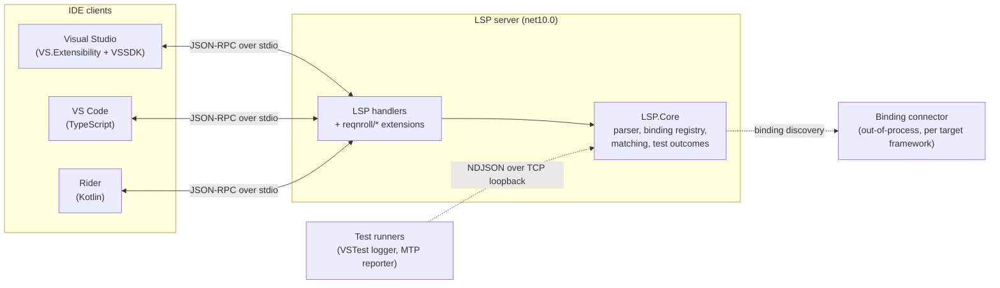

# Reqnroll IDE Support: developer documentation

This folder describes how Reqnroll IDE Support is built. It is written for maintainers and for LLM
agents working in the repository. End-user documentation lives in [`site/`](site/README.md).

## What this solution is

Reqnroll IDE Support gives developers editing [Reqnroll](https://reqnroll.net/) (Gherkin/BDD for .NET)
projects the same editing experience in **Visual Studio**, **VS Code** and **JetBrains Rider**. The
language intelligence lives in one shared [Language Server Protocol](https://microsoft.github.io/language-server-protocol/)
(LSP) server. Each IDE has a thin client that starts the server, forwards editor events, and renders the
results. It replaces the legacy Visual Studio-only extension.

## Scope

**Provided** (see [Feature Designs](LSP-IDE-Support-Feature-Designs.md) for the full list):
Gherkin syntax highlighting and parse/binding diagnostics; step completion and keyword completion;
go to step definition, find step usages, find unused step definitions, hook navigation; define-steps
scaffolding; step rename across `.feature` and C# files; document outline, folding, formatting and
comment toggling; CodeLens and inlay hints for binding information; running scenarios with pass/fail
shown on the Run CodeLens; New Project/Item templates and an installation experience.

**Not provided:** SpecFlow or other Cucumber implementations, step definitions written in F#, VB.NET
templates. Some features differ by IDE; the per-feature designs state which.

## Repository map

| Path | Contents |
|---|---|
| `src/Core` | Code shared by the server, the clients and the test reporters: configuration, logging, telemetry, the test logger and MTP reporter |
| `src/LSP` | `LSP.Core` (parser, binding registry, matching, outcomes), `LSP.Server` (the OmniSharp-hosted server), `LSP.Connector` (out-of-process binding discovery) |
| `src/VisualStudio` | VS extension, VSSDK integration, wizards, templates |
| `src/VSCode` | VS Code extension (TypeScript) |
| `src/Rider` | Rider plugin (Kotlin, Gradle) |
| `tests` | Unit tests, LSP specs (`.feature`), fixtures, performance benchmarks; mirrors `src` |
| `docs` | This documentation; `docs/site` is the end-user site |

## What you will find here

Read in this order if you are new:

| Document | Read it to learn |
|---|---|
| [LSP-IDE-Support-Overview.md](LSP-IDE-Support-Overview.md) | Goals, non-goals and the high-level architecture |
| [LSP-IDE-Support-Architecture.md](LSP-IDE-Support-Architecture.md) | Module design, server internals, how each IDE client is built, cross-cutting concerns |
| [LSP-IDE-Support-Feature-Designs.md](LSP-IDE-Support-Feature-Designs.md) | How each feature works end to end |
| [LSP-Protocol-Extensions.md](LSP-Protocol-Extensions.md) | Every custom `reqnroll/*` LSP method and its payloads |
| [Test-Outcomes-Pipeline.md](Test-Outcomes-Pipeline.md) | How results of real test runs reach the Run CodeLens |
| [Test-Runner-Integration-Design.md](Test-Runner-Integration-Design.md) | Mapping scenarios to generated test methods; Run/Debug per IDE |
| [Telemetry-Events-Inventory.md](Telemetry-Events-Inventory.md) | Every telemetry event and its schema |
| [LSP-IDE-Support-Open-Questions.md](LSP-IDE-Support-Open-Questions.md) | Unresolved decisions and risks. Check before assuming something is settled |
| [VS-LSP-Eager-Activation-Research.md](VS-LSP-Eager-Activation-Research.md) | Getting the Visual Studio LSP client to start early |
| [VSCode-Onboarding-And-Wizards-Implementation-Plan.md](VSCode-Onboarding-And-Wizards-Implementation-Plan.md) | VS Code onboarding, wizards and templates |
| [LSP-Spec-Gap-Analysis.md](LSP-Spec-Gap-Analysis.md) | LSP capabilities deliberately not implemented |
| [architecture/complexity-hotspots.md](architecture/complexity-hotspots.md) | Measured complexity hot spots in the code |
| [Archive/](Archive/) | Historical plans and designs. Not maintained, so do not rely on them |
| [site/](site/README.md) | End-user documentation (Sphinx) |

Several of these documents predate the conventions below and are being brought into line; the
[status table](#document-status) shows which.

## Document status

| Status | Meaning |
|---|---|
| Conforms | Follows the conventions below |
| Reference | A catalogue or measurement; the code wins if they disagree |
| Needs rework | Still contains phase history, issue references or chronological narrative, or is too large to read in one pass |

| Document | Status |
|---|---|
| Test-Outcomes-Pipeline.md | Conforms |
| LSP-Protocol-Extensions.md, Telemetry-Events-Inventory.md | Reference |
| LSP-Spec-Gap-Analysis.md, architecture/complexity-hotspots.md | Reference (point-in-time analyses) |
| Overview, Architecture, Feature Designs, Open Questions | Needs rework (Architecture and Feature Designs also need splitting) |
| Test-Runner-Integration-Design, VS-LSP-Eager-Activation-Research, VSCode-Onboarding-And-Wizards-Implementation-Plan | Needs rework |

## Writing and maintaining these documents

When you change behaviour, update the relevant document in the same change.

### Content rules

1. **Describe the system as it is now.** Write what the code does and why it is shaped that way, not how
   it evolved. No development phases, roadmaps, "originally X, later Y" narrative, branch names or dated
   reproduction logs.
2. **No issue or PR numbers as explanation.** State the reason in a sentence. A bare "#123" forces a
   reader out of the repository and may not survive. Link an issue only if it is still open.
3. **Keep history only when it prevents a mistake.** If a maintainer could plausibly repeat a mistake
   without it, keep a short *pitfall* or *rejected alternative* with the failure mode. Otherwise leave it
   to git history.
4. **Anchor claims in code.** Name the file, type or method that implements a behaviour. If a document
   and the code disagree, the code wins; fix the document.
5. **Status is one line:** `Implemented`, `Proposed` or `Reference`, plus anything still open. No
   "Draft for team review", and no revision notes layered on top of a body that is now wrong.

### Shape of a design document

Each design document (one per feature or area) should contain, in this order:

1. **Purpose and scope**: what it does and what it deliberately does not.
2. **Overview diagram**: a Mermaid `flowchart` of the parts and who talks to whom.
3. **Sequence diagram(s)**: a Mermaid `sequenceDiagram` for each main flow.
4. **Glossary**: a table of terms specific to this area (including words that mean something different here
   than elsewhere).
5. **Key classes**: a table of the main types, each with its location and responsibility, or a Mermaid
   `classDiagram` where relationships matter.
6. **Behaviour and contracts**: wire formats, rules, configuration.
7. **Pitfalls and design decisions**: what not to do and why.
8. **Known limitations** and **Testing**.

Prefer several small, topic-focused files that fit in a single read over one very large document.
Use Mermaid for all diagrams, not ASCII art, so they stay diffable and readable by tools.
