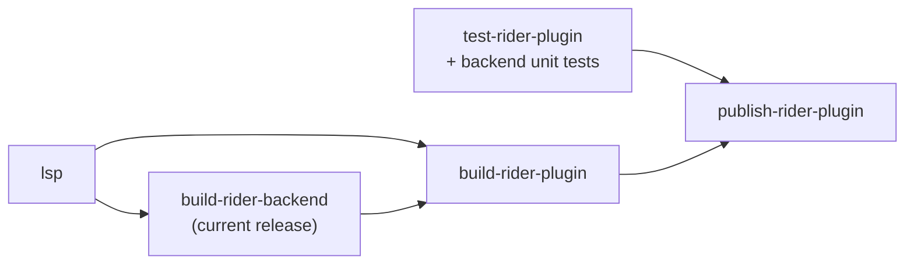

# Rider: breakpoints in `.feature` files — implementation plan

Status: **backend module, Gradle wiring and the closed-range build are implemented and committed on
`feature/453-rider-gherkin-psi`; nothing has run in a live Rider yet.** The CI matrix, the per-release backend
smoke test, Marketplace publishing and the changelog-rendered change notes below are not built. Facts marked
*(verified)* were checked against the Rider 2026.2.3.1 binaries (`javap` on `lib/intellij.rider.jar`,
`ilspycmd` on `lib/ReSharperHost/*.dll`) or against this repository; everything else is a design
decision or an assumption that the spike in [§8](#8-work-breakdown) must confirm.

> **Superseded in scope** by [Rider-Gherkin-PSI-Plan.md](Rider-Gherkin-PSI-Plan.md), which treats this
> backend module as Phase 1 and replaces the frontend `TEXT` shim (§4) with a real frontend PSI.
>
> **Release policy (decided 2026-11-13): newest Rider only.** Each plugin release targets only the current
> Rider release; there is no frontend-only leg for older Rider and no back-porting
> ([PSI plan §4.1](Rider-Gherkin-PSI-Plan.md#41-release-policy-newest-rider-only)). §6, §7 and §10 below are
> updated for it. Mentions of a frontend-only or older-Rider leg elsewhere in this plan are historical.

Related: GitHub issue #453 (VS Code half shipped separately), open questions
[O6 and O9](LSP-IDE-Support-Open-Questions.md), and the limitations list in
[Test-Runner-Integration-Design §12](Test-Runner-Integration-Design.md).

## 1. Goal and scope

Let a user toggle a line breakpoint on a step in a `.feature` file in Rider and have the .NET debugger
stop there when a scenario is debugged — the same behaviour Visual Studio has always had and VS Code
now has.

This is the **minimal** version:

- Line breakpoints only, on any line Rider lets through (no per-step positions, no Gherkin structure
  in Rider's backend).
- No change to how `.feature` files are edited: the editor side keeps its current PSI-free,
  language-server-driven design.
- No custom messages between Rider's frontend and backend (no `rdgen` model).

Out of scope: refusing breakpoints on description lines and on the `Rule:`, `Background:` and `Examples:` header
lines (that needs the Gherkin dialect's keywords), conditional/log breakpoints beyond what Rider gives any .NET line breakpoint, and Rider versions this
plan chooses not to support (see [§7](#7-marketplace-publication)).

## 2. How Rider decides whether a breakpoint can be created

A breakpoint must pass two checks. Both fail for `.feature` files today.

**Gate 1 — frontend (Kotlin).** `DotNetLineBreakpointType.canPutAt` calls
`RiderBreakpointHost.isSupportedLanguage(psiFile, line)`, which:

- reads `psiFile.getLanguage()` *(verified)*, and
- returns true if any `com.intellij.rider.debuggerSupportPolicy` extension is registered for that
  language and its `isAvailable(psiFile, line)` returns true *(verified)*.

`RiderDebuggerSupportPolicy.isAvailable` is `public final` and always returns `true` *(verified)*, so a
plugin can register the stock class for a language but **cannot subclass it to filter by line**.

> **Wrinkle.** Our `.feature` files have no `ParserDefinition`, so IntelliJ's fallback builds a
> `PsiPlainTextFileImpl` whose language is `PlainTextLanguage` (id `TEXT`), not our
> `ReqnrollFeatureLanguage` (id `Gherkin`) — already documented in
> `ReqnrollFeatureInlayHintsController`. Registering the policy for `Gherkin`, as the legacy plugin
> does for its own language, would therefore **not** match. See [§4](#4-frontend-changes).

**Gate 2 — backend (.NET, ReSharper host).** The frontend then asks the backend for breakpoint
variants. `BreakpointVariantsEnumerator.GetVariants` *(verified)*:

1. finds the `IProjectFile` for the path; none → no breakpoint;
2. takes its **primary PSI file**; none → no breakpoint;
3. looks up an `IBreakpointVariantsProvider` for **that PSI file's language** through
   `LanguageManager`; none → no breakpoint;
4. calls `GetBreakpointVariants(file, line, solution)`; a `LineBreakpoint` becomes a
   `DummyBreakpointVariant`, a `TextRangeBreakpoint` becomes a positioned variant. An empty list → no
   breakpoint (Rider does not fall back to a default variant).

**After creation** there is no further language check: the frontend sends the file path and line to
the debugger worker, which binds through the `#line "X.feature"` sequence points Reqnroll's generated
code puts in the PDB — the same mechanism VS and VS Code rely on.

Precedents: T4 (`ForTea` plugin) returns `new LineBreakpoint(null)` for any in-range line; the legacy
`reqnroll/Reqnroll.Rider` plugin has a full Gherkin PSI on both sides and returns a
`TextRangeBreakpoint` per step.

## 3. Backend module

### 3.1 Location and project

```
src/Rider/dotnet/
  Directory.Build.props                         # RiderSdkVersion, wave-derived properties
  Reqnroll.IdeSupport.Rider.Backend/
    Reqnroll.IdeSupport.Rider.Backend.csproj    # net472, PackageReference JetBrains.Rider.SDK
    ZoneMarker.cs
    FeatureFiles/
      FeatureProjectFileType.cs
      FeatureLanguage.cs
      FeatureProjectFileLanguageService.cs
      FeatureLanguageService.cs                 # stub lexer + parser
      FeatureFile.cs                            # one-node IFile
    Debugger/
      FeatureBreakpointVariantsProvider.cs
      BreakpointLineFilter.cs                   # pure function, no SDK types
```

- **Target framework**: `net472`, as the legacy backend uses with SDK 2026.2. Confirm for every SDK
  version we target.
- **SDK reference**: `JetBrains.Rider.SDK` from nuget.org, pinned per Rider version. Versions 2024.3.x
  through 2026.3.0 are published there *(verified)*. The legacy plugin instead uses
  `lib/DotNetSdkForRdPlugins` inside the downloaded Rider as a package source; nuget.org avoids a
  second Rider download per CI leg when the Kotlin side keeps compiling against 2024.3.5.
- **Zone marker**: declare the zones the components need, copying the SDK template / legacy plugin;
  the exact zone interfaces are to be confirmed during the spike.

### 3.2 Types

| Type | Base | Notes |
|---|---|---|
| `FeatureProjectFileType` | `KnownProjectFileType`, `[ProjectFileTypeDefinition]` | Name **`REQNROLL_FEATURE`**, extension `.feature`. Deliberately not the legacy name `GHERKIN` (see [§5](#5-coexistence-with-the-legacy-plugin)). |
| `FeatureLanguage` | `KnownLanguage`, `[LanguageDefinition]` | Backend PSI language for `.feature`. |
| `FeatureProjectFileLanguageService` | `ProjectFileLanguageService`, `[ProjectFileType(typeof(FeatureProjectFileType))]` | Maps the file type to `FeatureLanguage`. |
| `FeatureLanguageService` | `LanguageService`, `[Language(typeof(FeatureLanguage))]` | **Stub**: a lexer that emits the whole buffer as one token and a parser that returns `FeatureFile` with one leaf. No caches, no type declarations, no formatter. |
| `FeatureFile` | minimal `IFile` implementation | One node. Exists only so `GetPrimaryPsiFile()` is non-null and reports `FeatureLanguage`. |
| `FeatureBreakpointVariantsProvider` | `IBreakpointVariantsProvider`, `[Language(typeof(FeatureLanguage))]` | Returns `[new LineBreakpoint()]` when `0 <= line < lineCount` and `BreakpointLineFilter` accepts the line; otherwise empty. `GetSupportedFileExtensions()` returns `.feature`. |
| `BreakpointLineFilter` | static, no SDK types | Rejects lines that never have generated code: blank lines, `#` comments, `@` tag lines, `|` table rows (including Examples rows) and doc strings with their delimiters. Keyword-free, so no Gherkin dialect is needed. Needed because Rider binds a breakpoint on a line without code to the next line with code (verified live: a breakpoint on a tag line stopped on the `Scenario:` line below it, one on a table row bound too). |

The backend never parses Gherkin. All structural knowledge stays in the language server.

**Spike check before building the stub language:** confirm Rider's backend gives `.feature` no
primary PSI file today. If it already maps `.feature` to some existing language, attaching a provider
to that language would avoid the stub, but it would also affect every other file of that language, so
the stub remains the default.

### 3.3 Side effects to check

A backend language for `.feature` means ReSharper starts treating these files as something it knows.
With a stub language service most features should stay inert (one token, no declarations, no caches),
but the spike must confirm there are no new highlights, inspections, To-do entries, search hits or
errors in the backend log.

## 4. Frontend changes

Gate 1 keys on the PSI language, which is `TEXT` for our files (see [§2](#2-how-rider-decides-whether-a-breakpoint-can-be-created)).

**F1 — register for `TEXT` (recommended for the minimal version).**

```xml
<rider.debuggerSupportPolicy language="TEXT"
    implementationClass="com.jetbrains.rider.debugger.RiderDebuggerSupportPolicy"/>
```

- One line of `plugin.xml`, no Kotlin. Our plugin already depends on `com.intellij.modules.rider`,
  which defines the extension point.
- **Side effect**: Gate 1 now passes for *every* plain-text file in Rider (`.txt`, unknown
  extensions). Gate 2 should still refuse them because no backend provider exists for their
  language, so no breakpoint is created. The spike must confirm a click on a `.txt` gutter shows
  nothing (no error, no balloon, no greyed breakpoint).
- Without the backend module (the older-Rider leg in [§6](#6-build-and-ci-changes)) the same line is
  harmless: Gate 2 refuses every `.feature` line too.

**F2 — fallback: give `.feature` a stub frontend `ParserDefinition`** so `psiFile.language` becomes
`Gherkin`, then register the policy for `Gherkin`. This removes the side effect but changes the
PSI language of every `.feature` editor. Several existing features (inlay hints, folding, code vision
lenses) were deliberately built PSI-free around the current behaviour, and language-keyed platform
features (spell checking, To-do, declarative providers) would start dispatching to us. Use F2 only if
F1's side effect proves visible.

**Step Into Step Definition.** Rider's Step Into from a stopped `.feature` step does not reach the step
definition (verified live on Rider 2026.2.3.1 with Reqnroll 3.0.0):

- With "Enable external source debug" off, it steps over the whole step to the next one.
- With it on, it steps into Reqnroll's `ExecutionEngine`.
- The same happens from the generated `await testRunner.AndAsync(...)` line with `allowDebugGeneratedFiles` set,
  so it is not caused by the `#line` mapping.

Rider's Windows stepper does use the runtime's Just My Code stepper when external source debugging is off, and
marks every module with loaded symbols as user code (decompiled `Mono.Debugging.Win32`: `CorStepper`,
`CorRuntimeEventProcessor.OnModuleLoad`). That stepper follows one thread, so the likely cause is that Reqnroll's
asynchronous path reaches the binding on another thread. Visual Studio's Just My Code stepping does land in the
step definition.

`StepIntoStepDefinitionAction` fills the gap:
- It asks the server for the step's definition (`textDocument/definition`) and runs to the start of that method's
  body with `XDebugSession.runToPosition`.
- An undefined or ambiguous step, or a binding without source, falls back to the platform's Step Into with a
  message in the debugger tool window.
- It carries Step Into's shortcuts (F7 in `$default`, F11 in the Visual Studio keymaps).
  `StepIntoStepDefinitionPromoter` makes it win them only while the debugger is stopped on a `.feature` line.
- It needs no backend module.

## 5. Coexistence with the legacy plugin

Open question **O9** is undecided. This feature makes it sharper: today the two plugins only overlap
on the editor side; with a backend module both would also register a backend project file type for
`.feature` (legacy: `GHERKIN`). Which one wins is undefined and unverified.

Options (decision needed):

1. Declare the plugins incompatible in our `plugin.xml`
   (`<incompatible-with>net.reqnroll</incompatible-with>`; `net.reqnroll` is the legacy plugin ID
   *(verified)*). Confirm Rider honours `incompatible-with` for a plugin ID rather than only a module.
2. Document "uninstall the legacy plugin first" and accept undefined behaviour if both are present.

**Decided and implemented: option 1.** `plugin.xml` declares `<incompatible-with>net.reqnroll</incompatible-with>`
and its description now says the two cannot be enabled together (it used to say users could switch back and
forth). Still to do: the §9 check that Rider actually enforces `incompatible-with` for a plugin ID, before a
release. Record the answer as O9's "can both be installed at once".

Note the legacy plugin ships a backend per Rider release too (see
[§7](#7-marketplace-publication)), so incompatibility is needed on the backend side as much as the editor
side.

## 6. Build and CI changes

### 6.1 Today *(verified)*

- `src/Rider/gradle.properties`: `platformVersion = 2024.3.5`, `pluginSinceBuild = 243`,
  `pluginUntilBuild = 262.*`. One universal `.zip` for all six server RIDs.
- `.github/workflows/ci.yml`: `build-rider-plugin` (ubuntu) runs `./gradlew buildPlugin` and
  `verifyPlugin`; Gradle **never runs `dotnet` in CI** (server and test logger arrive as artifacts via
  `-PlspServerBuildDir` / `-PlspTestLoggerBuildDir`). `test-rider-plugin` runs Gradle tests.
  `publish-rider-plugin` only promotes the candidate artifact; **nothing is uploaded to the JetBrains
  Marketplace**.
- Version: `<ReqnrollIdeSupportMainVersion>.<run_number>`, checked against `plugin.xml` by the
  "Verify plugin version" step.

### 6.2 Gradle

- **One setting drives everything:** `riderSdkVersion` in `gradle.properties` (for example `2026.2.3.1`). A
  `-PwithBackend=true` build derives from it the wave (`262`: two-digit year, then release number), the
  `-p:RiderSdkVersion` passed to `dotnet`, `sinceBuild` (`262`) and `untilBuild` (`262.*`), the plugin version
  suffix (`<main>.<run>.262`) and the releases `verifyPlugin` checks. They cannot disagree with the SDK the
  backend was built against *(implemented and checked locally)*.
- **The range is closed on purpose.** The build fails if `-PpluginSinceBuild` or `-PpluginUntilBuild` is combined
  with `withBackend=true`, and if `riderSdkVersion` is not a Rider release number. An open upper bound would let
  Rider install the backend on a newer release it was never built for.
- **`withBackend` defaults to `false`** until the CI job lands, so CI as it stands still produces the
  frontend-only plugin for the whole range and never runs `dotnet` in Gradle. A backend build is opt-in.
  Under the release policy the backend build becomes the only build: `withBackend` then defaults to `true`, or
  is removed along with `pluginSinceBuild` / `pluginUntilBuild` in `gradle.properties`.
- New `compileBackend` task (`dotnet build -c Release -p:RiderSdkVersion=…`) for local builds, plus an
  external `-PbackendBuildDir` override for CI, mirroring the existing `publishServer` /
  `lspServerBuildDir` pattern so Gradle still never runs `dotnet` in CI.
- `prepareSandbox` copies `Reqnroll.IdeSupport.Rider.Backend.dll` (and `.pdb`) into
  `<plugin>/dotnet/` when `withBackend` is true; `buildPlugin` fails if it is missing.
- The Kotlin jar is still compiled against 2024.3.5 with Kotlin API level 2.0. Under the release policy it moves
  to the same Rider release as the backend: `platformVersion` follows `riderSdkVersion`.

### 6.3 Workflow



Under the release policy there is one leg, the current Rider release, so no matrix. A second, temporary leg
against the EAP SDK runs only ahead of a Rider release ([§7.2](#72-automation-and-ownership)).

- **New `build-rider-backend` job**: `actions/setup-dotnet`, `dotnet build` with the current release's SDK
  version, upload `rider-backend`. Cache `~/.nuget/packages`; the SDK packages are large.
- **`build-rider-plugin`** downloads the server/test-logger artifacts as today plus the backend artifact, then
  runs `buildPlugin` and `verifyPlugin`. `pluginVerification.ides` narrows to the one release.
- **The Plugin Verifier does not check .NET code.** Compiling the backend against the release's SDK is
  the only automated compatibility check; a live check per new release stays manual.
- **Version**: `<main>.<run_number>.<wave>`, as the Gradle build already derives it. The wave suffix keeps an EAP
  upload and the release upload distinct. The "Verify plugin version" step reads the expected value from
  `riderSdkVersion`.
- **Artifacts**: one `Reqnroll.IdeSupport.Rider.<version>.zip`.
- **Tests**: Kotlin tests plus a `plugin.xml` registration test (parsed as XML, not a fixture; see the PSI plan).
  Backend: an SDK-free xUnit project that links `BreakpointLineFilter.cs`.
- **Per-release backend smoke test (added after review).** Compiling against each SDK version will not catch a
  wrong zone marker or a component that fails to load. The legacy plugin shows the `JetBrains.Rider.SDK.Tests`
  framework can run in CI. Add **one** test per supported release that loads the module's components and asks
  for a breakpoint on a `.feature` line; it costs far less than the legacy plugin's full set of comparison-file
  tests and closes the "exact zone requirements" gap in [§11](#11-not-verified).
- **Check whether `dotnet build` of the `net472` backend works on the Ubuntu runner** (reference assemblies come
  from `Microsoft.NETFramework.ReferenceAssemblies`); otherwise the backend job needs `windows-latest`.
- **Cost**: one extra `dotnet build` per CI run. Paths-filter
  triggers need no change because everything lives under `src/Rider/**`.

## 7. Marketplace publication

The plugin **is** on the Marketplace: `net.reqnroll.idesupport` is plugin 35337, and version `2026.2.1564`
covers builds 243.0 – 262.\* *(from the review on the tracking issue, read from the Marketplace API)*. Uploaded
manually. The version scheme below must be checked against that upload: each new upload needs a version that
sorts after `2026.2.1564`. That upload stays the newest version for Rider 2024.3 – 2026.1 users once the release
policy starts.

### 7.1 What the legacy plugin teaches

The legacy `reqnroll/Reqnroll.Rider` plugin (`net.reqnroll`, Marketplace 24012) is the same model at larger
scale, so its history is a guide to the cost:

- **One Rider release per plugin version**, with the plugin version copying the SDK (`2026.2.0`) and an exact
  `since-build`.
- **No upper bound since 2025.1.** Every upload from 2025.1.0 to 2026.2.0 has an empty `until-build`, so users on
  a newer Rider can install a backend built for an older one, and it can fail at runtime when an API changes.
  This plan keeps a closed range per release instead ([§6.2](#62-gradle)).
- **Most releases needed code changes**, not only an SDK bump (2025.1: 17 files; 2025.3: a deadlock fix; 2026.2:
  8 files of assembly API changes). Our backend is much smaller but uses the same ReSharper PSI and
  language-service base types (`FileElementBase`, `LanguageService`, `IBreakpointVariantsProvider`), so budget for
  per-release work.
- **Only the newest release gets fixes**; some releases are in its CHANGELOG but were never uploaded. This plugin
  adopts the same policy (decided 2026-11-13).
- **Release process is manual**: CI runs no `verifyPlugin`, no Kotlin tests and no publish step.

Worth keeping from it: change notes rendered from `CHANGELOG.md` with `org.jetbrains.changelog`, backend tests in
CI, and `<incompatible-with>`.

### 7.2 Automation and ownership

- **Automate publishing.** Every Rider release now needs an upload with its own version and closed range, plus an
  EAP upload before it; that is error-prone by hand. Use `publishPlugin` with a Marketplace token secret in a
  manual release job that already sets `telemetryEnv=prod`.
- **EAP builds ahead of each release.** Publish an EAP-SDK build to a non-default Marketplace channel before each
  Rider release. Under the release policy this is required: with a closed `untilBuild`, users who upgrade Rider
  have no plugin until an upload covers the new release.
- **A scheduled check** that flags or queues a build when a new Rider release (or EAP) is beyond the newest
  `pluginUntilBuild`. Today `JetBrains.Rider.SDK 2026.3.0` is already on nuget.org while the range stops at
  `262.*`.
- **Name an owner and a response time** for updating the backend for each new Rider release. The supported
  window decision in [§10](#10-decisions-needed) is incomplete without it.
- **Render change notes from the changelog**: add `org.jetbrains.changelog` and fill
  `pluginConfiguration.changeNotes` from `CHANGELOG.md`; the current `plugin.xml` has none, and every upload
  shares them.

- **One plugin ID, one upload per Rider release.** Keep `net.reqnroll.idesupport`. Each upload has a
  closed `since`/`until` range for its release, so ranges never overlap. Rider offers the newest upload whose
  range covers its build; users never choose.
- **Older Rider is frozen, not updated.** Users on an older release keep the last upload whose range covers
  their build, including the language server bundled in it. ~~A frontend-only leg for older Rider~~ was
  considered and rejected by the release policy.
- **Supported window: the current Rider release only** (decided 2026-11-13; earlier proposal: the two newest).
- **Following Rider's releases.** Uploads need a closed `untilBuild` (`<wave>.*`). Until an upload for a new
  Rider release ships, users of that release have no plugin. To avoid that, build against the EAP SDK (the
  `-rc` / EAP packages on nuget.org) and publish to a non-default Marketplace channel before the release.
  - Note: today's plugin already stops at `262.*`, and `JetBrains.Rider.SDK 2026.3.0` is on nuget.org
    *(verified)*, so a range bump is already due independently of this plan.
- **Upload mechanics**: `publishPlugin` (IntelliJ Platform Gradle Plugin) with a Marketplace token secret, run
  only from the release pipeline; or the Marketplace upload API with the same zip.
- **Alternative packaging, not recommended for the minimal version**: a separate companion plugin
  that holds only the backend module and depends on the main plugin. It keeps the main plugin a single
  upload, but adds a second listing, a second install step, and its own version matrix anyway.

## 8. Work breakdown

0. **Spike (local, no CI)**, go/no-go:
   1. Backend stub plus provider plus F1 registration, built against the locally installed Rider's
      SDK.
   2. Install into Rider 2026.2.
   3. Run the live checks in [§9](#9-verification-plan).
1. **PR — backend module and Gradle wiring** for a single wave (the current Rider), local
   `compileBackend` path, `prepareSandbox` packaging, unit tests, `plugin.xml` registration and the O9
   coexistence decision.
2. **PR — CI job and versioning** ([§6.3](#63-workflow)): the backend build as the only build, with the Kotlin
   side compiled against the same Rider release.
3. **PR — docs**:
   - `feature-overview` row and footnote;
   - `running-scenarios` Rider tab;
   - CHANGELOG;
   - Test-Runner-Integration-Design §12;
   - Open-Questions O6 and O9.
4. **Marketplace publishing**, once O9 is settled ([§7](#7-marketplace-publication)).

## 9. Verification plan

Live, in Rider, on a sample Reqnroll project (Windows first; macOS/Linux at least once before release):

| Check | Expected |
|---|---|
| Gutter click (or the keymap's Toggle Line Breakpoint) on a step line | Breakpoint created, survives IDE restart (verified) |
| Debug a scenario | Stops on plain steps, and on Outline steps once per row (verified). Stops on a Background step in **one** scenario only (verified; a known limitation, see [§12](#12-known-limitations)) |
| Step Into from a stopped step | Lands on the first line of the step definition's body (`StepIntoStepDefinitionAction`, [§4](#4-frontend-changes)); an ambiguous step falls back to plain Step Into |
| Breakpoint on a blank, comment, tag, table or Examples row, or doc string line | Refused by the filter (tag and table rows verified live; doc strings unit-tested only) |
| Breakpoint on a description, `Rule:`, `Background:` or `Examples:` line | Accepted; binds to the next line with code (a known limitation) |
| Edit the `.feature` without rebuilding | Binds by the old line numbers (same as VS Code); document it |
| Gutter click on a `.txt` file (F1 side effect) | Nothing happens, no error (verified) |
| Backend log and IDE (`idea.log`) | No errors from the stub language |
| Legacy plugin also installed | Behaves as decided for O9 |
| Plugin on a Rider outside the upload's range | Rider refuses to install it (closed range) |

## 10. Decisions needed

1. ~~Supported Rider window~~ — **decided 2026-11-13: the current Rider release only**, no back-porting
   ([PSI plan §4.1](Rider-Gherkin-PSI-Plan.md#41-release-policy-newest-rider-only)). **Still open: who updates
   the plugin for each new Rider release (EAP build first), and how quickly.**
2. ~~O9: declare the legacy plugin incompatible~~ — done in `plugin.xml`; Rider enforcing it for a plugin ID is
   still to be verified.
3. F1 (`TEXT` registration) vs F2 (stub frontend parser); proposed F1 unless the spike shows a
   visible side effect.

## 11. Not verified

These are assumptions until the spike runs:

- `StepIntoStepDefinitionAction`'s fallback paths (undefined or ambiguous step, binding without source); the run-to
  path was verified live on Rider 2026.2.3.1, landing on the `{` line of two different step definitions.
- Why Rider's Just My Code stepping misses the step definition (the other-thread explanation is not confirmed).
- What hung the Debug runs seen during live checks (no `.feature` breakpoints were involved).
- That `incompatible-with` works for a plugin ID.
- That `dotnet build` of the `net472` backend succeeds on the Ubuntu CI runner.
- How the proposed version scheme sorts against the existing `2026.2.1564` upload, and that Rider 2024.3 – 2026.1
  users keep being offered that upload once newer ones have closed ranges.
- That `net472` is the right target framework for every targeted SDK.
- Exact zone requirements.
- The Marketplace's handling of the proposed version scheme.

## 12. Known limitations

**A breakpoint on a Background step stops in one scenario only.** Verified on Rider 2026.2.3.1 with Reqnroll 3.0.0.

- **Cause in the generated code.** Reqnroll 3 does not call a shared background method. It copies the Background
  steps into every scenario's generated test method, so the same `#line` maps the Background line into several
  methods.
- **Cause in Rider.** Rider binds a line breakpoint to a single method. The selection is
  `MethodAndSequencePointResolveProcessor` in `Debugger.Common.dll`. Visual Studio binds the line in every method,
  so it stops once per scenario.
- **Why multi-method mode doesn't fix it.** Rider's multi-method breakpoints (`TextRangeBreakpoint` with
  `isMultiMethodBreakpoint`) only add methods with exactly as many sequence points as the first match, and scenarios
  with different numbers of steps never have that. Switching the backend to them would make Background breakpoints
  work for some features and not others, so it is not done.
- **Workaround.** Put the breakpoint in the Background step's step definition. That is hit for every scenario.
- **Not affected.** Scenario Outline rows share one method, so an Outline step stops once per row.

**Lines without generated code still take a breakpoint.** This applies to description lines and to `Rule:`,
`Background:` and `Examples:` header lines. Rider moves such a breakpoint to the next line that has code.
`BreakpointLineFilter` refuses the lines it can recognise without the dialect's keywords; see [§3.2](#32-types).
