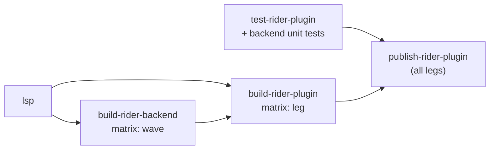

# Rider: breakpoints in `.feature` files — implementation plan

Status: **plan, not implemented.** Nothing below has been built or run in Rider yet. Facts marked
*(verified)* were checked against the Rider 2026.2.3.1 binaries (`javap` on `lib/intellij.rider.jar`,
`ilspycmd` on `lib/ReSharperHost/*.dll`) or against this repository; everything else is a design
decision or an assumption that the spike in [§8](#8-work-breakdown) must confirm.

> **Superseded in scope** by [Rider-Gherkin-PSI-Plan.md](Rider-Gherkin-PSI-Plan.md), which treats this
> backend module as Phase 1 and replaces the frontend `TEXT` shim (§4) with a real frontend PSI.

Related: GitHub issue #453 (VS Code half shipped separately), open questions
[O6 and O9](LSP-IDE-Support-Open-Questions.md), and the limitations list in
[Test-Runner-Integration-Design §12](Test-Runner-Integration-Design.md).

## 1. Goal and scope

Let a user toggle a line breakpoint on a step in a `.feature` file in Rider and have the .NET debugger
stop there when a scenario is debugged — the same behaviour Visual Studio has always had and VS Code
now has.

This is the **minimal** version:

- Line breakpoints only, on any line Rider lets through (no per-step positions, no Gherkin structure
  in Rider's backend).
- No change to how `.feature` files are edited: the editor side keeps its current PSI-free,
  language-server-driven design.
- No custom messages between Rider's frontend and backend (no `rdgen` model).

Out of scope: refusing breakpoints on lines that can never bind (Examples rows, descriptions, tags),
conditional/log breakpoints beyond what Rider gives any .NET line breakpoint, and Rider versions this
plan chooses not to support (see [§7](#7-marketplace-publication)).

## 2. How Rider decides whether a breakpoint can be created

A breakpoint must pass two checks. Both fail for `.feature` files today.

**Gate 1 — frontend (Kotlin).** `DotNetLineBreakpointType.canPutAt` calls
`RiderBreakpointHost.isSupportedLanguage(psiFile, line)`, which:

- reads `psiFile.getLanguage()` *(verified)*, and
- returns true if any `com.intellij.rider.debuggerSupportPolicy` extension is registered for that
  language and its `isAvailable(psiFile, line)` returns true *(verified)*.

`RiderDebuggerSupportPolicy.isAvailable` is `public final` and always returns `true` *(verified)*, so a
plugin can register the stock class for a language but **cannot subclass it to filter by line**.

> **Wrinkle.** Our `.feature` files have no `ParserDefinition`, so IntelliJ's fallback builds a
> `PsiPlainTextFileImpl` whose language is `PlainTextLanguage` (id `TEXT`), not our
> `ReqnrollFeatureLanguage` (id `Gherkin`) — already documented in
> `ReqnrollFeatureInlayHintsController`. Registering the policy for `Gherkin`, as the legacy plugin
> does for its own language, would therefore **not** match. See [§4](#4-frontend-changes).

**Gate 2 — backend (.NET, ReSharper host).** The frontend then asks the backend for breakpoint
variants. `BreakpointVariantsEnumerator.GetVariants` *(verified)*:

1. finds the `IProjectFile` for the path; none → no breakpoint;
2. takes its **primary PSI file**; none → no breakpoint;
3. looks up an `IBreakpointVariantsProvider` for **that PSI file's language** through
   `LanguageManager`; none → no breakpoint;
4. calls `GetBreakpointVariants(file, line, solution)`; a `LineBreakpoint` becomes a
   `DummyBreakpointVariant`, a `TextRangeBreakpoint` becomes a positioned variant. An empty list → no
   breakpoint (Rider does not fall back to a default variant).

**After creation** there is no further language check: the frontend sends the file path and line to
the debugger worker, which binds through the `#line "X.feature"` sequence points Reqnroll's generated
code puts in the PDB — the same mechanism VS and VS Code rely on.

Precedents: T4 (`ForTea` plugin) returns `new LineBreakpoint(null)` for any in-range line; the legacy
`reqnroll/Reqnroll.Rider` plugin has a full Gherkin PSI on both sides and returns a
`TextRangeBreakpoint` per step.

## 3. Backend module

### 3.1 Location and project

```
src/Rider/dotnet/
  Directory.Build.props                         # RiderSdkVersion, wave-derived properties
  Reqnroll.IdeSupport.Rider.Backend/
    Reqnroll.IdeSupport.Rider.Backend.csproj    # net472, PackageReference JetBrains.Rider.SDK
    ZoneMarker.cs
    FeatureFiles/
      FeatureProjectFileType.cs
      FeatureLanguage.cs
      FeatureProjectFileLanguageService.cs
      FeatureLanguageService.cs                 # stub lexer + parser
      FeatureFile.cs                            # one-node IFile
    Debugger/
      FeatureBreakpointVariantsProvider.cs
      BreakpointLineFilter.cs                   # pure function, no SDK types
```

- **Target framework**: `net472`, as the legacy backend uses with SDK 2026.2. Confirm for every SDK
  version we target.
- **SDK reference**: `JetBrains.Rider.SDK` from nuget.org, pinned per Rider version. Versions 2024.3.x
  through 2026.3.0 are published there *(verified)*. The legacy plugin instead uses
  `lib/DotNetSdkForRdPlugins` inside the downloaded Rider as a package source; nuget.org avoids a
  second Rider download per CI leg when the Kotlin side keeps compiling against 2024.3.5.
- **Zone marker**: declare the zones the components need, copying the SDK template / legacy plugin;
  the exact zone interfaces are to be confirmed during the spike.

### 3.2 Types

| Type | Base | Notes |
|---|---|---|
| `FeatureProjectFileType` | `KnownProjectFileType`, `[ProjectFileTypeDefinition]` | Name **`REQNROLL_FEATURE`**, extension `.feature`. Deliberately not the legacy name `GHERKIN` (see [§5](#5-coexistence-with-the-legacy-plugin)). |
| `FeatureLanguage` | `KnownLanguage`, `[LanguageDefinition]` | Backend PSI language for `.feature`. |
| `FeatureProjectFileLanguageService` | `ProjectFileLanguageService`, `[ProjectFileType(typeof(FeatureProjectFileType))]` | Maps the file type to `FeatureLanguage`. |
| `FeatureLanguageService` | `LanguageService`, `[Language(typeof(FeatureLanguage))]` | **Stub**: a lexer that emits the whole buffer as one token and a parser that returns `FeatureFile` with one leaf. No caches, no type declarations, no formatter. |
| `FeatureFile` | minimal `IFile` implementation | One node. Exists only so `GetPrimaryPsiFile()` is non-null and reports `FeatureLanguage`. |
| `FeatureBreakpointVariantsProvider` | `IBreakpointVariantsProvider`, `[Language(typeof(FeatureLanguage))]` | Returns `[new LineBreakpoint()]` when `0 <= line < lineCount` and `BreakpointLineFilter` accepts the line; otherwise empty. `GetSupportedFileExtensions()` returns `.feature`. |
| `BreakpointLineFilter` | static, no SDK types | Optional cheap filter that rejects blank lines and `#` comment lines from the line's text. No Gherkin parsing. Can grow later (e.g. `|` table rows) without touching the PSI. |

The backend never parses Gherkin. All structural knowledge stays in the language server.

**Spike check before building the stub language:** confirm Rider's backend gives `.feature` no
primary PSI file today. If it already maps `.feature` to some existing language, attaching a provider
to that language would avoid the stub, but it would also affect every other file of that language, so
the stub remains the default.

### 3.3 Side effects to check

A backend language for `.feature` means ReSharper starts treating these files as something it knows.
With a stub language service most features should stay inert (one token, no declarations, no caches),
but the spike must confirm there are no new highlights, inspections, To-do entries, search hits or
errors in the backend log.

## 4. Frontend changes

Gate 1 keys on the PSI language, which is `TEXT` for our files (see [§2](#2-how-rider-decides-whether-a-breakpoint-can-be-created)).

**F1 — register for `TEXT` (recommended for the minimal version).**

```xml
<rider.debuggerSupportPolicy language="TEXT"
    implementationClass="com.jetbrains.rider.debugger.RiderDebuggerSupportPolicy"/>
```

- One line of `plugin.xml`, no Kotlin. Our plugin already depends on `com.intellij.modules.rider`,
  which defines the extension point.
- **Side effect**: Gate 1 now passes for *every* plain-text file in Rider (`.txt`, unknown
  extensions). Gate 2 should still refuse them because no backend provider exists for their
  language, so no breakpoint is created. The spike must confirm a click on a `.txt` gutter shows
  nothing (no error, no balloon, no greyed breakpoint).
- Without the backend module (the older-Rider leg in [§6](#6-build-and-ci-changes)) the same line is
  harmless: Gate 2 refuses every `.feature` line too.

**F2 — fallback: give `.feature` a stub frontend `ParserDefinition`** so `psiFile.language` becomes
`Gherkin`, then register the policy for `Gherkin`. This removes the side effect but changes the
PSI language of every `.feature` editor. Several existing features (inlay hints, folding, code vision
lenses) were deliberately built PSI-free around the current behaviour, and language-keyed platform
features (spell checking, To-do, declarative providers) would start dispatching to us. Use F2 only if
F1's side effect proves visible.

## 5. Coexistence with the legacy plugin

Open question **O9** is undecided. This feature makes it sharper: today the two plugins only overlap
on the editor side; with a backend module both would also register a backend project file type for
`.feature` (legacy: `GHERKIN`). Which one wins is undefined and unverified.

Options (decision needed):

1. Declare the plugins incompatible in our `plugin.xml`
   (`<incompatible-with>net.reqnroll</incompatible-with>`; `net.reqnroll` is the legacy plugin ID
   *(verified)*). Confirm Rider honours `incompatible-with` for a plugin ID rather than only a module.
2. Document "uninstall the legacy plugin first" and accept undefined behaviour if both are present.

Recommendation: option 1, recorded as the answer to O9's "can both be installed at once".

## 6. Build and CI changes

### 6.1 Today *(verified)*

- `src/Rider/gradle.properties`: `platformVersion = 2024.3.5`, `pluginSinceBuild = 243`,
  `pluginUntilBuild = 262.*`. One universal `.zip` for all six server RIDs.
- `.github/workflows/ci.yml`: `build-rider-plugin` (ubuntu) runs `./gradlew buildPlugin` and
  `verifyPlugin`; Gradle **never runs `dotnet` in CI** (server and test logger arrive as artifacts via
  `-PlspServerBuildDir` / `-PlspTestLoggerBuildDir`). `test-rider-plugin` runs Gradle tests.
  `publish-rider-plugin` only promotes the candidate artifact; **nothing is uploaded to the JetBrains
  Marketplace**.
- Version: `<ReqnrollIdeSupportMainVersion>.<run_number>`, checked against `plugin.xml` by the
  "Verify plugin version" step.

### 6.2 Gradle

- New properties: `riderWave` (e.g. `262`), `riderSdkVersion` (e.g. `2026.2.4`), and
  `withBackend` (default `true`).
- `sinceBuild`/`untilBuild` come from the leg: backend legs use `<wave>` / `<wave>.*`; the
  frontend-only leg keeps `243` / `<oldest backend wave − 1>.*`.
- New `compileBackend` task (`dotnet build -c Release -p:RiderSdkVersion=…`) for local builds, plus an
  external `-PbackendBuildDir` override for CI, mirroring the existing `publishServer` /
  `lspServerBuildDir` pattern so Gradle still never runs `dotnet` in CI.
- `prepareSandbox` copies `Reqnroll.IdeSupport.Rider.Backend.dll` (and `.pdb`) into
  `<plugin>/dotnet/` when `withBackend` is true; `buildPlugin` fails if it is missing.
- The Kotlin jar is unchanged and still compiled against 2024.3.5 with Kotlin API level 2.0, so it is
  identical across legs.

### 6.3 Workflow



- **New `build-rider-backend` job**, matrix over supported waves: `actions/setup-dotnet`,
  `dotnet build` with that wave's SDK version, upload `rider-backend-<wave>`. Cache
  `~/.nuget/packages`; the SDK packages are large.
- **`build-rider-plugin` becomes a matrix** over legs: `frontend-only` plus one per supported wave.
  Each leg downloads the server/test-logger artifacts as today plus its backend artifact, then runs
  `buildPlugin` and `verifyPlugin`. `pluginVerification.ides` must be narrowed to the leg's range.
- **The Plugin Verifier does not check .NET code.** Compiling the backend against each wave's SDK is
  the only automated compatibility check; a live check per new wave stays manual.
- **Version per leg**: every upload of one plugin ID needs a unique version. Proposed:
  `<main>.<run_number>.<wave>` for backend legs and `<main>.<run_number>.0` for the frontend-only leg.
  The "Verify plugin version" step reads the expected value from the matrix.
- **Artifacts**: `Reqnroll.IdeSupport.Rider.<version>.zip` per leg; `publish-rider-plugin` collects all
  of them.
- **Tests**: Kotlin tests are unchanged, plus one `BasePlatformTestCase` asserting the
  `debuggerSupportPolicy` registration. Backend: an SDK-free xUnit project that links
  `BreakpointLineFilter.cs`. The ReSharper test framework is too heavy for the value it adds here.
- **Cost**: roughly one extra `dotnet build` per wave plus one extra Gradle run per leg. Paths-filter
  triggers need no change because everything lives under `src/Rider/**`.

## 7. Marketplace publication

The plugin is not on the Marketplace yet (see O9), so this describes the model to adopt when it is.

- **One plugin ID, several uploads.** Keep `net.reqnroll.idesupport`. Upload one zip per leg with
  non-overlapping `since`/`until` ranges. Rider offers the newest upload whose range covers its build;
  users never choose.
- **Older Rider keeps getting updates.** The frontend-only leg covers `243` up to just below the
  oldest backend wave. Those users get every release, just without `.feature` breakpoints. This avoids
  the usual "per-version plugin drops old IDEs" cost.
- **Supported window**: proposed as the two newest Rider releases with backend legs. That is the
  policy decision behind the matrix size.
- **Following Rider's releases.** Backend legs need a closed `untilBuild` (`<wave>.*`). Until a leg
  for a new Rider release ships, users of that release get no update from us. To avoid that, add a
  leg against the EAP SDK (the `-rc` / EAP packages on nuget.org) and publish it to a non-default
  Marketplace channel before the release.
  - Note: today's plugin already stops at `262.*`, and `JetBrains.Rider.SDK 2026.3.0` is on nuget.org
    *(verified)*, so a range bump is already due independently of this plan.
- **Upload mechanics**: `publishPlugin` (IntelliJ Platform Gradle Plugin) per leg with a Marketplace
  token secret, run only from the release pipeline; or the Marketplace upload API with the same
  zips. Change notes are identical across legs.
- **Alternative packaging, not recommended for the minimal version**: a separate companion plugin
  that holds only the backend module and depends on the main plugin. It keeps the main plugin a single
  upload, but adds a second listing, a second install step, and its own version matrix anyway.

## 8. Work breakdown

0. **Spike (local, no CI)**, go/no-go:
   1. Backend stub plus provider plus F1 registration, built against the locally installed Rider's
      SDK.
   2. Install into Rider 2026.2.
   3. Run the live checks in [§9](#9-verification-plan).
1. **PR — backend module and Gradle wiring** for a single wave (the current Rider), local
   `compileBackend` path, `prepareSandbox` packaging, unit tests, `plugin.xml` registration and the O9
   coexistence decision.
2. **PR — CI matrix and versioning** ([§6.3](#63-workflow)), including the frontend-only leg.
3. **PR — docs**:
   - `feature-overview` row and footnote;
   - `running-scenarios` Rider tab;
   - CHANGELOG;
   - Test-Runner-Integration-Design §12;
   - Open-Questions O6 and O9.
4. **Marketplace publishing**, once O9 is settled ([§7](#7-marketplace-publication)).

## 9. Verification plan

Live, in Rider, on a sample Reqnroll project (Windows first; macOS/Linux at least once before release):

| Check | Expected |
|---|---|
| F9 and gutter click on a step line | Breakpoint created, survives IDE restart |
| Debug a scenario | Stops on Background steps (once per scenario), plain steps, and Outline steps (once per row) |
| Step Into from a stopped step | Lands in the step definition (VS Code needed Just My Code for this) |
| Breakpoint on Examples row, blank or comment line | Blank/comment refused by the filter; Examples row accepted but never hit |
| Edit the `.feature` without rebuilding | Binds by the old line numbers (same as VS Code); document it |
| Gutter click on a `.txt` file (F1 side effect) | Nothing happens, no error |
| Backend log and IDE (`idea.log`) | No errors from the stub language |
| Legacy plugin also installed | Behaves as decided for O9 |
| Plugin on the oldest supported Rider (frontend-only leg) | Loads; `.feature` breakpoints refused, nothing else changes |

## 10. Decisions needed

1. Supported Rider window for backend legs (proposed: two newest releases).
2. O9: declare the legacy plugin incompatible (proposed: yes).
3. F1 (`TEXT` registration) vs F2 (stub frontend parser); proposed F1 unless the spike shows a
   visible side effect.

## 11. Not verified

These are assumptions until the spike runs:

- That the debugger worker binds `.feature` line breakpoints through `#line` sequence points.
- Step Into behaviour.
- That a stub `LanguageService` and `IFile` are enough for `GetPrimaryPsiFile()`.
- That Gate 2 quietly refuses plain-text files.
- That `incompatible-with` works for a plugin ID.
- That `net472` is the right target framework for every targeted SDK.
- Exact zone requirements.
- The Marketplace's handling of the proposed version scheme.
