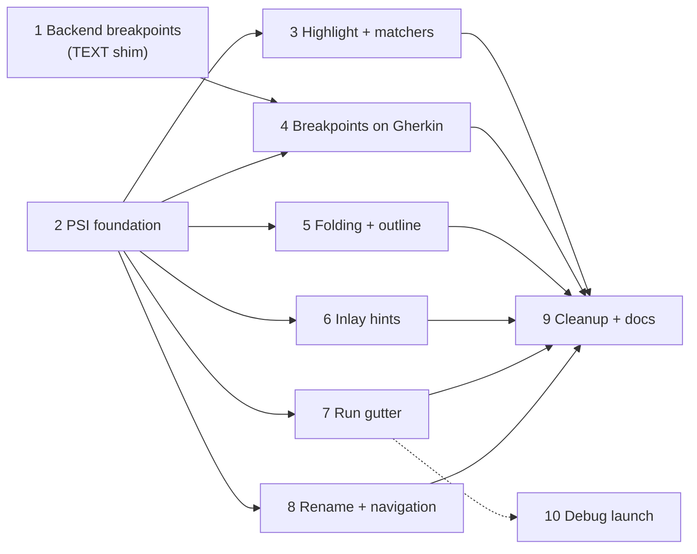

# Rider: a PSI for `.feature` files — implementation and rework plan

Status: **in progress.** Phases 1 (backend module, Gradle wiring, closed one-release range), 2a, 2b and the
Phase 4 policy switch are committed on `feature/453-rider-gherkin-psi`; none has been run in a live Rider, and
the CI matrix, publishing automation and Phases 3 and 5–10 are not started. This supersedes the scope of
[Rider-Feature-Breakpoints-Plan.md](Rider-Feature-Breakpoints-Plan.md). That plan's backend module is
kept unchanged as [Phase 1](#6-phases); its frontend half (§4, the `TEXT` registration) becomes a
temporary shim that [Phase 4](#6-phases) removes.

Facts marked *(verified)* were checked against this repository or the Rider 2026.2.3.1 binaries.
Everything else is a design decision or an assumption listed in [§9](#9-not-verified).

## 1. Why

The Rider plugin registers `.feature` as a file type whose language (`ReqnrollFeatureLanguage`, id
`Gherkin`) has **no `ParserDefinition`** *(verified)*. IntelliJ therefore builds a plain-text PSI whose
language is `TEXT`, not `Gherkin`. Every platform feature that dispatches by PSI language then either
never fires for us or fires for the wrong language. The plugin has worked around that one feature at a
time, with hand-managed `Editor` models and action overrides *(verified: `plugin.xml`, the doc comments
of `ReqnrollFeatureInlayHintsController`, `ReqnrollFeatureFoldingController`,
`RunTestCodeVisionProvider`, `ReqnrollCommentByLineCommentAction`)*.

The goal is to give `.feature` a real, thin PSI and move each workaround onto the platform extension
point it was standing in for. Users gain native behaviour. The plugin loses code it has to keep
working on every Rider release.

### Non-goals

- Replacing the language server. Diagnostics, step binding, completion content, rename edits and test
  discovery stay server-side. The PSI describes **structure**, never meaning.
- A backend (ReSharper) Gherkin PSI. The Phase 1 stub stays a stub.
- Changing VS or VS Code.

## 2. Design

### 2.1 Thin PSI, server stays authoritative

The PSI is a lexer plus a tree parser, **both built on the Cucumber Gherkin parser** rather than
written by hand ([§2.5](#25-reusing-the-gherkin-parser)). It never reports errors (the server owns
diagnostics) and never resolves anything. It exists so the platform can answer "what language, what
token, what block is this line in".

### 2.2 Lexer

A `LexerBase` that replays the real Gherkin token matcher over the buffer ([§2.5](#25-reusing-the-gherkin-parser))
and emits one IntelliJ token per matched span. It produces these token kinds:

| Token | Notes |
|---|---|
| Structural keyword | `Feature`, `Rule`, `Background`, `Scenario`, `Scenario Outline`, `Examples` and their localised forms |
| Step keyword | `Given`, `When`, `Then`, `And`, `But`, `*` and localised forms |
| Text | Names, descriptions, step text |
| Tag | `@name` |
| Comment | `# …` |
| Language header | `# language: xx` |
| Pipe / table cell | Table rows |
| Doc-string delimiter / content | `"""` and ` ``` ` |
| Placeholder | `<name>` inside Outline steps and cells |
| Whitespace / newline | |

- **Localisation.** The matcher resolves keywords from `# language: xx` using the library's own
  dialect data (`GherkinDialects` is public API), so nothing is bundled or duplicated. Editing the
  header therefore needs one full re-highlight.
- **Restartable state.** The simple version rescans the whole buffer on every `start()` and caches the
  token list per document modification stamp. Linear cost; measure on a large file
  ([§8](#8-verification)). Restarting from saved state would be faster but needs the matcher's private
  state, so it is a later optimisation.
- **Project default language.** The server resolves a per-project default language and falls back from
  `en-US` to `en` (`ReqnrollGherkinDialectProvider`). The client needs that value too, as per-file user
  data, with a re-parse when it changes. Until it is wired, files that rely on project config for a
  non-English language mis-parse in the PSI (the server still treats them correctly).
- **Colour parity.** Each token type maps to the same `TextAttributesKey` that
  `ReqnrollSemanticTokensSupport` already assigns to the matching `reqnroll.*` legend name. When the
  server's tokens arrive the file looks identical, so the swap is invisible apart from the instant
  first paint.

### 2.3 Tree

```
FEATURE_FILE
  FEATURE (tags, keyword, name, description)
    BACKGROUND (STEP*)
    RULE
      SCENARIO | SCENARIO_OUTLINE
        STEP (DOC_STRING | TABLE)?
        EXAMPLES (TABLE)
```

The tree comes from Gherkin's own grammar: the library parser's `startRule` / `endRule` / `build(token)`
callbacks map directly onto `PsiBuilder` markers and tokens, so rule boundaries (including Gherkin's
description-versus-step and doc-string corner cases) are exactly the grammar's. A malformed file still
produces a full tree, because the adapter closes every open marker on an error or end of file; the tree
must never throw away text.

- Typed elements only where a feature needs them: `ReqnrollStep` (keyword, text, owning scenario),
  `ReqnrollScenario` (name, kind, line range), `ReqnrollTable`. Everything else is a generic
  `ASTWrapperPsiElement`.
- **No `PsiNamedElement` and no `PsiReference` in the first iterations.** Naming an element or giving
  it a reference makes platform Rename, Find Usages and "highlight usages" engage on it, and none of
  those can be answered without a PSI target in a C# file, which the Rider frontend does not have
  *(see [§9](#9-not-verified))*.

### 2.4 Registration

```xml
<lang.parserDefinition language="Gherkin" implementationClass="…ReqnrollFeatureParserDefinition"/>
<lang.syntaxHighlighterFactory language="Gherkin" implementationClass="…"/>
```

`ReqnrollFeatureFileType` already declares `language="Gherkin"`, so no file-type change is needed.

### 2.5 Reusing the Gherkin parser

Checked against the published jars (Maven Central `io.cucumber:gherkin`, NuGet `Gherkin`) and the
server's `IdeSupportGherkinParser`. The bridge itself has not been built.

| Option | Verdict |
|---|---|
| **Java `GherkinParser` (public API) as the tree source** | Rejected. Given an invalid file (unterminated doc string, unknown `# language:`) it returns a `ParseError` and **no partial document** *(verified by running it)*. A PSI must cover the whole text. Fine only as a structure-only side channel, which cannot anchor markers or highlighting. |
| **.NET `Gherkin` package, via the server** | Rejected. The server already does this and tolerates errors, but the PSI is needed synchronously on the frontend. |
| **Java internal parser, driving `PsiBuilder`** | **Chosen.** `Parser`, `Token`, `TokenScanner` and `GherkinTokenMatcher` are package-private *(verified)*, but `Parser.Builder` is exactly the callback shape `PsiBuilder` needs. |
| **Hand-written lexer and parser** | Rejected. It would re-implement the grammar's corner cases and keyword tables and need to track upstream. |

**Version.** Use Java `io.cucumber:gherkin` **39.1.0**, the version matching the server's `Gherkin`
39.1.0 *(verified: both are published through 42.0.1 in lock-step)*. Dependencies are `messages` and
`jspecify`; the jar is about 240 KB and `messages` about 120 KB, with Jackson only as a test dependency
of `messages` *(verified from the POMs)*. Gherkin is MIT-licensed upstream.

**Reaching the internal classes.** Put one small adapter class in package `io.cucumber.gherkin` inside
our plugin jar, written in Java (the Gradle build gains a Java source set; today it is Kotlin only), so
it can use the package-private types on the classpath. The fallback is to vendor the library source.
Both need checking in Rider ([§9](#9-not-verified)).

**Adapter responsibilities.**

1. A `Parser.Builder` that maps `startRule` / `endRule` to `PsiBuilder` markers and `build(token)` to
   tokens, using each token's line and column for offsets.
2. Catch the exception the library throws at an error or at end of file, and close all open markers so
   the tree is complete.
3. A restartable `Lexer` that replays `TokenScanner` and `GherkinTokenMatcher` and emits sub-line spans
   (keyword, text, tags, table cells, doc-string content) from each `Token`.
4. The per-file default language ([§2.2](#22-lexer)).

**Parity with the server.** Both sides come from the same Cucumber release train, so grammar and
keywords should agree. Contract tests: run the Cucumber shared test corpus (the `good/*.feature` files
with their expected token output) through the adapter, and compare structure for a fixed sample against
the server's `documentSymbol`.

## 3. Area-by-area rework

Ranked by user impact, as agreed. Each row names the code that goes away.

| # | Area | Today | After the PSI | Removed / changed | Risk |
|---|---|---|---|---|---|
| 1 | **Instant syntax colour** | Semantic tokens only; nothing coloured until the server answers | `SyntaxHighlighter` from the lexer; semantic tokens overlay it | Nothing removed; adds `BraceMatcher`, `QuoteHandler` | Low |
| 2 | **Run / Debug gutter** | `RunTestCodeVisionProvider` inline lens; no Debug | `RunLineMarkerContributor` gives a native gutter marker with the standard Run/Debug menu on `SCENARIO` / `SCENARIO_OUTLINE` | `RunTestCodeVisionProvider` (after a deprecation release behind a setting). `FailedStepGutterMarks` stays: it paints per-run state, not structure | Medium |
| 3 | **Breakpoints** | Spike registers the debugger policy for `TEXT`, so every plain-text file passes Gate 1 | Register the policy for `Gherkin` only | The `TEXT` line in `plugin.xml`. The backend stub stays | Low |
| 4 | **Navigation and refactoring entry points** | Promoter and action for F12 / Ctrl+B / Ctrl+click; claimed Shift+F6; Comment action overridden by ID | `Commenter`; `renameHandler` extension point for Rename Step; navigation re-evaluated in [Phase 8](#6-phases) | `ReqnrollCommentByLineCommentAction` (if parity holds). Shift+F6 claim | **High** for navigation, Low for the rest |
| 5 | **Hand-managed editor visuals** | `editorFactoryListener`s drive `foldingModel` and `inlayModel`; tag links by hand | **Prefer what Rider's generic LSP client now does itself** (see the principle below): native folding from 2025.2.2, native inlay hints from 2025.2.2, native outline from 2025.3, driven by the server's responses. Our controllers remain only for older builds and are switched off where the platform does the work | The folding controller, once `pluginSinceBuild` reaches 2025.2.2; the inlay-hint controller likewise, after checking for double rendering | Medium |
| 6 | **Typing assists** | Two `typedHandler`s for `|` realignment and `@` / space popups | Same handlers, now language-scoped. Add `SpellcheckingStrategy`, `IndexPatternBuilder` (TODO), breadcrumbs | Nothing | Low |

### Notes per area

1. **Highlighting.** Platform brace matching and quote handling arrive with the language. Check that
   the semantic-token overlay does not flicker against the lexer colours when a file is first opened.
2. **Run gutter.** The marker's actions call the existing `RunTestRunner`, so execution is unchanged.
   The **Debug** entry has to start `dotnet test` with the VSTest host-debug handshake and attach the
   .NET debugger. That is separate work ([Phase 10](#6-phases)): the PSI supplies the entry point but
   not the launch. Keep the inline lens for one release so users who like it can switch back.
3. **Breakpoints.** Gate 1 keys on `psiFile.language`, which becomes `Gherkin`. Do this as soon as
   Phase 2 lands rather than leaving the `TEXT` shim in place.
4. **Navigation.** Go to Definition works today through the generic LSP client plus the 2026.2
   promoter. A `PsiReference` on step text would need a PSI target in a `.cs` file, and Rider's frontend
   has no C# PSI to offer. So this area is an investigation with a go/no-go, not a committed rewrite. The
   committed parts are the `Commenter` and a native `renameHandler`. Rename Step stays a server rename:
   the handler only changes how it is invoked (Refactor menu, user keymaps), not how the edit is built.
5. **Visuals.** *Principle (decided after building a tree-based folding and Structure view and then
   reversing it):* anything the server already answers through a standard LSP request is driven by that
   response in every IDE, so there is one set of rules. The PSI is for what an LSP response cannot give:
   instant colour before the server starts, the breakpoint gate, run markers, the rename handler. A
   tree-based copy of the fold and outline rules drifted from the server's within one commit (a Feature's
   fold started on a different line), so it was removed.
   - **Folding:** the server's `foldingRange`. Rider 2025.2.2+ folds from it natively (verified in the 2026.2
     binaries: `LspFoldingBuilder` registered for any language, on by default); `NativeLspFolding` switches the
     old controller off there. Below that the controller renders the same ranges.
   - **Outline:** the server's `documentSymbol`, native from Rider 2025.3. Rider before that has no outline.
   - **Inlay hints, code lens, document links:** Rider's client also gained native support for these (inlay
     hints 2025.2.2, document links 2025.1, code lens 2026.1, per JetBrains' LSP page). Phase 6 starts by
     checking, on a new Rider, whether the platform already draws what our controllers draw, since both
     being active would double-render.

## 4. Cross-cutting concerns

- **Double rendering during migration.** Today's workaround controllers and the new language-scoped
  platform features will both fire once the language is real. Every area migrates in a single PR that
  adds the platform feature **and** removes its workaround. No area lands half-way.
- **Spell checking, TODO indexing and other language-dispatched features start running on `.feature`.**
  Phase 2 ships a `SpellcheckingStrategy` that skips keywords, tags, placeholders and step parameters,
  so users do not get a wall of squiggles.
- **Legacy plugin (`net.reqnroll`).** It registers its own `.feature` file type and PSI. With both
  plugins present, two parsers fight over one extension. **Done:** `plugin.xml` declares
  `<incompatible-with>net.reqnroll</incompatible-with>` and its description no longer tells users they can run
  both. Still to verify: that Rider honours it for a plugin ID.
- **What the PSI does and does not tie to Rider releases.** The PSI is Kotlin, compiled against 2024.3.5, and
  stays one build for 243 – 262.\* (`verifyPlugin` checks it across the range). Only the backend module is tied
  to one release, and only builds made with `-PwithBackend=true` carry it; see the closed-range rules in
  [the breakpoints plan §6.2](Rider-Feature-Breakpoints-Plan.md#62-gradle).
- **Formatting.** `ReqnrollFormattingService` is registered `order="first"` and keeps winning. No
  `FormattingModelBuilder` is added, so Reformat Code still goes through the server.
- **Compatibility range.** The Kotlin jar is shared by all legs (243 – 262.*). Every extension point
  used must exist in 2024.3. `verifyPlugin` checks binary compatibility of that Kotlin code across the
  range, so the PSI work is partly self-checking, unlike the .NET backend.
- **Marketplace.** No new legs. The frontend-only leg for older Rider gets the PSI features too
  (highlighting, gutter run, folding, outline), since none of them need the backend. Only breakpoints
  need the backend leg.
- **Parity with the server.** See [§2.5](#25-reusing-the-gherkin-parser). Pin the Java jar to the
  server's Gherkin version and bump them together.
- **Packaging and classloading.** The Gherkin and `messages` jars ship inside the plugin. The
  split-package adapter and any `io.cucumber` classes already in the IDE need checking
  ([§9](#9-not-verified)).
- **Testing in Rider.** Rider's `BasePlatformTestCase` fixtures fail with "solution can't be null"
  (recorded from issue 566). `ParsingTestCase`, which uses a mock project, **does work** in this build
  *(verified: `ReqnrollFeatureParserTest` passes under `./gradlew test`)*, as do plain unit tests. The
  earlier plan's `BasePlatformTestCase` for the breakpoint policy registration should instead be a test
  that parses `plugin.xml`.

## 5. Dependency order



## 6. Phases

Sizes are rough estimates in working days and have not been validated.

| Phase | Deliverable | Exit criterion | Est. |
|---|---|---|---|
| **0** | Live check of the backend spike in `runIde` | Go/no-go for Phase 1 (checks in [§8](#8-verification)) | 1 |
| **1** | Backend module and Gradle wiring (**built and committed**; the `TEXT` shim is gone). Build now derives a closed one-release range from `riderSdkVersion` and defaults to frontend-only. Still to do: CI matrix, per-release backend smoke test, publishing automation, changelog-rendered change notes (breakpoints plan §6–7) | Breakpoint binds and hits in a live Rider | per earlier plan |
| **2a** | **Parser bridge**: Java source set, Gherkin 39.1.0 dependency, same-package adapter, `PsiBuilder` builder, restartable lexer; no registration yet | Shared corpus passes; invalid files yield a full tree; spike confirms classloading in Rider | 3–4 |
|  | *Status: built and unit-tested (corpus, lexer, `PsiBuilder` replay via `ParsingTestCase`); `ReqnrollFeatureParserDefinition` exists but is deliberately not registered in `plugin.xml`. Classloading in a real Rider is the open item.* | | |
| **2b** | **PSI foundation**: `ParserDefinition`, typed elements, per-file default language, `SpellcheckingStrategy`, no behavioural change otherwise | Every existing feature still works with the language now real; no double rendering | 2–3 |
|  | *Status: registered in `plugin.xml` (parser definition, spellchecking strategy), and the debugger policy moved from `TEXT` to `Gherkin` in the same change, since the PSI language changed (this also completes Phase 4). The default language is read from the project's `reqnroll.json` / `specflow.json` by `FeatureDefaultLanguages` (`App.config` not read). Typed elements are deferred to the first phase that needs them. Still open: re-parsing open files when the configuration changes (needed before Phase 3 makes the colours visible), and a live check that nothing double-renders.* | | |
| **3** | **Highlighting and matchers**: `SyntaxHighlighter`, `BraceMatcher`, `QuoteHandler`, `Commenter`; retire the comment action override if parity holds | First paint coloured before the server starts; comment toggling matches the server's behaviour | 2–3 |
|  | *Status: built and unit-tested. Done: the lexer-based `SyntaxHighlighter` (sharing `ReqnrollFeatureTextAttributes` with the semantic tokens, with header and body table cells distinguished), the `Commenter`, and re-parsing open files when `reqnroll.json` / `specflow.json` changes (`FeatureLanguageConfigListener`). **Not done, deliberately:** `BraceMatcher` and `QuoteHandler` (the grammar has no bracket or quote tokens: a placeholder is one token and quotes are plain step text), and retiring the comment action override (it stays until a live check shows the platform action matches the server's toggle for doc strings and tables). Unverified: that `FileContentUtil.reparseFiles` also refreshes an open editor's highlighter, and that nothing flickers when semantic tokens arrive.* | | |
| **4** | **Breakpoints on `Gherkin`**: switch the policy, drop `TEXT` | `.txt` gutter clicks no longer reach Gate 1 | 0.5 |
| **5** | **Folding and Structure view**: ~~`FoldingBuilder`, `StructureViewBuilder` from the tree~~ — reversed, see §3 note 5; server ranges and symbols in every IDE | Rider 2025.2.2+ folds natively with the controller off; older Rider folds through the controller; both use the server's ranges | 1 |
|  | *Status: a tree-based `FoldingBuilder` and Structure view were built and committed, then reverted in favour of server ranges everywhere. Done: `NativeLspFolding` (checks for the platform's `LspFoldingRangeSupport` class) switches the folding controller off on builds with native folding; docs corrected (the old claim that Rider's client has no folding consumer was true only for 2024.3). Left as it was: no outline before Rider 2025.3. Unverified: native folding in a live Rider with `Gherkin` as the PSI language (does the platform's any-language builder still apply, does its cache refresh while typing), and that the controller really is off there.* | | |
| **6** | **Native-rendering audit** (replaces the declarative inlay provider, per the §3 note 5 principle): confirm on a new Rider that inlay hints, code lens and document links each render once | One hint, lens and link per source, no duplicates | 1 |
|  | *Status: static audit done against the Rider 2026.2.3.1 binaries. Inlay hints: `NativeLspInlayHints` already switches the controller off where the platform's `LspInlayHintsProviderFactory` is registered. Code lens: `NativeLspCodeLens` does the same for `LspCodeVisionProvider`. **Document links: not gated.** 2026.2 has `LspDocumentLinkCache` (sends `textDocument/documentLink`) and `LspDocumentLinkReferenceProvider` (an implicit PSI reference, so Ctrl+click navigation), and `LspHighlightingPassFactory` is registered; whether it draws the underline for `.feature` files, and whether Ctrl+click then opens the browser twice next to `ReqnrollFeatureTagLinkController`, needs a live check. Gating the controller without that check could drop the permanent underline and hover hint. **Live check (2026.2.3.1): Ctrl+click opened the link twice**, once through the platform's reference (which works now that `.feature` has a PSI) and once through the controller. The platform's switch (`LspDocumentLinkDisabled`) is a descriptor customization the plugin cannot set while it compiles against 2024.3, so the controller now leaves the click to the platform wherever `LspDocumentLinkSupport` exists (`NativeLspDocumentLinks`). It keeps drawing the underline and the hover hint and still reports the click telemetry. The single tab after that change is not yet verified. Note that the platform's navigation does not apply `TagLinkSupport.isOpenableUrl`'s scheme block list.* | | |
| **7** | **Run gutter**: `RunLineMarkerContributor`; keep the lens behind a setting for one release | Run works from the gutter; failed-step marks unaffected | 3 |
| **8** | **Rename and navigation**: `renameHandler`; navigation investigation with go/no-go | Rename Step appears under Refactor and honours keymaps; navigation decision recorded | 2 + spike |
| **9** | **Cleanup and docs**: remove dead workarounds, update `client-rider.md` §7 and §8, feature pages, CHANGELOG | Doc comments no longer say "no PSI" | 1–2 |
| **10** | **Debug launch** for scenarios (separate track) | F5-style Debug from the gutter attaches and hits `.feature` breakpoints | tbd |

Phases 3 and 5–8 are independent of each other once Phase 2 is in, so they can be reviewed as
separate PRs in any order. Phase 2 is the only large risk: it changes the language of every `.feature`
editor.

## 7. Rollback

- Phases 2–8 each ship as one PR with a revert path. Phase 2's `ParserDefinition` registration is a
  single `plugin.xml` line, so a field problem with the PSI can be mitigated by removing it while the
  platform features keep their old controllers, but only if the controllers of later phases are still
  present. That is why each migration removes its workaround in the same PR as it adds the replacement,
  and why Phase 2 must not remove anything.
- The Run lens stays behind a setting for one release (Phase 7).

## 8. Verification

Live, in Rider, on a sample Reqnroll project (Windows first).

| Check | Expected |
|---|---|
| Open a `.feature` with the server stopped | Coloured at once; the colours do not change when the server starts |
| Localised file (`# language: fr`) | Keywords coloured and folded correctly; editing the header re-highlights |
| Project whose default language is not English, no header | PSI and server agree on keywords |
| Invalid file (unterminated doc string, unknown language) | Whole text still in the tree; no exception in the log |
| Large file (several thousand lines) | No typing lag; no EDT stalls in the log; measure the lexer rescan cost |
| Fold / unfold, Structure view | Same folds as VS Code on the same file (Rider 2025.2.2+ natively, older through the controller, never both); outline from Rider 2025.3 |
| Inlay hints, code lens, document links | Each rendered once on Rider 2025.2.2+, 2026.1+ and 2026.2; tag link Ctrl+click opens once |
| Gutter marker | Run works; failed-step marks appear after a failed run |
| Breakpoints | As in the earlier plan's table; no response on a `.txt` gutter |
| Comment, Rename Step, F12 | Unchanged behaviour on all supported Rider versions |
| Spell check | No squiggles on keywords, tags, placeholders or parameters |
| Legacy plugin also installed | Rider reports the incompatibility |

## 9. Not verified

- Everything in the backend breakpoint spike (see the earlier plan §11).
- That a frontend PSI is created for `.feature` in Rider, and how it interacts with the platform LSP
  client's own `.feature` handling. The legacy plugin does it, which is the only evidence.
- That Rider's frontend has no usable PSI for C# files, which decides whether Phase 8's navigation
  go/no-go can be a go.
- Whether the semantic-token overlay and the lexer highlighter composite without flicker on every
  supported Rider.
- Whether `RunLineMarkerContributor` markers show the standard Debug entry for a non-C# language in
  Rider, rather than needing a custom action.
- Whether a `Commenter` reproduces the server's comment toggle for doc strings and tables.
- That a class in package `io.cucumber.gherkin` inside our plugin jar can reach the package-private
  parser types in Rider's plugin classloader (the same runtime package), and that the IDE bundles no
  conflicting `io.cucumber` classes. Fallback: vendor the source.
- That Java Gherkin 39.1.0 behaves the same as .NET 39.1.0 on the shared corpus.
- Whole-buffer lexer rescans stay fast enough on large files.
- That the parser's error behaviour at end of file lets the adapter always close a complete tree.
- The effort estimates in [§6](#6-phases).

## 10. Decisions needed

1. Commit to the PSI programme, or ship Phase 1 alone and stop.
2. Phase 2 sequencing: before Phase 1 ships, or after. The proposal is **after** (Phase 1 is built and
   independent).
3. ~~Legacy plugin: declare it incompatible~~ — done; verify Rider enforces it.
3a. Backend support window and an owner and response time for each new Rider release (see breakpoints plan §7.2).
4. Keep the inline Run lens as a setting for one release (proposed: yes).
5. Whether navigation (Phase 8) is in scope or only Rename and the `Commenter`.
