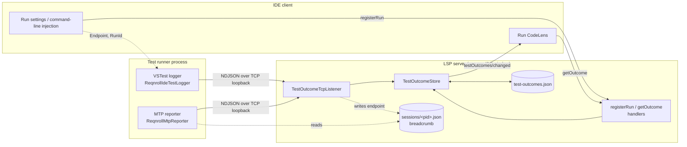
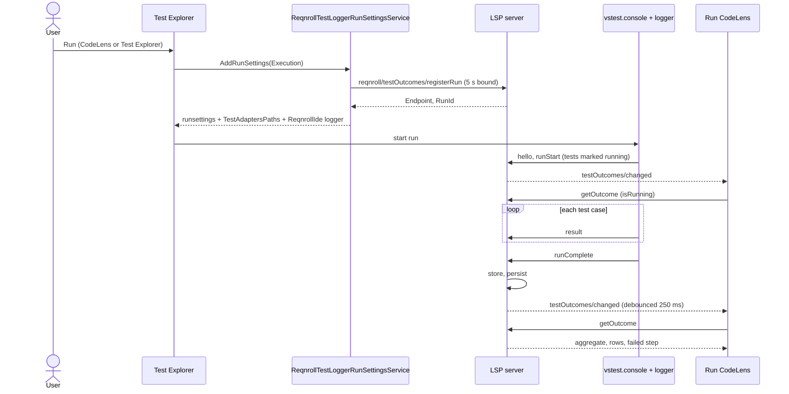
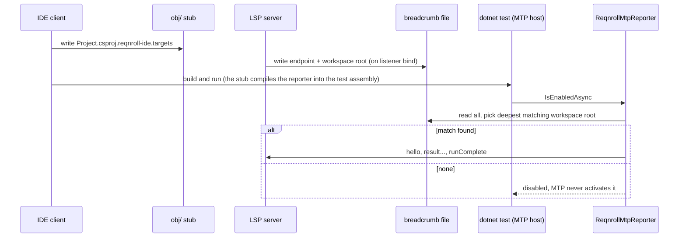
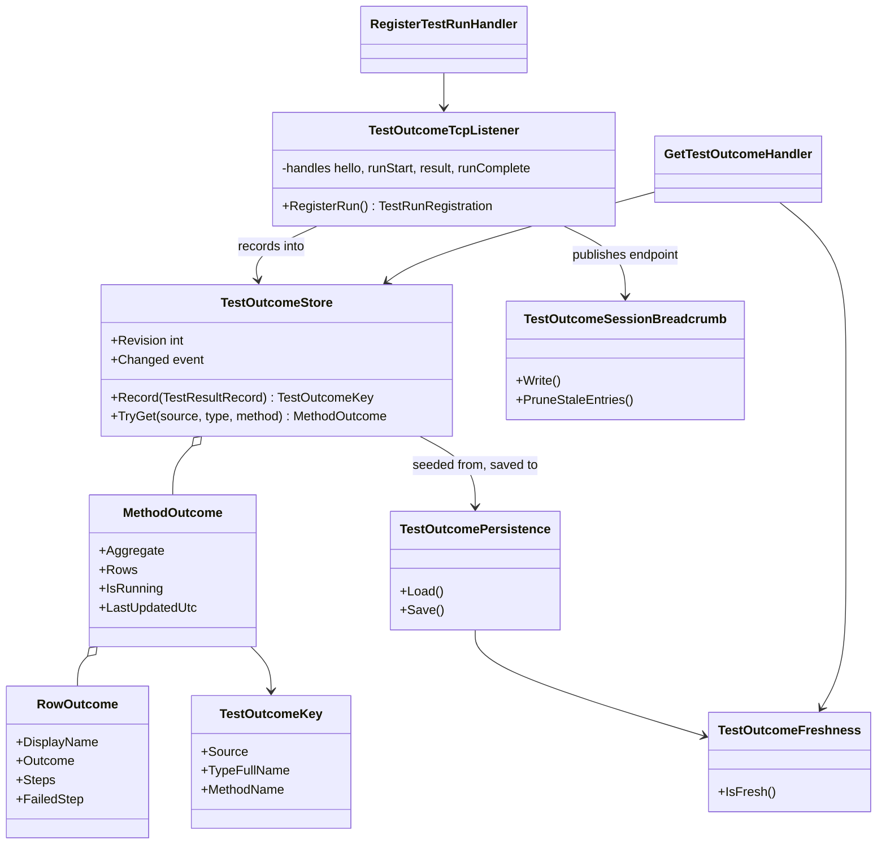

# Test Outcomes Pipeline

**Status:** Implemented. Describes the system as it is; verify against the source files named in each section.
**Audience:** Maintainers and agents working on Run CodeLens glyphs, the test logger or reporter, or the LSP server's test-outcome features.

## 1. Purpose and scope

This is the path by which a pass/fail result from a real test run reaches the Run CodeLens on a
`.feature` file in Visual Studio, Rider and VS Code. For how a scenario maps to a generated test method,
and how the Run/Debug affordance itself works, see
[Test-Runner-Integration-Design.md](Test-Runner-Integration-Design.md).

It provides:

- Live and last-run pass/fail on every Scenario and Scenario Outline line, with a per-example-row
  breakdown and the first failing step.
- Results taken from the standard test pipelines (VSTest and Microsoft.Testing.Platform, "MTP"), not from
  an IDE-internal test API, so all three IDEs observe results the same way.
- A design that runs out of process from the user's test run and never slows or fails it.

It does not provide outcomes for a terminal `dotnet test` run when no IDE session exists to hear it,
native Test Explorer presence in Rider or VS Code, or any change to the user's test project or to Reqnroll itself.

## 2. Overview

One implementation serves every IDE: the receiver, store and persistence live in the LSP server. Each IDE
contributes only (a) getting a reporter into the test run and (b) rendering the answer. The logger and
reporter are loaded into the user's own test process, so they reference almost nothing
(`Microsoft.TestPlatform.ObjectModel` or `Microsoft.Testing.Platform` only) and carry no JSON library.
`TestReporter.Common` exists so that sharing code between them does not drag the Gherkin, Roslyn or
Newtonsoft dependencies of `Reqnroll.IdeSupport.Common` into that process.

## 3. Flows

### 3.1 A VSTest run triggered from Visual Studio

Rider follows the same shape, with `RunTestRunner` adding `--test-adapter-path` and `--logger` to its own
`dotnet test` command line in place of the runsettings hook, and polling `getOutcome` after the process exits.
VS Code registers once per activation instead of per run (§6.2).

### 3.2 An MTP run

## 4. Glossary

| Term | Meaning here |
|---|---|
| **Outcome** | The result of a test case: `Passed`, `Failed`, `Skipped`, `NotFound` or `None`. |
| **Row** | One test case of a generated method. A Scenario Outline produces one row per example. |
| **Aggregate** | A method's single outcome derived from its rows (§6.3). |
| **Container** | The compiled test assembly (`TestCase.Source`). The first part of the key. |
| **Managed name** | vstest's row-invariant `ManagedType`/`ManagedMethod`; the method carries a parameter signature that is stripped. |
| **VSTest logger** | `ReqnrollIdeTestLogger`, an `ITestLoggerWithParameters` that vstest loads in the runner process. |
| **MTP reporter** | `ReqnrollMtpReporter`, a Microsoft.Testing.Platform extension compiled into the test project. |
| **Run registration** | The `Endpoint` and `RunId` the server hands out via `registerRun`. |
| **Endpoint** | `127.0.0.1:<port>` of the server's outcome listener. |
| **Breadcrumb** | A per-server JSON file recording its endpoint and workspace root, so an MTP reporter can find it. |
| **Stub** | The project-local `obj/<Project>.csproj.reqnroll-ide.targets` that wires the MTP reporter into one project. |
| **Step trace** | The per-step lines Reqnroll writes to test output; parsed to find the first failing step. |
| **Stale** | The container was rebuilt after the outcome was recorded; the outcome describes old code. |
| **Aged out** | Not updated for 2 hours and not running; treated as not found. |
| **Bridge** | `RunTestOutcomeBridge`, the Visual Studio-only reflection fallback that reads VS's own Test Explorer store. |
| **Design mode** | vstest's long-lived `vstest.console` that Test Explorer reuses across runs. |

## 5. Key classes

| Class | Location | Responsibility |
|---|---|---|
| `ReqnrollIdeTestLogger` | `src/Core/Reqnroll.IdeSupport.TestLogger` | VSTest logger; turns vstest events into NDJSON. Inert without an `Endpoint`. |
| `ReqnrollMtpReporter` | `src/Core/Reqnroll.IdeSupport.TestReporter.MTP` | MTP session handler and data consumer; same wire format; finds the server through breadcrumbs. |
| `OutcomeSink`, `NdjsonWriter` | `…TestReporter.Common` | Hand-written JSON writer and fire-and-forget TCP/file sink shared by both reporters. |
| `SessionBreadcrumbMatcher`, `WorkspaceRootLocator`, `SessionsDirectory` | `…TestReporter.MTP` | Reporter-side breadcrumb discovery (deepest workspace match wins). |
| `Reqnroll.IdeSupport.TestReporter.MTP.targets` | `…TestReporter.MTP/build` | MSBuild gate and source injection for the MTP reporter. |
| `TestOutcomeTcpListener` | `src/LSP/…LSP.Server/Features/TestOutcomes` | Loopback receiver; feeds the store; debounced `changed` push. |
| `RegisterTestRunHandler`, `GetTestOutcomeHandler` | same | The `registerRun` and `getOutcome` requests. |
| `TestOutcomeStore`, `TestOutcomeKey`, `MethodOutcome`, `RowOutcome` | `src/LSP/…LSP.Core/TestOutcomes` | Aggregation by method; row upsert; revision counter. |
| `TestOutcomePersistence`, `TestOutcomeFreshness` | same | Cross-session file; one rule for "container rebuilt". |
| `TestOutcomeSessionBreadcrumb` | same | Writes, prunes and deletes the server's breadcrumb. |
| `StepTraceParser` | `src/Core/…Common/TestOutcomes` | Step trace → per-step outcomes and first failing step. |
| `ReqnrollTestLoggerRunSettingsService`, `TestLoggerActivationRules`, `TestLoggerRunSettings` | `src/VisualStudio/…VSSDKIntegration/TestLogger` | VS run-settings hook; when to inject; how to merge. |
| `RunTestOutcomeService` | `src/VisualStudio/…Extension/TestOutcomes` | VS client for `registerRun` and `getOutcome`. |
| `RunTestCodeLensCallbackListener`, `RunTestCodeLensDataPoint`, `RunTestCodeLensRedirect`, `RunTestOutcomeBridge` | `src/VisualStudio/…VSSDKIntegration/RunTestCodeLens` | VS lens: server-first lookup, bridge fallback, refresh on change. |
| `TestOutcomesChangedInterceptor` | `src/VisualStudio/…Extension/LspInterception` | Forwards the `changed` push to the lens. |
| `MtpProjectStubs`, `MtpProjectStubSolutionListener` | VS `…VSSDKIntegration/TestReporter`, `…Extension/TestOutcomes`; Rider `MtpProjectStubs.kt`; VS Code `mtpProjectStubs.ts` | Keep each Reqnroll project's `obj/` stub in sync. |
| `RunTestRunner`, `RunLensSupport` | `src/Rider/…/testrunner` | Rider `dotnet test` invocation and lens. |
| `testOutcomesService.ts`, `runSettingsInjector.ts`, `testOutcomeCodeLens.ts` | `src/VSCode/src/testOutcomes` | VS Code registration, runsettings merge, read-only lens. |

## 6. Contracts and behaviour

### 6.1 Wire format (reporter → server)

Newline-delimited JSON over one TCP loopback connection, UTF-8. The reporter sends; the server never
replies. Unknown fields are ignored on both sides, and `hello.protocol` (currently `1`) is bumped only for
incompatible changes. Field names are the contract; see `OutcomeSink`, `ReqnrollIdeTestLogger` and
`ReqnrollMtpReporter` for the exact set.

| Message | Meaning | Notable fields |
|---|---|---|
| `hello` | Connection opened | `protocol`, `runId`, `reporterKind` (`VSTestLogger` or `MTP`), `runnerPid`, `idePid`, `targetFramework` |
| `runStart` | VSTest only. Run begins | `testCount`, `sources`, `tests` (identities, used to mark methods as running) |
| `result` | One per test case (one per Scenario Outline example row) | `source`, `managedType`, `managedMethod`, `fqn`, `displayName`, `outcome`, `durationMs`, `errorMessage`, `stdout`, `stdoutTruncated` |
| `runComplete` | Run finished | `executed`, `aborted`, `canceled`, `elapsedMs` |

`stdout` carries Reqnroll's step trace, capped at 64 KB and flagged when truncated. A connection that
closes without `runComplete` is treated as an aborted run. MTP never sends `runStart` (it does not hand a
reporter the test list up front), so MTP-sourced runs show final results but no "running" state.

### 6.2 Getting a reporter into the test run

**VSTest: per-run registration.** The IDE asks the server for a run registration
(`reqnroll/testOutcomes/registerRun` → `Endpoint`, `RunId`) and passes it to the logger as parameters.

- **Visual Studio.** `ReqnrollTestLoggerRunSettingsService` is an `IRunSettingsService` MEF export. For
  each *execution* request it merges `TestAdaptersPaths` (the VSIX's bundled `TestLogger\` directory) and a
  `ReqnrollIde` `<Logger>` into the effective runsettings. Discovery requests, runs with no `Reqnroll.dll`
  beside any container, and a missing bundled logger all inject nothing. The kill switch is the environment
  variable `REQNROLL_IDE_DISABLE_TEST_LOGGER` (anything other than empty, `0` or `false` disables).
- **Rider.** `RunTestRunner` owns the `dotnet test` invocation. In VSTest mode it adds
  `--test-adapter-path <bundled logger dir>` and `--logger "ReqnrollIde;Endpoint=…;RunId=…"` next to its
  existing TRX logger. After the process exits it polls `getOutcome` per target method (bounded), because
  the final `runComplete` may not have been processed yet. If registration, bundling or polling fails it
  falls back to the TRX result.
- **VS Code.** C# Dev Kit, not this extension, launches the tests. The extension registers once per
  activation and points the shared setting `dotnet.unitTests.runSettingsPath` at a generated runsettings file
  that merges the logger into the user's own file. It is opt-in via `reqnroll.testOutcomes.enabled` because it
  changes a `dotnet.*` setting shared with C# Dev Kit and persisted in the workspace's `.vscode/settings.json`.
  The generated file is named per workspace, and turning the option off restores the setting's prior value.

**MTP: source-injected reporter and breadcrumb discovery.** MTP has no per-run configuration channel, so
the reporter discovers the server itself.

1. **Injection.** Each IDE writes a project-local stub, `obj/<Project>.csproj.reqnroll-ide.targets`, for
   Reqnroll projects. MSBuild imports it through the standard
   `$(MSBuildProjectExtensionsPath)$(MSBuildProjectFile).*.targets` wildcard, so only that project is
   affected: no per-user MSBuild drop, environment variable or project-file edit.
2. **Gating.** The stub imports `Reqnroll.IdeSupport.TestReporter.MTP.targets`, which decides at build time,
   from evaluated properties and resolved references, whether to act. It requires a Reqnroll reference, C#, a
   test host, an MTP opt-in, .NET 8 or later, a minimum `LangVersion`, and a Microsoft.Testing.Platform
   version in `[2.0.0, 3.0.0)`. A project failing a gate gets nothing and a low-importance build message
   naming the reason. Set `ReqnrollIdeSupportDisableMtpReporter=true` to opt out.
3. **Compile from source.** The reporter's source files are copied into the project's intermediate directory,
   compiled into its own test assembly, and registered with a `TestingPlatformBuilderHook` item.
4. **Discovery.** The server writes `<Reqnroll app dir>/test-outcomes/sessions/<pid>.json` holding its
   listener endpoint and workspace root. At test start the reporter resolves its own workspace root, reads the
   breadcrumbs, and connects to the one whose workspace root is the deepest ancestor of its own. With no
   match it disables itself in `IsEnabledAsync`, so MTP never activates it; a failed connect leaves it
   inert. Breadcrumbs of dead processes are pruned on write, and a clean shutdown deletes its own.

### 6.3 Server behaviour

**Key.** `TestOutcomeKey = (normalized source path, managed type, method name without signature)`. The path
goes through `PathUtils.NormalizeForComparison` and compares case-insensitively. `source` is the compiled
test container, the same value the CodeLens side looks up (`ScenarioTestTarget.OutputAssemblyPath`).

**Store.** Each method holds its rows, upserted by display name, so a run filtered to one example row does
not erase the other rows' last-known state. Aggregate: `Failed` if any row failed, else `Passed` if any
passed, else `Skipped`, else the rows' own value. Step traces are parsed into per-step outcomes on ingest and
the raw stdout is dropped. The store is thread-safe and exposes a monotonic `Revision`.

**Change push.** After results arrive the listener debounces by 250 ms and sends
`reqnroll/testOutcomes/changed`; the client re-requests what it shows. `runComplete` clears "running" marks
immediately. Running marks are keyed by a per-connection id (`<runId>/<seq>`) minted on `hello` (pitfall 3).

**Lookup (`getOutcome`).** Returns `found`, the aggregate, per-row detail (outcome, duration, error, step
count, first failing step), `isRunning` and `isStale`.

- **Stale:** found and flagged stale. Clients render no glyph rather than an out-of-date green.
- **Aged out:** reported as not found, because a run the store never saw may have happened since.

**Persistence.** One JSON file shared by every IDE and server instance,
`%LOCALAPPDATA%\Reqnroll\test-outcomes.json` (override: `REQNROLL_TEST_OUTCOMES_PATH`). Entries whose
container was rebuilt are dropped on load, and entries older than 30 days on save. Saves merge with what is
on disk (newest wins) and write via temp file and replace.

### 6.4 Client rendering

- **Visual Studio.** The out-of-process `RunTestCodeLensDataPoint` asks the devenv process (through
  `RunTestCodeLensCallbackListener`) for the server's answer first. If the server has no entry it falls back
  to the bridge. A stale server entry yields no glyph and does *not* consult the bridge. A Feature or Rule
  lens combines its methods worst-first: running, then any failure, then unresolved (no glyph), then skipped,
  then passed. On the `changed` push, `RunTestCodeLensRedirect.NotifyOutcomesChanged()` bumps
  `OutcomeRevision` (folded into each lens tag's descriptor) and refreshes the tagger so CodeLens re-creates
  the data points.
- **Rider.** `RunTestRunner` and `RunLensSupport`; row detail and the failing step appear in the lens tooltip.
- **VS Code.** A read-only CodeLens on Scenario and Outline lines with a no-op command, so it adds no
  competing Run affordance next to C# Dev Kit's. Positions come from `textDocument/documentSymbol`; it
  refreshes on `testOutcomes/changed`. It exists because C# Dev Kit annotates the generated `.cs` method,
  never the `.feature` line, and has no notion of an outline row.

## 7. Pitfalls and design decisions

1. **Do not key on `FullyQualifiedName`.** NUnit bakes `TestCase` arguments into row FQNs. The managed names
   are row-invariant; strip the `(…)` signature from the method. That is safe because Reqnroll never
   generates overloaded scenario methods in a feature class.
2. **`AddRunSettings(Execution)` is called twice per Run click** in Visual Studio, and vstest in design mode
   initializes the logger two or three times per run, only one of which sends `runStart`. Never assume one
   call or one connection per run, and never mutate state per call.
3. **`runId` is a correlation id only.** VS Code registers once per session and bakes the id into a static
   runsettings file, and idle logger instances close sockets at arbitrary times. Keying running marks by
   `runId` let an idle instance's disconnect clear the real run's marks. Hence the per-connection key; idle
   drops are logged at Verbose.
4. **No per-connection secret on the listener.** A single-use token was tried and removed. The token
   travelled to the runner inside the same runsettings file that names the port, so it never raised the bar
   above "a local process", and being single-use it rejected every connection after the first in VS Code. The
   loopback bind is the whole trust boundary: any local process can post outcomes to one IDE instance. Do not
   reintroduce a token without solving the multi-connection case.
5. **TCP loopback, not a named pipe.** The JVM has no first-class Windows named-pipe client, and one transport
   for all three IDEs is worth more than platform idiom. Loopback binds do not trigger firewall prompts.
6. **VS `AddRunSettings` is synchronous.** `registerRun` is a cross-process call, so it is awaited with
   `JoinableTaskFactory.Run` and bounded by a 5 s timeout; on timeout nothing is injected for that run. A
   pre-fetched pool of registrations would avoid blocking but adds pool and race handling; the bounded block
   was chosen deliberately.
7. **Invalidate the tagger, not the whole redirect.** `RunTestCodeLensRedirect.InvalidateAll()` also drops the
   resolved-target cache and re-triggers the unbatched `resolveTestTargets` round trips. Use
   `NotifyOutcomesChanged()`.
8. **One path-normalization routine.** Mismatched normalizations between `TestCase.Source` and the
   CodeLens-side output path cause silent "no outcome". Always use `PathUtils.NormalizeForComparison`.
9. **Rider and `dotnet test` modes differ.** Under MTP, `--logger` and `--test-adapter-path` are silently
   ignored (compat mode) or fatal with exit code 5 (native mode), and even `--nologo` derails the run. Add
   them only for VSTest mode. Run `dotnet test` with the project directory as working directory, or the
   `global.json` MTP opt-in is not found.
10. **The MTP reporter is compiled from source, not shipped as a DLL.** A prebuilt reporter pinned to one
    Microsoft.Testing.Platform version produced MSB3277/CS1705 version conflicts and runtime type-load
    failures. Compiling against the project's own version removes the second copy.
11. **The stub lives in `obj/`.** It is project-local, normally git-ignored, survives `dotnet clean`, and is
    rewritten when `obj/` is deleted. Known gap: VS may keep an evaluation from before the stub existed, so
    the first build after a stub is first written can run without the reporter.
12. **The reporter must never fail a run.** Connect with a short timeout; on any socket error stop sending;
    with no endpoint stay inert (a hand-written runsettings naming the logger must not break a run).
13. **Stale and aged-out are different states.** Stale means known-wrong, so the client shows nothing and
    skips its fallback. Aged-out means "no longer vouched for", so the client's fallback may know more.
14. **The bridge is a fallback, not the source.** `RunTestOutcomeBridge` reads VS-internal types by reflection
    and is blind to outline rows; it remains for runs the pipeline did not see.
15. **xml2js root quirk (VS Code runsettings merge).** `parseStringPromise` with `explicitArray: true` wraps
    every descendant in a one-item array but returns the root bare; code that rebuilds the document must
    handle that asymmetry.

## 8. Known limitations

- Outcomes appear only for runs an IDE session can hear: terminal VSTest runs have no endpoint. Terminal MTP
  runs report if a matching breadcrumb exists.
- MTP-sourced runs have no "running" state (§6.1).
- MTP projects on .NET Framework or an unsupported Microsoft.Testing.Platform version get no reporter (§6.2).
- The first build after a stub appears may be uninstrumented (pitfall 11).

## 9. Testing

| Layer | Where |
|---|---|
| Logger, writer and transport; end-to-end through a real `dotnet test` on a fixture project | `tests/Core/Reqnroll.IdeSupport.TestLogger.Tests` (fixture: `tests/Core/TestLoggerFixtures/MsTestReqnroll`) |
| MTP reporter and fixture | `tests/Core/TestReporterFixtures/MsTestReqnrollMtp` |
| Store, key, freshness, persistence, handlers, listener, breadcrumb | `tests/LSP/Reqnroll.IdeSupport.LSP.Server.Tests/Features/TestOutcomes/` |
| Step-trace parsing | `tests/Core/Reqnroll.IdeSupport.Common.Tests/TestOutcomes/` |
| Runsettings merge and activation rules | `tests/VisualStudio/Reqnroll.IdeSupport.VisualStudio.Tests/TestLogger` |
| VS Code runsettings, paths, stubs, CodeLens | `src/VSCode/src/test/testOutcomes/` |
| Latency targets for `registerRun`, `getOutcome`, `changed` | `tests/Performance/…Benchmarks.Core` (`PerfTargets.cs`) |

Behaviour that crosses real IDE processes (the VS in-proc/out-of-proc CodeLens hop, Rider's polling, C# Dev
Kit launching a run) is not covered by the automated suite and needs a live check when touched.
