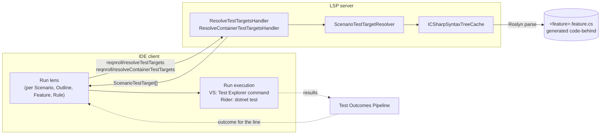
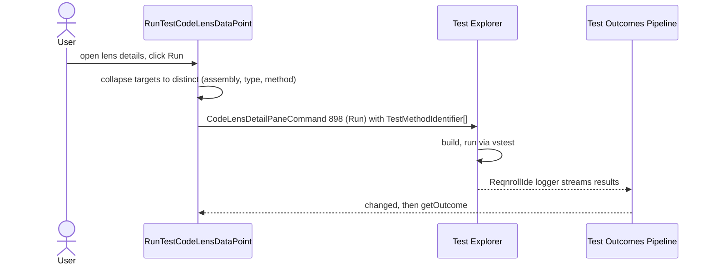
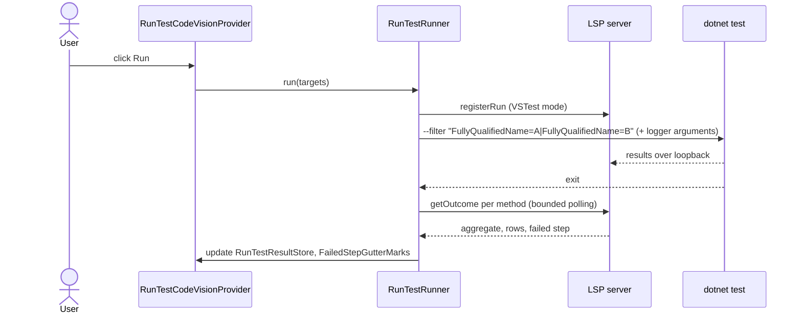
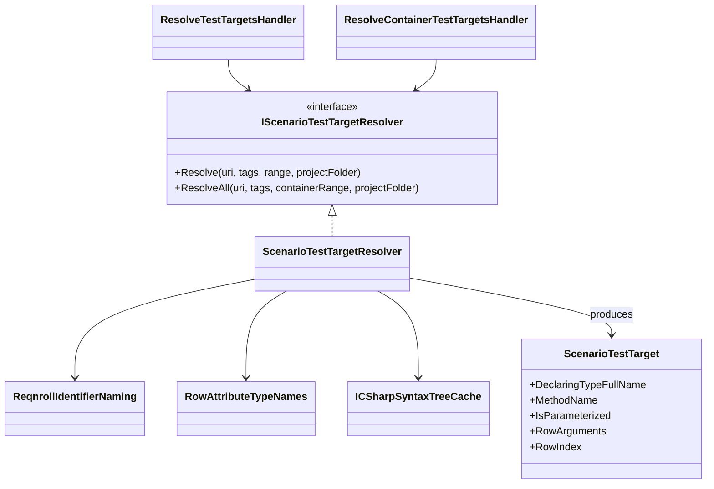

# Test Runner Integration

**Status:** Implemented. Describes the system as it is; verify against the source files named in each section.
**Audience:** Maintainers and agents working on scenario→test-method resolution, the Run/Debug CodeLens, or running scenarios from an IDE.

## 1. Purpose and scope

Every IDE needs to answer one question for a `.feature` file: *which generated C# test method does this
scenario (or Scenario Outline example row) correspond to?* This document covers:

1. The **mapping layer**, which resolves a scenario to its generated test method(s). It is built once in the
   LSP server and shared by all IDEs.
2. The **Run (and, in Visual Studio, Debug) affordance** on each Scenario, Scenario Outline, Feature and Rule line, per IDE.
3. How a run's **result** (pass/fail, first failing step) is recognised. The transport and storage of results is in
   [Test-Outcomes-Pipeline.md](Test-Outcomes-Pipeline.md).

LSP has no run/debug/test-result vocabulary, so only the mapping layer is an LSP feature; everything else is IDE glue.

Out of scope: breakpoints in `.feature` files (a separate, unbuilt feature); a native Test Explorer tree
entry for scenarios in VS Code or Rider (see pitfalls 6 and 7).

| IDE | Run | Debug | Pass/fail on the line |
|---|---|---|---|
| Visual Studio | CodeLens that invokes Test Explorer's own Run command | Same, Debug command | Yes (outcomes pipeline) |
| Rider | Inline CodeVision lens that shells to `dotnet test` | No | Yes, plus failed-step gutter mark |
| VS Code | None of its own: C# Dev Kit provides Run/Debug | None | Read-only CodeLens (opt-in; outcomes pipeline) |

## 2. Overview



The resolver reads the generated code-behind with Roslyn instead of re-implementing Reqnroll's naming
rules (pitfall 1). Resolution is therefore possible only after the project has been built at least once.

## 3. Flows

### 3.1 Resolving a lens

```mermaid
sequenceDiagram
    participant LENS as Run lens (client)
    participant H as ResolveTestTargetsHandler
    participant R as ScenarioTestTargetResolver
    participant C as ICSharpSyntaxTreeCache
    participant F as Project.feature.cs

    LENS->>H: reqnroll/resolveTestTargets (uri, range)
    H->>R: Resolve(uri, tags, range, projectFolder)
    R->>R: find scenario tag at range, compute class and method names
    R->>C: get syntax tree of .feature.cs
    C->>F: read if last-write time changed
    C-->>R: tree
    R->>R: find exact-name method, or name-prefix methods; count row attributes
    R-->>H: ScenarioTestTarget[]
    H-->>LENS: targets (empty if not yet built)
```

### 3.2 Running from Visual Studio



### 3.3 Running from Rider



## 4. Glossary

| Term | Meaning here |
|---|---|
| **Test target** | `ScenarioTestTarget`: one generated method (or one row of a parameterized method) a scenario resolves to. |
| **Generated code-behind** | `<feature>.feature.cs`, written by Reqnroll's generator at build time. Co-located with the feature, or under `obj/` when the project moves it. |
| **Row-tests mode** | A Scenario Outline becomes one parameterized method with one row attribute per `Examples:` row. The default. |
| **Individual-methods mode** | A Scenario Outline becomes one method per example row (`allowRowTests` off, or a provider without row support). |
| **Template method** | In individual-methods mode, the attribute-less public parameterized method named exactly like the Outline. Not a test. |
| **Row attribute** | The per-row attribute: `InlineData`, `TestCase`, `Arguments` or `DataRow`. |
| **Container** | A `Feature:` or `Rule:` block, resolved as a whole for "Run Scenarios". |
| **Step trace** | Reqnroll's default per-step stdout lines (`-> done:`, `-> error:`, …). |
| **`#line hidden` region** | Generated code after each step's `#line` pragma; the reason stack traces point at the wrong step (pitfall 4). |
| **Own execution** | The client runs `dotnet test` itself (Rider), as opposed to delegating to a native runner (Visual Studio). |

## 5. Key classes



| Class | Location | Responsibility |
|---|---|---|
| `IScenarioTestTargetResolver`, `ScenarioTestTargetResolver` | `src/LSP/…LSP.Core/TestTargets` | Maps a range (scenario, outline, example row, or container) to targets by parsing the code-behind. |
| `ScenarioTestTarget` | same | The result record. |
| `ReqnrollIdentifierNaming` | same | Port of Reqnroll's `ToIdentifier()` and variant-name rules. |
| `RowAttributeTypeNames` | same | The four row-attribute type names, as one union. |
| `ICSharpSyntaxTreeCache` | `src/LSP/…LSP.Core/Parsing/CSharp` | Shared parse cache with last-write-time freshness; also used by rename. |
| `ResolveTestTargetsHandler`, `ResolveContainerTestTargetsHandler` | `src/LSP/…LSP.Server/Features/TestTargets` | The two LSP requests. |
| `RunTestCodeLensService`, `ScenarioTestTargetService` | `src/VisualStudio/…Extension/RunTestCodeLens`, `…/TestTargets` | VS: symbol-tree walk and per-line resolution. |
| `RunTestCodeLensTaggerProvider`, `RunTestCodeLensDataPoint`, `TestExplorerCommandIds` | `src/VisualStudio/…VSSDKIntegration/RunTestCodeLens` | VS: tag placement, lens details, Run/Debug/Show-in-Test-Explorer commands. |
| `RunTestCodeVisionProvider`, `RunLensSupport`, `RunTestTargetCache`, `RunTestRunner`, `RunTestResultStore`, `FailedStepLocator`, `FailedStepGutterMarks` | `src/Rider/src/main/kotlin/…/testrunner` | Rider: lens, target memoization, `dotnet test` execution, results, failed-step mark. |

## 6. Generator naming rules

These were established by decompiling `Reqnroll.Generator` (`UnitTestMethodGenerator`,
`UnitTestFeatureGenerator`, each framework's generator provider) and checking against generated
`.feature.cs` files. They are the ground truth the resolver's naming code must match.

**Regular scenario.** Method name is `scenario.Name.ToIdentifier()`. The `DisplayName` carries the title
verbatim. Each step statement is wrapped in a `#line N "File.feature"` pragma at the step's real line.

**Scenario Outline, row-tests mode.** One method named `outline.Name.ToIdentifier()`; its `DisplayName` is the
outline title for every row, so a row has no name of its own. Row identity exists only in the row attribute's
argument values. The step pragmas point at the outline's own step lines.

**Scenario Outline, individual-methods mode.** One method per example row, named
`{outline.Name.ToIdentifier()}_{exampleSetIdentifier}_{variantName.ToIdentifier()}`:

- `variantName` is the row's first cell value if first-cell values are unique across the `Examples:` block,
  otherwise `Variant {index}` (0-based).
- `exampleSetIdentifier` is the `Examples:` block's `Name:` if given; omitted entirely for exactly one unnamed
  block; `ExampleSet {n}` for several unnamed blocks.
- `DisplayName` is `{scenario title}: {variantName}`.

In both modes there is also an attribute-less public **template method** named like the Outline, which is not
a test.

**Which mode.** The generator passes `provider.GetTraits().HasFlag(RowTests) && config.AllowRowTests`. The
resolver does not evaluate this; the exact-name-method versus `Name_…` shape in the generated file is the
outcome (pitfall 2).

**Declaring class.** `{feature.Name.ToIdentifier()}Feature`. The namespace comes from the MSBuild code
generation, normally the project's root namespace plus the relative folder.

**Row attribute per provider.** Each is simply counted; none is parsed for arguments.

| Framework | Row attribute | Method attribute |
|---|---|---|
| xUnit (v2) | `Xunit.InlineDataAttribute` | `Xunit.SkippableTheoryAttribute` |
| xUnit.v3 | `Xunit.InlineDataAttribute` | `Xunit.TheoryAttribute` |
| NUnit3 | `NUnit.Framework.TestCaseAttribute` | `NUnit.Framework.TestAttribute` |
| TUnit | `TUnit.Core.ArgumentsAttribute` | `TUnit.Core.TestAttribute` and `DisplayNameAttribute` |
| MSTest | `…UnitTesting.DataRowAttribute` | `TestMethodAttribute` |

MSTest quirk: for a single-column `Examples:` table the generator inserts an unused dummy `string` parameter
ahead of the tags parameter, so its row has a different parameter count than other frameworks. The resolver
does not depend on this.

**AST-transforming generator plugins (for example `Reqnroll.ExternalData`).** Such a plugin injects
`Examples:` rows (read from an external file) into the in-memory AST after parsing and before code generation.
The `.feature` file can therefore show zero rows or no `Examples:` block at all, and even a plain `Scenario:`
with the plugin's tag can generate a fully parameterized row-tests method. The LSP server's own Gherkin parse
never sees the injected rows.

## 7. Mapping layer

### 7.1 Resolution rules

`ScenarioTestTargetResolver` locates the generated class, then resolves each scenario tag against it:

- **Row-tests mode:** the exact-name method exists and carries at least one attribute. One target per row
  attribute, sharing `MethodName`, distinguished by `RowIndex`; `IsParameterized` is true.
- **Individual-methods mode:** the exact-name method is absent or attribute-less (the template), so the
  `{name}_…` prefix methods are the targets, one per row.
- **Plain scenario:** exactly one target.
- **Not yet built / no code-behind:** no targets.

The code-behind is found next to the feature file, falling back to the `obj/` location Reqnroll 3.3.0+ uses
when `GenerateFeatureFileCodeBehindInProjectDirectory` is false (hence the `projectFolder` parameter).

**Row counting is positional.** The generator emits row attributes in `Examples:` document order, once per row,
with no reordering, so the Nth row attribute is the Nth example row. The resolver counts row attributes from
the union of the four names (`RowAttributeTypeNames.All`) and never parses their arguments. `RowArguments` is
filled only by correlating that position with the `.feature` file's own example rows, and stays null when the
row has no visible `.feature` counterpart (the ExternalData case).

**Row selection.** Resolving at a specific example row returns just that row's target. In row-tests mode this
is the same method with a different `RowIndex`; nothing runs "just that row" (pitfall 5).

### 7.2 Container resolution ("Run Scenarios")

`ResolveAll(containerRange)` resolves every Scenario and Scenario Outline tag fully contained in a Feature's or
Rule's **full body range** (not its header line or selection range), including scenarios nested in a Rule when
the range is the Feature's. `Background:` blocks are excluded. Each contained scenario contributes exactly what
`Resolve` would give for it, always with no specific row selected. Both requests share one private
`ResolveScenarioTag` helper, so a target looks identical whichever request produced it.

The Visual Studio client checks for a Scenario or Outline on a line first and only then walks the symbol tree
for Feature (`SymbolKind.Module`) and Rule (`SymbolKind.Namespace`) nodes. Container targets are marked as
outline-style so the lens label reads "Run Scenarios". Because the target shape is unchanged, the lens data
point and Test Explorer path need no container-specific code.

### 7.3 Cost model

A file with thousands of scenarios must not be re-parsed or re-resolved per scenario.

- All resolutions go through the shared `ICSharpSyntaxTreeCache`, which re-reads a file only when its
  last-write time changes. This also makes caching safe across a rebuild without a file watcher.
- Clients resolve only what is visible:
  - **Visual Studio.** `RunTestCodeLensService.GetTagLocationsAsync` walks only the symbol tree (no
    resolution) to place tags; `GetTargetsForLineAsync` resolves a single line on demand from that line's data
    point.
  - **Rider.** `CodeVisionProvider` has no visible-range or per-entry-resolve hook, so every recompute walks the
    whole symbol tree. `RunTestTargetCache` memoizes each `(uri, line)` result by an identity string (scenario
    kind plus name) so only changed scenarios issue a request. It is cleared on `reqnroll/refreshCodeLens`, which
    also fires when a `[Binding]` method changes in a `.cs` file.

## 8. LSP messages

| Direction | Method | Params → result |
|---|---|---|
| Client → server | `reqnroll/resolveTestTargets` | `uri`, `range` → `ScenarioTestTarget[]` |
| Client → server | `reqnroll/resolveContainerTestTargets` | `uri`, `range` (a container's full body) → `ScenarioTestTarget[]` |

Names are in `CustomLspMethodNames.cs`; payloads are in [LSP-Protocol-Extensions.md](LSP-Protocol-Extensions.md).
These are plain custom requests with no registration options. The container request is a separate handler so
the per-scenario path is unaffected by the broader query.

## 9. Run and Debug per IDE

### 9.1 Visual Studio

Visual Studio's own run/debug/pass-fail affordance for ordinary tests is itself a classic CodeLens data-point
provider. The Reqnroll lens therefore reuses that API family (an in-process `ITaggerProvider` plus an
out-of-process `IAsyncCodeLensDataPointProvider`, scoped to the `Gherkin` content type) rather than a separate
editor-margin extension point. Run and Debug are not implemented by the extension: the details popup emits a
`CodeLensDetailPaneCommand` against Test Explorer's own commands (`TestExplorerCommandIds`: Run 898, Debug 899,
Show in Test Explorer 904, command set `1E198C22-5980-4E7E-92F3-F73168D1FB63`), with a `TestMethodIdentifier[]`
built from the targets (output assembly path, normalized FQN, managed type, managed method). Test Explorer does
the actual build and run. Targets are collapsed to distinct `(assembly, type, method)` before the call, so a
row-tests Outline passes one element, and an individual-methods Outline or a Feature/Rule container passes N.
Pass/fail comes from the [outcomes pipeline](Test-Outcomes-Pipeline.md).

### 9.2 Rider

The lens is a `CodeVisionProvider`, because the plugin registers `.feature` with no PSI tree and
`RunLineMarkerContributor` is PSI-based. It renders inline with ▶/✓/✗ glyphs, not as a gutter icon.
`RunTestRunner` owns execution: it runs `dotnet test --filter` against the targets, ORing one exact
`FullyQualifiedName=` term per distinct method (`buildTestFilter`; a row-tests Outline collapses to one term).
It runs in the project directory (so `global.json` is found) and varies its arguments by `DotnetTestMode`
(`VS_TEST`, `MTP_COMPAT`, `MTP_NATIVE`); details are in the outcomes pipeline. There is no Debug action.

**Failed-step gutter mark.** The server's step-trace parser reports each failed row's first failing step.
`FailedStepLocator` maps that execution index to a `.feature` line using the `documentSymbol` tree, in the order
Reqnroll traces steps: the Feature's Background steps, then the enclosing Rule's, then the scenario's own.
`FailedStepGutterMarks` adds a `RangeHighlighter` with a red failed gutter icon and a tooltip (the traced step
plus the first line of each failed row's error) to each open editor's markup model. A Scenario Outline whose
rows fail on different steps gets one mark per distinct step. Marks are in memory, replaced on re-run, and a
file's marks are dropped on its first edit. A TRX-only fallback result has no step detail and gets no mark.

### 9.3 VS Code

The extension has no Run, Debug or `TestController` for scenarios. C# Dev Kit owns test discovery and
execution, including its gutter Run/Debug. The extension only shows the opt-in read-only outcome lens described
in the outcomes pipeline. See pitfall 6 for why.

### 9.4 Scenario Outlines

In row-tests mode "run all examples" is the same action as running a single scenario: the runner executes every
row as part of the one method. In individual-methods mode the full variant set is passed as multiple targets
(§9.1, §9.2). The resolver must return the variants, never the template method (pitfall 3).

## 10. Recognising a failed step

The failing step cannot be found from a stack trace; use the step trace instead (pitfall 4).

Reqnroll's default stdout pairs each step's keyword and text with an outcome line, in execution order, with no
`reqnroll.json` opt-in needed. `StepTraceParser` (`src/Core/…Common/TestOutcomes`) turns it into per-step
outcomes. Outcome prefixes (from `Reqnroll.Tracing.TestTracer`):

| Prefix | Meaning |
|---|---|
| `done: {match} ({duration}s)` | Step passed |
| `error: {message} ({duration}s)` | Step threw |
| `skipped: {message}` | Step explicitly skipped |
| `skipped because of previous errors` | Never ran; an earlier step failed |
| `pending: {match}: {message}` | Bound but pending |
| `binding error: {message}` | Ambiguous or otherwise unresolvable binding |
| `undefined: {skeleton}` | No binding matches the step text |

`binding error` and `undefined` have no step method at all, so there is no C# frame to attribute even in
principle. The parser's step order lines up with the `.feature` file's own step order, which the server already
has from its Gherkin parse.

## 11. Pitfalls and design decisions

1. **Read the generated code; do not predict names.** Predicting would drift silently whenever Reqnroll
   changes its sanitization or naming. The cost is that resolution needs a prior build; that is acceptable
   because there is nothing to run before one anyway. If the code-behind proved unreliable in a fresh clone,
   prediction (§6) is the fallback, but it is not the design.
2. **Never infer parameterization from the `.feature` file's shape.** A visible example-row count of zero or a
   missing `Examples:` block does not mean "plain scenario" or "no targets" (ExternalData and similar plugins).
   Always decide from the generated class. Do not detect the test framework either: the code-behind is the
   ground truth, a detection miss used to collapse a row-tests Outline to one target, and the MSTest V2/V4 split
   is moot because both emit `DataRowAttribute`.
3. **Skip the template method.** An exact-name method with no attributes is the template; the `{name}_` variants
   are the tests. Matching the template as "the" method produced a single non-test target and no variants.
4. **Do not use stack traces for step attribution.** Each step's `#line` pragma is followed by `#line hidden`,
   and the scenario's final `ScenarioCleanupAsync` call, where a caught step exception is rethrown, sits in the
   hidden region. The CLR attributes that frame to the last visible `#line`, which is always the scenario's last
   step. This misattributes the failure on every scenario whose failing step is not last, in every IDE and
   test host; click-to-navigate to the failure has the same flaw.
5. **Do not address a single Outline row.** Visual Studio's `TestMethodIdentifier` identifies a method, not a
   row. Rider's runner names a row by a formatted display string embedding the argument values, not an index.
   Both formats vary by framework and version. The lens therefore always runs the whole parameterized method.
6. **VS Code deliberately has no run mechanism of its own.** `vscode.tests` exposes only `createTestController`,
   so there is no way to read another extension's controller results. The generic `testing.runAtCursor` command
   requires a focused editor at the cursor, so triggering it from a `.feature` lens would force a visible switch
   to `.feature.cs`, and would still not return results. Owning a `TestController` instead duplicates C# Dev
   Kit's own listing of the same generated methods and added nothing its gutter and Test Explorer did not
   already provide. The accepted consequence is that C# Dev Kit's discovery reliability is its own problem.
7. **Rider has no native Unit Tests tool window integration.** Rider's .NET unit testing is not built on the
   IntelliJ `SMTRunnerEventsListener`/`SMTestProxy` mechanism. It is a Rider-specific RD-protocol system
   (`com.jetbrains.rider.unitTesting.*`) where the JVM frontend can only fire run/debug signals on sessions that
   the .NET backend (ReSharperHost) creates. A plugin cannot inject a test element from the JVM side. Native
   presence would need a separate C# ReSharper SDK backend plugin, a different project with its own build and
   packaging, so Rider keeps its own execution.
8. **Visual Studio's glyph reflection is guarded.** The Test Explorer proxy types used to read outcomes are
   `internal`, so the bridge degrades to "no glyph" on any failure and Run/Debug (public API only) is unaffected.
   See the outcomes pipeline.
9. **Do not resolve per scenario.** Re-parsing the same code-behind per call cost about 150 ms each; a 1,300-row
   file pegged a CPU core for as long as it was open. Even with a cheap resolution, resolving every scenario on
   each recompute took 30 to 45 seconds on a 2,000-scenario file, past Visual Studio's own CodeLens data-point
   timeout of about 26 seconds. Hence the shared cache and visible-only resolution (§7.3).
10. **Match the MSTest provider by its real type.** The string key `mstest` resolves to
    `MsTestV2GeneratorProvider` (or `MsTestV4GeneratorProvider`), not the `MsTestGeneratorProvider` base class
    that a type-name search finds first; that base class throws from `SetRow` and is never instantiated for a
    real project.

## 12. Known limitations

- Resolution needs a built project; before the first build the lens shows nothing.
- Visual Studio passes a multi-element `TestMethodIdentifier[]` for individual-methods Outlines and containers
  on the expectation that Test Explorer runs every element. It has been exercised for containers; if it ever
  honoured only the first element, the fallback is one command per method.
- Rider has no Debug action and no native tool-window presence.
- Breakpoints in `.feature` files are not supported. The generated `#line` pragmas mean the test assembly's PDB
  already carries `.feature`-relative sequence points, so this may be a narrow "register `.feature` as a
  breakpoint source" problem per IDE rather than a from-scratch debug adapter.

## 13. Testing

| Layer | Where |
|---|---|
| Resolver: plain scenario, row-tests Outline, individual-methods Outline (named and unnamed `Examples:`), and the ExternalData-style case of zero visible example rows, against hand-built code-behind | `tests/LSP/Reqnroll.IdeSupport.LSP.Core.Tests/TestTargets/ScenarioTestTargetResolverTests.cs` |
| Handlers: URI and range handling, absent buffer, not-yet-built, container resolution | `tests/LSP/Reqnroll.IdeSupport.LSP.Server.Tests/Features/TestTargets` |
| Step-trace parsing | `tests/Core/Reqnroll.IdeSupport.Common.Tests/TestOutcomes` |
| Rider runner, filter building, target cache | `src/Rider/src/test/kotlin/…/testrunner` |

Native-runner invocation and result-event handling in each IDE are not practically unit-testable and need a
live check when changed. Core tests build their inputs directly and avoid `VsxStubs`, which pulls in WPF.
