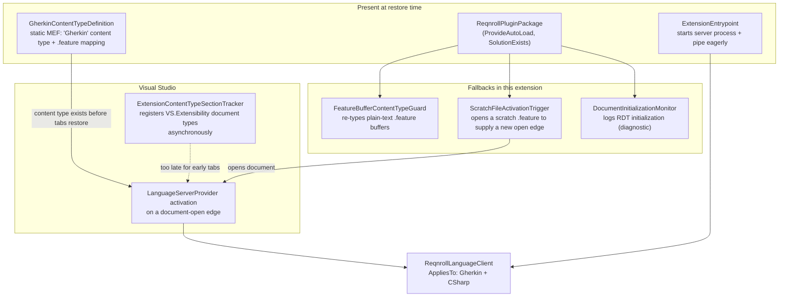
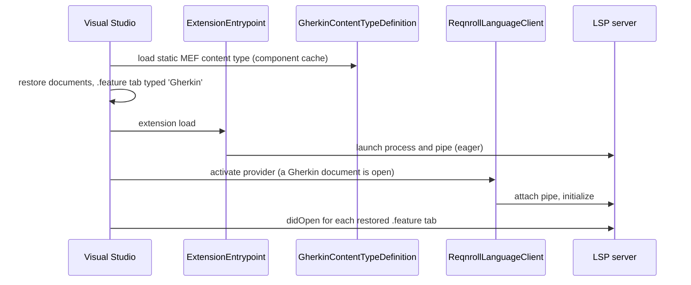
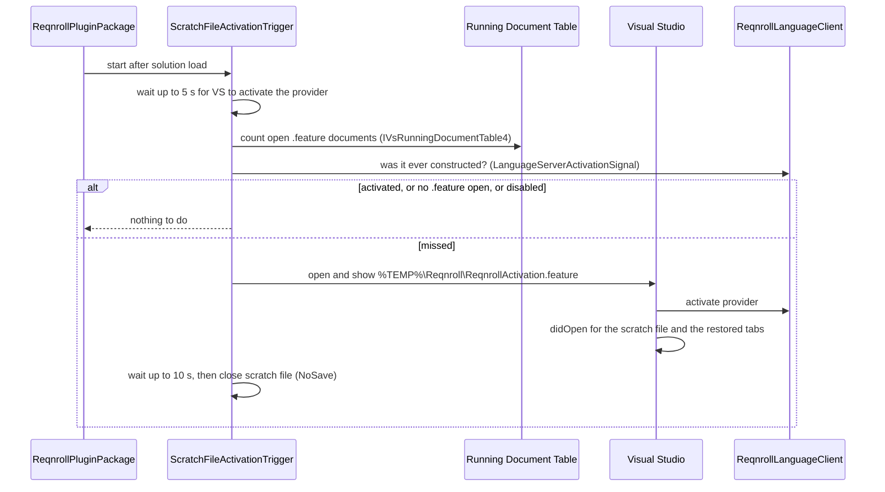

# Visual Studio LSP Activation

**Status:** Implemented. Describes the system as it is; verify against the source files named in each section.
**Audience:** Maintainers working on how and when the Visual Studio extension starts the Reqnroll language server and attaches editor features to `.feature` files.

## 1. Purpose and scope

Visual Studio only runs a VisualStudio.Extensibility `LanguageServerProvider` once a matching document is
opened, and editor features attach by content type. Both depend on a `.feature` file being recognised *as a
Gherkin document* as early as possible, including a tab Visual Studio restores from the previous session.
This document explains the mechanisms that make that happen and the ones deliberately not used.

It does not cover the server's process launch and pipe handling (see the Architecture reference) or the
language features themselves.

## 2. Overview

## 3. Flows

### 3.1 Normal start with a restored `.feature` tab

### 3.2 Missed activation: the scratch-file trigger

## 4. Glossary

| Term | Meaning here |
|---|---|
| **Activation** | Visual Studio calling `CreateServerConnectionAsync` on the `LanguageServerProvider` and running LSP `initialize`. |
| **Open edge** | The moment a document is opened. Visual Studio evaluates provider activation on this edge and does not re-evaluate already-open documents. |
| **Restored tab** | A document Visual Studio reopens from the previous session. |
| **Stub frame** | A restored document whose window frame is created in a pending-initialization state under delayed document loading. |
| **RDT** | Running Document Table: Visual Studio's registry of open documents. |
| **Content type** | The editor's document classification; taggers, classifiers, the navigation bar and LSP view features attach by `[ContentType("Gherkin")]`. |
| **Document type** | The VisualStudio.Extensibility `DocumentTypeConfiguration` form of a content type, registered asynchronously by Visual Studio. |
| **Scratch file** | A temporary empty `.feature` document opened only to create a fresh open edge. |
| **Activation signal** | `LanguageServerActivationSignal`, stored in AppDomain data so the package and the VS.Extensibility side agree even if they load separate assembly copies. |

## 5. Key classes

| Class | Location | Responsibility |
|---|---|---|
| `ReqnrollLanguageClient` | `src/VisualStudio/…Extension` | The `LanguageServerProvider`. `AppliesTo` = Gherkin and CSharp document types. Sets the activation signal in its constructor. |
| `ExtensionEntrypoint` | same | Extension configuration (in-process, deliberately no `LoadedWhen`). |
| `ReqnrollPluginPackage` | same | Autoloads on `SolutionExists`; starts the guard, trigger and monitor. |
| `GherkinContentTypeDefinition` | `src/VisualStudio/…VSSDKIntegration/Editor` | Static MEF export of the `Gherkin` content type and `.feature` mapping. |
| `FeatureBufferContentTypeGuard` | `src/VisualStudio/…Extension/Documents` | Logs each `.feature` buffer's content type and re-types plain-text ones to `Gherkin`. |
| `ScratchFileActivationTrigger`, `ActivationTriggerRules`, `ActivationTriggerDecision`, `LanguageServerActivationSignal`, `SolutionOpenState` | `src/VisualStudio/…Extension/Activation` | The fallback trigger, its decision rules, the signal, and the solution-open wait. |
| `DocumentInitializationMonitor` | `…Extension/Documents` | RDT event sink that records when a restored document becomes real. |
| `VsStubFrameInitializer` | same | Realizes stub frames *after* the server has initialized, so `didOpen` fires for background restored tabs. |

## 6. Behaviour and contracts

**Provider scope.** `AppliesTo` includes the `CSharp` document type as well as Gherkin, so a restored `.cs` tab
can open the activation gate even when the foreground tab is not a feature file. This is not extra server
traffic: the server already handles `.cs` `didOpen`/`didChange` for binding discovery. The cost is that the
provider also activates in solutions that do not use Reqnroll.

**Static content type.** `GherkinContentTypeDefinition` registers `Gherkin` (base
`code-languageserver-preview`, the same as the document type) and the `.feature` mapping as MEF exports. The
tracker reuses a same-named content type and keeps a mapping that already `IsOfType` it, so both registrations
coexist.

**Scratch-file trigger.** Started after solution load; runs at most once per session.

1. Wait up to 5 s (`GracePeriod`) for Visual Studio to activate the provider itself.
2. Require an open `.feature` document, scanning the RDT with `IVsRunningDocumentTable4` (which does not
   load stubs). Only `.feature` documents count, so it never opens a Reqnroll file in a non-Reqnroll solution.
3. Require that `ReqnrollLanguageClient` was never constructed (the activation signal).
4. Open and show `%TEMP%\Reqnroll\ReqnrollActivation.feature`, wait up to 10 s (`ActivationTimeout`), close
   with `NoSave`.

Activation applies to the whole provider, so Visual Studio then sends `didOpen` for the restored tabs too, and
the user's own document never has to be closed and reopened. Set `REQNROLL_IDE_DISABLE_ACTIVATION_TRIGGER`
(anything other than empty, `0` or `false`) to turn it off.

**Solution-open wait.** `SolutionOpenState` reads `__VSPROPID.VSPROPID_IsSolutionOpen` and returns as soon as the
solution is open, which is what the trigger's grace period is measured from.

## 7. Pitfalls and design decisions

1. **Activation is edge-triggered on document open.** On the first launch after an install or update, while
   Visual Studio rebuilds its contribution cache, an already-open `.feature` file may never activate the
   provider that session. Clicking the tab, editing, or switching windows does nothing; only a new document
   open does. That is why a fallback trigger exists.
2. **The content type must exist before tabs restore.** A VS.Extensibility document type alone is registered
   asynchronously and fire-and-forget. A tab restored before that finishes keeps the generic type for its
   whole life, so nothing keyed on `[ContentType("Gherkin")]` ever attaches: no classifier, CodeLens, navigation
   bar or LSP view features. Re-typing the buffer later (`ITextBuffer.ChangeContentType`) reaches taggers and
   classifiers but not `IVsTextViewCreationListener`s on views that already exist, so the static MEF
   registration is the primary fix and the guard is secondary.
3. **Do not use the RDT enumeration that materialises documents.** `IVsRunningDocumentTable.GetDocumentInfo`
   always creates doc data. Use `IVsRunningDocumentTable4` and `GetDocumentFlags` (`RDT_PendingInitialization`)
   to scan without forcing initialization.
4. **Do not force-activate the provider with an "invisible open", and do not realize stub frames earlier.** An
   earlier attempt raced Visual Studio's own tab restore and produced two server processes and flickering C#
   code lenses. `VsStubFrameInitializer` therefore stays passive and runs only after the server has
   initialized. (The two-server bounce itself came from handing the same pipe to a second
   `CreateServerConnectionAsync`; the connection service now returns a fresh pipe per call over one process.)
5. **Do not add `ExtensionConfiguration.LoadedWhen`.** It was tried to make extension load deterministic. It
   fixed nothing, and both deploys carrying it produced a bad first run afterwards (activation 13 s late, or
   none within the session), because the gate has to be evaluated while Visual Studio rebuilds the extension
   cache. Do not reintroduce it without a measured problem it solves.
6. **A polling loop on a nonexistent property ID costs ~10 s.** The solution-open check once read a
   `VSPROPID` value that does not exist, so it always failed and ran to its cap, delaying "solution loaded"
   and everything gated on it, including this trigger. Use `VSPROPID_IsSolutionOpen`.
7. **Cancellation must not look like "no scenario".** A `reqnroll/refreshCodeLens` invalidation that cancels an
   in-flight Run CodeLens target lookup used to be turned into an empty answer and cached as "no scenario on
   this line". The navigation-bar symbol service now surfaces cancellation and
   `RunTestCodeLensResultCache` restarts callers whose computation was invalidated.
8. **Not available in the VS.Extensibility model:** there is no public equivalent of the classic
   `ILanguageClientBroker.LoadAsync` (which Roslyn and other classic extensions use to force-load a client).
   The only levers are the breadth of `AppliesTo` and supplying a document-open edge. Toggling the provider's
   `Enabled` flag cannot force activation and stops a running server. Dropping back to classic
   `ILanguageClient` just to get the broker would give up the VS.Extensibility contributions (CodeLens,
   commands, document types) the extension is built on.

## 8. Known limitations

- The scratch-file trigger is a workaround for a missing platform capability. If Visual Studio adds an explicit
  activation entry point to `LanguageServerProvider`, or counts restored documents as opened, it can go.
- Because `CSharp` is in `AppliesTo`, the provider activates in solutions that do not use Reqnroll.
- A first launch after deploying a new build is slow to start (cold extension cache) and has no LSP features
  for several seconds. That is not a regression; compare warm starts only.
- Server-side warm-up (pre-parsing feature files and building the binding registry at `initialize`) would
  shorten the cold case but is not built.

## 9. Testing

| Layer | Where |
|---|---|
| Trigger decision rules and kill switch | `ScratchFileActivationTriggerTests.cs` in `tests/VisualStudio/Reqnroll.IdeSupport.VisualStudio.Tests` |
| Buffer content-type guard decisions | `FeatureBufferContentTypePolicyTests.cs`, same project |
| Live behaviour | Manual in the experimental instance: restored `.feature` only; restored `.feature` with a `.cs` tab foreground; several `.feature` tabs (the case that once produced two servers); first launch after a fresh deploy |

To see delayed document loading directly, set `StubTabTitleFormatString` to `{0} [Stub]` under
`HKEY_CURRENT_USER\Software\Microsoft\VisualStudio\<instance hive>\BackgroundSolutionLoad`; restored tabs that
are not yet initialized then show `[Stub]` in the title. The extension's own log timeline to compare is
`ExtensionEntrypoint.OnInitializedAsync` → server launch → `ReqnrollLanguageClient` constructor →
`CreateServerConnectionAsync` → `OnServerInitializationResultAsync` → first `didOpen`.
