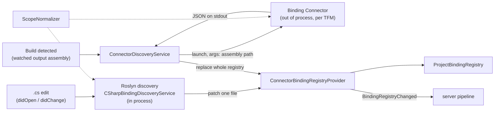
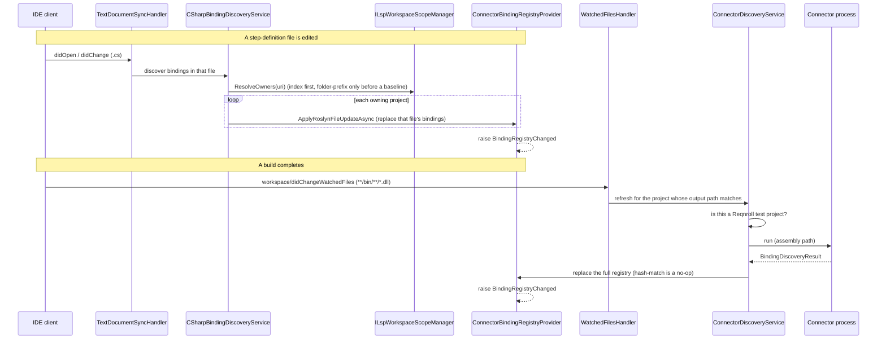
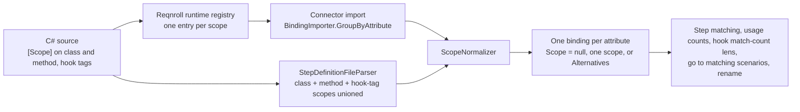

# Binding Discovery

**Status:** Implemented. Describes the system as it is; verify against the source files named in each section.
**Audience:** Maintainers working on how step and hook bindings get into the registry: Roslyn source discovery, the reflection connector, scope handling, or discovery triggers and gating.

## 1. Purpose and scope

The server maintains, per project, a registry of step-definition and hook bindings: patterns, source locations,
parameter types and scopes. Nearly every step-related feature reads it. This document describes the two discovery
sources, how their results merge, when each runs, which projects they run for, and the rules that keep the two paths
equivalent. Which project owns a file is in [workspace-and-membership.md](workspace-and-membership.md); what happens
after the registry changes is in [server-pipeline.md](server-pipeline.md).

## 2. Overview

| | Roslyn discovery | Reflection discovery (Connector) |
|---|---|---|
| Runs | In process, on every `.cs` edit | Out of process, after a build |
| Needs a build | No | Yes |
| Granularity | One file | Whole assembly |
| Strength | Immediate feedback | Authoritative: generated code, runtime-registered bindings, derived attributes |
| Weakness | Syntactic only | Not available until the next build |

## 3. Flows

An initial discovery run is also triggered on `reqnroll/projectLoaded`. Visual Studio does not rely on file watching
for builds: its client hooks `DTE.Events.BuildEvents.OnBuildDone` directly.

## 4. Glossary

| Term | Meaning here |
|---|---|
| **Binding** | A method with a Reqnroll step or hook attribute. One `ProjectBinding` per attribute. |
| **Registry** | `ProjectBindingRegistry`: the project's bindings. `Invalid` until the first discovery completes. |
| **Roslyn patch** | A per-file replacement of bindings layered on the current registry. |
| **Connector** | `Reqnroll.IdeSupport.LSP.Connector`: the out-of-process reflection scanner. |
| **Discovery result** | `BindingDiscoveryResult`: the Connector's JSON output. |
| **Last-good hash** | The assembly hash the registry was last built from; a rebuild changes it. |
| **Scope** | A binding's `[Scope]` restriction (tag, feature title, scenario title). |
| **Alternatives scope** | `BindingScope.Alternatives`: several scopes OR-ed. |
| **Test project** | A Reqnroll project that owns at least one feature file, as opposed to a bindings library. |

## 5. Key classes

| Class | Location | Responsibility |
|---|---|---|
| `CSharpBindingDiscoveryService` | `src/LSP/…LSP.Server/Discovery/Roslyn` | Routes a `.cs` edit to every owning project and applies the Roslyn patch. |
| `StepDefinitionFileParser` | `src/LSP/…LSP.Core/Parsing/CSharp` | Syntactic parse of a `.cs` file into step and hook bindings with scopes, plus structural validation. |
| `ConnectorBindingRegistryProvider` | `…LSP.Server/Discovery/Connector` | Owns the project's registry; applies patches and refreshes; raises `BindingRegistryChanged`. |
| `ConnectorDiscoveryService`, `IConnectorDiscoveryService` | same | Decides whether to run the Connector; runs it; handles failure. |
| `OutProcReqnrollConnector`, `OutProcReqnrollConnectorFactory` | `…/Discovery/Connector/AssemblyReflection` | Launches the Connector executable (`ProcessHelper.RunProcess`) and parses stdout. |
| `ReqnrollProjectDetector` | `…LSP.Core/Discovery` | The "is this a Reqnroll test project" gate. |
| `ScopeNormalizer` | `…LSP.Core/Bindings` | Single place that reduces a binding's scopes. |
| `BindingImporter` | `…LSP.Core/Bindings` | Imports wire entries; `GroupByAttribute`, `GetBindingError`. |
| `WatchedFilesHandler` | `…LSP.Server/Workspace` | Watches `**/reqnroll.json`, `**/.editorconfig`, `**/bin/**/*.dll`. |

## 6. Behaviour and contracts

### 6.1 Merge strategy

A Roslyn patch replaces the bindings from that one file in the owning registries. It is layered on the connector's
current registry and deliberately does not advance the last-good hash. A real build changes the hash, so the Connector
result then replaces the entire registry; with no rebuild the connector run is a hash-match no-op and the source-level
patch persists. The editor therefore reflects source edits immediately and still captures anything visible only after
compilation. A step renders as unbound only once the owning project has a valid registry; against an `Invalid`
registry, step matching is skipped and steps stay unclassified.

### 6.2 Index-driven routing

`CSharpBindingDiscoveryService` routes through `ResolveOwners`, which returns the set of owning projects from the
membership index, falling back to longest folder-prefix only for a project with no baseline yet. The patch fans out to
every owner (a linked `.cs` belongs to several). The same lookup gates it: a `.cs` that no project's index claims, for
example one excluded from its `.csproj` but open in the editor, contributes to no registry.

### 6.3 Which projects the Connector runs for

No client filters what it sends: Visual Studio and VS Code report every project, Rider every runnable project. The
server gates in `ConnectorDiscoveryService`, using `ReqnrollProjectDetector`:

| Signal | Effect |
|---|---|
| `ide.reqnroll.isReqnrollProject` in `reqnroll.json` | Authoritative both ways when present; absent falls through. Editing the file reloads config and re-triggers discovery. |
| A package reference whose name contains `Reqnroll` | The project uses Reqnroll. Covers every test-framework, tooling and extension package without an exact-name list. |
| `Reqnroll.dll` next to the output assembly | The project uses Reqnroll. Required for Rider (which sends no package references); covers transitive references and Visual Studio's transient empty list. |
| Owns at least one feature file, per the membership index | Only then is it a *test* project. A binding library's bindings reach the IDE through the referencing test project's output. |

The feature-file signal reads the membership index, never the folder, so a linked feature file counts. It reports
"unknown" until the baseline arrives, and unknown runs discovery. Legacy SpecFlow is deliberately not detected.

### 6.4 Failure and degradation

If the Connector fails (assembly locked by a test runner, corrupt binary) the server logs, retains the most recent valid
registry (Roslyn-derived bindings remain), warns with `window/showMessage`, and never clears the registry. It
operates degraded until the next successful run.

### 6.5 Connector process

Ported from the legacy `Reqnroll.VisualStudio` connector. The server launches the executable per request with the
assembly path as an argument and reads the JSON discovery result from stdout and the exit code; there is no
persistent pipe or port. It ships .NET Framework variants (net462, net472, net481) that use `AppDomain` isolation,
because the cross-platform server cannot load a .NET Framework assembly into an `AssemblyLoadContext`. The server
picks the variant by the target project's TFM. The Connector's own log file is buffered and written only on a
discovery error or at `Info`/`Verbose` level.

### 6.6 Error parity

`ProjectBinding.Error` is the single field every diagnostics consumer reads (C# binding squiggles, `.feature`
near-miss enrichment), so both paths must populate it identically for the same failure. The connector path combines a
binding-level import error with the scope's error. The Roslyn path (`CombineErrors`) folds in the same scope error plus
a malformed step expression's exception (from the real `Cucumber.CucumberExpressions` and `Cucumber.TagExpressions`
libraries) alongside the structural-validation error: binding type must be a class and not generic; a method on an
abstract type must be static; a method must not be `async void`; the four non-scenario-scoped hook types must be
static.

### 6.7 Scope parity

A binding's `[Scope]`s decide which scenarios it applies to, and both paths must give the same answer for the same
source, since Roslyn results replace a file's Connector results on every edit and any difference would look like a change
nobody made. Reqnroll's runtime registers **one binding per scope** over the union of class-level `[Scope]`s,
method-level `[Scope]`s and, for a hook, each tag on the hook attribute. Those are **alternatives (OR)**. Inside one
scope, `Tag`, `Feature` and `Scenario` must **all** match (AND). The Connector sees the runtime registry (one wire entry
per scope); Roslyn rebuilds the same union from syntax.

`ScopeNormalizer` uses only rewrites that cannot change which scenarios match:

| Rule | Why it is exact |
|---|---|
| No scope, or a scope that restricts nothing (bare `[Scope]`), makes the binding unrestricted (`Scope == null`). | `X OR everything = everything`. The hook lens then shows "all scenarios". |
| Scopes with the same feature and scenario title merge, OR-ing their tags (`@a` + `@b` becomes `(@a) or (@b)`); each member is parenthesized so a full tag expression stays a self-contained group. | `(t1 AND F) OR (t2 AND F) = (t1 OR t2) AND F` |
| A scope with that title and no tag absorbs the tagged ones. | `F OR (t AND F) = F` |
| Duplicates collapse, bare tag names get `@`, groups and tags sort ordinally. | Attribute order is not promised by reflection, so the result must not depend on it. |
| A scope that arrived with an error is never merged or absorbed. | Its error must stay visible. |

Examples:

| Source | Runtime entries | Resulting `Scope` |
|---|---|---|
| `[Scope(Tag="@a")] [Scope(Tag="@b")]` | `@a`, `@b` | one scope, tag `(@a) or (@b)` |
| `[Scope(Tag="@web")] [Scope(Feature="Checkout")]` | `@web`, `Feature=Checkout` | alternatives |
| class `[Scope(Tag="@ui")]`, method `[Scope(Feature="Checkout")]` | `@ui`, `Feature=Checkout` | alternatives (class and method are OR-ed, not AND-ed) |
| `[Scope(Feature="Checkout")] [BeforeScenario("web","smoke")]` | `Feature=Checkout`, `@web`, `@smoke` | alternatives |
| `[Scope] [Scope(Tag="@web")]` | one unrestricted, `@web` | `null` |
| `[Scope(Tag="@web", Feature="Checkout")]` | one entry | one scope, both required |

## 7. Pitfalls and design decisions

1. **One binding per attribute is a contract.** The CodeLens handlers, `FindMatchingScenariosHandler` and the rename
   picker identify a binding by its attribute's location and keep the first found. With one binding per scope, a hook
   with two scopes would be counted against its first scope only and the rename picker would list the attribute twice.
   `BindingImporter.GroupByAttribute` groups wire entries identical but for scope. The wire carries no attribute ordinal,
   so two textually identical attributes on one method form one group; they already share one `BindingId`, which
   excludes scope. `ScopeParityTests` pins parity across scenario tag combinations in either entry order.
2. **Roslyn runs in process, deliberately.** Its value is immediacy; out of process it would serialize the full
   payload over IPC on every edit event. Only the expensive reflection scan is out of process. The cost is a Roslyn
   dependency in `LSP.Core`, accepted as stable.
3. **stdin/stdout, not a pipe or port.** Simplest, no collisions, inherently local and restricted to the launching
   process, so there is no network-exposed channel to secure. The Connector is launched per request, not kept running.
4. **Skipping a real test project is worse than one redundant run.** Hence "unknown runs discovery".
5. **A shared project is never discovered.** It produces no assembly; its bindings reach the registry through each
   importing project. See [workspace-and-membership.md](workspace-and-membership.md).
6. **Never advance the last-good hash from a Roslyn patch.** Doing so would make the next real build look like a no-op
   and leave a source-derived registry in place.

## 8. Known limitations

- **Custom-derived binding attributes are not found by Roslyn discovery.** The parser is syntactic only (a single file,
  no compilation) and recognizes bindings by simple attribute name. A user attribute deriving from a Reqnroll one
  (`class GivenWebAttribute : GivenAttribute`) is found only by the Connector after a build, so its steps appear
  unmatched until then. Closing it needs a project `Compilation` and base-type walking, which is a larger change to how
  files are obtained. A skipped test in `StepDefinitionFileParserTests` records it.
- The runtime compares feature and scenario titles case-insensitively (`BindingScope.Match`), while
  `ProjectBinding.MatchScope` compares case-sensitively. This predates scope normalization and is independent of it.

## 9. Testing

| Layer | Where |
|---|---|
| Parser, scope normalizer, importer, scope parity (`ScopeParityTests`) | `tests/LSP/Reqnroll.IdeSupport.LSP.Core.Tests/Bindings`, plus `…LSP.Connector.Tests` |
| Discovery service, routing, gating, provider | `tests/LSP/Reqnroll.IdeSupport.LSP.Server.Tests/Discovery` |
| Roslyn and reflection end to end through a simulated client | `tests/LSP/Reqnroll.IdeSupport.LSP.Server.Specs/Features/Discovery`, using `…Specs.BindingsFixture` |
