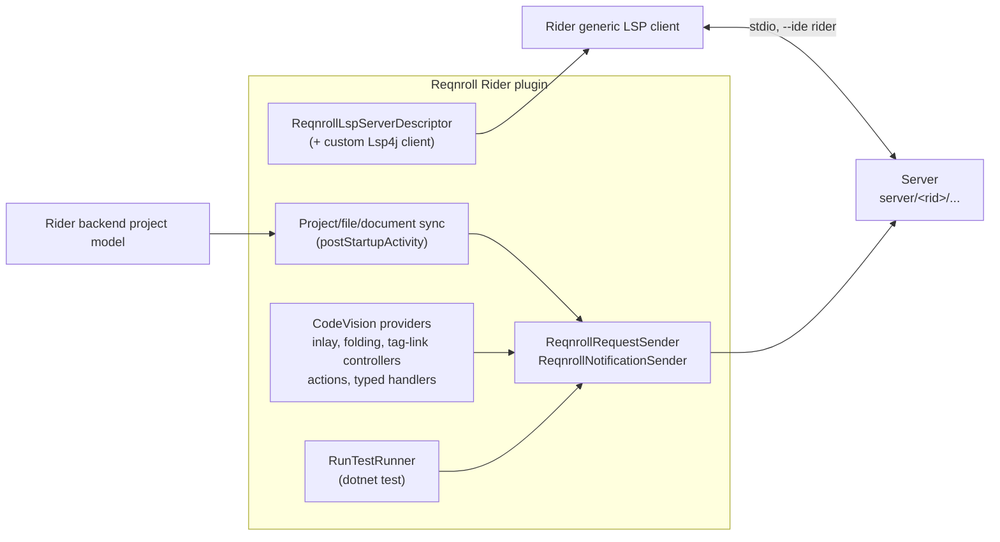
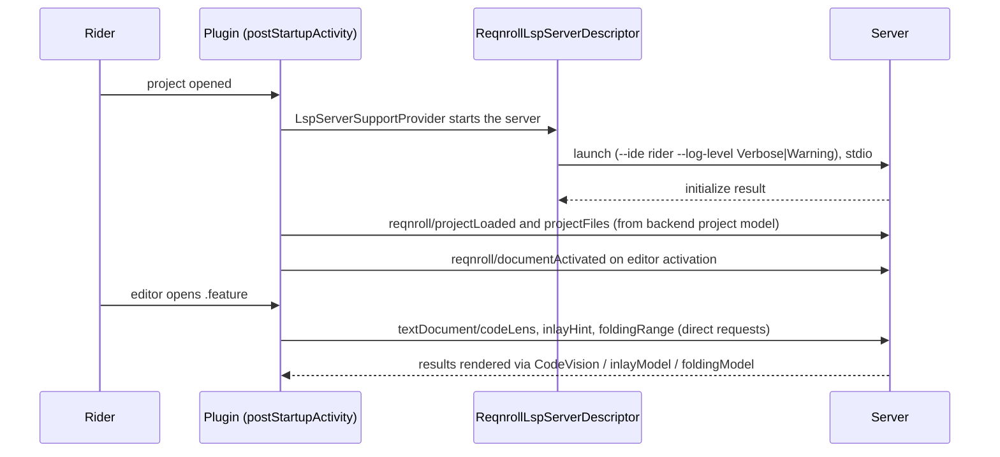

# Rider Client

**Status:** Implemented. Describes the system as it is; verify against `src/Rider`.
**Audience:** Maintainers working on the Rider plugin.

## 1. Purpose and scope

A **Kotlin-only** IntelliJ Platform plugin (`src/Rider`) that runs the server inside Rider through the platform's
built-in generic LSP client (`com.intellij.platform.lsp.api`). There is no ReSharper/.NET-backend half and no MSBuild
step in its own build. The plugin adds Kotlin glue only where the generic client has no consumer for a capability, where a
feature needs a bespoke `reqnroll/*` message, or where a platform action excludes `.feature` files. For the other
clients and the per-feature tiers, see [ide-clients.md](ide-clients.md).

## 2. Overview

## 3. Flows

## 4. Glossary

| Term | Meaning here |
|---|---|
| **CodeVision** | IntelliJ's inline lens extension point (`codeInsight.codeVisionProvider`). |
| **PSI** | IntelliJ's parsed-tree model. `.feature` has none (no `ParserDefinition`), which rules out PSI-based extension points. |
| **`lsp4jServerClass`** | The descriptor override that adds `reqnroll/*` methods to the standard `LanguageServer` interface. |
| **Dev sandbox** | A JVM started via `./gradlew runIde` (system property `reqnroll.devSandbox`). |
| **RID** | Runtime identifier of the bundled server build. |

## 5. Key classes

| Class | Purpose |
|---|---|
| `ReqnrollLspServerDescriptor` | Launch command, supported files (`.feature`, `.cs`), `lspGoToDefinitionSupport`, `lspSemanticTokensSupport`, `lspFormattingSupport`, the custom `lsp4jServerClass`, and `clientCapabilities` overrides advertising refresh and dynamic-registration support the platform default omits. |
| `ReqnrollLspServerSupportProvider`, `ReqnrollServerPathResolver` | Registration with the generic client; resolves the bundled server relative to the plugin's install directory. |
| `ReqnrollRequestSender` | Sends custom requests (`findStepUsages`, `findUnusedStepDefinitions`, `findHooks`, test outcome and target requests) and the standard `codeLens`, `inlayHint`, `onTypeFormatting`, `foldingRange`, and `workspace/executeCommand` (`reqnroll.toggleComment`) requests. |
| `ReqnrollNotificationSender` | Sends `projectLoaded`, `projectUnloaded`, `projectFiles`, `documentActivated`. |
| `ReqnrollRunnableProjectsListener`, `ReqnrollProjectFilesSync`, `ReqnrollDocumentActivationSync`, `ReqnrollProjectBaseline`, `ReqnrollLspServerReadiness` | Project, membership and activation sync from Rider's backend project model. |
| `ReqnrollCodeLensRefreshInterceptor`, `ReqnrollInlayHintRefreshInterceptor` | Wrap the platform's notification handler so refresh requests also refresh CodeVision and inlay hints. |
| `ReqnrollSemanticTokensSupport` | A `TextAttributesKey` per `reqnroll.*` legend name (the platform default maps only about 23 standard names). |
| `StepUsagesCodeVisionProvider`, `HookCodeVisionProvider`, `StepHooksCodeVisionProvider`, `RunTestCodeVisionProvider` | The lenses; `HookLensSupport` holds shared logic. |
| `ReqnrollFeatureInlayHintsController`, `ReqnrollFeatureFoldingController`, `ReqnrollFeatureTagLinkController` | `editorFactoryListener`s that call the standard requests directly and render with `Editor.inlayModel`, `foldingModel` and tag links. |
| `ReqnrollFeatureOnTypeFormattingHandler`, `ReqnrollFeatureCompletionAutoPopupHandler` | `typedHandler`s: `\|`-triggered table realignment; auto-popup completion. |
| `FindStepUsagesAction`, `FindUnusedStepDefinitionsAction`, `GoToHooksAction`, `ReqnrollResultPopup` | Tools-menu and editor-context actions with a shared chooser popup. |
| `RenameFeatureStepAction`, `RenameCSharpStepAction`, `RenameStepRunner`, `RenameWorkspaceEditApplier` | Step rename (`.feature` bound to Shift+F6; `.cs` context-menu only). |
| `ReqnrollCommentByLineCommentAction` | Overrides the platform's `CommentByLineComment` action by ID. |
| `ReqnrollGoToDefinitionAction`, `ReqnrollGoToDefinitionPromoter` | Make F12 / Ctrl+B / Ctrl+click reach the server on Rider 2026.2+. |
| `RunTestRunner`, `RunLensSupport`, `FailedStepGutterMarks` | Run lens and execution; see [../Test-Runner-Integration-Design.md](../Test-Runner-Integration-Design.md). |
| `ReqnrollToggleFeatureInlayHintsAction` | "Show Feature Inlay Hints" toggle. |
| `ReqnrollDebugLogger` | File logging gated on the dev-sandbox property. |

## 6. Behaviour and contracts

**Module dependencies** are `com.intellij.modules.rider` and `com.intellij.modules.platform`. `com.intellij.modules.lsp`
is not a registered module in Rider's distribution (requiring it fails with "no such plugin found"); the
`com.intellij.platform.lsp.api.*` classes are in the core artifact.

**Server launch.** `--ide rider --log-level <Verbose|Warning>`: `Verbose` only when started via `./gradlew runIde`,
`Warning` for an installed plugin. The packaged plugin bundles all six RIDs and picks the right one at runtime.

**Build.** Pure Gradle (`org.jetbrains.intellij.platform` plugin, Kotlin/JVM, JDK 21 toolchain). The server is a
prebuilt artifact. Local dev: the `publishServer` task runs `dotnet publish` for the host OS only. CI:
`-PlspServerBuildDir=<dir>` skips it and `prepareSandbox` copies the server builds that `test-lsp.yml` already
produced, so Gradle never invokes `dotnet`. Key tasks: `buildPlugin`, `verifyPlugin` (the plugin ID deliberately avoids
the substring "rider", which the Verifier rejects), `runIde`, `test`. Test logger and MTP reporter bundles are handled
the same way (`publishTestLogger`).

**Compatibility.** `pluginSinceBuild` 243 to `pluginUntilBuild` 262.* (`gradle.properties`); developed and verified
against Rider 2024.3.5.

**Extension points used:** `platform.lsp.serverSupportProvider`, `fileType`, three `postStartupActivity` sync
listeners plus lifecycle and telemetry activities, `codeInsight.codeVisionProvider` (×4), `editorFactoryListener` (×3),
`typedHandler` (×2), `actionPromoter`, a `Reqnroll` tool window, and actions (`overrides="true"` for
`CommentByLineComment`).

## 7. Pitfalls and design decisions

1. **No PSI.** `.feature` has no `ParserDefinition`. A declarative inlay provider registered for it was silently never
   invoked, and `RunLineMarkerContributor` is inherently PSI-based. Hence hand-managed `Editor` models and
   `CodeVisionProvider`s, which operate on offsets. Because of that lenses render inline, not as gutter icons.
2. **Go to Definition needs no PSI bridge**: `lspGoToDefinitionSupport = true` suffices. The one exception is Rider
   2026.2+, where F12, Ctrl+B and Ctrl+click route through a backend-delegating action that never reaches the LSP
   definition support for Gherkin; the promoter plus action fix that, and menu navigation always worked.
3. **The comment action hardcodes its handler** and gates on the language's commenter, so an `EditorActionHandler`
   decoration is never consulted. Override the action by ID instead; every keymap binds its shortcuts to that ID.
4. **Rider has no native rename bridge for LSP** (no rename customisation exists on the descriptor), and the server
   pushes `workspace/applyEdit` for rename only to clients with `AppliesRenameResponseEditNatively`. So
   `RenameWorkspaceEditApplier` applies the returned `WorkspaceEdit` locally inside one write command. A
   server-initiated `workspace/applyEdit`, as the comment toggle uses, is applied natively by the platform's `Lsp4jClient`.
5. **Send the same TFM in `projectFiles` as in `projectLoaded`.** A mismatch silently degrades every per-project query to
   folder scanning.
6. **Shared projects need explicit handling.** Rider's baseline is a project-folder walk, so it reads imported
   `.projitems` directly and sends no delta for a file added to a shared project.
7. **Native Unit Tests window presence is out of reach** from the JVM; see the test runner doc.
8. **The plugin ID must not contain "rider".**

## 8. Known limitations

- No Debug action for scenarios; no native Unit Tests tool window presence.
- Older Rider versions have no outline (the native Structure view renders the standard `documentSymbol` response on
  current Rider).
- Lenses are inline, not gutter icons.

## 9. Testing

| Layer | Where |
|---|---|
| Unit tests (JUnit5 / `kotlin.test`) | `src/Rider/src/test`, run with `./gradlew test` |
| Live | `./gradlew runIde` sandbox, or the devcontainer (WSLg) for locked-down workstations; `src/Rider/CONTRIBUTING.md` |
