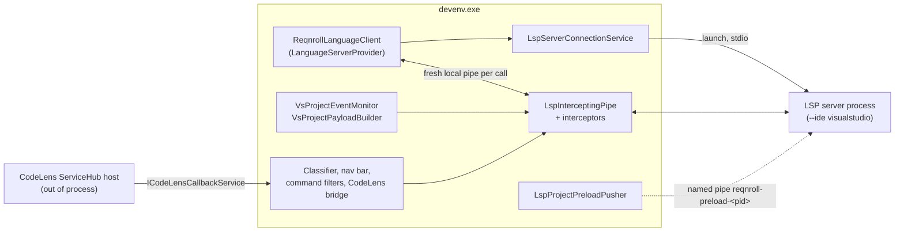
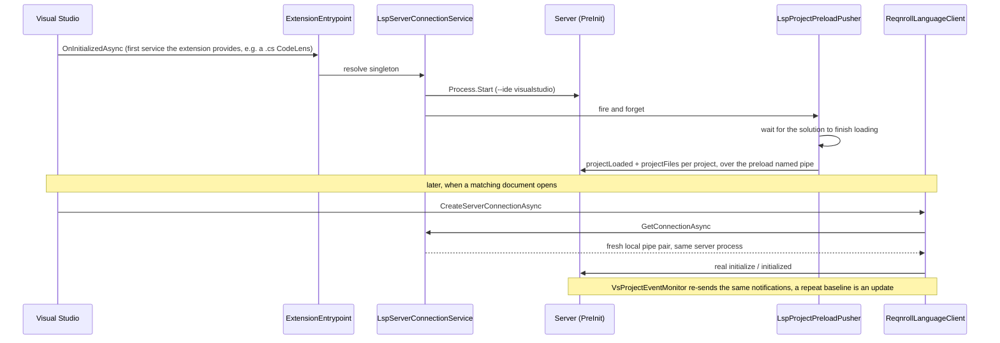
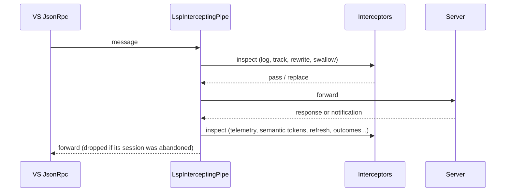

# Visual Studio Client

**Status:** Implemented. Describes the system as it is; verify against `src/VisualStudio`.
**Audience:** Maintainers working on the Visual Studio extension: server connection, project bridge, CodeLens bridge, classifiers, command filters.

## 1. Purpose and scope

A hybrid extension: **VS.Extensibility** is the primary API (the language client, step-usage CodeLens on `.cs` files,
commands) with **VSSDK** used where VS.Extensibility has no equivalent (classic CodeLens for `.feature` files,
classifiers, the navigation bar, command filters, wizards, run-settings hooks). The server is bundled in the VSIX under
`LSPServer/` and launched with `--ide visualstudio`. For the other clients and the per-feature tiers see
[ide-clients.md](ide-clients.md). How the language client gets activated for restored tabs is in
[../VS-LSP-Activation.md](../VS-LSP-Activation.md); first-run and wizards are in
[../Onboarding-And-Scaffolding.md](../Onboarding-And-Scaffolding.md).

| Component | API | Reason |
|---|---|---|
| Language client (`ReqnrollLanguageClient`) | VS.Extensibility | First-class LSP support |
| CodeLens on `.cs` (step usages, hook match count) | VS.Extensibility `ICodeLensProvider` | `StepCodeLensProvider`, `HookMatchCountCodeLensProvider` |
| CodeLens on `.feature` (hook match, Run) | VSSDK classic `Microsoft.VisualStudio.Language.CodeLens` | VS.Extensibility has no generic consumer for a custom language |
| Classification, navigation bar, command filters, `IRunSettingsService` | VSSDK / MEF | Not in VS.Extensibility |
| New Project / Item wizards | VSSDK | Wizard interfaces not in VS.Extensibility |

## 2. Overview

## 3. Flows

### 3.1 Eager server start and preload

### 3.2 Pass-through and interception

## 4. Glossary

| Term | Meaning here |
|---|---|
| **`LanguageServerProvider`** | The VS.Extensibility type VS activates when a matching document opens. |
| **Intercepting pipe** | `LspInterceptingPipe`: sits between VS's LSP client and the real server stream to log, rewrite and observe messages, and to inject custom requests. |
| **Session** | One VS-facing pipe pair. VS can request a connection more than once per session (extension hot-reload), so sessions can be abandoned. |
| **Preload channel** | A process-local named pipe through which the extension gives the server project data before the real `initialize`. |
| **`PreInit`** | `LanguageServer.PreInit(...)`: builds the server's container without blocking on the client handshake, so the preload listener can run first. |
| **Classic CodeLens bridge** | An in-process tagger plus an out-of-process data-point provider that calls back through `ICodeLensCallbackService`. |

## 5. Key classes

| Class | Location (`src/VisualStudio/…`) | Responsibility |
|---|---|---|
| `ExtensionEntrypoint`, `ReqnrollLanguageClient`, `ReqnrollPluginPackage` | `…Extension` | Extension config; the language client; the autoloaded VSSDK package. |
| `LspServerConnectionService` | `…Extension/LspInterception` | Owns the server process and intercepting pipe; starts eagerly; hands out a fresh VS-facing pipe per call. |
| `LspInterceptingPipe`, `InterceptorPipeline`, `ILspMessageInterceptor`, `VsFacingSessionManager`, `VsSessionRouter`, `LspRequestCorrelator` | same | The pipe and its session handling. |
| Interceptors: `TelemetryEventInterceptor`, `CodeLensRefreshInterceptor`, `TestOutcomesChangedInterceptor`, `SemanticTokensClassificationInterceptor`, `DocumentActivationTrackingInterceptor`, `ScaffoldTrackingInterceptor`, `ShadowDocumentFilterInterceptor`, `ShutdownHandshakeInterceptor` | `…Extension/LspInterception`, `…/Classification` | Per-message behaviours. |
| `VsProjectEventMonitor`, `VsProjectPayloadBuilder`, `LspProjectPreloadPusher` | `…Extension/LspNotifications` | Builds and sends project notifications from EnvDTE and project items; preload. |
| Feature services | `…Extension/<Feature>` (`FindStepUsages`, `GoToHooks`, `RenameStep`, `CommentToggle`, `FormatDocument`, `GoToStepDefinition`, `DocumentLinks`, `NavigationBar`, `RunTestCodeLens`, `HookFeatureCodeLens`, `StepCodeLens`, …) | Per-feature client logic. |
| `Classification/*` | `…Extension/Classification` | `SemanticTokenClassificationStore`, `GherkinSemanticClassifier`. |
| VSSDK integration | `…VSSDKIntegration` | Command filters and their Redirect bridges (`CommentToggle`, `FormatDocument`, `GoToDefinition`, `DocumentLinks`), `NavigationBar`, `HookCodeLens`, `RunTestCodeLens`, `LineCodeLens`, `Editor`, `IdeServices`, `ProjectSystem`, `WellKnownIds`, `TestLogger`, `TestReporter`, `Telemetry`. |
| `Wizards`, `Wizards.Core`, `Wizards.UI` | `src/VisualStudio` | New Project / Item wizards. |

## 6. Behaviour and contracts

**Eager start.** `LspServerConnectionService` moves process launch, pipe construction and interceptor wiring off the
`.feature`-open path. `ExtensionEntrypoint.OnInitializedAsync` is the extension-load hook; it fires once, on the first
service the extension provides. In practice that is the `.cs` step-usage CodeLens, seconds before the language client
would otherwise be constructed, so the singleton is resolved there, not merely constructor-injected into the client
(injection alone would only buy tens of milliseconds). `CreateServerConnectionAsync` then awaits the in-flight task.
`VsProjectEventMonitor` and the telemetry transmitter are still constructed after VS's own `initialize`/`initialized`
handshake and attached to the service lazily.

**Preload side channel.** OmniSharp queues every request and notification until the client's real `initialize`
completes, and VS sends `initialize` only when the provider activates. Pushing project data over the normal channel is
therefore a no-op until then, however early the process started. `Program.cs` uses `PreInit` so the container exists
before the handshake; `ProjectPreloadListener` listens on a named pipe (`reqnroll-preload-<pid>`) for
`projectLoaded`/`projectFiles` lines and dispatches them straight to the scope manager. `LspProjectPreloadPusher`
waits for the solution to load, then pushes a baseline for every solution project, reusing `VsProjectPayloadBuilder`.
The real notifications arrive later over LSP and a repeat baseline is an update, so whichever arrives first does the
discovery work and the second is a cheap refresh. The listener stops after `Initialize()` returns.

**Project information.** `VsProjectEventMonitor` sources `projectLoaded` from EnvDTE (project file, output path, TFM,
package references) and membership from the project's physical file items. It re-sends on build completion
(`BuildEvents.OnBuildDone`, which is why Visual Studio needs no file-watch signal), on item add/remove and on `.csproj`
change. Shared projects are not sent; their files are listed in each importing project's baseline.

**Fresh pipe per call.** Visual Studio can call `CreateServerConnectionAsync` more than once per session (extension
hot-reload, by design). Each call gets a fresh local pipe pair; the connection to the real server process is untouched
by the swap. `VsSessionRouter` drops a response whose owning session was abandoned.

**Semantic tokens.** `SemanticTokensClassificationInterceptor` captures `reqnroll/semanticTokens`, caches them in
`SemanticTokenClassificationStore`, and `GherkinSemanticClassifier` emits spans with `IdeSupportClassifications`.

**CodeLens on `.feature`.** An in-process `ITaggerProvider` places tags and out-of-process data-point providers call back
into `devenv.exe` through `ICodeLensCallbackService` listeners. Hook lenses use two data-point providers sharing one
line-scoped tag.

**Launch and logging.** `--ide visualstudio`; log files named per the shared convention in the Reqnroll log folder.
The log level defaults to Warning for an installed extension and Verbose in development (see `ServerArguments`).

## 7. Pitfalls and design decisions

1. **Do not return one cached pipe.** A second consumer writing to a completed writer throws and corrupts the
   connection. Always build a fresh pair per call.
2. **A response from an abandoned session must be dropped**, not forwarded to the new session. Visual Studio's JsonRpc
   treats an unmatched response as a fatal protocol violation and closes the new connection.
3. **Eager resolution, not injection.** Resolve `LspServerConnectionService` in `OnInitializedAsync`; relying on the
   language client's constructor wastes the head start.
4. **Marshal to the UI thread before DTE/COM.** `SwitchToMainThreadAsync` first; background VS.Extensibility code cannot
   touch DTE directly.
5. **Newtonsoft in the host.** Calls that depend on the host's Newtonsoft version must use the parameterless
   `JToken.ToString()`; other overloads can throw `MissingMethodException`.
6. **Path length matters.** Builds under deeply nested worktree paths fail with misleading errors (the VS IDE reports
   fake "invalid targets" and the CLI hits `VSSDK1300`); build from a short path.
7. **Mixed content types.** Prefer registering static MEF exports for anything needed at restore time; see the
   activation document.
8. **Keep VS-referencing code out of classes with pure logic.** The .NET loader resolves every member signature before
   constructing a type, so a class with a `Microsoft.VisualStudio.TestWindow.*` member cannot be unit tested; put the pure
   logic in a separate type (as `TestLoggerActivationRules` does).

## 8. Known limitations

- The Document Outline window is not populated; navigation-bar dropdowns are.
- Rename change annotations are not supported (the edit is applied natively from a pushed `workspace/applyEdit`).
- Whether Visual Studio applies a multi-file rename edit as one undo transaction has not been verified.

## 9. Testing

| Layer | Where |
|---|---|
| Client logic with `VsxStubs` doubles | `tests/VisualStudio/Reqnroll.IdeSupport.VisualStudio.Tests` |
| Wizard logic | `tests/VisualStudio/Reqnroll.IdeSupport.VisualStudio.Wizards.Tests` |
| Live | The Visual Studio experimental instance; the `REQNROLLVS_DEBUG=1` environment variable forces Verbose logging |
