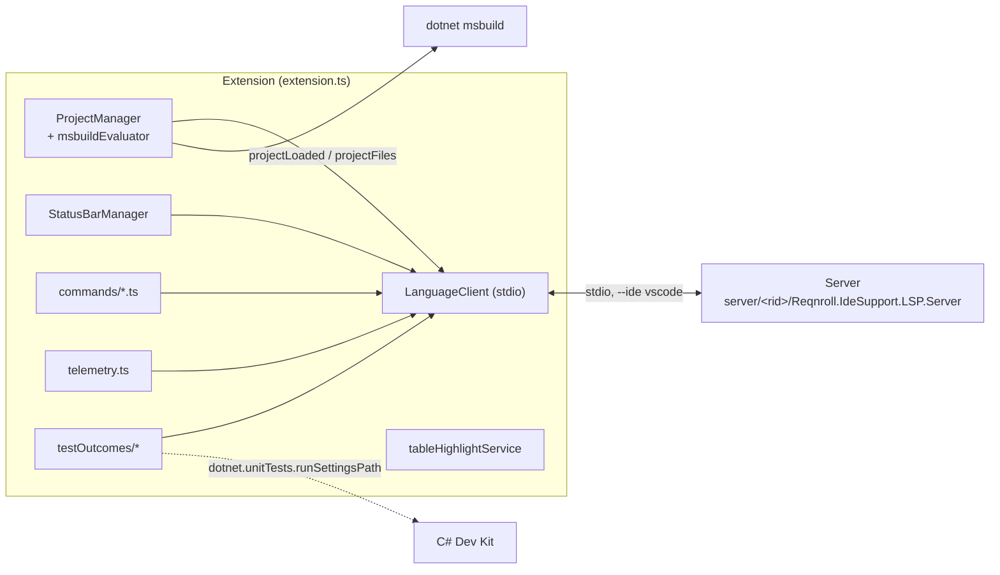
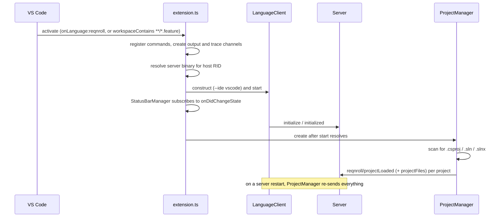

# VS Code Client

**Status:** Implemented. Describes the system as it is; verify against `src/VSCode`.
**Audience:** Maintainers working on the VS Code extension.

## 1. Purpose and scope

A TypeScript extension (`src/VSCode`, built on `vscode-languageclient` v10) that launches the server, bridges VS Code's
workspace to the server's project model, and adds the few things LSP cannot express. Nearly all Gherkin intelligence is
in the server. For the other clients and the per-feature tiers, see [ide-clients.md](ide-clients.md).

## 2. Overview

## 3. Flows

## 4. Glossary

| Term | Meaning here |
|---|---|
| **Language id `reqnroll`** | The language the extension registers for `.feature`. Deliberately not `gherkin`, which the Cucumber extension also registers. |
| **RID** | Runtime identifier of the bundled server build (`win-x64`, `osx-arm64`, …). |
| **v1 / v2 project notification** | Folder-only (solution files) versus MSBuild-evaluated (`.csproj`) project information. |
| **Inspector log** | A file-only trace in lsp-viewer format, written when `reqnroll.trace.server` is `messages` or `verbose`. |
| **C# Dev Kit** | Microsoft's extension that owns test discovery and execution in VS Code. |

## 5. Key classes

| File | Purpose |
|---|---|
| `src/extension.ts` | Entry point: resolves the server, registers commands, creates channels, starts the client, wires `ProjectManager` and `StatusBarManager`. |
| `src/lsp/projectManager.ts` | Watches `.csproj`/`.sln`/`.slnx`; sends `projectLoaded`, `projectFiles`, `projectUnloaded`. |
| `src/lsp/msbuildEvaluator.ts` | Shells `dotnet msbuild -getProperty` (design-time build) for TFM, output path, assembly name, root namespace, assets file; reads package references from `project.assets.json`. |
| `src/lsp/serverRestart.ts` | Calls a listener each time the server comes back up after a restart, so state can be re-pushed. |
| `src/lsp/lspInspectorLogger.ts` | `FileLspTraceChannel`: a file-only `LogOutputChannel` (no Output-panel pane) handed to the client as its trace channel. |
| `src/lsp/codeLensSuppression.ts`, `executeCommandDedupe.ts`, `manualDocumentSync.ts`, `editRejection.ts`, `saveTracker.ts`, `tagLinks.ts` | Client-side glue for CodeLens requests, command de-duplication, document sync, rejected edits, save tracking and clickable tags. |
| `src/statusBar.ts` | Status item reflecting `Starting` / `Running` / `Stopped`. |
| `src/tableHighlightService.ts` | Data-table cell and header decoration; needs decoration APIs semantic tokens cannot express. |
| `src/telemetry.ts` | `TelemetryReporter` wiring for `telemetry/event`. |
| `src/commands/*.ts` | One file per custom command (step usages, unused definitions, go to hooks, matching scenarios, hook and step CodeLens, step navigation, rename, comment toggle, CodeLens refresh). |
| `src/testOutcomes/*` | Opt-in test outcome support; see [../Test-Outcomes-Pipeline.md](../Test-Outcomes-Pipeline.md). |
| `syntaxes/gherkin.tmLanguage.json` | TextMate grammar: colours keywords, tags, comments, doc strings, table delimiters, numbers and placeholders before the first semantic-token response; no visible effect afterwards. |
| `language-configuration.json` | Comments, brackets, indentation for the language. |

## 6. Behaviour and contracts

**Manifest.** Publisher `Reqnroll`, name `reqnroll-ide-support-vscode`. Activation: `onLanguage:reqnroll`,
`workspaceContains:**/*.feature`. Plain-text files do not activate it: `.feature` is always typed `reqnroll`, and the client's document selector only matches that language. `.feature` is registered to language `reqnroll` with the
TextMate scope `text.reqnroll.feature`. For that language the extension is the default formatter and
`editor.formatOnType` is on (table auto-formatting). Settings: `reqnroll.trace.server` (`off`/`messages`/`verbose`),
`reqnroll.protocolLogLevel` (default `Warning`), `reqnroll.testOutcomes.enabled` (default off). Minimum VS Code is 1.96
(`engines.vscode ^1.96.0`), the first version fully compatible with `vscode-languageclient` v10.

**Server path.** Production: `{extensionDir}/server/<rid>/Reqnroll.IdeSupport.LSP.Server[.exe]`. Development
(Extension Development Host): a relative path from `src/VSCode` to the server's publish output. The server is started
with `--ide vscode` over stdio; a missing binary shows an error notification.

**Project notifications.** VS Code has no MSBuild project system, so there are two tiers: for `.sln`/`.slnx` the
extension adds the project to the known set and sends only the folder (the server uses folder-prefix routing); for
`.csproj` `msbuildEvaluator.ts` evaluates properties, which enables reflection-based discovery. File membership comes
from `dotnet msbuild -getItem`, which also expands shared-project imports. If `dotnet` is unavailable the fields are
empty.

**Inspector logs.** Written when tracing is on, in the shared Reqnroll log folder: Windows
`%LOCALAPPDATA%\Reqnroll\logs`, macOS `~/Library/Logs/Reqnroll/logs`, Linux `~/.local/share/Reqnroll/logs`, as
`reqnroll-vscode-inspector-YYYYMMdd-HHmmss.log`.

**Packaging.** Built with `vsce` into a `.vsix` that bundles the server self-contained for all six RIDs under
`server/<rid>/`. CI publishes the six RIDs in parallel and the `build-vscode-extension` job downloads them and runs
`vsce package`.

## 7. Pitfalls and design decisions

1. **Keep the language id `reqnroll`.** Using `gherkin` clashes with the Cucumber extension.
2. **Do not lower the minimum VS Code version** without re-verifying `vscode-languageclient` v10 compatibility.
3. **A `files.watcherExclude` covering `bin/` silently breaks rebuild detection**, for the standard watcher and any
   client-side one alike.
4. **Re-push state after a server restart.** The client framework restarts a crashed server on the same
   `LanguageClient`, re-sending `initialize` but not replaying our own notifications; project information must be sent
   again from the restart listener.
5. **The extension has no run mechanism of its own.** C# Dev Kit owns test execution; see
   [../Test-Runner-Integration-Design.md](../Test-Runner-Integration-Design.md).
6. **`workspace/applyEdit` and rename are applied natively**, so no extra rename glue is needed beyond the picker
   (`renameStep.ts`).

## 8. Known limitations

- A feature file linked into a second project never appears in the Explorer under the linking project (VS Code's
  Explorer is a filesystem view).
- Without `dotnet` on the path, MSBuild-based properties are empty and discovery falls back.

## 9. Testing

| Layer | Where |
|---|---|
| Unit tests (Mocha) for `projectManager`, commands, test outcomes, walkthrough | `src/VSCode/src/test` |
| Manual | `Extension Development Host` (F5) against a sample solution |
