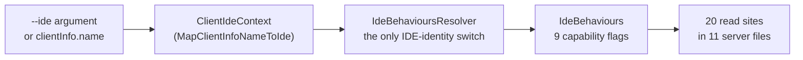

# Complexity Hot Spots — Reqnroll.IdeSupport

**Status:** Reference (point-in-time measurement, 2026-10-18). The code wins if it disagrees.
**Scope:** C# under `src/LSP`, `src/Core` and `src/VisualStudio`; TypeScript under `src/VSCode/src`
(excluding `src/VSCode/src/test`); Kotlin under `src/Rider/src/main`. Generated files (`obj/`, `bin/`,
`*.Designer.cs`, `*.g.cs`, `*.d.ts`) are excluded.

**Previous action items are done.** Every Tier 1/Tier 2 item from the 2026-09-03 measurement
(#586–#593) and the notification split it depended on (#577) is closed. §3 shows where each one ended up.

---

## 1. Method

Complexity is **measured, not estimated**. Five passes run over every file in scope:

1. **File size**: lines per file.
2. **Per-method cyclomatic proxy and length**: decision points are counted per method after comments
   and string literals are stripped. A method runs from its declaration to the start of the next
   declaration. The proxy is 1 plus the count of:
   - C#: `if` `while` `for` `foreach` `case` `catch` `&&` `||` `??`
   - TypeScript: `if` `while` `for` `case` `catch` `&&` `||` `??`
   - Kotlin: `if` `while` `for` `catch` `&&` `||` `?:`, plus one per non-`else` `when` branch arrow
3. **Coupling**: the number of constructor parameters per class (Kotlin and C# primary constructors
   included). Records and Kotlin `data class`es are left out because they are value carriers, not
   collaborators.
4. **Comment hygiene** *(new)*: per file, the number of issue/PR references (`#123`, `issue 123`,
   `PR 123`) inside comments, plus a phrase heuristic for history narrative ("previously",
   "originally", "no longer", "used to", "regression", "root cause", "the fix" and similar).
5. **Per-IDE gating in the server** *(new)*: where the server compares IDE identity or reads an
   `IdeBehaviours` flag, counted in code only (comments are excluded).

The stripper understands C# verbatim (`@"…"`), interpolated, raw (`"""…"""`) and char literals,
Kotlin triple-quoted strings, and TypeScript template literals. This is the same lexing problem that
once broke the first pass (§1.1).

### 1.1 Measurement pitfalls

- **Do not bound methods by brace matching.** A brace matcher with naive string stripping overran a
  hand-written lexer's literal-heavy code and reported a 53-line method as 307 lines. Bounding by the
  next declaration avoids this.
- **Local functions and inline lambdas move the boundaries.** In C#, a `static` local function looks
  like a member declaration, so `Program.ConfigureServer` is reported as a 231-line `Describe`. In
  TypeScript, `registerCommand('…', async () => {` inside `activateCore` looks like a method. Check
  any outlier against the language server's symbol span (Serena `find_symbol`). The figures for
  `ConfigureServer` and `activateCore` below come from that check.
- **`??` and `?:` inflate the proxy for defaulting code.** `HandleConnectionAsync` scores 33, and
  about 8 of those points are `?? default` reads of optional JSON fields. Read the method before you
  rank it.
- **The history heuristic over-counts.** "Bindings previously discovered for this file" is a
  description, not history. Treat the history column as an upper bound for triage. The issue-reference
  count is exact.

---

## 2. Overall shape

| Area | Files | Lines | Methods | CX > 20 | CX ≥ 15 | Methods ≥ 100 LOC | Files ≥ 500 lines |
|---|---|---|---|---|---|---|---|
| `src/LSP` | 386 | 36,815 | 1,420 | 1 | 5 | 12 | 8 |
| `src/Core` | 107 | 7,392 | 338 | 0 | 2 | 0 | 0 |
| `src/VisualStudio` | 227 | 25,750 | 995 | 0 | 3 | 4 | 5 |
| `src/VSCode/src` | 50 | 6,854 | 309 | 0 | 1 | 1 | 1 |
| `src/Rider/src/main` | 88 | 9,047 | 453 | 0 | 5 | 1 | 2 |
| **Total** | **858** | **85,858** | **3,515** | **1** | **16** | **18** | **16** |

**One method in the whole product exceeds CX 20, and no file reaches 1,000 lines.** The largest file
is `VsUtils.cs` at 938 lines. Method-level complexity is no longer the problem.

The difficulty for a new contributor now comes from **breadth**: one feature is spread across many
files, in three languages, and comments explain code by pointing at issue numbers (§5, §7).

---

## 3. Status of the previous findings

| Previous finding | Where it is now |
|---|---|
| `StepDefinitionFileBuilder` hand-rolled C# lexer (CX 32) | Replaced with Roslyn. `MaskLiteralsAndComments` is gone and `AppendToFile` is CX 6 / 37 LOC |
| `LspInterceptingPipe` god class (1,042 lines) | 418 lines. The frame codec (`LspFrameCodec`), correlation (`LspRequestCorrelator`), routing (`VsSessionRouter`) and pumps (`VsToServerPump`, `ServerToVsPump`) are separate types |
| `CodeActionHandler.Handle` (179 LOC, CX 20) | 28 LOC, CX 3. `StepDefinitionTargetResolver` and the action builders took the work, and the class now has 11 constructor dependencies (§6) |
| `RenameHandler.HandlePrepareRenameAsync` (143 LOC, CX 17) | 49 LOC, CX 9 |
| `RunTestOutcomeBridge.TryGetOutcomeAsync` (CX 30) | 21 LOC, CX 5. The reflection work moved into `GetOrCreateProxyAsync` (CX 20, see §4) |
| `FeatureStepTextBuilder.TryBuildViaRegex` (CX 27) | 20 LOC, CX 7 |
| `BindingRegistryChangedHandler.RediscoverCsFilesAsync` (103 LOC, CX 16) | 35 LOC, CX 4. File selection moved to `CsFileReconciliationSelector.Collect` (CX 13) |
| `SemanticTokensService.Encode` (134 LOC) | Split into `CollectOrderedEntries`, `ResolveOverlaps` and `DeltaEncode` |

---

## 4. Method-level hot spots now

Short list. Only the first row is a clear decomposition candidate. The rest are listed so a reviewer
knows they were looked at.

| Method | LOC | CX | Assessment |
|---|---|---|---|
| `TestOutcomeTcpListener.HandleConnectionAsync` (`LSP.Server/Features/TestOutcomes/TestOutcomeTcpListener.cs:212`) | 148 | 33 | **The only method above CX 20.** One method handles the whole NDJSON connection lifecycle: it parses the hello line and infers the reporter kind, dispatches `runStart`/`result`/`runComplete` messages, keeps per-run counters, sends telemetry, and finalizes aborted runs in `finally`. It carries ten mutable locals across those stages. The seam is a per-connection state object with `OnHello` / `OnMessage` / `OnClosed` methods, which leaves the listener with accept-and-dispatch only. About 8 points of the CX are `??` defaults, so the real branching is closer to 25. It still ranks first |
| `RunTestRunner.run` / `runDotnetTest` / `detectDotnetTestMode` (Rider `testrunner/RunTestRunner.kt:69, :416, :587`) | 91 / 120 / 49 | 20 / 16 / 16 | Three of the five branchiest Kotlin methods are in this one 756-line file, the largest in the plugin. It also has the most history narrative of any file (§7). Branching comes from the test-runner mode (VSTest logger or MTP reporter) and from failure handling. A mode-strategy split would follow the existing `detectDotnetTestMode` result |
| `RunTestOutcomeBridge.GetOrCreateProxyAsync` (VSSDK `RunTestCodeLens/RunTestOutcomeBridge.cs:138`) | 79 | 20 | **Mostly essential.** It is reflection interop against `internal` VS test-window types, and its contract is "never throws", so every reflection step needs a defensive check. Leave it as is |
| `TestOutcomePersistence.ReadFile` (`LSP.Core/TestOutcomes/TestOutcomePersistence.cs:183`) | 49 | 19 | Reads the persisted outcome file: a format-version check, then validation of each entry before it is accepted. Dense but local |
| `StepExpressionParameters.SlotLengthAt` (`LSP.Core/Rename/StepExpressionParameters.cs:37`) | 31 | 18 | Cucumber-expression slot scanning, with 18 decision points in 31 lines. It is short enough to read, and it needs good tests rather than a split |
| `GenericOutProcReqnrollConnector.GetConnectorPath` (`LSP.Server/Discovery/Connector/AssemblyReflection/GenericOutProcReqnrollConnector.cs:49`) | 49 | 18 | Picks the connector for a target framework moniker. It is a lookup table written as conditionals |

**Long, low-branch methods.** These are worth knowing about but are not complexity problems:
`RenameHandler.HandleRenameAsync` (176 LOC, CX 12), `RenameStepCommand.ExecuteCommandAsync` (VS,
153 / 14), `ConnectorBindingRegistryProvider.RunDiscoveryAsync` (158 / 8),
`LspServerConnectionService.StartAsync` (VS, 158 / 9).

**VS Code `activateCore`** (`src/VSCode/src/extension.ts:182`) is 363 lines with CX 26. The CX is
spread over 12 inline `registerCommand` handlers and the client setup around them. Handlers that grow past a few lines should move
to `src/VSCode/src/commands/`, which already holds `renameStep.ts`, `stepCodeLens.ts` and
`hookCodeLens.ts`.

---

## 5. Breadth: one feature, many files

File count by path name across all five areas. This undercounts, because helpers whose path does not
contain the keyword are missed.

| Path contains | Files | Lines | Server (`src/LSP`) | VS | VS Code | Rider | `src/Core` |
|---|---|---|---|---|---|---|---|
| `telemetry` | 76 | 6,063 | 1,445 | 1,105 | 1,016 | 1,103 | 1,394 |
| `codelens` | 49 | 5,767 | 997 | **4,197** | 488 | 85 | — |
| `definition` | 49 | 4,809 | 3,074 | 1,365 | 143 | 227 | — |
| `rename` | 29 | 4,582 | 3,328 | 466 | 358 | 430 | — |
| `testoutcome` | 32 | 4,373 | 1,768 | 731 | 1,574 | — | 300 |
| `hook` | 38 | 3,134 | 1,055 | 1,470 | 172 | 378 | 59 |

What this means for a contributor:

- **Rename** is the deepest server feature. `Features/Rename` holds 14 files and 2,524 lines, and
  `LSP.Core/Rename` adds 6 files and 804 lines. Each client then adds its own two-step "pick a target,
  then apply" flow. `RenameHandler.cs`, at 770 lines and 13 dependencies, is the largest server file.
  [features/rename.md](../features/rename.md) is the map across server and clients. Read it before
  changing any one piece.
- **CodeLens is mostly Visual Studio code.** 4,197 of 5,767 lines are VS-side. VS renders `.feature`
  lenses through the classic `Language.CodeLens` data-point API (`VSSDKIntegration/*CodeLens/`)
  rather than the LSP lens, so each lens kind (step, hook, run-test) has a provider, data point,
  tagger, callback listener and result cache. That is a structural cost of the VS API, not
  accidental duplication. [features/hooks-and-lenses.md](../features/hooks-and-lenses.md) describes
  the shape.
- **Telemetry** touches every area because each client has its own transmitter
  (`TelemetryTransmitter.cs`, `RiderTelemetryTransmitter.kt`, `telemetry.ts`) over the shared event
  catalogue in `src/Core`.

The largest files per area: `VsUtils.cs` (938), `LspServerConnectionService.cs` (817),
`RenameHandler.cs` (770), `VsProjectEventMonitor.cs` (767), `RunTestRunner.kt` (756),
`StepDefinitionFileParser.cs` (715), `ReqnrollRequestSender.kt` (648), `Program.cs` (631),
`extension.ts` (559).

---

## 6. Coupling

Constructor dependencies, records and data classes excluded:

| Deps | C# classes | Kotlin | TypeScript |
|---|---|---|---|
| ≥ 10 | 6 | 0 | 0 |
| 7–9 | 24 | 0 | 0 |
| 5–6 | 39 | 3 | 1 |
| **< 5** | **268** | **21** | **11** |

80% of C# classes take fewer than 5 dependencies. The Kotlin plugin takes its collaborators from
`getInstance(project)` / `service<…>()` lookups (54 sites in 33 files) rather than constructors, so
its column understates coupling.

| Class | Deps | Note |
|---|---|---|
| `RenameHandler` | 13 | Unchanged. Rename breadth (§5) |
| `BindingRegistryChangedHandler` | 13 | Unchanged after the three-event split. One class still implements `INotificationHandler` for all three notifications |
| `ReqnrollLanguageClient` (VS) | 12 | The VS composition root for the language client |
| `CodeActionHandler` | 11 | Up from 8. Decomposing `Handle` moved work into injected collaborators. That is the expected trade: smaller methods for a wider constructor |
| `CompletionHandler` | 11 | |
| `TextDocumentSyncHandler` | 10 | |

The next tier (7–9) includes several positional value types that are not records
(`StepUsageLocation`, `VsWizardContext`, `ProjectStepDefinitionBinding`, `StepBindingMatch`, the
Gherkin AST nodes). Ignore those. As before, coupling is a lagging indicator, and no standalone
action is proposed.

---

## 7. Comment hygiene: issue numbers and history in code

[docs/README.md](../README.md) bans issue numbers and history narrative from documentation. The code
comments do not follow that rule yet:

| Area | Issue refs in comments | Files with ≥ 1 ref | History-phrase hits (upper bound) |
|---|---|---|---|
| `src/LSP` | 516 | 179 of 386 | 132 |
| `src/VisualStudio` | 440 | 125 of 227 | 82 |
| `src/Rider/src/main` | 215 | 76 of 88 | 47 |
| `src/VSCode/src` | 167 | 40 of 50 | 16 |
| `src/Core` | 78 | 26 of 107 | 20 |
| **Total** | **1,416** | **446 of 858** | **297** |

Rider and VS Code are the densest: 86% and 80% of their files cite an issue. 31 files carry ten or
more references each.

The typical patterns:

- **The issue number stands in for the reason**, for example "reported (issue #621) and rethrown" or
  "Renamed from the bare `Error` (issue #627)". The comment is only useful if the reader leaves the
  repository.
- **Fix-option shorthand**, for example "issue #722 suggested fix (c), made explicit". This means
  nothing without the issue thread.
- **"Used to" / "originally" / "previously registered as"**: history that git already keeps.

Files with the most references, which are the best places to start:

| File | Issue refs | History hits |
|---|---|---|
| `src/VSCode/src/extension.ts` | 33 | 0 |
| `src/Core/…/Telemetry/TelemetryEvents.cs` | 31 | 3 |
| `VisualStudio.Extension/LspInterception/LspInterceptingPipe.cs` | 25 | 1 |
| `src/Rider/…/testrunner/RunTestRunner.kt` | 23 | 13 |
| `LSP.Server/Features/Rename/RenameHandler.cs` | 22 | 6 |
| `VisualStudio.Extension/LspInterception/LspServerConnectionService.cs` | 21 | 5 |
| `src/Rider/…/lsp/ReqnrollRequestSender.kt` | 21 | 1 |
| `VisualStudio.Extension/ReqnrollPluginPackage.cs` | 19 | 5 |
| `LSP.Server/Discovery/Connector/ConnectorDiscoveryService.cs` | 17 | 5 |
| `LSP.Server/Hosting/Program.cs` | 16 | 6 |

**Recommendation:** apply the documentation content rules to comments. State the reason in the
comment, keep a short *pitfall* where it prevents a repeat mistake, link an issue only while it is
open, and leave the rest to `git blame`. This is mechanical, low-risk work that can be done file by
file. It is the largest single readability gain available before the Beta. A rule that blocks new
`#NNN` references in comments (an analyzer, or a CI `rg` check) would stop the count from growing
back.

---

## 8. Per-IDE gating in the server

The server is in good shape here. IDE identity is resolved once, and features read capability flags
rather than asking "is this Visual Studio?".

**IDE identity is compared in only three places:** `ClientIdeContext.MapClientInfoNameToIde`
(normalizes the client name), `IdeBehavioursResolver` (the single switch that builds the flags), and
`IdeLogPrefix` (log-file prefix only). No `IsVisualStudio` / `IsRider` / `IsVsCode` checks remain in
`src/LSP` or `src/Core`.

| `IdeBehaviours` flag | Read sites (production code) |
|---|---|
| `SupportsCodeLensResolve` | 10: `HookMatchCountCodeLensHandler` (5), `StepCodeLensHandler` (3), `Program`, `ClientIdeContext` |
| `RequiresPushedSemanticTokens` | 2: `Program`, `SemanticTokensPushHandler` |
| `AppliesRenameResponseEditNatively` | 2: `RenameHandler`, `RenamePostApplyCoordinator` |
| `RejectsEmptyTriggerCompletion` | 1: `CompletionHandler` |
| `RequestsCompletionAfterDeletion` | 1: `CompletionHandler` |
| `UsesCustomCodeLensRefresh` | 1: `CodeLensRefreshRequester` |
| `HonorsShowDocumentRequests` | 1: `DefineStepsTriggeredHandler` |
| `NavigatesStepsViaFindStepDefinitions` | 1: `DefinitionHandler` |
| `RunsVscodeOpenCommandLocally` | **0.** It is set for VS Code and asserted in tests, but no production code reads it |

Findings:

- `RunsVscodeOpenCommandLocally` is dead in production. Either wire it to the code action that emits
  `vscode.open` (its doc comment describes that guard), or remove it together with its row in
  [server-protocol.md](server-protocol.md).
- `SupportsCodeLensResolve` is read five times inside one handler. A single "resolve now or defer"
  helper on the handler would make the VS/non-VS lens difference visible in one place.

---

## 9. Explicitly not flagged

A length-only metric would flag these. They are recorded because "we looked and decided no" is more
useful to a future reader than silence.

| Item | Measurement | Why it is fine |
|---|---|---|
| `Program.ConfigureServer` (`Hosting/Program.cs:217`) | 360 lines, **CX 3** | A declarative registration manifest. Its 12 `Apply…Capability` local functions each set one capability on the initialize response. It has grown, so new capabilities should keep using the local-function pattern rather than inline blocks |
| `LanguageServerOptionsExtensions.InitializeCustomProtocolRouting` (`:85`) | 241 lines, **CX 6** | A routing table written as code |
| `ReqnrollPackageDetector.GetReqnrollPackage` / `SpecFlowPackageDetector.GetSpecFlowPackage` | 49 LOC, CX 16 | Package detection has irreducible case analysis. Both are small, stable and tested |
| `RunTestOutcomeBridge.GetOrCreateProxyAsync` | 79 LOC, CX 20 | Essential defensive reflection (§4) |
| `StepDefinitionFileParser.AttributeStringInfo` | record | A data carrier, not logic |

The first two remain the clearest demonstration that **length without branching is not complexity**.

---

## 10. Candidate work (not yet tracked)

None of these has been filed as an issue. In rough order of value for Beta readability:

1. **Comment hygiene pass** (§7), file by file starting with the table above, plus a check that
   rejects new `#NNN` references in comments.
2. **Split `TestOutcomeTcpListener.HandleConnectionAsync`** into a per-connection state object (§4).
3. **Resolve `RunsVscodeOpenCommandLocally`**: wire it or delete it (§8).
4. **Rider `RunTestRunner.kt`**: separate the runner modes (§4), together with its comment cleanup.
