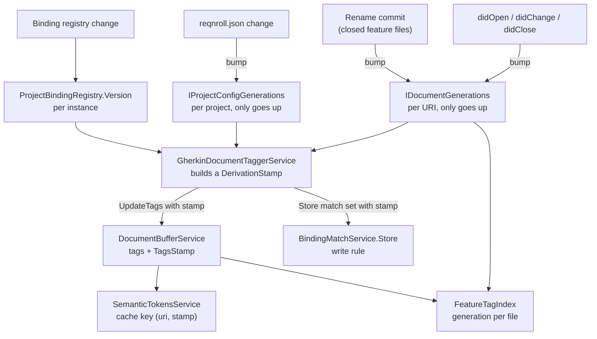
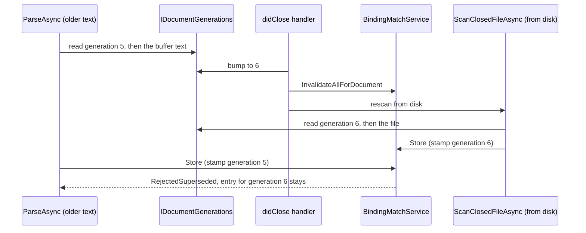
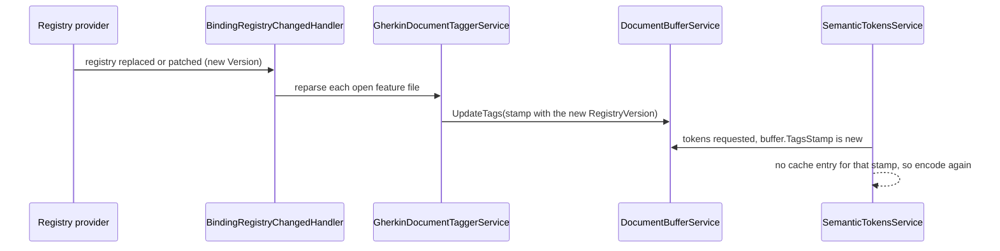

# Derived State Versioning: Stamps and the Write Rule

**Status:** Implemented. Describes the system as it is; verify against the source files named in each section.
**Audience:** Maintainers adding a cache, a writer of per-document state, or anything that reads a match set, a tag set
or a token cache and has to decide whether it is current.

## 1. Purpose and scope

The server derives per-document state from three inputs: the document's text, its project's configuration (the
feature language) and the project's binding registry. Several writers produce that state concurrently: the parse after
`didOpen`/`didChange`, the closed-file scans after a registry change, the rescan after `didClose`, the rename commit,
and the reconcile after a `reqnroll.json` edit. Without ordering, the last writer wins, not the newest, so a slow
derivation from older inputs could overwrite a newer result and leave it stale until something else re-derived it.

This document describes how each piece of derived state records the versions of its inputs (a **stamp**), how guarded
stores compare stamps (the **write rule**), and which caches key on stamps. It covers `.feature` documents only.

It does not cover: where bindings come from ([binding-discovery.md](binding-discovery.md)), which project owns a file
([workspace-and-membership.md](workspace-and-membership.md)), or the parse-and-match pass itself
([server-pipeline.md](server-pipeline.md)). It deliberately does not add snapshot isolation for readers that add up
over many documents (step-usage CodeLens, Find Usages); see §7.

## 2. Overview

## 3. Flows

### 3.1 A write that arrives too late

### 3.2 A registry change reaching an unchanged open document

No cache is told to evict. The tag set carries a newer stamp, so everything keyed on the stamp misses.

## 4. Glossary

| Term | Meaning here |
|---|---|
| **Content generation** | A `long` per document URI that goes up on every event that changes what the server believes the text is. It exists for closed files too and survives `didClose`. Not the client's document version, which restarts when a file is reopened. |
| **Config generation** | A `long` per project (`ProjectOwner`) that goes up when its `reqnroll.json` changes. |
| **Registry version** | `ProjectBindingRegistry.Version`: unique per immutable registry instance across the process. |
| **Stamp** | `DerivationStamp(ContentGeneration, ConfigGeneration, RegistryVersion)`: the versions of the inputs one derivation read. |
| **Superseded** | The stamp's content generation is not the document's current one: the text moved on after the inputs were read. |
| **Stale** | The stamp is older than the entry already stored under the same key. |
| **Key** | `MatchSetKey(DocumentId, Owner)`: a feature linked into several projects has one entry per owner, all with the same content generation. |

## 5. Key classes

| Type | Location | Responsibility |
|---|---|---|
| `IDocumentGenerations` / `DocumentGenerations` | `LSP.Core/Documents` | Per-URI counter: `Current`, `Bump`. Case-insensitive on the URI. Singleton. |
| `IProjectConfigGenerations` / `ProjectConfigGenerations` | `LSP.Core/Workspace` | Per-project counter keyed by `ProjectOwner`. Singleton. |
| `DerivationStamp` | `LSP.Core/Matching` | The stamp, ordered lexicographically: content, then config, then registry. A total order. |
| `FeatureBindingMatchSet.Stamp` | `LSP.Core/Matching` | The stamp of the inputs the match set was built from. `DocumentVersion` stays for wire messages that need the client version. |
| `BindingMatchService.Store` | `LSP.Core/Matching` | Applies the write rule inside its write lock and returns a `StoreOutcome`. `GetStoreStats` returns running totals. |
| `DocumentBuffer.Generation`, `.TagsStamp` | `LSP.Server/Documents` | The generation the text carries, and the stamp of the tags attached to it. `Update` clears the tags and their stamp. |
| `DocumentBufferService.Update` | `LSP.Server/Documents` | Stores the text with the generation it was bumped to. Ignores an update whose generation is lower than the buffer's, so two changes arriving out of order cannot put older text over newer. |
| `DocumentBufferService.UpdateTags` | `LSP.Server/Documents` | Update-only. Attaches tags only if the stamp's content generation is the buffer's. |
| `GherkinDocumentTaggerService` | `LSP.Server/Tagging` | Builds the stamp for `ParseAsync` and `ScanClosedFileAsync`, reading each input before using it. |
| `SemanticTokensService` | `LSP.Server/Features/SemanticTokens` | Caches under `(uri, TagsStamp)`, drops entries with older stamps, and derives `ResultId` from the stamp. |
| `FeatureTagIndex` | `LSP.Server/Features/Completions` | Open buffers: counts anchored on `buffer.Generation`. Closed files: the generation read before the file, plus the write time. |

## 6. Behaviour and contracts

### 6.1 Where the generations go up

- **Content generation:** `didOpen`, `didChange` and `didClose` in `TextDocumentSyncHandler`, and
  `RenamePostApplyCoordinator` for each closed feature file the rename edits. A close counts because it switches the
  source of truth from the editor buffer to the file on disk, even when the buffer matched the file.
- **Config generation:** `ReqnrollConfigChangedHandler`, before it publishes the reconcile for that project. The
  workspace-root path does not bump: it serves `.editorconfig`, which never changes how a feature file parses.
- A feature file leaving one project is **not** a content bump. See §7.

### 6.2 The stamp is built from values read before the inputs

`ParseAsync` takes the content generation with the buffer snapshot, reads the config generation before the feature
language, and uses the registry instance it matched against. `ScanClosedFileAsync` reads the config generation before
the language and receives a content generation its caller read before the text. `RescanClosedFileAsync` reads the
generation before `ReadAllTextAsync`. A stamp is therefore never newer than the input it describes. A write whose text
changed during the read is rejected as superseded instead of being recorded as current.

### 6.3 The write rule

`BindingMatchService.Store` evaluates an incoming set under its write lock:

1. **Superseded:** `Stamp.ContentGeneration != generations.Current(DocumentId)` → dropped.
2. **Stale:** an entry exists and `Stamp < stored.Stamp` → dropped.
3. Otherwise the set replaces the entry. Equal stamps are accepted: two scans of identical inputs are interchangeable,
   and a closed file can change on disk without any event, so the second scan may carry newer text under the same
   generation.

A dropped write changes nothing: the stored entry stays, the reverse indexes stay, and the pre-baseline placeholder
for an unknown owner is not evicted. `StoreOutcome` tells the caller what happened. `GetStoreStats` counts accepted,
superseded and stale writes. A rejection logs at Verbose with the key, both stamps and the current generation. If newer
text came from an older registry or configuration than the stored entry's, `Store` logs a Warning
(`project-input regression`), because project inputs are read monotonically and that should not happen.

`DocumentBufferService.UpdateTags` applies rule 1 to the tags: tags computed from older text are never attached to a
newer buffer, and tags for a buffer that was closed are never attached to a re-created one.

### 6.4 Invariants the rule depends on

Dropping a write is only safe if something newer is already on its way.

- **Every content bump is followed by a re-derivation of the new content.** `didOpen`/`didChange` schedule a parse.
  `didClose` runs `RescanClosedFileAsync`. A rename of a closed feature file re-derives it from the post-rename text,
  staged before the client applied the edit, because at commit the disk may hold either version.
- **Every registry change re-derives that project's entries.** A replacement re-derives every file; a patch reparses
  open files at once and rescans closed files after the debounce.
- **Project-input reads are monotonic.** A derivation that starts later never reads an older registry or config
  generation than one that started earlier.
- **Every config bump is followed by a re-derivation of the project's entries.** The handler publishes the patched
  notification, which reparses open files and schedules the closed-file rescan.

### 6.5 Downstream caches compare stamps and are never told to evict

- `SemanticTokensService` encodes from the buffer's current tags and caches under `(uri, buffer.TagsStamp)`. A tag set
  from a newer registry or configuration misses the cache by construction. While the buffer has no tags (the window
  after an edit, before its parse lands) it returns an empty result, never tokens cached for older text.
- `FeatureTagIndex` anchors an open buffer's counts on `buffer.Generation`. A closed file's entry also records the
  generation read before the file, so a rename or close re-reads a file whose write time did not visibly change. The
  feature language is still compared by value, because it is the value the parse actually used.

### 6.6 Closed-file writes refresh the step usage lenses

A closed file's match sets feed the step usage count shown over C# step definitions. Two writers change them with no
parse of an open document behind them, so each requests a lens refresh itself:

- `FeatureDocumentReparser.RescanClosedDocumentAsync` (from `didClose`) rescans from disk and publishes
  `ClosedFileMatchCacheChangedNotification`. `CodeLensRefreshHandler` handles it through the same debounce as
  `MatchCacheChangedNotification`, so closing many documents sends one refresh.
- `RenamePostApplyCoordinator` asks for one refresh after it has re-derived the closed feature files. The registry
  refresh that precedes the re-derivation asks too, but before those usages are in the cache.

The notification is separate from `MatchCacheChangedNotification` because that one drives diagnostics, semantic tokens
and inlay hints for an open document, none of which applies to a closed file.

## 7. Pitfalls and design decisions

1. **Do not bump the content generation for a change that is per project.** The generation is per document. A feature
   leaving one project does not change its text, and bumping would reject in-flight writes for the file's other owners
   with nothing to re-derive them. That breaks the invariant in §6.4.
2. **Read every input before using it.** A stamp taken after the read can be newer than the text it describes, which
   makes an old derivation look current.
3. **Use a total order for stamps.** With "both components at least as large", two stamps can be incomparable, and
   whichever tie-break you pick the next incomparable write can flip it back.
4. **Keep the generation after `didClose`.** It is what lets a write from before the close be recognised as stale. The
   cost is one entry per feature URI ever seen, the same order as the match cache.
5. **Tests that build a `BindingMatchService` must share its `IDocumentGenerations` with the code that bumps.** With a
   private instance every write looks superseded. A test that models "switching back" to earlier bindings must build a
   new registry, as a real rediscovery does: re-storing a set built from the older instance is stale.
6. **Do not add a caller-name parameter to a mocked interface method.** NSubstitute matches it as an argument, so
   `DidNotReceive().Store(Arg.Any<…>())` passes without checking anything.
7. **A new configuration input that changes how a feature file parses must bump the config generation** through the
   same handler, or the invariant for config bumps fails and stale entries are never replaced.
8. **Rejected alternatives.**
   - *Restructure the handlers as commands and queries.* The protocol and the MediatR pipeline already separate them.
     The problem was write ordering, which versioned read models fix.
   - *Fix each stale-write path locally.* Every path would need its own ordering logic, and the next writer would
     reintroduce the problem.
   - *Compare only the client's document version.* It does not exist for closed files and restarts on reopen.
   - *An immutable snapshot of the whole match cache for sweeps.* See §8.

## 8. Known limitations

- **Closed feature files edited outside the editor are not observed.** `WatchedFilesHandler` has no `.feature`
  branch, so such an edit does not bump the generation and is picked up only at the next registry replacement. A
  watcher added later must bump the generation and schedule a rescan together.
- **Readers that add up over many documents see a mixed set.** Step usage counts, Find Usages and Find Unused Step
  Definitions read many entries with one lock per call. A sweep that overlaps a rescan can mix entries from before and
  after it. Every bulk writer ends in a debounced lens refresh, so the counts correct; no sweep-level generation exists.
- **A feature file removed from one project keeps that project's match set** until the next full scan, because the
  membership delta publishes nothing that drops a single `(uri, project)` entry.
- **`MatchCacheChangedNotification` is still published after a dropped parse.** It costs a refresh that reads the
  current cache; it does not publish stale data.
- **Only the feature language is a configuration input.** The stamp carries a counter, not the values read.

## 9. Testing

| What | Where |
|---|---|
| The write rule, outcomes, counters, two owners of one document | `LSP.Core.Tests/Matching/BindingMatchServiceStampOutcomeTests`, `BindingMatchServiceOrderingTests` |
| Generation and config counters, the stamp order | `LSP.Core.Tests` (`DocumentGenerations`, `ProjectConfigGenerations`, `DerivationStamp`) |
| Each stale-write ordering, driven deterministically with hooks | `LSP.Server.Tests/Tagging/GherkinDocumentTaggerServiceRaceTests`, `GherkinDocumentTaggerServiceCloseRaceTests` |
| Stamps recorded on buffers and match sets, read order | `LSP.Server.Tests/Tagging/GherkinDocumentTaggerServiceStampTests`, `Documents/DocumentBufferServiceGenerationTests` |
| Token cache keyed on stamps, including a registry change recolouring an unchanged document | `LSP.Server.Tests/Features/SemanticTokens/SemanticTokensServiceTests`, `Tagging/SemanticTokensStampEndToEndTests` |
| Tag index freshness by generation | `LSP.Server.Tests/Features/Completions/FeatureTagIndexTests` |
| Lens refresh after a closed-file rewrite | `Parsing/FeatureDocumentReparserTests`, `Pipeline/CodeLensRefreshHandlerTests`, `Features/Rename/RenamePostApplyCoordinatorTests` |

These tests were not exercised live in an IDE: the live checks (usage lens counts across cold starts on a solution with
linked feature files, a language change during a rebuild, and typing in a slow-to-parse file) have not been run.
