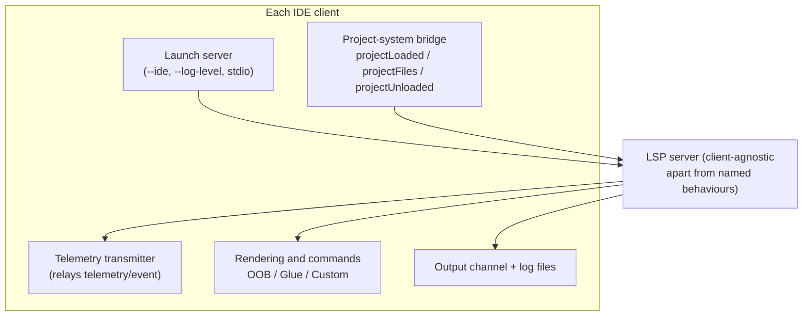
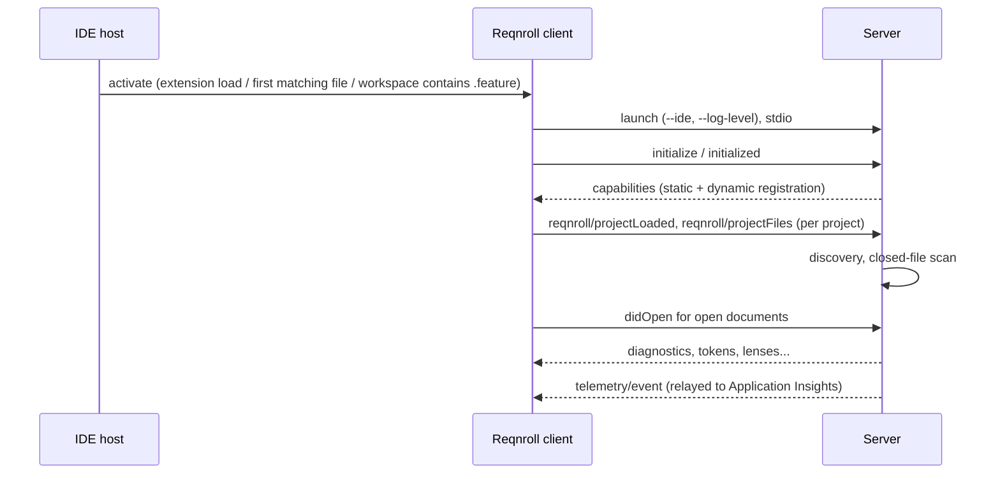

# IDE Clients: Common Role and the Cross-IDE Matrix

**Status:** Implemented. Describes the system as it is. This matrix is the authoritative statement of how each feature is delivered in each IDE.
**Audience:** Maintainers deciding where a change belongs (server or client), or why a feature is delivered differently in one IDE.

## 1. Purpose and scope

All Gherkin intelligence lives in the server. Each IDE has a thin client that starts the server, forwards editor and
project-system events, and renders results with the IDE's own UI. This document defines what every client does, the
three implementation tiers a feature can fall into, and, per feature, which tier each IDE uses and whether the
server branches for it. The three clients are described in [client-vscode.md](client-vscode.md),
[client-visualstudio.md](client-visualstudio.md) and [client-rider.md](client-rider.md).

## 2. Overview

Common responsibilities of every client:

- Bundle the server (self-contained executables for `win-x64`, `win-arm64`, `linux-x64`, `linux-arm64`, `osx-x64`,
  `osx-arm64`; Visual Studio bundles Windows only) and start it with `--ide <name>` over stdio.
- Send project information (`projectLoaded`, `projectFiles`, `projectUnloaded`) from the IDE's own project system.
- Relay `telemetry/event` to Application Insights with host-stamped IDE, IDE version and extension version.
- Surface a `Reqnroll` output channel and write inspector and log files to the shared Reqnroll log folder.
- Cope with a server restart. Restart policy is each client framework's default; state a client pushed to the old
  server with its own notifications (project information) is not replayed and must be re-pushed on every restart.

## 3. Flows

### 3.1 Startup (generic)

## 4. Glossary

| Term | Meaning here |
|---|---|
| **OOB** | Works through the IDE's generic LSP client for the standard method. A declarative configuration knob (a property override, a `package.json` contribution) still counts as OOB. |
| **Glue** | The method is standard LSP, but the IDE's generic client has no rendering consumer for it, or its built-in consumer is unreliable, so the client calls it directly and renders through the IDE's native extension points. |
| **Custom** | A bespoke `reqnroll/*` message, because no standard method expresses the feature or the workflow goes beyond what the standard method returns. |
| **Server-conditional** | The server branches on a client behaviour for that feature. "No" means the server behaves identically even if the client's tier differs per IDE. |

## 5. Key classes

| Piece | Visual Studio | VS Code | Rider |
|---|---|---|---|
| Language client / launcher | `ReqnrollLanguageClient`, `LspServerConnectionService` | `extension.ts` (`LanguageClient`) | `ReqnrollLspServerDescriptor`, `ReqnrollLspServerSupportProvider` |
| Project bridge | `VsProjectEventMonitor`, `VsProjectPayloadBuilder` | `lsp/projectManager.ts`, `lsp/msbuildEvaluator.ts` | `ReqnrollProjectFilesSync`, `ReqnrollRunnableProjectsListener` |
| Telemetry | `TelemetryTransmitter`, `TelemetryEventInterceptor` | `telemetry.ts` | `RiderTelemetryTransmitter`, `ReqnrollTelemetryEventInterceptor` |
| Custom requests | `*Service` classes per feature | `commands/*.ts` | `ReqnrollRequestSender` |

## 6. The cross-IDE matrix

| Feature | VS Code | Visual Studio | Rider | Server-conditional? |
|---|---|---|---|---|
| F1 Syntax highlighting (semantic tokens) | OOB (`semanticTokenScopes` config); TextMate grammar until tokens arrive | **Custom**: `reqnroll/semanticTokens` push, `SemanticTokensClassificationInterceptor`, custom `IClassifier` | Glue: standard pull, custom `TextAttributesKey` per legend name | **Yes**: push only for Visual Studio |
| F2 Project/binding discovery notifications | Custom: `projectManager.ts` + `dotnet msbuild` | Custom: `VsProjectEventMonitor` via EnvDTE and CPS | Custom: `ReqnrollProjectFilesSync`/`ReqnrollRunnableProjectsListener` via Rider's project model | No |
| F3/F4 Diagnostics and parse errors | OOB | OOB | OOB | No |
| F5 Go to step definition | F12/Peek OOB (`definition`); the Reqnroll command is **Custom** (`reqnroll/findStepDefinitions`, QuickPick labelled by class, method and attribute) | **Custom**: `GoToDefinitionCommandFilter` takes over Edit.GoToDefinition and sends `findStepDefinitions`; several matches open Find All References titled after the step. Ctrl+hover underline only where a lookup finds a navigable binding | OOB via the generic Go To Definition | No |
| F6 Define steps (code action) | OOB (quick fix) | OOB (`ScaffoldTrackingInterceptor` only registers the new file with the membership index) | OOB (Alt+Enter) | No |
| F7/F8 Completion | OOB | OOB | OOB | **Yes**: completion workarounds for Visual Studio |
| F9 Document outline | OOB (native Outline) | **Custom**: `reqnroll/documentSymbolHierarchical` + `GherkinNavigationBarSymbolService` / `IVsDropdownBarClient` (navigation-bar dropdowns). Visual Studio never sends `documentSymbol` | OOB on current Rider (native Structure view); older Rider has no outline | No |
| F10 Code folding | OOB | OOB | Glue: `ReqnrollFeatureFoldingController` calls `foldingRange` and renders via `Editor.foldingModel` | No |
| F11 Document formatting | OOB | OOB | OOB (`lspFormattingSupport` override) | No |
| F12 Table formatting (on type) | OOB (`editor.formatOnType`) | OOB | Glue: `ReqnrollFeatureOnTypeFormattingHandler` (a `typedHandler`) | No |
| F13 Comment / uncomment | Glue: `workspace/executeCommand` `reqnroll.toggleComment` on Ctrl+/ | Glue: same request, via command-filter redirects on Edit.CommentSelection, UncommentSelection and ToggleLineComment | Glue: `ReqnrollCommentByLineCommentAction` overrides the platform action by ID so every keymap reaches it | No |
| F14 Find step usages | Custom: `reqnroll/findStepUsages` + QuickPick | Custom: same + `NavigationPickerDialog` | Custom: same + `StepUsagesCodeVisionProvider`/`FindStepUsagesAction` | No |
| F15 Find unused step definitions | Custom: `reqnroll/findUnusedStepDefinitions` | Custom | Custom + `FindUnusedStepDefinitionsAction` | No |
| F16 Step rename | Custom: `renameStep.ts` (`renameTargets`, `selectRenameTarget`) over `textDocument/rename` | Custom: same messages | Custom: `RenameFeatureStepAction`/`RenameCSharpStepAction` + `RenameStepRunner`/`RenameWorkspaceEditApplier` | **Yes**: `AppliesRenameResponseEditNatively` |
| F17 Go to hooks | Custom: `reqnroll/findHooks` + QuickPick | Custom + `NavigationPickerDialog` | Custom: `GoToHooksAction` | No |
| F18 Step-usage CodeLens | OOB (native `CodeLensProvider`) | **Custom**: `StepCodeLensService` over `LspInterceptingPipe`; refresh via `reqnroll/refreshCodeLens` | Glue: `StepUsagesCodeVisionProvider` | **Yes**: refresh message |
| F23 Inlay hints | OOB | OOB | Glue: `ReqnrollFeatureInlayHintsController` via `Editor.inlayModel` | No |
| F24 Hook-match CodeLens (`.feature`) | Glue: `hookCodeLens.ts` provider; click reuses `findHooks` | **Custom**: classic CodeLens API (`HookCodeLensTaggerProvider` + data-point providers); out-of-process data points call back through `ICodeLensCallbackService` | Glue: `HookCodeVisionProvider` + `StepHooksCodeVisionProvider` | No |
| F25 Hook-binding match-count CodeLens (`.cs`) | Glue: shares the F18 provider; `goToMatchingScenarios.ts` | **Custom**: `HookMatchCountCodeLensProvider` (second `ICodeLensProvider`) | Glue via `StepUsagesCodeVisionProvider` dispatch | No |
| F26 Run / outcomes | None of its own (C# Dev Kit); opt-in read-only outcome lens | **Custom**: classic CodeLens bridge to Test Explorer | Glue: `RunTestCodeVisionProvider` + own `dotnet test` | No |
| F27 C# binding validation | OOB | OOB | OOB | No |
| F28 Clickable tags | OOB (`documentLink`, plus `tagLinks.ts` support) | Custom: `DocumentLinkService` / symbol provider bridge | Glue: `taglinks` package | No |

Why the tiers differ, in one place:

- **Rider's generic client has no rendering-side consumer** for codeLens, inlay hints, on-type formatting or folding
  (confirmed by decompiling the platform), hence Glue for those.
- **Visual Studio's built-in consumers are unreliable or too narrow** for semantic tokens (fixed name table), code
  lenses on `.feature` files (VS.Extensibility has no generic consumer for a custom language), outline (classic
  dropdown bar needs a shape standard `documentSymbol` does not provide), and go to definition (the standard result
  title cannot explain ambiguity).
- **Custom messages** exist where no standard method expresses the feature (hooks, unused definitions) or the
  workflow needs more than the standard result (rename's ambiguous-binding picker, `findStepDefinitions`).

## 7. Pitfalls and design decisions

1. **Do not move IDE conditionals into handlers.** Put a client quirk in `IdeBehaviours`, so handlers branch on a
   named behaviour. See [server-protocol.md](server-protocol.md).
2. **Find usages cannot use `textDocument/references`.** Dispatch by caret position is unreliable on all three IDEs
   because the C# server intercepts it, so every client uses the custom message.
3. **Verify per-IDE assumptions against the platform.** Several early assumptions were wrong: Rider needs no PSI
   bridge for cross-language navigation; Rider's formatting needs no override; VS Code's standard watcher is enough
   for rebuild detection.
4. **Keep a client's custom code to the minimum the platform forces.** Client-side logic is the hardest to test
   automatically; push behaviour into the server where it can be specified with `.feature` specs.

## 8. Known limitations

- Visual Studio does not advertise rename change annotations, so renames apply silently where VS Code and Rider show a
  grouped preview.
- Visual Studio's Document Outline window is not populated (navigation-bar dropdowns are).
- Rider has no Debug action for scenarios and no native Unit Tests window presence.
- VS Code has no run affordance of its own.

## 9. Testing

| Layer | Where |
|---|---|
| Behaviour that is the same for every IDE | `tests/LSP/Reqnroll.IdeSupport.LSP.Server.Specs`, as `.feature` specs through a simulated client |
| IDE-conditional server behaviour | Separate `*VisualStudio.feature` specs, gated on the client identity |
| Visual Studio client logic | `tests/VisualStudio/Reqnroll.IdeSupport.VisualStudio.Tests` (with `VsxStubs` doubles), `…Wizards.Tests` |
| VS Code client logic | `src/VSCode/src/test` (Mocha) |
| Rider client logic | `src/Rider/src/test` (JUnit5 / `kotlin.test`) |

Native-runner invocation, rendering and live behaviour in each IDE are not practically unit-testable and are verified by
hand in the experimental instance, `Extension Development Host` or `runIde` sandbox.
