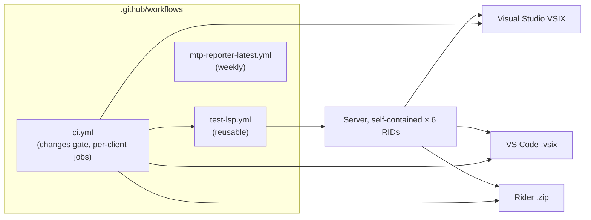
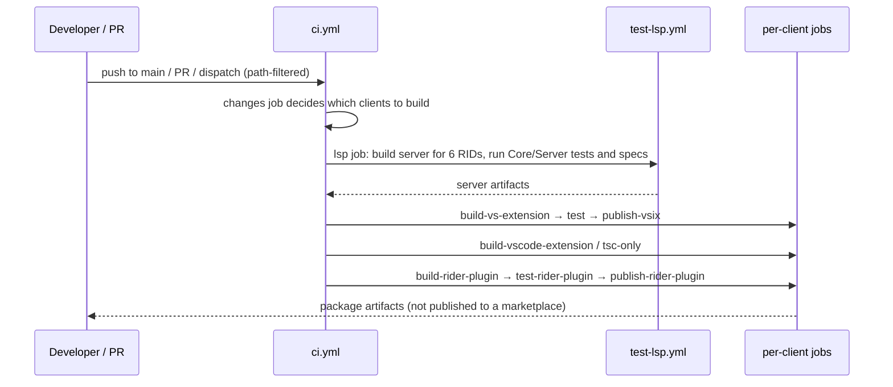

# Operations: Build, Versioning, Logging and Lifecycle

**Status:** Implemented. Describes the system as it is; verify against `.github/workflows` and the logging code.
**Audience:** Maintainers working on CI, packaging, diagnostics and logs, configuration inputs, or server lifetime.

## 1. Purpose and scope

The operational surface of the product: what configuration it reads, how it is built and packaged, how versions are
assigned, what it logs and where, how it fails, and how long the server lives. Telemetry is in
[telemetry.md](telemetry.md); performance in [performance.md](performance.md).

## 2. Overview

## 3. Flows

## 4. Glossary

| Term | Meaning here |
|---|---|
| **RID** | Runtime identifier of a server build (`win-x64`, `win-arm64`, `linux-x64`, `linux-arm64`, `osx-x64`, `osx-arm64`). |
| **Inspector log** | A client-side JSON-RPC trace in lsp-viewer format. |
| **Application directory** | The Reqnroll folder for logs and persisted state (`%LOCALAPPDATA%\Reqnroll` on Windows). |
| **Log level** | `Off`, `Error`, `Warning`, `Info`, `Verbose` (there is no `Debug`). |
| **Preview** | The release designation; no breaking-change-free guarantee between Preview releases. |

## 5. Key classes and files

| Item | Location | Responsibility |
|---|---|---|
| `ci.yml`, `test-lsp.yml`, `mtp-reporter-latest.yml` | `.github/workflows` | CI orchestration, server build and tests, weekly check of the MTP reporter against the latest Microsoft.Testing.Platform and MSTest. |
| `ReqnrollLogPaths`, `SynchronousFileLogger`, `IdeSupportDebugLogger` | `src/Core/…Common/Logging` | Log folder, naming, 10-day pruning, debug logger. |
| `LspInspectorLogger`, `lspInspectorLogger.ts` | VS Extension, VS Code | Client-side inspector traces. |
| `LspServerConnectionService.ServerArguments`, `ReqnrollLspServerDescriptor.resolveLogLevel` | VS, Rider | Default log level per client. |
| Configuration loader | `src/Core/…Common/Configuration` | `reqnroll.json` and `.editorconfig` loading. |

## 6. Behaviour and contracts

### 6.1 Configuration inputs

- `reqnroll.json`: test framework, discovery settings, Gherkin language, and flags such as
  `ide.reqnroll.isReqnrollProject` and `ide.traceability.tagLinks`.
- `.editorconfig`: for `.feature` files the server reads `indent_size`, `indent_style` and `end_of_line`.
- IDE settings and environment: server path overrides for development (for example `REQNROLL_GHERKIN_SERVER_PATH`
  for Rider), trace levels, and the kill switches documented with the features that have them.

### 6.2 CI and packaging

Two workflows carry the build: `ci.yml` (push to `main`, PRs, manual dispatch; path-filtered to the source and test trees;
a `changes` job gates the per-client jobs) and the reusable `test-lsp.yml` (builds the server self-contained for all six
RIDs and runs `LSP.Core.Tests`, `LSP.Server.Tests`, `LSP.Server.Specs`). The per-client jobs are inside `ci.yml`, not
separate workflows. `publish-vsix` and `publish-rider-plugin` upload the package as a CI artifact; **marketplace
publication is not automated today.** The server tests run on Windows runners and the six server builds are cross-published from a Linux runner, which the
LSP separation from IDE-specific code makes possible.
The VS Code job downloads all six server artifacts and runs `vsce package`; the Rider job takes them through
`-PlspServerBuildDir`.

Publication requirements, performed outside CI at present: the VSIX must be code-signed; the VS Code `.vsix` is
published through `vsce` with a verified publisher; the Rider plugin is published through the JetBrains Marketplace API
with a token held as a secret. The bundled server inherits signing from its package.

### 6.3 Versioning

The server and all three clients share one version and release together, so each extension bundles only the server it
was tested against. CI stamps versions as `<main version>.<run number>`. The server targets `net10.0` and follows the
current .NET on a cadence aligned with Reqnroll's runtime; clients are unaffected because they launch the binary. Breaking
`reqnroll.json` schema changes need a migration guide and tolerant loading across a transition of at least one major
version. The server declares capabilities at `initialize` and must not send messages for capabilities a client did not
advertise; OmniSharp handles standard negotiation.

### 6.4 Logging

The server uses `ILogger`, routing entries to `window/logMessage` (shown in each client's `Reqnroll` output channel) and,
in addition, to a local file sink. Every file shares one canonical UTC-timestamped preamble.

| Log | Name | Notes |
|---|---|---|
| Server | `reqnroll-<ide>-<role>-[debug-]<yyyyMMdd>-<pid>.log` | Under the application directory's `logs` folder; pruned after 10 days. |
| Client inspector | `reqnroll-<ide>-inspector-<datetime>.log` | Written when tracing is enabled; format compatible with lsp-viewer. |
| Connector | `reqnroll-lsp-connector-<date>-<pid>.log` | Buffered in memory and flushed only on a discovery error, or at `Info`/`Verbose`. |

Default levels: an installed client passes `--log-level Warning`; development configurations raise it to `Verbose`
(Rider only when started through `runIde`; for Visual Studio setting `REQNROLLVS_DEBUG=1` also forces Verbose). Each client
exposes a trace-level setting (for example VS Code's `reqnroll.trace.server`) that maps onto it. `window/showMessage`
is for alerts needing immediate attention (Connector crash, missing .NET runtime). Users reporting bugs are directed to
the GitHub tracker with the `Reqnroll` output channel and, for protocol problems, an inspector trace.

### 6.5 Errors and resilience

- Parser exception: store an empty AST with one parse-error diagnostic; return an empty token list; the buffer is never
  partially updated.
- Connector failure: keep the last valid registry, log, warn, never clear it.
- Server exit: each client's framework restart policy applies; clients re-push their own state after a restart.
- Cancellation: stores are atomic, so cancellation cannot leave inconsistent state.

### 6.6 Server lifecycle

A single server instance serves all open workspace folders (multi-root). It ends when the IDE workspace closes. Launch
timing differs: **Visual Studio** eagerly at extension load; **Rider** at project startup through `postStartupActivity`;
**VS Code** lazily on a matching activation event (`onLanguage:reqnroll`, `onLanguage:plaintext`) or earlier when
`workspaceContains:**/*.feature`.

## 7. Pitfalls and design decisions

1. **Build the VS extension from a short path.** Deep worktree paths break IDE builds with misleading errors.
2. **Share one version.** Per-client versions would let a client meet a server it was not tested against.
3. **Rider's Marketplace plugin ID must avoid the substring "rider"**; the Plugin Verifier rejects it.
4. **Verbose by default for developers only.** Installed clients default to Warning to keep logs small.
5. **Do not treat `publish-*` job names as publication.** They only upload artifacts.

## 8. Known limitations

- Marketplace publication and signing are manual.
- No automated end-to-end suite against real IDE instances; it is required before the Preview label is lifted.

## 9. Testing

| Layer | Where |
|---|---|
| Logging, log paths, pruning | `tests/Core/Reqnroll.IdeSupport.Common.Tests`, `tests/LSP/Reqnroll.IdeSupport.LSP.Server.Tests/Logging` |
| Workflows | Run on CI; the MTP reporter check runs weekly |
