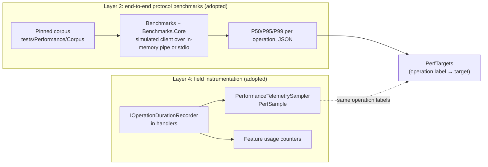
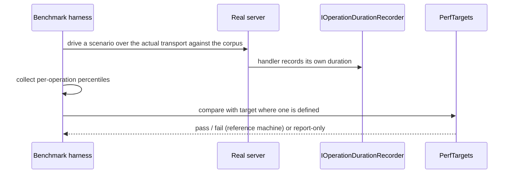

# Performance Requirements and Verification

**Status:** Implemented. Describes the system as it is; verify against `tests/Performance` and `src/LSP/…LSP.Server/Performance`.
**Audience:** Maintainers adding an operation, changing a hot path, or interpreting benchmark and field numbers.

## 1. Purpose and scope

This document states the latency targets, and how they are confirmed. Two kinds of target need different verification:
interactive round-trips (measured end to end at the protocol boundary, because timing a service in isolation
undercounts JSON-RPC serialization, transport and the MediatR fan-out) and batch operations (coarse enough for
wall-clock timing). It also separates *where* assertions run: shared CI runners are too noisy for absolute thresholds,
so absolute asserts run on a designated reference machine and CI is suited to relative regression detection.

How to run the benchmarks is in `src/LSP/CONTRIBUTING.md`.

## 2. Overview

## 3. Flows

## 4. Glossary

| Term | Meaning here |
|---|---|
| **P95** | The 95th percentile: 95% of requests complete within the stated time. |
| **Interactive** | An operation judged by its P95 round-trip. |
| **Batch** | An operation judged by wall-clock (median or max). |
| **Layer 2 / Layer 4** | Synthetic end-to-end benchmarks / field instrumentation. Layers 1 (micro-benchmarks) and 3 (CI regression gate) are deliberately deferred. |
| **Corpus** | A pinned, structural-fingerprint-checked set of `.feature` files and bindings (`CorpusDriftTests` guards it). |
| **Measured, no published threshold** | An operation with a `PerfTargets` entry reporting `—`: measured and benchmarked but never asserted. |
| **`IncludesFixedDelay`** | A target whose measurement includes a deliberate debounce window (for example the 500 ms refresh debounce). |

## 5. Key classes

| Class / project | Location | Responsibility |
|---|---|---|
| `Reqnroll.IdeSupport.LSP.Server.Benchmarks`, `…Benchmarks.Core` | `tests/Performance` | Console tool and harness/scenario/reporting library; `session` command models latency under concurrent editing. |
| `PerfTargets` | `…Benchmarks.Core/Latency` | Target per operation label; kind (interactive P95 or batch). |
| Corpus | `tests/Performance/Corpus` | Pinned workload; regenerable with `Benchmarks generate-corpus`. |
| `…Benchmarks.Corpus` | `tests/Performance` | Compiles `Corpus/Bindings/CorpusSteps.cs` into a loadable assembly for the discovery scenarios. Those scenarios report as skipped, not faked, when it is absent. |
| `IOperationDurationRecorder`, `OperationDurationRecorder`, `PerformanceTelemetrySampler` | `src/LSP/…LSP.Server/Performance` | Field timing, wired into nearly every handler (semantic tokens, completion, definition, references, rename, code actions, code lens, document outline, folding, formatting, inlay hints, find unused, comment toggle, text sync, test outcomes). |

## 6. Behaviour and contracts

Targets, at **P95** under typical conditions (up to 500 `.feature` files and 2,000 binding patterns):

| Operation | Target |
|---|---|
| `textDocument/semanticTokens/full` | < 100 ms from last `didChange` |
| `textDocument/completion`: keyword | < 50 ms |
| `textDocument/completion`: step | < 150 ms |
| `textDocument/definition`, cache hit | < 100 ms |
| `textDocument/publishDiagnostics` push | < 500 ms from the end of the debounce window |
| Roslyn re-discovery, single `.cs` file | < 2 s |
| Reflection discovery, post-build | < 10 s |
| Initial workspace scan, cold start | < 30 s |

These are design targets, not contractual SLAs.

The harness hosts a real server, in process over an in-memory pipe by default or `--out-of-process` over stdio against
the built executable (the production transport). Layer 2 asserts absolute thresholds on a designated reference
machine only. The JSON output is also the baseline format a future Layer 3 gate would use.

Operations that are measured but carry no threshold include the test-outcome pipeline: `reqnroll/testOutcomes/getOutcome`
(bare, plus `#found` and `#not-found`), `registerRun`, `testOutcomes/ingest#results-burst`, `changed`, and persistence
`#load`/`#save`. The bare `getOutcome` row keeps the field label and its synthetic counterpart aligned one to one; the
variants exist because a hit and a miss cost differently. A threshold is proposed from reference-machine data before it
is asserted.

## 7. Pitfalls and design decisions

1. **Do not time services in isolation to claim a target.** Interactive targets include serialization, transport and
   fan-out.
2. **Do not assert absolute numbers on shared CI runners.** They are too noisy; use the reference machine, and use CI for
   relative regression only.
3. **Use the same operation label in the recorder and the benchmark.** That is what lets field and synthetic numbers line
   up, and what makes a catalogue entry count usage (see [telemetry.md](telemetry.md)).
4. **A fixed debounce is part of some targets.** Mark `IncludesFixedDelay` so a debounce window is not read as slowness.
5. **Skip, do not fake.** A scenario that needs the corpus bindings assembly reports skipped when it is missing.
6. **Cost shape matters more than per-call cost for lenses.** See the test-runner document: resolving a file's scenarios
   one by one made a cheap call pathological at 1,300 to 2,000 scenarios.

## 8. Known limitations

- Layer 1 (service micro-benchmarks) and Layer 3 (CI regression gating) are not built; add Layer 3 once the Layer 2
  baseline is trusted on a fixed runner.
- Targets describe typical hardware; the field layer is what shows how real workspaces behave.

## 9. Testing

| Layer | Where |
|---|---|
| Corpus integrity | `CorpusDriftTests` |
| Recorder, sampler, targets | `tests/LSP/Reqnroll.IdeSupport.LSP.Server.Tests/Performance`, benchmark library tests |
