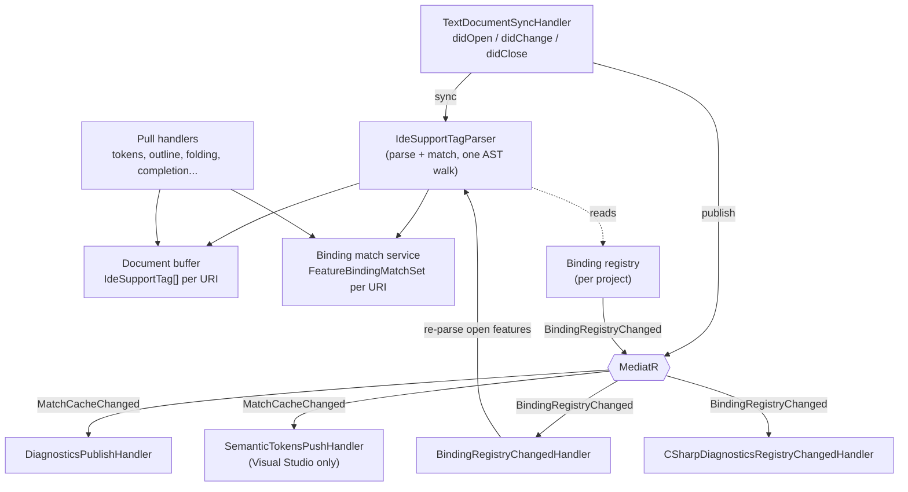
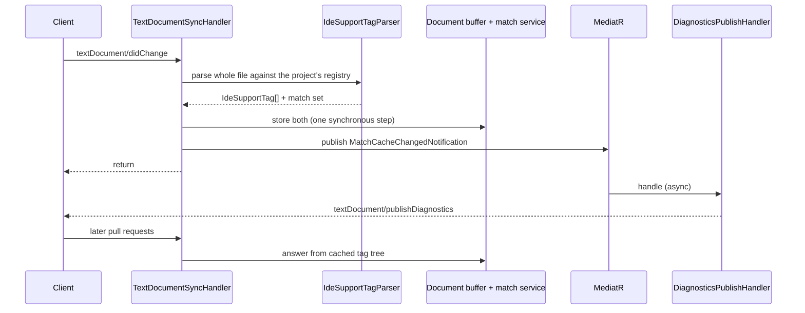
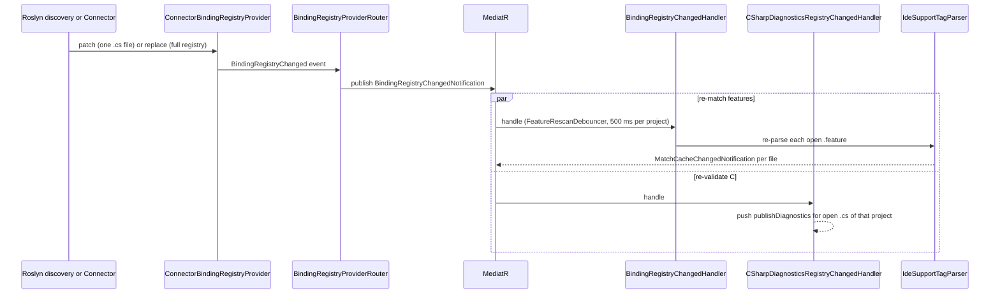
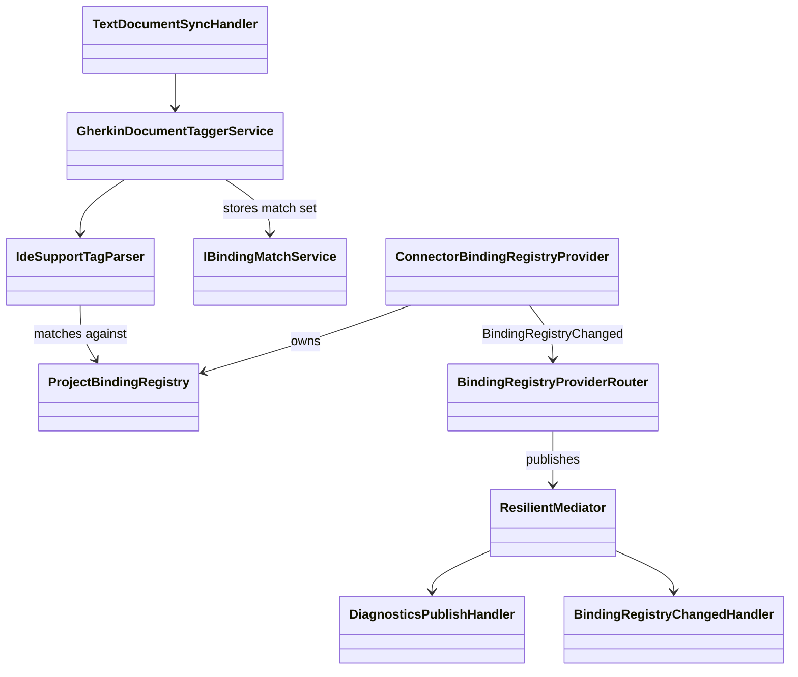

# Server Pipeline: Parsing, Matching and Internal Events

**Status:** Implemented. Describes the system as it is; verify against the source files named in each section.
**Audience:** Maintainers working on the Gherkin parse/match path, diagnostics fan-out, handlers, or anything that reacts to a binding or document change.

## 1. Purpose and scope

This document describes what happens inside the server between a document or binding change and the answers sent
to clients: the single-pass parse-and-match, the caches it fills, the internal MediatR events that fan out from it,
and the list of protocol handlers. Where the bindings themselves come from, see
[binding-discovery.md](binding-discovery.md). Which project a file belongs to is in
[workspace-and-membership.md](workspace-and-membership.md). How messages arrive and are registered is in
[server-protocol.md](server-protocol.md).

## 2. Overview

The model is **sync-first, async-rest**. The first state change (parsing and matching) must finish before the
handler can answer the current request, because, for example, `semanticTokens/full` needs the cached tags
immediately. Everything downstream (diagnostics, token pushes, refreshes of other open files) is independent and
dispatched asynchronously.

## 3. Flows

### 3.1 A `.feature` edit

### 3.2 The binding registry changes

## 4. Glossary

| Term | Meaning here |
|---|---|
| **Tag tree** | `IdeSupportTag[]`: structural classification (keywords, tags, descriptions, doc strings, tables, parse errors) fused with step match results (`DefinedStep`, `UndefinedStep`, `StepParameter`, `ScenarioOutlinePlaceholder`). |
| **Document buffer** | Per-URI cache of the tag tree and the file's effective Gherkin dialect. |
| **Match set** | `FeatureBindingMatchSet`: match results for a feature, kept in the binding match service. |
| **Binding registry** | Per-project store of bindings. Replaced or patched by discovery. |
| **Protocol handler** | An OmniSharp class in `Features/<Capability>` that handles an incoming LSP message. |
| **Internal handler** | A MediatR notification handler in `Pipeline/` that performs downstream work. |
| **Sync-first** | The protocol handler does the first state write itself and publishes events for the rest. |
| **Syntax-tree cache** | `ICSharpSyntaxTreeCache`: self-validating Roslyn parse cache for C# files the server reads but does not buffer. |

## 5. Key classes

Protocol handlers (one class may serve several messages):

| Class | Messages |
|---|---|
| `TextDocumentSyncHandler` | `didOpen`, `didChange`, `didClose` for `.feature` and `.cs` |
| `WatchedFilesHandler` | `workspace/didChangeWatchedFiles` |
| `SemanticTokensHandler` | `semanticTokens/full`, `/delta` |
| `DefinitionHandler` | `textDocument/definition` |
| `CodeActionHandler` | `textDocument/codeAction` |
| `CompletionHandler` | `completion`, `completionItem/resolve` |
| `DocumentSymbolHandler` | `textDocument/documentSymbol` |
| `FoldingRangeHandler`, `DocumentLinkHandler`, `InlayHintHandler` | `foldingRange`, `documentLink` (clickable tags), `inlayHint`; statically declared capabilities |
| `FormattingHandler` | `formatting`, `rangeFormatting`, `onTypeFormatting` |
| `CommentToggleHandler` | `workspace/executeCommand` for `reqnroll.toggleComment` |
| `ReferencesHandler`, `FindStepUsagesHandler` | `textDocument/references` (from `.cs`), `reqnroll/findStepUsages` |
| `RenameHandler`, `RenameTargetsHandler` | `prepareRename`, `rename`, `reqnroll/selectRenameTarget`, `reqnroll/renameTargets` |
| `StepCodeLensHandler`, `HookCodeLensHandler`, `HookMatchCountCodeLensHandler`, `CodeLensResolveHandler` | `textDocument/codeLens` variants and `codeLens/resolve` (dispatched by a `kind` discriminator in `CodeLens.Data`) |

Rename helpers that are not handlers: `WorkspaceEditBuilder` (annotated `DocumentChanges` for clients that advertise
`changeAnnotationSupport`, else the legacy `Changes` map), `RenameChangeAnnotations` (annotation-id constants),
`CSharpAttributeLiteralResolver`, `RenameBindingResolver`, `NewNameReconciler`, and `RenamePostApplyCoordinator`
(pushes a real `workspace/applyEdit` for clients with `AppliesRenameResponseEditNatively` and invalidates the match
cache of closed `.feature` files the edit touched). See [../features/rename.md](../features/rename.md).

Internal notifications:

| Notification | Produced by | Consumed by |
|---|---|---|
| `MatchCacheChangedNotification` | `TextDocumentSyncHandler` after parse and match; `BindingRegistryChangedHandler` after re-matching an open file | `DiagnosticsPublishHandler` (push diagnostics); `SemanticTokensPushHandler` (Visual Studio only) |
| `BindingRegistryChangedNotification` | `BindingRegistryProviderRouter`, relaying `ConnectorBindingRegistryProvider.BindingRegistryChanged` (raised by Roslyn patching a `.cs` file and by the Connector refresh after a build) | `BindingRegistryChangedHandler`; `CSharpDiagnosticsRegistryChangedHandler` |

## 6. Behaviour and contracts

### 6.1 Parse and match in one pass

On `didOpen` and `didChange` the sync handler runs `IdeSupportTagParser`, which parses Gherkin and matches steps in a
single AST walk. The resulting tag tree goes to the document buffer and the match set to the binding match service,
written together synchronously. Every later request for the document reads the cached tag tree and does not re-parse.
Because parse and match are not separate stages, there is no "parsed" event: the sync handler publishes
`MatchCacheChangedNotification` directly.

### 6.2 Registry changes

Both discovery sources converge on one path. On a `.cs` `didOpen`/`didChange`, `TextDocumentSyncHandler` calls
`ICSharpBindingDiscoveryService` directly (no extra notification hop). That patches the owning project's
`ConnectorBindingRegistryProvider`, which raises `BindingRegistryChanged`. A build detected through
`WatchedFilesHandler` raises the same event after the Connector refresh. `BindingRegistryChangedHandler` then
re-parses every open feature file against the updated registry, atomically replacing the tag tree and match set, and
republishes `MatchCacheChangedNotification` for each.

`CSharpDiagnosticsRegistryChangedHandler` subscribes independently: on any change it re-pushes
`textDocument/publishDiagnostics` for every open `.cs` file owned by the affected project, reading each binding's
`Error` from the registry through `ICSharpDiagnosticsAggregator`. The registry's change-detection gate compares
`Error` too, so a validity-only edit (for example removing `static` from a hook) raises a change on its own. Because
an invalid binding never matches a step, that edit also correctly refreshes "undefined step" diagnostics in `.feature`
files.

### 6.3 C# syntax-tree cache

`ICSharpSyntaxTreeCache` serves the C#-facing consumers that read files the server does not buffer:
`ScenarioTestTargetResolver` (the generated `.feature.cs`) and `CSharpAttributeLiteralResolver` (rename). It has no
invalidation event; it validates on read, in two modes:

- **Disk mode** (`GetOrParseFromDisk`) for files with no known live text: freshness by last-write time, so a rebuild
  that regenerates the code-behind is picked up with no watcher.
- **Live-text mode** (`GetOrParse`) for callers that already hold the current text: freshness by comparing the text.

It is bounded by a small most-recently-used cap, since disk-only files have no "close" event to hook.

### 6.4 Error handling and atomicity

- If the Gherkin parser throws, the handler stores an empty AST with a single parse-error diagnostic covering the
  file and returns an empty token list. The buffer is never left partially updated.
- Handlers that write the document buffer or binding registry use an atomic store model: the new value is written in
  full or not at all, whatever the cancellation timing.
- A failed Connector run retains the last valid registry (Roslyn-derived bindings remain), logs, and warns the user
  with `window/showMessage`. It never clears the registry. See [binding-discovery.md](binding-discovery.md).

## 7. Pitfalls and design decisions

1. **MediatR is for downstream fan-out only.** It keeps new internal handlers addable without touching protocol
   handlers, supports diagnostics aggregation from several independent services, and lets tests inject handlers. The
   price is a less linear call graph; the flows above exist to compensate. A move off OmniSharp would not touch
   parsing, discovery or matching, because those are insulated from the framework layer.
2. **Do not add a notification hop for `.cs` changes.** Going straight to `ICSharpBindingDiscoveryService` is
   deliberate; the shared registry-changed event is the single convergence point.
3. **Do not push C# diagnostics from the sync handler as well.** An earlier version did, to work around the registry
   change gate ignoring `Error`. With `Error` in the comparison one trigger suffices, and the direct push would be
   redundant.
4. **Interactive work must not wait on diagnostics.** The reason for sync-first: diagnostics may need to re-parse
   several open feature files, which should not block the response to the current request.
5. **The registry cache is the contract between discovery and everything else.** Do not read bindings from any other
   source in a feature.

## 8. Known limitations

- The call graph is less linear than direct calls; debugging a `didChange` crosses several handlers.
- `textDocument/codeAction` on `.cs` files (for example generating a step definition from a binding template) is
  feasible but not built. IDEs merge code actions from several servers, so a future one would appear beside the C#
  server's in the lightbulb menu without conflict.

## 9. Testing

| Layer | Where |
|---|---|
| Parser, tag tree, match set, formatting and other `LSP.Core` services | `tests/LSP/Reqnroll.IdeSupport.LSP.Core.Tests` |
| Handlers, pipeline handlers, debouncers | `tests/LSP/Reqnroll.IdeSupport.LSP.Server.Tests` |
| Whole pipeline through a simulated client over stdio | `tests/LSP/Reqnroll.IdeSupport.LSP.Server.Specs` |
