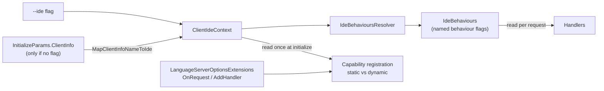
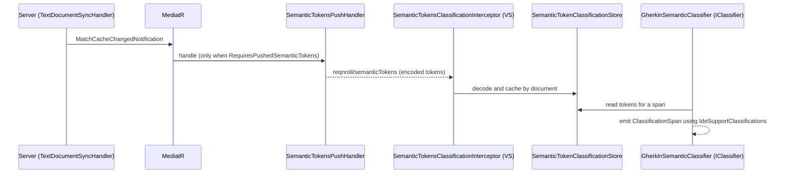
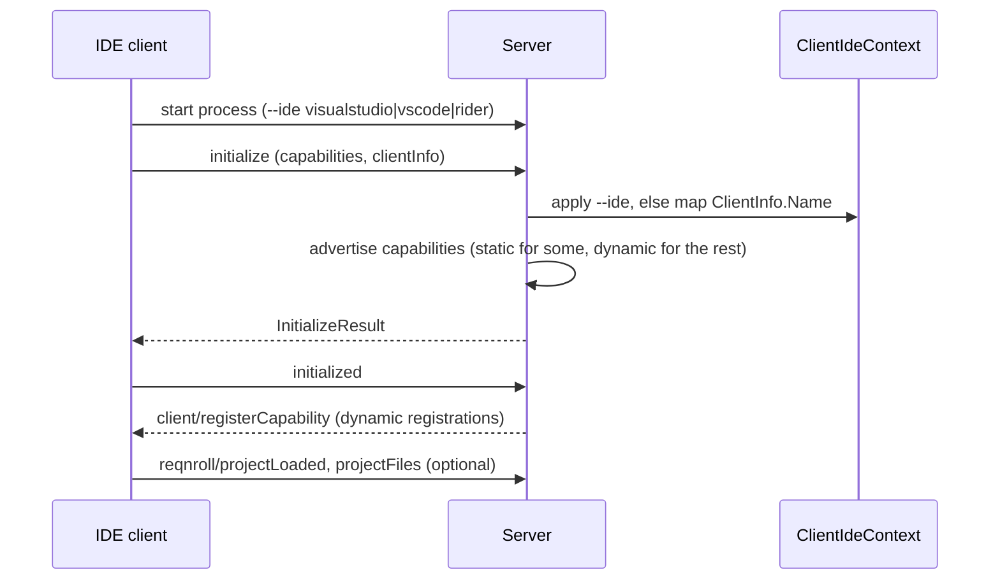

# Server Protocol: How the Server Speaks LSP

**Status:** Implemented. Describes the system as it is; verify against the source files named in each section.
**Audience:** Maintainers adding a handler or a capability, or debugging why a client behaves differently from another.

## 1. Purpose and scope

This document explains how the language server uses the Language Server Protocol, and where it deliberately does
something other than a textbook server. It covers capability registration, per-client behaviour switches, the
custom `reqnroll/*` methods, the push path for Visual Studio semantic tokens, and the rules for request priority,
cancellation and debouncing. It assumes basic familiarity with LSP: initialize/initialized, requests versus
notifications, document sync, push versus pull, semantic-token encoding, and static versus dynamic registration. The
[LSP 3.17 specification](https://microsoft.github.io/language-server-protocol/specifications/lsp/3.17/specification/)
is the authority for those.

For what happens inside the server after a message arrives, see [server-pipeline.md](server-pipeline.md). For the
exact payloads of the custom methods, see [../LSP-Protocol-Extensions.md](../LSP-Protocol-Extensions.md).

## 2. Overview

The server is client-agnostic except for two kinds of decision: which capabilities to register statically at
`initialize`, and a small set of named **behaviours** that handlers read per request. Handlers branch on a
behaviour, never on an IDE name, so a change in a client's quirks is a one-line edit to the resolver.

## 3. Flows

### 3.1 Visual Studio semantic tokens: server push plus client classifier

### 3.2 Initialize and capability negotiation

## 4. Glossary

| Term | Meaning here |
|---|---|
| **Static registration** | A capability declared in the `initialize` result. |
| **Dynamic registration** | A capability registered later through `client/registerCapability`. OmniSharp's handler base classes do this by default. |
| **`--ide` flag** | Server start argument naming the client. The only per-IDE identity available before the client connects. |
| **Client identity** | The resolved IDE name in `ClientIdeContext`: the flag if present, else a mapping of `ClientInfo.Name`. |
| **Behaviour** | A named boolean in `IdeBehaviours` describing a client quirk (for example `RequiresPushedSemanticTokens`). |
| **Push / pull** | Server-initiated versus client-initiated data flow. Most LSP features are pull; this server adds a push path for Visual Studio semantic tokens. |
| **Legend** | The semantic-token type list declared at `initialize`. Reordering or removing entries is a breaking change. |
| **Custom method** | A `reqnroll/*` request or notification for something LSP has no vocabulary for. Clients that do not know one ignore it. |

## 5. Key classes

| Class | Location | Responsibility |
|---|---|---|
| `Program` | `src/LSP/…LSP.Server/Hosting` | Entry point: parses `--ide` and `--log-level`, applies the semantic-tokens capability decision, starts the server. |
| `LanguageServerOptionsExtensions` | same | Capability and `reqnroll/*` registration: manual `OnRequest<>` for static capabilities, `AddHandler<>` for the rest. |
| `ClientIdeContext`, `MapClientInfoNameToIde` | same | Resolved client identity and the `ClientInfo` fallback mapping. |
| `IdeBehaviours`, `IdeBehavioursResolver` | `src/LSP/…LSP.Core/Ide` | The behaviour flags and the single place they are populated from identity. |
| `ReqnrollMethodProvider` | `…LSP.Server/Protocol` | Registers the `reqnroll/*` method names with OmniSharp. |
| `CustomLspMethodNames`, `LspStandardMethodNames` | `src/Core/…Common/Lsp` | Canonical method-name constants shared by the server and the Visual Studio client. |
| `SemanticTokensPushHandler` | `…LSP.Server/Pipeline` | Pushes `reqnroll/semanticTokens` when the behaviour is set. |
| `SemanticTokensClassificationInterceptor`, `SemanticTokenClassificationStore`, `GherkinSemanticClassifier` | `src/VisualStudio/…Extension/Classification` | Visual Studio side of the push path. |
| `TextDocumentSyncHandler` | `…LSP.Server/Features/TextSync` | One sync handler for `.feature` and `.cs`, routed by extension. |
| `CodeLensRefreshHandler`, `InlayHintRefreshHandler`, `SemanticTokensRefreshHandler`, `RefreshDebouncer` | `…LSP.Server/Pipeline`, `Concurrency` | Debounced refresh pushes to clients. |

## 6. Behaviour and contracts

### 6.1 Capability registration

OmniSharp registers dynamically by default. Capabilities that need static registration are wired manually with
`options.OnRequest<>` in `LanguageServerOptionsExtensions`: semantic tokens, references, document symbol, code
lens and `codeLens/resolve`, inlay hints, folding ranges, prepare-rename/rename and rename targets. Everything else
uses `AddHandler<>`. The `--ide` flag decides, once at `initialize`, which of these to register statically.

### 6.2 Client identity and behaviours

The `--ide` flag always wins. `InitializeParams.ClientInfo` fills the identity in only when no flag was passed.
`ClientInfo.Name` is a product name ("Visual Studio Code"), not an identifier, so `MapClientInfoNameToIde` is an
ordered, case-insensitive substring table. The order matters: "Visual Studio Code" contains "Visual Studio", so
the VS Code tokens are tested first. A name matching nothing resolves to no identity, which behaves like a
standard-LSP client. The resolved identity is logged at `initialize` with both raw sources.

Behaviours, as the resolver sets them today:

| Behaviour | Meaning | Set for |
|---|---|---|
| `RequiresPushedSemanticTokens` | Server pushes `reqnroll/semanticTokens` and withholds `full`/`range` from the advertised provider (the legend is still advertised) | Visual Studio |
| `UsesCustomCodeLensRefresh` | Refresh with `reqnroll/refreshCodeLens` instead of `workspace/codeLens/refresh` | Visual Studio |
| `RejectsEmptyTriggerCompletion` | An empty completion list on a trigger character makes the client delete the typed character, so a suppressed completion returns a no-op item | Visual Studio |
| `RequestsCompletionAfterDeletion` | The client asks for completion after a deletion, reporting the deleted text as `triggerCharacter` with kind `Invoked`; answer with an empty list | Visual Studio |
| `AppliesRenameResponseEditNatively` | The client applies whatever edit the rename response carries, so the server pushes the real edit with `workspace/applyEdit` and returns an empty edit | Visual Studio |
| `NavigatesStepsViaFindStepDefinitions` | Step navigation goes through `reqnroll/findStepDefinitions`; gates telemetry for `textDocument/definition` only | Visual Studio |
| `RunsVscodeOpenCommandLocally` | The client runs the built-in `vscode.open` command itself | VS Code |
| `HonorsShowDocumentRequests` | `window/showDocument` reliably opens a document | VS Code |
| `SupportsCodeLensResolve` | The client issues `codeLens/resolve`, so per-lens counts can be deferred | none currently |

### 6.3 Custom project-system notifications

LSP has no vocabulary for which project owns a file, its output assembly, or its package references. Three optional
client→server notifications carry this: `reqnroll/projectLoaded` (build properties), `reqnroll/projectFiles`
(file membership) and `reqnroll/projectUnloaded`. Each is optional: a client that cannot produce one omits it and the
server degrades (folder-prefix routing, no membership index). See
[workspace-and-membership.md](workspace-and-membership.md).

### 6.4 Document scope

The server registers interest in `*.feature` and `*.cs` files, but is not a general C# server. Its interest in `.cs`
is limited to: `didOpen`/`didChange` for Roslyn binding re-discovery; `textDocument/references` and
`reqnroll/findStepUsages`; `textDocument/codeLens` (usage counts on binding attributes); and pushed binding-validation
diagnostics (push only, no pull capability declared). Both Visual Studio and VS Code merge these with the native C#
server's diagnostics for the same file with no special handling. A single `TextDocumentSyncHandler` covers both file
types, because two `TextDocumentSyncHandlerBase` implementations claiming overlapping documents is ambiguous in
OmniSharp. `.cs` files are deliberately not stored in the Gherkin document buffer.

### 6.5 Request priority, cancellation and debounce

Interactive requests take priority over background pushes: completion highest, then definition and references, then
semantic tokens (tolerable under about 200 ms), then diagnostics (may be deferred until interactive responses are
served). Handlers that produce responses accept a `CancellationToken` and must leave the document buffer and binding
registry consistent if cancelled: the previous value stays valid until the new one is committed atomically.

Edits to a `.feature` file are parsed and matched synchronously on every change, with no debounce. Debouncing applies
downstream: `FeatureRescanDebouncer` (500 ms, keyed per project) gates re-parsing open feature files after a registry
change, and `RefreshDebouncer` (500 ms) gates the `codeLens`, `inlayHint` and `semanticTokens` refresh pushes, so a
burst of `.cs` saves or a rebuild does not refresh clients once per intermediate event.

## 7. Pitfalls and design decisions

1. **Visual Studio's colorizer cannot be extended.** It maps token-type names through a fixed internal switch that
   knows the standard types and a few C++/Roslyn/Razor names; every other name, including all `reqnroll.*`, falls
   through to plain text. Registering same-named MEF classification definitions is not consulted. It also pulls
   `semanticTokens/full` lazily and sometimes never for an open document. Hence the push path and the client
   classifier, which reuses the existing `IdeSupportClassifications` names so the colours match the legacy extension.
2. **Identity order is load-bearing.** Test "Visual Studio Code" before "Visual Studio", or every VS Code client is
   handed the Visual Studio push path.
3. **The flag is needed before the client connects.** The log file name and the semantic-token capability depend on
   it. `ClientInfo` arrives after the container, and so `ClientIdeContext`, is built; hence the fallback is a mutation
   at `initialize` rather than a constructor input. `ApplySemanticTokensCapability` reads the same context, so the
   advertised capability agrees with the handler that later pushes.
4. **Branch on behaviours, not IDE names.** A new quirk is a new `IdeBehaviours` flag set in the resolver. Two
   `initialize`-time decisions read identity directly; everything else reads the context per request.
5. **A client may ignore a custom message.** Never make a feature depend on a client acting on a `reqnroll/*`
   notification without a graceful degradation.
6. **The library caps protocol support at LSP 3.17.** `OmniSharp.Extensions.LanguageServer` 0.19.9 does not model
   anything from 3.18 onward, so such a feature needs hand-written DTOs and converters. Even some 3.17 features are
   unusable: the write-side converters for pull-diagnostics are `NotImplementedException` stubs, so the server stays on
   push diagnostics. Budget for custom plumbing before proposing a feature that needs a newer protocol addition.
7. **Parse the whole file on every change.** `didChange` may be incremental, but every Gherkin node carries absolute
   locations, so an inserted or deleted line shifts every later node. Incremental re-parse is not practical.

## 8. Known limitations

- Visual Studio and Rider cannot honour some standard capabilities, so those features use Glue or Custom
  client code; see [ide-clients.md](ide-clients.md) for the per-feature matrix.
- `SupportsCodeLensResolve` is not set for any client today, so per-lens counts are computed eagerly.

## 9. Testing

| Layer | Where |
|---|---|
| Identity resolution and behaviours | `tests/LSP/Reqnroll.IdeSupport.LSP.Server.Tests` (client context, resolver) |
| Handlers and wiring | `tests/LSP/Reqnroll.IdeSupport.LSP.Server.Tests/Features/*` |
| End-to-end protocol behaviour through a simulated client over stdio | `tests/LSP/Reqnroll.IdeSupport.LSP.Server.Specs` (`.feature` specs) |
