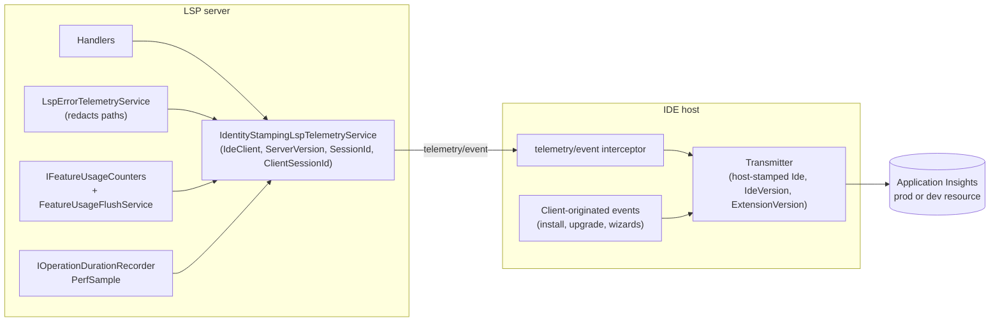
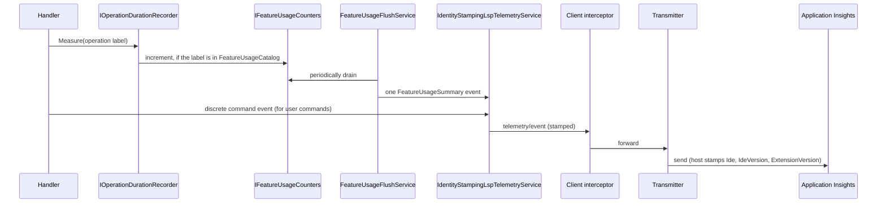

# Telemetry Architecture

**Status:** Implemented. Describes the system as it is. Event names and schemas are in [../Telemetry-Events-Inventory.md](../Telemetry-Events-Inventory.md); the code (`TelemetryEvents.cs`) wins if they disagree.
**Audience:** Maintainers adding an event, changing what is transmitted, or touching the transmitters.

## 1. Purpose and scope

This document explains how telemetry gets from the server and the IDE hosts to Application Insights, who is
responsible for what, and the privacy rules every event must obey. It does not list events; see the inventory.

## 2. Overview

## 3. Flows

## 4. Glossary

| Term | Meaning here |
|---|---|
| **Relay** | The server emits `telemetry/event`; the IDE host owns the concrete transmitter. |
| **Transmitter** | The host component that sends to Application Insights: `TelemetryTransmitter` (Visual Studio), `telemetry.ts` / `TelemetryReporter` (VS Code), `RiderTelemetryTransmitter` (Rider). |
| **Client-originated event** | An event that occurs before or independently of the server (install, upgrade, wizard) and is fired by the host. |
| **Feature usage** | In-memory request counts flushed periodically as one `FeatureUsageSummary`, for passive features. |
| **`PerfSample`** | A sampled duration event produced by the operation recorder. |
| **Stamping** | Adding `IdeClient`, `ServerVersion`, `SessionId`, `ClientSessionId` (server) and `Ide`, `IdeVersion`, `ExtensionVersion`, `ClientSessionId` (host). |

## 5. Key classes

| Class | Location | Responsibility |
|---|---|---|
| `TelemetryEvents` | `src/Core/…Common/Telemetry` | The single catalogue of event names, shared by server and hosts (VS Code and Rider mirror only client-originated names). |
| `ITelemetryService`, `IErrorTelemetryService`, `ITelemetryTransmitter` | same | Contracts. `IErrorTelemetryService` is the narrow interface (`MonitorError`) `LSP.Core` depends on; `ITelemetryService` extends it with Visual Studio lifecycle members. |
| `TelemetryScrubber`, `ExceptionStackSanitizer` | same | Path and identifier scrubbing. |
| `LspTelemetryService`, `IdentityStampingLspTelemetryService`, `ILspTelemetryService`, `NullLspTelemetryService`, `FileLoggingLspTelemetryService` | `src/LSP/…LSP.Server/Telemetry` | Server-side emission and stamping. |
| `LspErrorTelemetryService` | same | Forwards `MonitorError` as an `Error` event with filesystem paths redacted (`RedactPaths`). |
| `IFeatureUsageCounters`, `FeatureUsageCatalog`, `FeatureUsageFlushService` | `…/Telemetry/FeatureUsage` | Passive usage counting. |
| `IOperationDurationRecorder`, `PerformanceTelemetrySampler` | `…/Performance` | Duration recording and sampled `PerfSample`. |
| `TelemetryEventInterceptor` (VS), `registerTelemetry` in `telemetry.ts` (VS Code), `ReqnrollTelemetryEventInterceptor` (Rider) | per client | Forward `telemetry/event` to the transmitter. |

## 6. Behaviour and contracts

- **One Application Insights resource per environment.** All three hosts point at the same resource: the production one
  in a release build, the development one in every other build, chosen at build time through `REQNROLL_TELEMETRY_ENV`.
- **The Visual Studio host uses the standard `Microsoft.ApplicationInsights` SDK.** Rider POSTs directly to the
  ingestion REST endpoint through the JDK's `HttpClient`, since the Java SDK was not justified for one event type.
- **Stamping is split:** the server stamps `IdeClient`, `ServerVersion`, `SessionId` and `ClientSessionId` on everything it emits; each host
  stamps `Ide`, `IdeVersion`, `ExtensionVersion` and `ClientSessionId` on everything it transmits. `ClientSessionId` is the
  client's own per-IDE-process GUID, handed to the server as `--client-session-id` (#1199), so a client-originated
  exception joins to `ServerSessionStarted`.
- **Usage counting is by catalogue.** A handler that records its operation label gets counted if the label is in
  `FeatureUsageCatalog`; no event code is needed. Completion *acceptance* is not observable through standard LSP, so
  counts are of requests.
- **Install and upgrade events originate in the host**, before the server starts. `OpenProject` is server-side, covering
  all IDEs from one place, and `FeatureFileCount` is best-effort (null until the membership baseline arrives).

**Privacy rules.**

- `OpenProject` must not transmit absolute paths, project names or anything identifying the codebase: only aggregate
  counts.
- Error events must scrub messages for file paths and identifying strings before transmission; the server does this
  (`RedactPaths` replaces Windows, UNC and POSIX paths with `<path>`) before the message leaves the process.
- Telemetry is opt-out, uniformly across the three clients.
- Every event and its fields is documented in the public inventory.

## 7. Pitfalls and design decisions

1. **Relay through the client; do not transmit from the server.** A server-direct design misses pre-server events and
   duplicates credentials; per-client direct design needs telemetry code in three clients. The relay has the server
   emit once and each host own transport.
2. **A client with no interceptor loses every server event silently.** Rider once had none, so every event reached
   Visual Studio and VS Code but produced zero telemetry for Rider users. Any new client needs an interceptor.
3. **Catalogue passive features; never catalogue discrete commands.** Commands (Go to Definition, Find Usages, Rename,
   …) send their own per-call event. If they were also catalogued each invocation would be counted twice.
4. **Do not widen `ITelemetryService` for server code.** Only `MonitorError` was ever shared between `LSP.Core` and the
   Visual Studio host; everything else is a Visual Studio lifecycle concern. `LSP.Core` types depend on
   `IErrorTelemetryService` directly.
5. **Wire the real service, not a null one.** An access path hardcoded to a no-op (`LspIdeScope.TelemetryService`) once
   silently dropped config-load errors even after the main error path was fixed.
6. **Table formatting on type is not a command event.** It fires per keystroke, so perf sampling covers it instead.
7. **Parse timing is not reported by clients any more.** Visual Studio no longer parses `.feature` files locally; the
   sampled `PerfSample` for `didOpen`/`didChange` is the equivalent.

## 8. Known limitations

- "Offered" events (`DefineSteps command offered`) cannot observe acceptance, because the edit is applied client-side.
- Notification shown/dismissed events from the legacy extension have no equivalent: the current extension has no
  notification system to hook.

## 9. Testing

| Layer | Where |
|---|---|
| Server telemetry services, stamping, redaction, usage counters | `tests/LSP/Reqnroll.IdeSupport.LSP.Server.Tests/Telemetry` |
| Host transmitters and interceptors | Per-client test projects |
