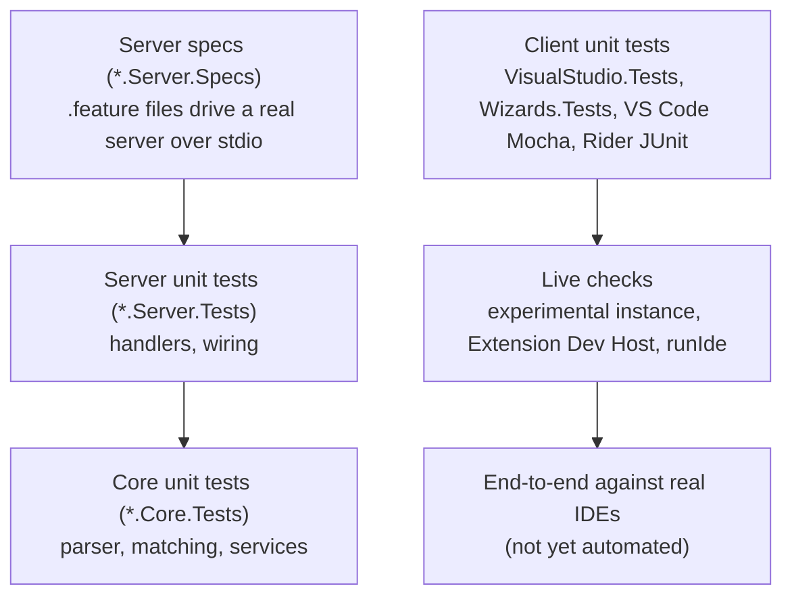
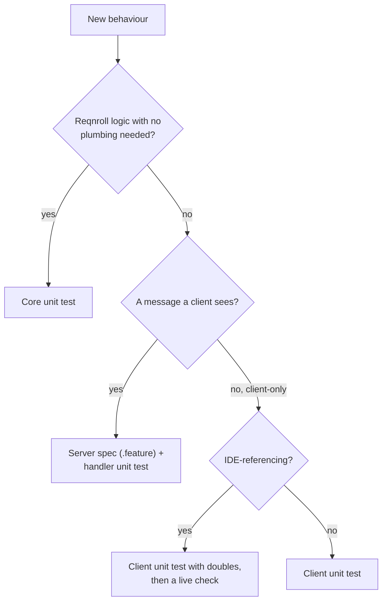

# Testing Strategy

**Status:** Implemented. Describes the system as it is; verify against the `tests` tree.
**Audience:** Maintainers deciding where a test belongs, or how a behaviour should be verified.

## 1. Purpose and scope

Which kinds of test exist, what each is for, how to choose between them, and what is deliberately not automated.
Performance verification is in [performance.md](performance.md).

## 2. Overview

## 3. Flows

## 4. Glossary

| Term | Meaning here |
|---|---|
| **`*.Tests`** | Unit tests. |
| **`*.Specs`** | Integration / BDD tests authored as Reqnroll `.feature` files (the project's own format drives its own test suite). |
| **Simulated client** | A test client that talks to a real server instance over stdio. |
| **`VsxStubs`** | Test doubles for Visual Studio SDK types. |
| **Fixture project** | A small generated or checked-in project used as an input corpus (`BindingsFixture`, test-logger and reporter fixtures). |

## 5. Key projects

| Project | Location | Covers |
|---|---|---|
| `Reqnroll.IdeSupport.Common.Tests` | `tests/Core` | Shared configuration, logging, telemetry, step-trace parser. |
| `…TestLogger.Tests`, `…TestReporter.MTP.Tests` (+ fixtures) | `tests/Core` | Test logger and MTP reporter, including real `dotnet test` runs. |
| `…LSP.Core.Tests` | `tests/LSP` | Parser, matching, formatting, completion, scope, test targets. |
| `…LSP.Server.Tests` | `tests/LSP` | Handlers, pipeline, workspace, telemetry, outcomes. |
| `…LSP.Server.Specs` (+ `BindingsFixture`) | `tests/LSP` | The primary verification gate for each feature through the full protocol pipeline. |
| `…LSP.Connector.Tests`, `…LSP.TestStubs` | `tests/LSP` | Connector and shared doubles. |
| `…VisualStudio.Tests`, `…VsxStubs`, `…Wizards.Tests`, `…Wizards.UI.Tester` | `tests/VisualStudio` | VS client logic, wizards. |
| `…Benchmarks*`, `Corpus` | `tests/Performance` | Latency benchmarks. |
| VS Code Mocha, Rider JUnit5 | `src/VSCode/src/test`, `src/Rider/src/test` | Client logic. |

## 6. Behaviour and contracts

- **Unit tests** exercise each `LSP.Core` service with mocked dependencies. Parser, semantic tokens, formatting and
  completion are priorities. They must not need a running server or IDE. Core tests build their inputs directly and
  avoid `VsxStubs`, which pull in WPF and crash on net10.
- **Server specs** simulate an IDE client against a real server. Behaviour specific to one IDE lives in a separate
  `*VisualStudio.feature`, gated on the client identity, never folded into a generic feature.
- **Visual Studio** code paths are covered by the unit tier (`VisualStudio.Tests` with `VsxStubs`: command wiring,
  classification interceptors, snippet service; `Wizards.Tests`: wizard logic). There is no Visual Studio spec tier.
- **Client-side tests** use `@vscode/test-electron` (Mocha) for VS Code and the IntelliJ Platform test framework
  (JUnit5) for Rider.
- **End-to-end** tests against real IDE instances are optional now and mandatory before the Preview label is lifted.
- **Behaviour first.** Behaviour that clients see is specified as server specs; client logic is tested only where it
  is real logic.

## 7. Pitfalls and design decisions

1. **Visual Studio-referencing classes cannot be unit tested directly.** The .NET loader resolves every member
   signature before constructing a type, so a class with a member typed from an assembly supplied only by `devenv.exe`
   forces that assembly to load. Move the logic into a type the loader never has to resolve those members for.
2. **Native-runner invocation and result events are not practically unit-testable.** Verify live.
3. **Timing tests are environment-sensitive.** Performance-threshold tests can fail under machine load and pass in
   isolation; treat a lone failure there with that in mind.
4. **Do not add IDE conditionals to generic specs.** Add a client-specific `.feature`.

## 8. Known limitations

- No automated end-to-end suite against real IDEs; the live checks above are manual.
- Rider's editor rendering (gutter marks, lenses) is covered by unit tests of the logic, not of the rendering.

## 9. Testing the tests

`test-lsp.yml` runs the server unit tests and specs on Windows runners and cross-publishes the six server builds from a
Linux runner; the VS and Rider test jobs run in `ci.yml`. See [operations.md](operations.md).
