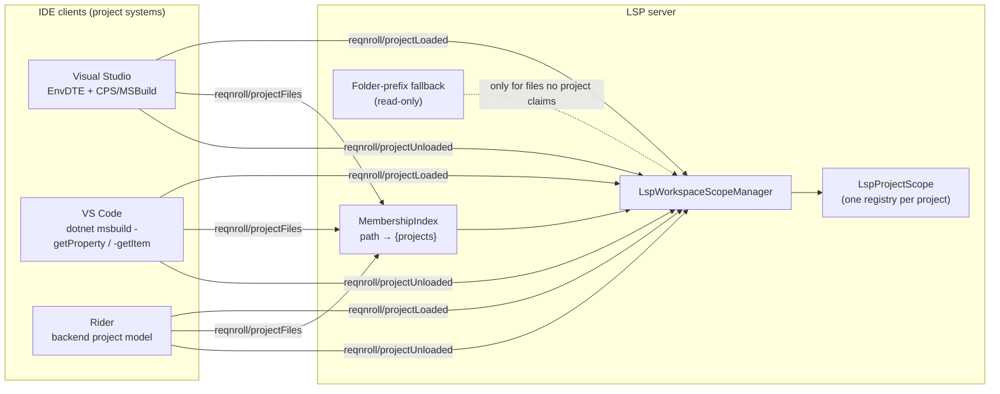
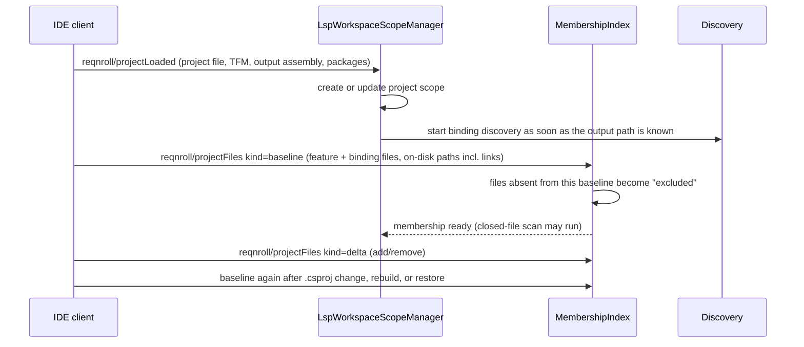
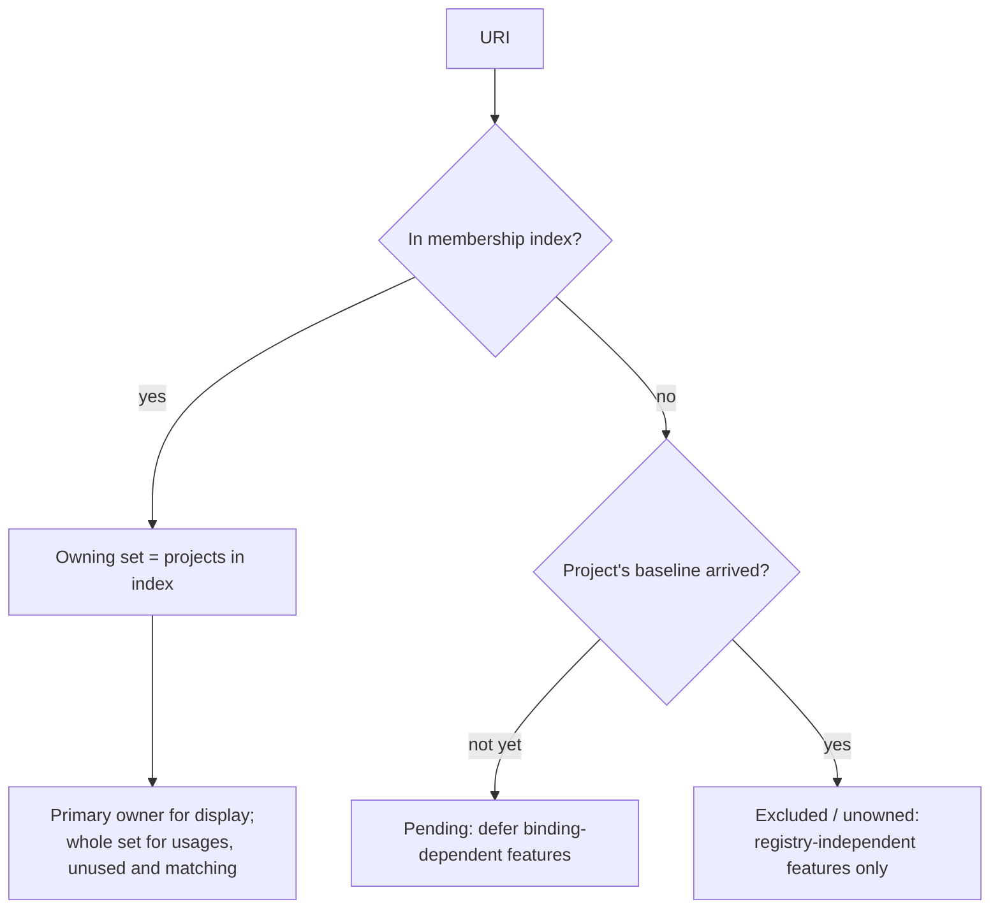

# Workspace Model and Project Membership

**Status:** Implemented. Describes the system as it is; verify against the source files named in each section.
**Audience:** Maintainers working on project detection, which registry a file belongs to, linked or excluded files, shared projects, or anything gated on "does a project own this file".

## 1. Purpose and scope

The server must decide, for every file, which project (or projects) own it, because bindings, configuration and
registries are all per project. LSP supplies only workspace folders and file URIs. This document describes the
workspace model, the client-supplied project notifications, the `path → {projects}` membership index that replaces
folder-prefix inference, and the dialect resolution that depends on the owner.

It does not cover how bindings are discovered once a project is known; see [binding-discovery.md](binding-discovery.md).

## 2. Overview

Each opened workspace folder maps to a scope manager holding one or more project scopes. Each project (keyed by
project file plus target framework moniker) has its own binding registry, so a monorepo with different
`reqnroll.json` files per project works. A merged view of all registries is not used.

## 3. Flows

### 3.1 Project load and membership

### 3.2 Resolving a file's owner

## 4. Glossary

| Term | Meaning here |
|---|---|
| **Project scope** | `LspProjectScope`: one project's configuration, registry and state. |
| **Project key** | `(projectFile, targetFrameworkMoniker)`. Membership and registries are keyed by it. |
| **Membership index** | Authoritative map from an on-disk path to the set of project keys that include it. |
| **Baseline / delta** | A complete snapshot of a project's membership, versus incremental add/remove entries. |
| **Linked file** | A file included from outside the project folder (`<Compile Include="..\Other\X.cs" Link="…">`). |
| **Excluded file** | A file inside the project folder removed from it (`<Compile Remove>`, false `Condition`). |
| **Pending / excluded** | Absence from the index means pending until the project's first baseline, excluded after. |
| **Primary owner** | The one project used where a single answer is needed (display, diagnostics owner). |
| **Shared project** | `.shproj`/`.projitems`: produces no assembly; its content belongs to each importing project. |
| **Closed-file scan** | The startup pass that indexes the project's feature and binding files that are not open. |

## 5. Key classes

| Class | Location | Responsibility |
|---|---|---|
| `LspWorkspaceScopeManager`, `ILspWorkspaceScopeManager` | `src/LSP/…LSP.Server/Workspace` | Owns scopes; handles the three notifications; `GetProjectForUri` (set), `ResolvePrimaryOwner`, `FindProjectByKey`. |
| `MembershipIndex` | same | The `path → {projects}` index; pending/excluded state; `HasBaselineForProject`. |
| `WatchedFilesHandler` | same | `workspace/didChangeWatchedFiles`: config reloads and build detection. |
| `LspProjectScope`, `LspReqnrollProject`, `ProjectKey`, `MembershipState` | `src/LSP/…LSP.Core/Workspace` | The project model. |
| `ReqnrollProjectLoadedParams`, `ReqnrollProjectFilesParams`, `ReqnrollProjectUnloadedParams` | same | Payloads, in Core because Core code consumes them. |
| `ReqnrollProjectDetector` | `…LSP.Core/Discovery` | Decides whether a project is a Reqnroll test project (see [binding-discovery.md](binding-discovery.md)). |

## 6. Behaviour and contracts

### 6.1 The three notifications

| Method | Carries |
|---|---|
| `reqnroll/projectLoaded` | `workspaceFolder`, `projectFile`, `projectFolder`, `outputAssemblyPath`, `targetFrameworkMoniker`, resolved `packageReferences`. Sent on open and when build properties change (rebuild, configuration switch). Cheap, so discovery can start early. |
| `reqnroll/projectFiles` | `{ projectFile, targetFrameworkMoniker, kind: "baseline" \| "delta", files: [{ path, role: "feature" \| "binding", added? }] }`. Optional. |
| `reqnroll/projectUnloaded` | `projectFile`. |

All three are optional, which is deliberate. `projectFiles` is separate from `projectLoaded` because the three project
systems differ: VS Code has no MSBuild project system and gets membership from an async `dotnet msbuild` evaluation
that lands later than "project exists"; Visual Studio can enumerate items only through the slower CPS/MSBuild path,
where EnvDTE `ProjectItems` is unreliable for SDK-style projects, globs, `Remove` and linked on-disk paths; Rider
produces it readily. Coupling them would make the fast path (output assembly known, discovery starts) wait on the
slow one. A client that omits `projectFiles` falls back to folder-prefix routing for that project. The two messages may
arrive in either order.

A client must send `projectFiles` with the same `targetFrameworkMoniker` it sent in `projectLoaded` (pitfall 4).
Clients re-send membership on project load, rebuild and `.csproj` change, so re-including a file restores ownership.

### 6.2 Two invariants

1. **Membership is conferred exclusively by the index.** Neither folder containment nor a file being open grants
   ownership. The closed-file scan is driven by the index, never a folder glob; otherwise an excluded file inside the
   project folder is silently re-admitted.
2. **Open-state never confers membership or accounting.** A file the user opens that no project owns gets
   registry-independent features only (semantic tokens, parse-error diagnostics, folding, formatting, document
   symbols). Binding-dependent features (unmatched-step diagnostics, step↔binding navigation, binding completion,
   usages and unused) are suppressed, and an opened-but-unowned `.cs` must not inject bindings into any registry
   through the Roslyn live path.

### 6.3 Many-to-many consequences

A linked file belongs to several projects, so feature-aware operations iterate the owning set:

- Diagnostics and matching run against each owner's registry; a step is unmatched only if unmatched in all owners.
- **Find Step Usages** unions a binding's usages across every project that includes it.
- **Find Unused** intersects: a binding is unused only if no feature in any including project references it.
- A single edit to a linked `.cs` invalidates every registry that includes it; the Roslyn patch fans out to all
  owners, gated on index membership so an excluded-but-open `.cs` patches nothing.

### 6.4 Shared projects

A shared project is not registered as a project at all: `LspWorkspaceScopeManager` ignores both
`projectLoaded` and `projectFiles` for it and the Visual Studio client does not send them. Its content is owned by each
project that imports it. Every client therefore lists a shared project's files in the `projectFiles` baseline of each
importing project: VS Code through `dotnet msbuild -getItem` (which expands the import), Visual Studio through DTE
`ProjectItems` (which already include shared items for SDK-style importers), Rider by reading the imported `.projitems`
directly. Rider sends no delta for a file added to a shared project; the next baseline picks it up.

### 6.5 Gherkin dialect

Resolved at two levels: the project default from `reqnroll.json` (`language`, default `en`), and a per-file override
from a `# language: <code>` comment on the first line, which takes precedence. The document buffer stores the
effective dialect with each file's tag tree, and completion and semantic tokens use it.

## 7. Pitfalls and design decisions

1. **Never infer membership from the filesystem.** The earlier model (`filePath.StartsWith(projectFolder)`, longest
   prefix, first match) collapsed a many-to-many relation into one guess. A linked file always routed to the project
   whose folder contained it, a file linked from outside every project folder routed to none and showed every step
   unmatched, and the defect was masked when two linking projects had identical registries.
2. **The connector gives no linking signal.** Reflection output reports a binding's physical, compile-time source path
   (from PDB sequence points), identical for every project that links it. Nothing in discovery output says one registry
   obtained a binding via a link.
3. **LSP cannot say which project a document belongs to.** A `TextDocumentItem` has no project field and the IDE does
   not say whose view of a shared file is open. Hence the index.
4. **TFM must match across the two messages.** `MembershipIndex` keys a baseline on (project file, TFM). A mismatched TFM
   files it where `HasBaselineForProject` never looks. Per-URI owner lookups still work (`FindProjectByKey` matches on
   project file only), but every per-project query (closed-file rescan, open-file reparse, C# reconciliation, C#
   diagnostics, rename) silently falls back to folder-prefix scanning and misses anything outside the project folder.
   The Rider plugin once sent an empty TFM for every `projectFiles`.
5. **Absence is ambiguous.** "Deliberately excluded" and "not yet reported" both look like absence, hence the
   pending-then-excluded rule. Declaring a file unowned before the first baseline would wrongly suppress features.
6. **A falsely "unused" result is harmful.** A folder-scoped Find Unused rooted at a binding's physical project reports
   a linked-and-used binding as unused and invites deleting live code. That is why unused is an intersection across
   owners.
7. **A shared project would win its own files.** Its folder is the innermost one containing its files, so if registered
   it would win `ResolvePrimaryOwner` for them and resolve them to a registry that can never be populated, since it
   produces no assembly.

## 8. Known limitations

- A client that cannot produce `projectFiles` keeps folder-prefix routing and the old limitations (linked files
  misrouted) for its projects. VS Code is a partial exception: it produces the manifest from MSBuild evaluation.
- In VS Code, a feature file linked into a second project never appears in the Explorer under the linking project.
  That view is a pure filesystem view. See limitation L1 in the
  [register](../LSP-IDE-Support-Open-Questions.md#2-accepted-limitations-and-standing-risks).

## 9. Testing

| Layer | Where |
|---|---|
| Membership index, scope manager, pending/excluded, primary owner | `tests/LSP/Reqnroll.IdeSupport.LSP.Server.Tests/Workspace` |
| Linked-file ownership, usages and unused end to end | `tests/LSP/Reqnroll.IdeSupport.LSP.Server.Specs/Features/Protocol/LinkedFileOwnership.feature`, `Features/Navigation/FindStepDefinitionUsages.feature`, `FindUnusedStepDefinitions.feature` |
| Client manifest production | Per-IDE test projects (`VisualStudio.Tests`, VS Code `src/test`, Rider `src/test`) |
