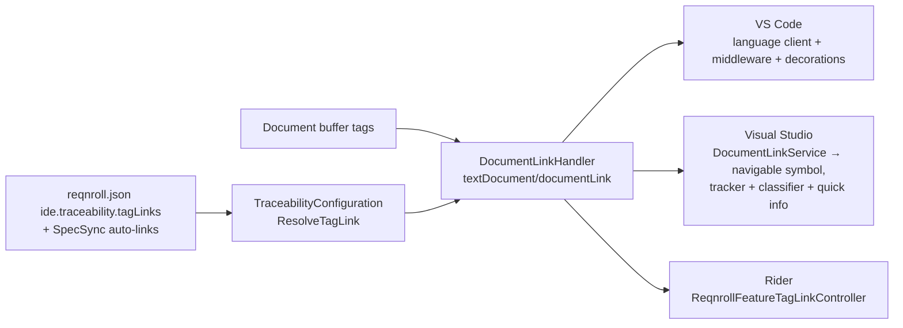
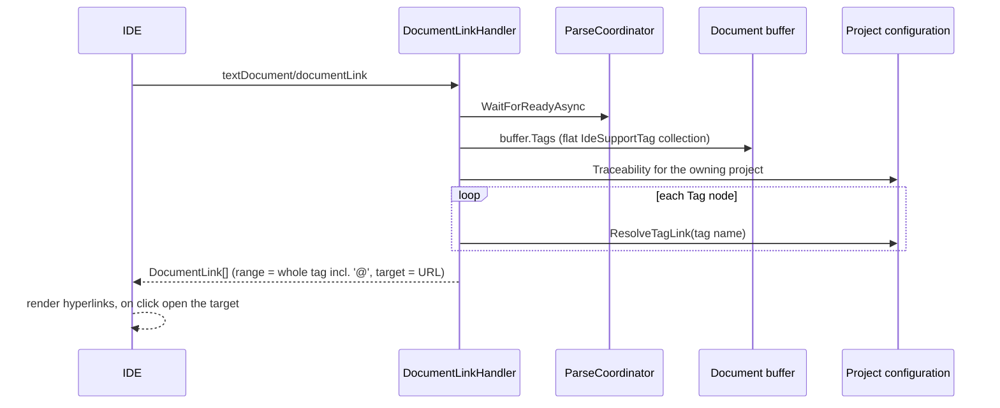

# Clickable Tags: Traceability Links (F28)

**Status:** Implemented. Describes the system as it is; verify against the source files named in each section.
**Audience:** Maintainers working on tag links, `textDocument/documentLink`, or the per-client link rendering.

## 1. Purpose and scope

A Gherkin tag such as `@issue:1234` becomes a Ctrl+click hyperlink to the matching tracker item (for example
`https://github.com/org/repo/issues/1234`) when it matches a pattern configured under `ide.traceability.tagLinks` in
`reqnroll.json`. Tags matching no pattern are not linked. Projects using SpecSync (`specsync.json`) get a link for
`<prefix>:<id>` tags automatically, pointing at `<projectUrl>/_workitems/edit/{id}`, with no extra configuration.
Configuration is per project: the requested document's owning project supplies the patterns. It ports the "clickable tags"
behaviour of the legacy extension.

Step navigation through `documentLink` is a separate, open question (see the
[register](../LSP-IDE-Support-Open-Questions.md#1-open-questions), O5). This feature handles tags only.

## 2. Overview

## 3. Flows

## 4. Glossary

| Term | Meaning here |
|---|---|
| **Tag link** | A configured mapping from a tag-name pattern to a URL template. |
| **`ResolveUrl`** | Requires the pattern to match the **whole** tag name (minus `@`), expands `{name}` placeholders from named capture groups, and returns null unless the result is an absolute URI. |
| **SpecSync** | A tool whose `specsync.json` implies links for `<prefix>:<id>` tags. |
| **Blocked scheme** | `javascript:`, `vbscript:`, `data:`, `command:`. |
| **Nudge** | A client re-registration that makes VS Code recompute links when the server signals a change. |

## 5. Key classes

| Class | Location | Responsibility |
|---|---|---|
| `DocumentLinkHandler` | `src/LSP/…LSP.Server/Features/DocumentLinks` | Iterates `IdeSupportTagTypes.Tag` nodes and resolves links; empty container when the buffer or tags are not ready or no links are configured. |
| `TraceabilityConfiguration`, `TagLinkConfiguration` | `src/Core/…Common/Configuration` | Pattern and template logic (the regex stays internal to `TagLinkConfiguration`). |
| `ProjectScopeIdeSupportConfigurationProvider` | `…Common/ProjectSystem/Configuration` | Merges SpecSync auto-links into `Traceability.TagLinks`. |
| `DocumentLinkService`, `TagLinkNavigableSymbolProvider`, `TagLinkTracker`, `TagLinkClassifier(Provider)`, `TagLinkQuickInfoSourceProvider`, `TagLinkRedirect` | `src/VisualStudio` (`…Extension/DocumentLinks`, `…VSSDKIntegration/DocumentLinks`) | Visual Studio request, click, permanent styling and quick info. |
| `tagLinks.ts` (`TagLinkDecorations`, `registerTagLinkRefresh`) | `src/VSCode/src/lsp` | VS Code click re-targeting, permanent styling, refresh nudge. |
| `ReqnrollFeatureTagLinkController`, `TagLinkSupport` | `src/Rider/…/taglinks` | Rider request, highlighters, hover and click. |

## 6. Behaviour and contracts

**Server.** `DocumentLinkHandler` awaits `IParseCoordinator.WaitForReadyAsync`, iterates the buffer's flat tag collection,
keeps nodes whose `Data` is a `Gherkin.Ast.Tag`, and passes each name to `TraceabilityConfiguration.ResolveTagLink`, which
trims the `@` and returns the first non-null URL across the configured links. `documentLink/resolve` is not supported
(`ResolveProvider = false`); the URL is computed eagerly (a regex match and string substitution, no I/O). The capability is
declared statically (`Program.ApplyStaticDocumentLinkCapability`) and the handler registered manually, avoiding the
dynamic-registration race with VS Code's restore of open `.feature` tabs. The request is counted as the passive feature
`DocumentLink` in `FeatureUsageCatalog`.

**Per client.**

- **VS Code.** Rendered by the language client. A `provideDocumentLinks` middleware re-targets each link at the internal
  `reqnroll.openTagLink` command (the real URL stays as the tooltip) so clicks are observable. Permanent styling:
  `TagLinkDecorations` remembers the link ranges the middleware returns per document and paints them with a
  `TextEditorDecorationType` (underline in `textLink.foreground`), re-applied when editors become visible and cleared when a
  document closes; a request returning nothing keeps the last known styling.
- **Visual Studio.** Its LSP client never sends `documentLink`, so `DocumentLinkService` requests it over the owned pipe and
  `TagLinkNavigableSymbolProvider` offers a Ctrl+Click symbol that opens the target with `VsShellUtilities.OpenSystemBrowser`.
  Permanent styling: `TagLinkTracker` (one per buffer) fetches links through `TagLinkRedirect.GetLinksAsync`, keeps only
  targets whose scheme is not blocked, holds each as a tracking span, and refreshes on a debounced buffer change and on the
  server's CodeLens refresh. `TagLinkClassifier` applies the editor's `url` classification (colour and underline) and
  `TagLinkQuickInfoSourceProvider` shows the URL and "CTRL + click to follow link" on hover.
- **Rider.** Its generic client never requests `documentLink`, so `ReqnrollFeatureTagLinkController` requests it, tracks each
  link as a range marker, and stores it as a range highlighter in the hyperlink colour with an underline. A 500 ms hover shows
  the target and "Ctrl + click to follow link" ("Cmd" on macOS); Ctrl/Cmd+hover adds the hand cursor and Ctrl/Cmd+click opens
  the link (`BrowserUtil.browse`).

**Telemetry.** Following a link sends the client-originated `Command.TagLink` event from all three IDEs, with no
properties (see the [inventory](../Telemetry-Events-Inventory.md)).

**Allowed targets.** All three IDEs open any scheme (`https:`, `file:`, `jira:`, `vscode:`, `slack:`, …) except the blocked
four, which stay refused because the URL comes from repository-controlled configuration. Whether the OS has a handler for a
custom scheme is the user's environment; an unhandled scheme does nothing.

## 7. Pitfalls and design decisions

1. **Do not make the Visual Studio styling a `UrlTag` tagger.** The editor's Go To Definition mouse handler stands down
   wherever a `UrlTag` exists (`ExistsUrlTagAt`), which would bypass `TagLinkNavigableSymbolProvider`, and with it the
   blocked-scheme rule and the telemetry.
2. **Startup race (VS Code).** The patterns live in the owning project's configuration, which does not exist until that
   project registers, and a restored tab asks for links earlier. The server answers at once (empty), LSP has no
   `documentLink` refresh, and VS Code re-asks only after an edit, so `registerTagLinkRefresh` listens for the server's
   `workspace/codeLens/refresh` and re-registers a no-op link provider to make open editors recompute. An earlier server-side
   wait was dropped because the held request was cancelled before the project registered. Visual Studio asks on every hover
   and Rider re-requests on the inlay-hint refresh, so neither is affected.
3. **Match the whole tag name.** A partial match would link tags that merely contain a pattern.
4. **Eager targets.** Computing the URL in the response keeps `resolve` unnecessary.

## 8. Known limitations

- No link refresh on configuration change: LSP has no `workspace/documentLink/refresh`, so open editors may show stale links
  until they re-request.
- Rider and VS Code click handling is covered by unit tests only, not live verification.
- Tags only; steps are not linked.

## 9. Testing

| Layer | Where |
|---|---|
| Pattern and template logic | `tests/Core/Reqnroll.IdeSupport.Common.Tests` |
| Handler | `tests/LSP/Reqnroll.IdeSupport.LSP.Server.Tests/Features/DocumentLinks` |
| Client behaviour | `tests/VisualStudio/Reqnroll.IdeSupport.VisualStudio.Tests`, `src/VSCode/src/test`, `src/Rider/src/test` |
