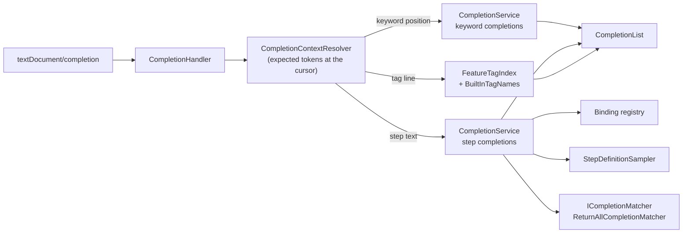
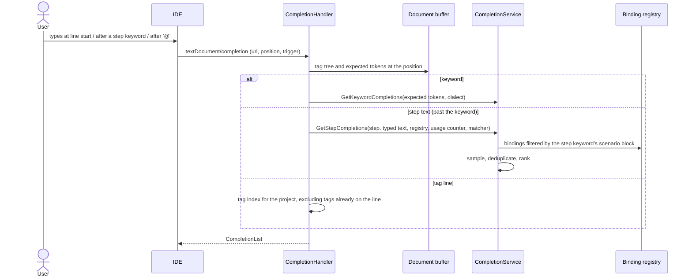

# Completion (F7, F8, tag completion)

**Status:** Implemented. Describes the system as it is; verify against the source files named in each section.
**Audience:** Maintainers working on keyword, step or tag completion, or on completion workarounds for a client.

## 1. Purpose and scope

Three kinds of completion in `.feature` files, all through `textDocument/completion` and one `CompletionHandler`:

- **Keywords** (F7). At the start of a line, the keywords valid in the current context: `Examples:` only inside a Scenario
  Outline, `Background:` only at feature level. Items come from the active Gherkin dialect: with `"language": "de"` the
  list offers `Gegeben`, `Wenn`, `Dann`.
- **Steps** (F8). After a step keyword, existing binding patterns as literal sample text with parameter placeholders such
  as `I have entered [int] into the calculator`; the full step text is inserted.
- **Tags**. Typing `@` on a tag line offers the tags already used elsewhere in the project, ranked by usage, plus the
  built-in `@ignore`.

## 2. Overview

## 3. Flows

## 4. Glossary

| Term | Meaning here |
|---|---|
| **Expected tokens** | The Gherkin token types the parser could accept at the cursor; drive keyword choice. |
| **Sample** | A human-readable example step text derived from a binding pattern. |
| **Matcher** | `ICompletionMatcher`: ranks or filters candidates. |
| **Tag index** | `FeatureTagIndex`: per-project tag usage counts. |
| **Trigger character** | `@` and space are declared as completion triggers. |

## 5. Key classes

| Class | Location | Responsibility |
|---|---|---|
| `CompletionHandler` | `src/LSP/…LSP.Server/Features/Completions` | Registers with document selector `**/*.feature`; dispatches by cursor context; applies the client workarounds. |
| `CompletionService`, `ICompletionService`, `CompletionContextResolver`, `CompletionContext`, `CompletionEntry`, `CompletionResult` | `…LSP.Core/Completions` | Keyword and step completion logic and context. |
| `StepDefinitionSampler`, `RegexStepDefinitionExpressionAnalyzer`, `AnalyzedStepDefinitionExpression` | same | Turn a binding pattern into sample text (ported from the legacy extension). |
| `ICompletionMatcher`, `ReturnAllCompletionMatcher` | `…Completions/Matching` | The ranking extension point and its pass-through default. |
| `FeatureTagIndex`, `BuiltInTagNames` | `…Features/Completions`, `…Completions` | Tag candidates. |

## 6. Behaviour and contracts

**Keyword items.** Block keywords get `": "` appended (dialect keywords carry no colon); step keywords from the dialect
already end with a space. The dispatch is a switch on the expected `TokenType` with the default keyword set (Feature,
Scenario, steps) as fallback. The insert text is a `TextEdit` spanning the keyword range on the current line. The dialect
falls back to `GherkinDialectProvider(lang).DefaultDialect`, the public API.

**Step items.** Dispatched when the cursor is on a step line and past the keyword (step text start is the step's column
plus the keyword length). Bindings are filtered by the scenario block matching the step keyword, sampled, deduplicated
and ranked. `SortText` is the zero-padded six-digit rank. The insert is the literal sample (no snippet placeholders),
replacing from the step text start to the end of the step line. Choice groups like `(option1|option2)` are kept
verbatim. The usage count (`IBindingMatchService.FindUsages(...).Count`) is passed to the matcher for future ranking.

**Matching is on the client.** `ReturnAllCompletionMatcher` returns all candidates with `IsIncomplete = false` and the
client filters. `ICompletionMatcher` is the seam for a fuzzy matcher if feedback shows the client filter is not enough.

**Tag items.** A tag position completes to tags used across the project, ranked by usage through the same matcher. Open
sibling files are counted from their already-parsed buffer tags (best effort: a tag typed while the background parse is
pending appears a moment later; completion never re-parses); closed files are indexed from disk once and cached until
their write time changes. The completing line's own tags are excluded and the replacement range spans only the
in-progress tag, so accepting a second tag never deletes the first. The index is per project, fed by the membership
index's file list, with a disk-scan-plus-open-buffers fallback before the baseline arrives. The old generic `@tag1`
placeholder is gone; the keyword path's `TagLine` entry is a bare `@`, used only as the parser-error quick fix
("Insert '@'").

**Client workarounds (server side).** Behaviour flags set for Visual Studio:

- `RejectsEmptyTriggerCompletion`: an empty list on a trigger character makes the client revert the typed character
  (a `|` is deleted), so a suppressed table-row completion returns a no-op item.
- `RequestsCompletionAfterDeletion`: after Backspace/Delete the client asks for completion with the deleted text as
  `triggerCharacter` and kind `Invoked`; nothing was typed, so the answer is an empty list.

## 7. Pitfalls and design decisions

1. **Never return an empty list on a trigger character for Visual Studio.** Return the safe no-op item instead.
2. **Do not treat deletion as typing.** Detect it by behaviour, not by IDE name.
3. **Tag completion must not re-parse on the completion path.** Use buffer tags for open files and the cached disk index
   for closed ones.
4. **The replacement range is per tag word.** Replacing the whole tag line would delete earlier tags.
5. **Client-side filtering first.** Server ranking is deferred behind the matcher seam until it is shown to be needed.

## 8. Known limitations

- Completion acceptance is not observable through standard LSP, so usage counts are of requests, not accepted items.

## 9. Testing

| Layer | Where |
|---|---|
| Keyword and step completion, sampler, matcher | `tests/LSP/Reqnroll.IdeSupport.LSP.Core.Tests/Completions` |
| Handler, tag index | `tests/LSP/Reqnroll.IdeSupport.LSP.Server.Tests/Features/Completions` |
| End to end | `tests/LSP/Reqnroll.IdeSupport.LSP.Server.Specs/Features/Editor/KeywordCompletion.feature`, `StepCompletion.feature`, plus `KeywordCompletionVisualStudio.feature`, `KeywordCompletionVsCode.feature` |
