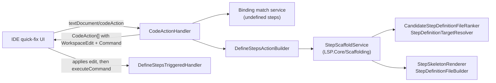
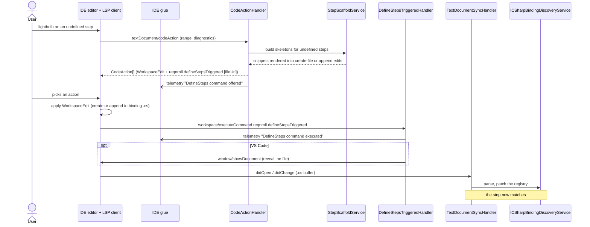

# Define Steps (F6)

**Status:** Implemented. Describes the system as it is; verify against the source files named in each section.
**Audience:** Maintainers working on the "Define missing steps" quick fix, step skeleton generation, or code actions on `.feature` files.

## 1. Purpose and scope

When one or more steps have no matching binding, a quick fix (lightbulb / Alt+Enter) offers to generate stub binding
methods in a new or existing step-definition file, with signatures and parameter types inferred from the step text.
Actions offered: "Define missing step", "Define step: …" and "Define all missing steps in file". The same handler also
offers quick fixes for some parser errors (`ParserErrorActionBuilder`, with an `InsertKeywordTriggeredHandler`).

The edit is applied entirely client side. Telemetry distinguishes *offered* from *executed*.

## 2. Overview

## 3. Flows

## 4. Glossary

| Term | Meaning here |
|---|---|
| **Skeleton** | The generated binding method (attribute, signature, body) for one undefined step. |
| **Snippet style** | The expression style of generated bindings: Cucumber expression or regex, sync or async. Set in `reqnroll.json`. |
| **Target file** | The step-definition file chosen to receive new methods (existing and ranked, or a new file). |
| **Offered / executed** | Telemetry for showing the action versus the client running its command after applying the edit. |

## 5. Key classes

| Class | Location | Responsibility |
|---|---|---|
| `CodeActionHandler`, `DefineStepsActionBuilder`, `ParserErrorActionBuilder` | `src/LSP/…LSP.Server/Features/CodeActions` | Builds the available actions at a range. |
| `StepDefinitionTargetResolver`, `CandidateStepDefinitionFileRanker` | `…LSP.Server/Features/CodeActions`, `…LSP.Core/Scaffolding` | Chooses which file receives the methods. |
| `IStepScaffoldService`, `StepScaffoldService`, `StepSkeletonDescriptor`, `StepSkeletonRenderer`, `StepDefinitionFileBuilder` | `…LSP.Core/Scaffolding` | Infers parameters and renders skeletons and files. |
| `DefineStepsTriggeredHandler` | `…LSP.Server/Features/CodeActions` | Handles `reqnroll.defineStepsTriggered`; emits the exact "executed" signal; reveals the file in VS Code. |
| `ScaffoldTrackingInterceptor` | `src/VisualStudio/…Extension/LspInterception` | Visual Studio only: registers a newly created `.cs` with the membership index before binding discovery runs. |

## 6. Behaviour and contracts

- **Client-side application.** The `WorkspaceEdit` is applied by the client; there is no `workspace/applyEdit` or
  `codeAction/resolve` round trip. When the edit creates or changes a `.cs` file, the resulting `didOpen`/`didChange`
  keeps the registry current.
- **Executed signal.** Each action carries `reqnroll.defineStepsTriggered` with the file URI; the client sends it after
  applying the edit. It is the server's only exact signal that the fix was chosen, and is not sent for a hand-written
  definition.
- **Reveal the file.** For clients with `HonorsShowDocumentRequests` the server uses `window/showDocument`. Clients that do
  not run `vscode.open` locally would forward it to the server, where it has no handler, so a code action must not carry
  only that command.
- **Telemetry.** `DefineSteps command offered` (each time the action is offered, not a count of lightbulb opens, since
  Visual Studio and Rider may request code actions on every caret move) and `DefineSteps command executed` (no properties).
  See [../Telemetry-Events-Inventory.md](../Telemetry-Events-Inventory.md).
- **Expression escaping.** Generated bindings escape special characters for the chosen style and for the C# string
  literal; async style files import `System.Threading.Tasks` when the project has implicit usings disabled.

## 7. Pitfalls and design decisions

1. **Visual Studio needs the membership hint.** A new `.cs` file the quick fix creates is not yet in any project's index; without
   `ScaffoldTrackingInterceptor` injecting a `projectFiles` delta before the `didOpen` is forwarded, the file would be
   treated as unowned and contribute no bindings.
2. **No `codeAction/resolve`.** Computing the edit up front keeps one round trip and makes the action atomic.
3. **Code actions on `.cs` files are deferred.** IDEs merge actions from several servers, so a future "generate step from
   binding template" would appear beside the C# server's own without conflict.

## 8. Known limitations

- "Offered" is observable; "accepted" is observable only through the executed command.

## 9. Testing

| Layer | Where |
|---|---|
| Scaffolding services | `tests/LSP/Reqnroll.IdeSupport.LSP.Core.Tests/Scaffolding` |
| Action builders, triggered handler | `tests/LSP/Reqnroll.IdeSupport.LSP.Server.Tests/Features/CodeActions` |
| End to end | `tests/LSP/Reqnroll.IdeSupport.LSP.Server.Specs/Features/Editor/DefineSteps.feature`, `DefineStepsTriggered.feature` |
