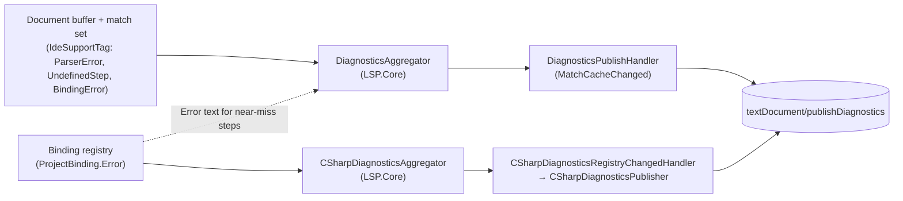
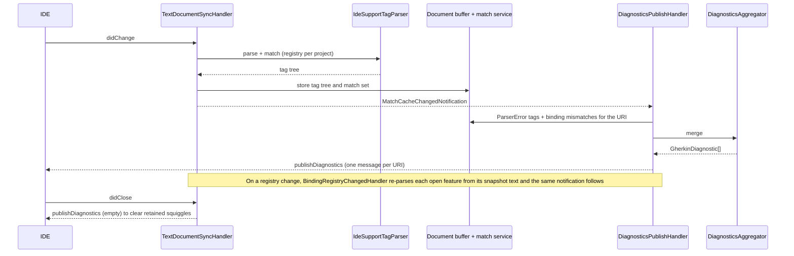
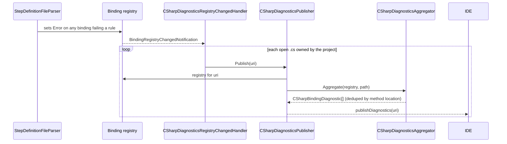

# Diagnostics (F3, F4, F27)

**Status:** Implemented. Describes the system as it is; verify against the source files named in each section.
**Audience:** Maintainers working on `.feature` warnings and errors, or on binding-validation squiggles in C# files.

## 1. Purpose and scope

Three kinds of diagnostic are produced:

- **Binding mismatches** in `.feature` files: a step with no matching binding gets a yellow squiggle (`source:
  "reqnroll.binding"`, `Warning`) reading "Step definition not found", or, if the step structurally matches a binding
  that exists but is invalid, that binding's specific error.
- **Parse errors** in `.feature` files: structurally invalid Gherkin gets a red squiggle (`source: "reqnroll.parser"`,
  `Error`).
- **Binding validation** in `.cs` files: a binding method that breaks a Reqnroll structural rule gets a warning
  squiggle on its identifier (`source: "reqnroll.binding"`).

Colour and squiggles are complementary, not redundant. Squiggles reach the Problems panel / Error List for cross-file
triage and keyboard navigation, and colour-only feedback is inaccessible to colour-blind users. `Warning` rather than
`Error` for mismatches separates them from parse errors and fits step-first workflows where a binding may not exist yet.

C# parse errors, type errors and anything else the C# compiler owns remain the native C# language server's domain; this
feature reports only Reqnroll binding-shape problems.

## 2. Overview

## 3. Flows

### 3.1 A `.feature` edit or a registry change

### 3.2 A `.cs` binding changes

## 4. Glossary

| Term | Meaning here |
|---|---|
| **Diagnostic source** | `reqnroll.parser` (parse errors) or `reqnroll.binding` (mismatches and C# validation). |
| **Near-miss** | A step that matches an existing binding structurally but not validly (the binding has an `Error`). |
| **`ProjectBinding.Error`** | The single field every diagnostic consumer reads; populated by both discovery paths. |
| **`ErrorLocation`** | The attribute-specific anchor of an error; Roslyn path only. |
| **Dedup by method** | Several attributes on one method share one location and must yield one squiggle. |
| **Push diagnostics** | `textDocument/publishDiagnostics`, the only model used (pull is unavailable). |

## 5. Key classes

| Class | Location | Responsibility |
|---|---|---|
| `DiagnosticsAggregator`, `GherkinDiagnostic` | `src/LSP/…LSP.Core/Diagnostics` | Combines parser errors and unmatched/ambiguous steps into one set; protocol-agnostic. |
| `DiagnosticsPublishHandler` | `…LSP.Server/Pipeline` | `MatchCacheChangedNotification` consumer: aggregates, converts ranges to LSP positions, pushes. |
| `ICSharpDiagnosticsAggregator`, `CSharpDiagnosticsAggregator` | `…LSP.Core/Diagnostics` | Groups bindings by identifier location and emits one diagnostic per method. |
| `CSharpDiagnosticsRegistryChangedHandler`, `CSharpDiagnosticsPublisher` | `…LSP.Server/Pipeline` | Re-push `.cs` diagnostics on registry change. |
| `StepDefinitionFileParser` | `…LSP.Core/Parsing/CSharp` | Runs the structural checks and sets `Error`. |
| `ProjectStepDefinitionBinding` | `…LSP.Core/Bindings` | `Match` returns null for an invalid binding; `WouldMatchIgnoringValidity` finds near-misses. |

## 6. Behaviour and contracts

**One message per URI.** The LSP specification requires that one message delivers the complete diagnostic set for a URI,
so parse errors and binding mismatches are merged by `DiagnosticsAggregator` and pushed together; separate messages
would clear each other. Diagnostics refresh after every `didChange` and whenever the binding registry changes. On
`didClose` an empty set is pushed inline from the sync handler (no fan-out needed).

**Parse errors** are `IdeSupportTag` items of type `ParserError` in the tag tree, read by the aggregator alongside
`UndefinedStep` and `BindingError` tags.

**Re-tagging on a registry change** re-parses from the snapshot text, not a cached AST. Gherkin parsing is fast and a
separate cached intermediate would add complexity without a user-visible gain.

**Near-miss messages.** `ProjectStepDefinitionBinding.Match` returns null for an invalid binding, so it is invisible to
real matching. Only when a step has no valid match at all, `WouldMatchIgnoringValidity` (regex and scope only, never used
for real execution matching) runs, and its result flows through `MatchResultItem`'s existing `Errors` mechanism, the
same one the ambiguous case uses. Example message: "Binding method 'Setup' must be static because its containing type
'Hooks' is abstract."

**C# validation rules** (ported from Reqnroll's `BindingSourceProcessor`; structural only):

| Rule | Applies to |
|---|---|
| Binding type must be a class (not struct, interface or record) | Every binding on the type |
| Binding type must not be a generic type definition | Every binding on the type |
| A method on an abstract binding type must be static | Every binding on the method |
| A method must not be `async void` | Every binding on the method |
| `BeforeTestRun`/`AfterTestRun`/`BeforeFeature`/`AfterFeature` must be static | That hook attribute |
| The step expression must be a valid Cucumber Expression or regex | That step-definition attribute |
| `[Scope(Tag = "...")]`'s tag expression must be valid | Every binding under that scope |

The last two use the real `Cucumber.CucumberExpressions` and `Cucumber.TagExpressions` libraries. They are anchored at
the failing attribute through `ErrorLocation` (Roslyn path only; the connector's data has no per-attribute location, so
its errors anchor at the method). A structural error is shared by every attribute on the method and stays anchored at the
method identifier so it deduplicates to one squiggle.

**No pull capability.** `diagnosticProvider` is deliberately not declared. Visual Studio polls `textDocument/diagnostic`
every 7 to 15 seconds and VS Code occasionally, and with no handler every poll fails for no benefit.

## 7. Pitfalls and design decisions

1. **Push only.** Pull diagnostics are unavailable with the current LSP framework; see the
   [register](../LSP-IDE-Support-Open-Questions.md#2-accepted-limitations-and-standing-risks).
2. **One trigger for `.cs` diagnostics.** The registry's change gate includes `Error`, so a validity-only edit raises
   the registry-changed event on its own. Do not also push from the `.cs` sync handlers. The same widening means an
   invalid binding changing validity also refreshes `.feature` "undefined step" diagnostics.
3. **Dedup by method.** A method with several attributes yields one `ProjectBinding` per attribute, all sharing one
   `SourceLocation`; without grouping they stacked as duplicate squiggles.
4. **Real, non-zero-width ranges.** The parser's location used to be zero-width (fine for Go to Definition, which discards
   end positions). For a diagnostic that rendered as a barely visible one-character squiggle, so the end position is
   captured at the source rather than re-derived from buffer text.
5. **Binding errors ride the existing replacement mechanism.** `Error` is a plain property replaced with the binding by
   both discovery paths; no separate merge logic is needed.
6. **Path identity can fake an ambiguity.** If a compiled DLL was built with source paths that differ from what the client
   reports for the same files (built in a devcontainer, opened natively), the path-based file identity check in
   `ReplaceBindings` never recognises them as one file and every binding is registered twice, so steps report ambiguous.
   Compare paths only through `PathUtils.NormalizeForComparison`.
7. **Diagnostics ownership is split.** The server publishes for `.feature` and for binding shape in `.cs`; IDEs merge these
   with the native C# server's diagnostics with no special handling in any client.

## 8. Known limitations

- `[StepArgumentTransformation]` validation is not provided; the parser does not discover that attribute.
- Connector-reported binding errors anchor at the method, not the attribute.

## 9. Testing

| Layer | Where |
|---|---|
| Aggregators, near-miss matching, validation rules | `tests/LSP/Reqnroll.IdeSupport.LSP.Core.Tests` |
| Publish handler, registry-changed handler | `tests/LSP/Reqnroll.IdeSupport.LSP.Server.Tests/Pipeline` |
| End to end | `tests/LSP/Reqnroll.IdeSupport.LSP.Server.Specs/Features/Editor/Diagnostics.feature` |
