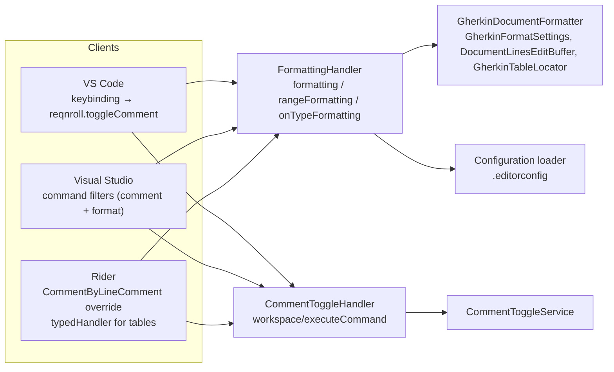
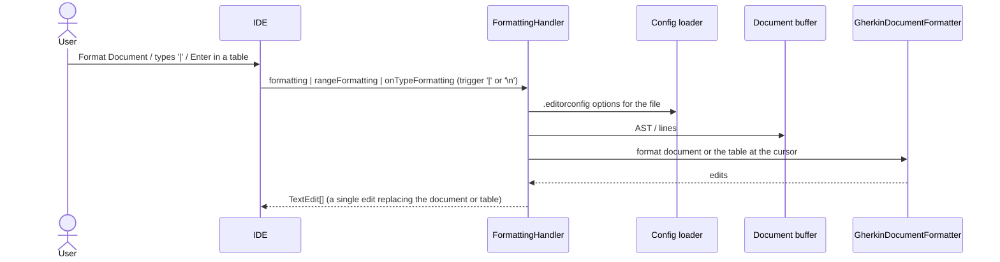
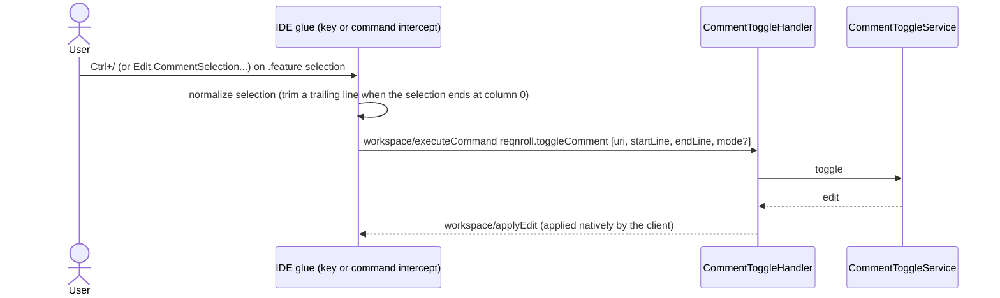

# Formatting and Commenting (F11, F12, F13)

**Status:** Implemented. Describes the system as it is; verify against the source files named in each section.
**Audience:** Maintainers working on document or table formatting, comment toggling, or their per-IDE command wiring.

## 1. Purpose and scope

- **Format Document (F11).** Re-indents the whole feature file: consistent indentation per nesting level, normalized
  spacing around keywords, blank lines between scenarios. Settings come from `.editorconfig` (`indent_size`,
  `indent_style`, `end_of_line`). Format Selection is supported too.
- **Table formatting (F12).** Typing `|` or pressing Enter inside a data or Examples table pads the columns so pipes
  align; a row missing its final trailing pipe gets one. Format Document aligns tables as well.
- **Comment / uncomment (F13).** A shortcut (Ctrl+/ and the usual per-IDE bindings) toggles `#` comments on the selected
  lines. LSP has no comment capability, so this is a custom command round trip.

## 2. Overview

## 3. Flows

### 3.1 Format Document and table formatting

### 3.2 Comment toggle

## 4. Glossary

| Term | Meaning here |
|---|---|
| **Mode** | `toggle` (default: uncomment if every line is commented, else comment), `comment`, `uncomment` (removes one `#` per commented line). |
| **`cursorBelowTable`** | The Enter case: the cursor is on the new empty line below the table; the edit range is extended to it. |
| **Command filter** | A Visual Studio `IOleCommandTarget` that takes over a built-in command for Gherkin views. |
| **On-type trigger** | `|` (first) and `\n` (more). |

## 5. Key classes

| Class | Location | Responsibility |
|---|---|---|
| `GherkinDocumentFormatter` (behind `IGherkinDocumentFormatter`), `GherkinFormatSettings`, `DocumentLinesEditBuffer`, `GherkinTableLocator` | `src/LSP/…LSP.Core/Formatting` | Re-indent, table alignment, line buffer shared by both formatters. |
| `FormattingHandler` | `…LSP.Server/Features/Formatting` | All three formatting messages; table detection (`FindTableLineRange`, `FindTableAtLine`). |
| `CommentToggleService`, `ICommentToggleService`, `CommentToggleMode`, `GherkinCommentEdit` | `…LSP.Core/Commenting` | Toggle logic. |
| `CommentToggleHandler` | `…LSP.Server/Features/Commenting` | `workspace/executeCommand` for `reqnroll.toggleComment`. |
| `FormatDocumentCommandFilter`, `FormatDocumentService`, `CommentToggleCommandFilter`, `CommentToggleService`, `CommentToggleRedirect` | `src/VisualStudio/…VSSDKIntegration`, `…Extension` | Visual Studio interception and requests. |
| `commentToggle.ts`, `selectionUtils.ts` | `src/VSCode/src` | VS Code command and selection normalization. |
| `ReqnrollCommentByLineCommentAction`, `ReqnrollFeatureOnTypeFormattingHandler` | `src/Rider` | Rider command override and table typed handler. |

## 6. Behaviour and contracts

**Formatting.** `formatting` and `rangeFormatting` return a single `TextEdit` replacing the entire document; for a range,
extra blank lines at its start and end are trimmed. The formatter re-indents keywords by nesting level (Feature →
Scenario → Step) using tabs by default; `GherkinFormatSettings` controls indent character, line endings and numeric
right-alignment in tables. `DocumentLinesEditBuffer` holds the raw line array and is mutated in place by both the document
and table formatters; the joined text is the edit's `newText`. The cursor-position edit range is captured **before**
formatting (which mutates the lines), using `originalEditEndLineLength` to produce valid end columns.

**Table formatting.** `FindTableLineRange` scans up and down from the cursor for lines whose trimmed start begins with `|`;
`FindTableAtLine` finds the AST table node. Tab was evaluated as a trigger and omitted, because Visual Studio routes Tab to
its completion handler rather than `onTypeFormatting`. For the `\n` trigger the edit range end is `(cursorLine, 0)` and
`newText` ends with a line ending.

**Per-IDE formatting delivery.**

- **VS Code:** generic; `editor.formatOnType` is on for the language.
- **Visual Studio:** the out-of-process `LanguageServerProvider` model does not route `Edit.FormatDocument` /
  `Edit.FormatSelection` to the server on its own. `FormatDocumentCommandFilter` intercepts both, `FormatDocumentService`
  sends the standard request and applies the returned edits directly to the buffer (a plain request/response, not a
  pushed `applyEdit`).
- **Rider:** document formatting works through an opt-in `lspFormattingSupport` override that activates the generic
  `LspFormattingService` (Rider's own formatter does not compete for `.feature`). On-type formatting needs
  `ReqnrollFeatureOnTypeFormattingHandler`, a `typedHandler` that calls the standard request and applies edits manually.

**Comment toggle per IDE.**

- **VS Code:** `ctrl+/` (`cmd+/` on macOS) bound to `reqnroll.toggleComment`, scoped to `editorLangId == reqnroll`; also in
  the editor context menu and command palette. Selection normalization trims a trailing line when the selection ends at
  `(line, 0)`.
- **Visual Studio:** `CommentToggleCommandFilter`, installed per editable Gherkin text view through an
  `IVsTextViewCreationListener`, takes over three standard commands, so user key bindings and the Edit menu work, and
  passes the matching mode:

| VS command | Default binding | Command set : ID | `mode` |
|---|---|---|---|
| `Edit.CommentSelection` | Ctrl+K, Ctrl+C | VSStd2K : 136 `COMMENT_BLOCK` (legacy alias 98) | `comment` |
| `Edit.UncommentSelection` | Ctrl+K, Ctrl+U | VSStd2K : 137 `UNCOMMENT_BLOCK` (legacy alias 99) | `uncomment` |
| `Edit.ToggleLineComment` | Ctrl+/ | `{160961B3-909D-4B28-9353-A1BEF587B4A6}` : 48 | `toggle` |

- **Rider:** `ReqnrollCommentByLineCommentAction` subclasses `CommentByLineCommentAction` and is registered with
  `overrides="true"` under the same action ID, so every keymap's comment shortcut reaches it (`Ctrl+/` default;
  `Ctrl+K,C`/`Ctrl+K,U` in the Visual Studio keymaps). Outside `.feature` files it defers to the platform. It is enabled only
  with the caret in a `.feature` editor and uses only the primary caret's selection.

The server's `workspace/applyEdit` is applied by each client's own LSP client natively.

## 7. Pitfalls and design decisions

1. **Visual Studio reverts an empty completion on a table trigger.** Its built-in Gherkin service auto-inserts a space after
   `|` and routes `|`, space, Enter and Tab to its completion handler; an empty list makes it remove the typed character. The
   server therefore returns a single `| ` item with a zero-length range for table rows (behaviour flag
   `RejectsEmptyTriggerCompletion`). On-type edits are sent correctly, but Visual Studio's pipeline may apply them late or
   override them via auto-insert.
2. **Capture the edit range before formatting.** The formatter mutates the line array, so any end column read afterward is
   wrong.
3. **Comment IDs must be real.** The filter once matched hard-coded IDs 145–147, which are unrelated VSStd2K commands, so none
   of the shortcuts reached the server. `Edit.ToggleLineComment` has no `VSConstants` entry; its ID comes from the
   `CommandBindings` in `Microsoft.VisualStudio.Editor.Implementation.dll`. `TryGetCommentMode` is kept `ThreadHelper`-free so the
   IDs are unit tested.
4. **Intercept the command, not the keystroke (Rider).** The platform action is a `MultiCaretCodeInsightAction` that hardcodes its
   handler and gates on a registered `Commenter` for the file's language, so decorating `EditorActionManager` has no effect and
   the built-in action is disabled for `.feature`. Override the action by ID.
5. **Do not keep a Reqnroll-specific comment menu command.** It was a stop-gap for broken key bindings and was removed.

## 8. Known limitations

- Visual Studio's built-in auto-insert after `|` can interact with on-type table edits.
- Rider's on-type and table behaviours depend on its typed-handler pipeline, not the generic client.

## 9. Testing

| Layer | Where |
|---|---|
| Formatter, comment service | `tests/LSP/Reqnroll.IdeSupport.LSP.Core.Tests/Formatting`, `…/Commenting` |
| Handlers | `tests/LSP/Reqnroll.IdeSupport.LSP.Server.Tests/Features/Formatting`, `…/Commenting` |
| End to end | `tests/LSP/Reqnroll.IdeSupport.LSP.Server.Specs/Features/Editor/DocumentFormatting.feature`, `CommentToggle.feature`, `KeywordCompletionVisualStudio.feature` |
| Command IDs | `tests/VisualStudio/Reqnroll.IdeSupport.VisualStudio.Tests` |
