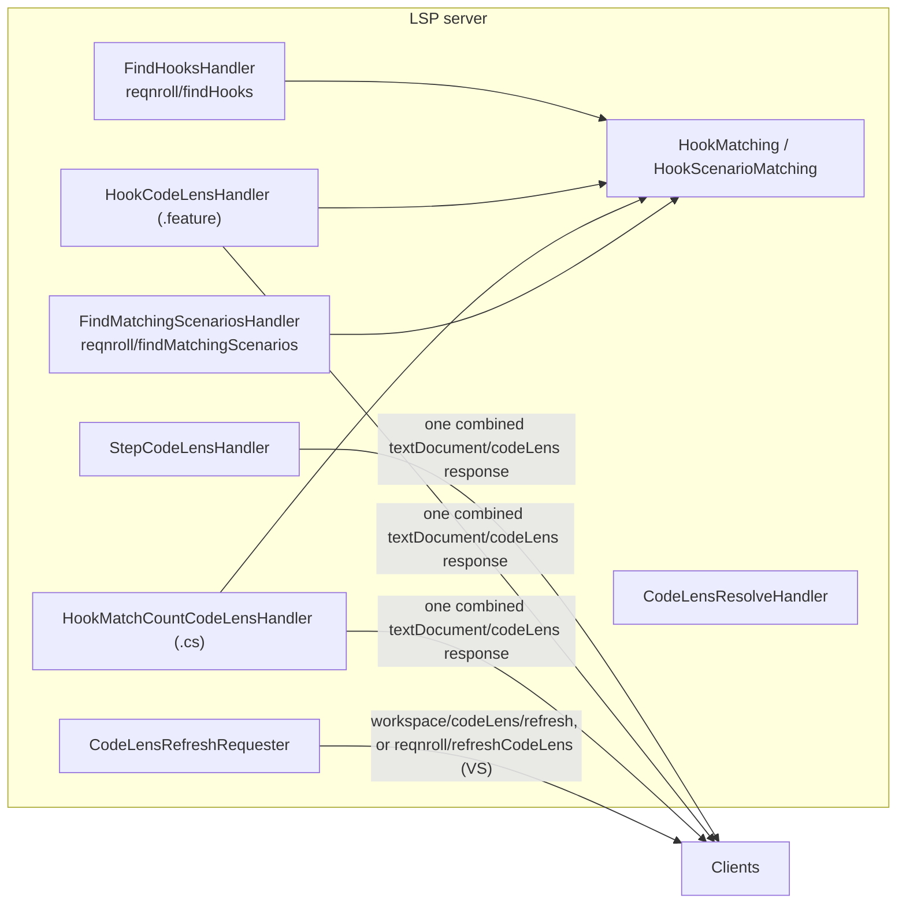
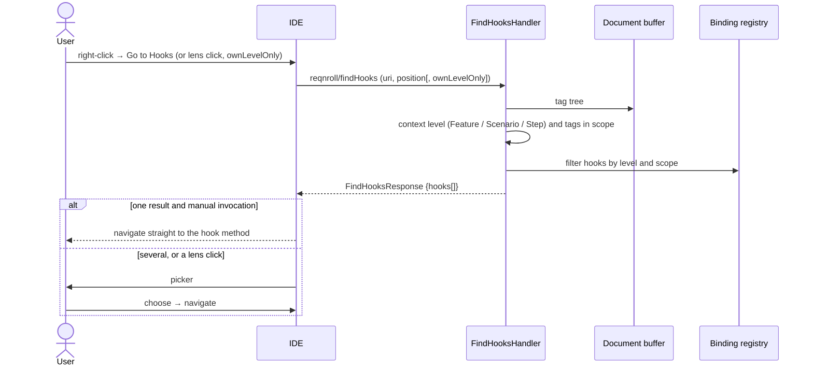
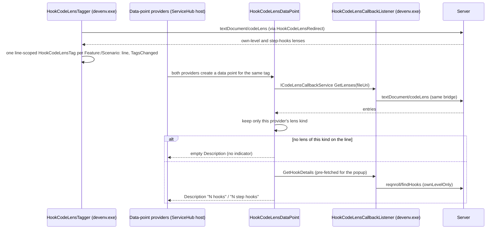

# Hook Navigation and CodeLenses (F17, F18, F24, F25)

**Status:** Implemented. Describes the system as it is; verify against the source files named in each section.
**Audience:** Maintainers working on Go to Hooks, the step-usage and hook CodeLenses, or Visual Studio's CodeLens bridges.

## 1. Purpose and scope

- **Go to Hooks (F17).** From a `.feature` file, list the hook bindings in scope at the cursor and navigate to one. From the
  `Feature:` line: `[BeforeTestRun]`/`[AfterTestRun]` and `[BeforeFeature]`/`[AfterFeature]`. From a `Scenario:` or
  `Scenario Outline:` line, additionally `[BeforeScenario]`/`[AfterScenario]`. From a step line, additionally
  `[BeforeStep]`/`[AfterStep]` and the step-block hooks. Everything is filtered by the tags in scope against each hook's
  tags and `[Scope]` expressions.
- **Step-usage CodeLens (F18).** A C# step binding shows "N usages" above its attribute; a click lists the matching steps.
- **Hook-match CodeLens on `.feature` (F24).** A lens above each `Feature:`/`Scenario:`/`Scenario Outline:` line that has at
  least one hook native to that level, plus a second lens on the `Scenario:` line for the step-level hook count that applies to
  every step in the scenario. Step lines get no lens of their own because matching depends only on the scenario's tags and
  scope. `Background:` and `Rule:` never get one. A lens click opens the hook picker filtered to that lens's own set, and
  **always** shows the picker, even for one match, so the click target visibly matches what the lens counted.
- **Hook-match-count CodeLens on `.cs` (F25).** The reverse direction: each hook binding shows how many scenarios it matches.
  `[BeforeTestRun]`/`[AfterTestRun]` are excluded. A hook with zero matches still renders "0 scenarios matched" (a stale tag
  scope is something the user should notice). An unscoped hook matches every scenario, so it renders the static label
  "all scenarios" and skips the corpus walk. Clicking always shows a results list.

## 2. Overview

The three CodeLens handlers are combined into one `textDocument/codeLens` registration and their results concatenated
(`LanguageServerOptionsExtensions`). A single `.cs` response legitimately carries step-usage and hook-count lenses, because a
`[Binding]` class mixes both kinds of method.

## 3. Flows

### 3.1 Go to Hooks

### 3.2 Rendering a `.feature` hook lens in Visual Studio

## 4. Glossary

| Term | Meaning here |
|---|---|
| **Own-level hooks** | Hooks native to the line's level (feature-level on `Feature:`, scenario-level on `Scenario:`). |
| **Step-hooks lens** | The second lens on a `Scenario:` line counting step-level hooks. |
| **`ownLevelOnly`** | `findHooks` flag restricting results to the lens's own set. |
| **Classic CodeLens** | `Microsoft.VisualStudio.Language.CodeLens`: tagger + out-of-process data-point provider. |
| **Data point** | The out-of-process object that supplies a lens's label and details. |
| **Callback listener** | The `devenv.exe` JSON-RPC target an out-of-process data point calls back into. |
| **Attribute-to-method mapping** | Reconciling server lenses (one per attribute, at the declaration line) with VS.Extensibility's one callback per method (range starting at the first attribute line). |

## 5. Key classes

| Class | Location | Responsibility |
|---|---|---|
| `FindHooksHandler`, `FindMatchingScenariosHandler`, `FindHooksParams/Response` | `src/LSP/…LSP.Server/Features/Definition` | `reqnroll/findHooks`, `reqnroll/findMatchingScenarios`. |
| `HookMatching`, `HookScenarioMatching` | `src/LSP/…LSP.Core/Bindings`, `…/Matching` | The single source of hook applicability and matching, so a lens count never disagrees with what a click shows. |
| `StepCodeLensHandler`, `HookCodeLensHandler`, `HookMatchCountCodeLensHandler`, `CodeLensResolveHandler`, `CodeLensRefreshRequester` | `…LSP.Server/Features/CodeLens` | Lens producers, resolve dispatch (by a `kind` in `CodeLens.Data`), refresh. |
| `StepCodeLensProvider`, `HookMatchCountCodeLensProvider`, `StepCodeLensState`, `StepCodeLensService` | `src/VisualStudio/…Extension/StepCodeLens`, `…/HookMatchCountCodeLens` | Visual Studio `.cs` lenses (VS.Extensibility `ICodeLensProvider`). |
| `HookCodeLensTaggerProvider`, `HookCodeLensTagger`, `HookCodeLensTag`, `HookCodeLensDescriptor`, `HookElementDescription`, `HookCodeLensDataPointProvider`, `StepHooksCodeLensDataPointProvider`, `HookCodeLensDataPoint`, `HookCodeLensCallbackListener`, `HookCodeLensRedirect` | `src/VisualStudio/…VSSDKIntegration/HookCodeLens` | Visual Studio `.feature` lens bridge. |
| `HookFeatureCodeLensService`, `FindHooksService` | `…Extension/HookFeatureCodeLens`, `…/GoToHooks` | In-process requests to the server. |
| `hookCodeLens.ts`, `stepCodeLens.ts`, `goToHooks.ts`, `goToMatchingScenarios.ts` | `src/VSCode/src/commands` | VS Code providers and click handlers. |
| `HookCodeVisionProvider`, `StepHooksCodeVisionProvider`, `StepUsagesCodeVisionProvider`, `HookLensSupport`, `GoToHooksAction`, `GoToHooksRunner`, `GoToMatchingScenariosRunner`, `ReqnrollResultPopup` | `src/Rider` | Rider lenses and actions. |

## 6. Behaviour and contracts

**Go to Hooks surface per IDE.** It maps onto no standard gesture, so each client exposes a command that sends the custom
`reqnroll/findHooks` request. (`textDocument/definition` is not viable: step lines already use it for step navigation, so
step-level hooks would be unreachable.)

- **Visual Studio.** Placed in `IDG_VS_CODEWIN_NAVIGATETOLOCATION` (beside Go To Definition and Find All References),
  visible only for the `Gherkin` content type. One result navigates directly; several open `NavigationPickerDialog` (a
  `DialogWindow` with a `ListBox`, entries `[HookType] MethodName (filename:line)`), via the shared `NavigationPickerHelper`.
- **VS Code.** `reqnroll.goToHooks` in the editor context menu (`navigation@90`, `editorLangId == reqnroll`) and palette. A
  single hook navigates; several show a QuickPick (`$(symbol-event) HookType`, method as description, `Order: N` as detail
  when non-zero). `doGoToHooks` gates auto-navigate on `!position?.alwaysShowPicker`, set only for lens clicks.
- **Rider.** `GoToHooksAction` (enabled with the caret in a `.feature` editor; in the Tools menu and `EditorPopupMenu`)
  calls `ReqnrollRequestSender.findHooks` from a background task; `GoToHooksRunner` navigates directly for one hook or
  shows the shared chooser popup, entries as `[HookType] MethodName (filename:line)`.

**Step-usage lens per IDE.** The server emits one `CodeLens` per step-binding *attribute* with its range at the method
declaration line (0-based).

- **VS Code.** `registerStepCodeLens` calls `vscode.languages.registerCodeLensProvider({ language: 'csharp' }, …)` directly
  after `client.start()` (not through `vscode-languageclient`'s CodeLens feature, to avoid clashing with the C# extension's own
  registration), sends the raw request, and maps lenses 1:1. Because it bypasses that feature it also loses its built-in
  `workspace/codeLens/refresh` listener, so it fires its own `onDidChangeCodeLenses` emitter from
  `client.onRequest(CodeLensRefreshRequest.type, …)`. `codeLens/resolve` is not used; the response already carries the command.
- **Rider.** The standard `textDocument/codeLens` is called directly through `ReqnrollRequestSender` and rendered by a native
  `CodeVisionProvider`; refresh uses the standard `workspace/codeLens/refresh`.
- **Visual Studio.** `StepCodeLensProvider` (VS.Extensibility `ICodeLensProvider`) is called once per C# *method*, with the
  range starting at the first attribute line. `StepCodeLensState` keeps a per-file registry of method start lines; as each
  `TryCreateCodeLensAsync` fires it registers its line, and VS processes visible methods bottom to top, so by the time
  `GetLabelAsync` runs for method N all methods below it are known. `GetNextMethodLine` supplies the upper bound; the filter
  `RangeLine >= currentStartLine && RangeLine < nextMethodStartLine` selects exactly the server lenses of this method (a fixed
  lookahead of 5 lines for the bottommost visible method). Usage counts across attributes on the method are summed.

**Hook-count lens per IDE.** VS Code shares the F18 `.cs` provider; Rider dispatches both lens kinds from
`StepUsagesCodeVisionProvider` by command name (`reqnroll.goToMatchingScenarios` versus `reqnroll.findStepUsages`); Visual
Studio registers `HookMatchCountCodeLensProvider` as a second `ICodeLensProvider`, reusing `StepCodeLensState` for the same
range reconciliation, and presents matches in the Find-Usages results window rather than the modal picker.

**Hook-lens on `.feature` per IDE.** VS Code: `registerHookCodeLens` provider (same pattern as F18). Rider: two
`CodeVisionProvider`s (own-level and step-hooks, ordered with `CodeVisionRelativeOrderingAfter`) sharing `HookLensSupport`,
because one provider cannot render two entries on a line. Visual Studio: the classic-API bridge below.

**Scopes.** A hook with several scopes (several `[Scope]` attributes, class- and method-level scopes, or tags on the hook
attribute) is one binding with one lens; discovery reduces the alternatives to one `BindingScope`. The count is the number of
scenarios matching **any** alternative, computed by `ProjectBinding.MatchScope`; `findMatchingScenarios` (the click) uses the same
function, so the list has as many entries as the lens counted. A bare `[Scope]` makes the hook unrestricted ("all scenarios").
See [../architecture/binding-discovery.md](../architecture/binding-discovery.md).

**Refresh.** The server refreshes with the standard `workspace/codeLens/refresh` for most clients and the custom
`reqnroll/refreshCodeLens` for Visual Studio. In Visual Studio `CodeLensRefreshInterceptor` acts on both full (rebuild) and
incremental signals, coalesced over a short window and rate-limited. The server publishes the incremental signal only when a
Roslyn patch actually changed a binding's matched expression, debounced, so method-body and comment edits never reach it. The
`.feature` bridge does not call `CodeLens.Invalidate()`; the tagger re-pulls through `HookCodeLensRedirect.InvalidateAll` and a
line whose lens content changed gets a new `ElementDescription`, hence a new tag and fresh data points.

## 7. Pitfalls and design decisions

**Visual Studio `.feature` lens: platform requirements found only by live debugging** (the SDK doc comments describe an older
model; each was found by decompiling VS's editor assemblies against a real failure):

1. **Register the assembly under both** `Microsoft.VisualStudio.MefComponent` and `Microsoft.VisualStudio.CodeLensComponent`.
   The first alone leaves the out-of-process data-point provider undiscovered, silently (the lens never appears in Tools →
   Options → Text Editor → CodeLens).
2. **Implement `ICodeLensTag2` and `ICodeLensDescriptorContextProvider`.** Plain `ICodeLensDescriptor`/`ICodeLensTag` have no
   context-resolution path and always throw "Unsupported CodeLens descriptor".
3. **The data points run out of process.** A `static` bridge (correct elsewhere in this repo) is invisible there; use
   `ICodeLensCallbackService`/`ICodeLensCallbackListener`.
4. **The callback listener needs `[ContentType("Gherkin")]`.** Without it VS composes it as a valid MEF part but never wires it
   onto the RPC target list, and every callback fails with `RemoteMethodNotFoundException`.
5. **`GetDetailsAsync` must not make its own callback.** `OnShowDetailsExecuted` blocks the UI thread on it without pumping
   messages, while the callback is dispatched onto that same UI thread: a deadlock (captured in a process dump). So
   `GetDataAsync`, which runs first on a normal async path, pre-fetches and caches the popup content.
6. **Two indicators on one line = one tag + two providers, never two tags.** The engine renders one adornment row per line and
   silently drops the extra tag however it differs. The tagger emits one line-scoped tag, both providers accept it, and each
   data point filters to its own kind and returns an empty `Description` to opt out.
7. **Cache tag instances per line** so an unchanged line keeps its identity; the host tracks tags by identity, so fresh
   instances every call churn data points on every scroll.
8. **`ElementDescription` is the only forwarded field,** so it encodes the line plus an opaque content `revision`; without the
   revision a refreshed count never reaches the editor.
9. **`CodeLensDetailEntryCommand` supports only a CommandSet+CommandId pair on Windows,** so the navigate command goes through an
   `IOleCommandTarget` on the package and a `.vsct`, not a VS.Extensibility command.

**Other.**

10. **One shared matching helper.** `HookMatching` serves both lenses and the click, so counts never disagree with results.
11. **The CodeLens invalidation registry must cover every lens type.** The `.cs` hook-count lens once registered nowhere, so it
    never refreshed after a rebuild (only navigating away and back updated it). The registry is keyed on a small
    `IInvalidatableLens` interface implemented by both lens types.
12. **Live refresh can provoke a client reconnect** (`CodeLens.Invalidate()` can make VS.Extensibility reactivate the language
    client). It is survivable, not eliminated: a fresh VS-facing pipe is handed out per call, late responses from abandoned
    sessions and cancelled owned requests are dropped, and the server process and registry are untouched. The interceptor
    degrades to build-only refresh with a warning if a feedback loop ever formed.
13. **A lens click always shows the picker.** Auto-navigating on a single match made a passive annotation cause a surprising
    jump; manual Go to Hooks still auto-navigates.

## 8. Known limitations

- Step lines never get an individual hook lens (by design).
- The Visual Studio hook lens popup's "Dock Popup" button yields an empty docked window: the classic out-of-process API gives
  a custom data point no way to populate it, and no extensibility point for it was found. Treat it as unsupported. A persistent
  results window would reuse the Find-All-References plumbing, as the hook-count lens already does.
- The Visual Studio `.feature` data point never raises `InvalidatedAsync` (the classic API gives no disposal hook to
  unsubscribe safely); refresh comes from the tagger side.

## 9. Testing

| Layer | Where |
|---|---|
| Matching, lens handlers | `tests/LSP/Reqnroll.IdeSupport.LSP.Core.Tests/Bindings`, `…Server.Tests/Features/CodeLens`, `…/Definition` |
| End to end | `…Server.Specs/Features/Navigation/FindHooks.feature`, `FindMatchingScenarios.feature`, `StepCodeLens.feature` |
| Clients | `tests/VisualStudio/Reqnroll.IdeSupport.VisualStudio.Tests`, `src/VSCode/src/test`, `src/Rider/src/test` |
