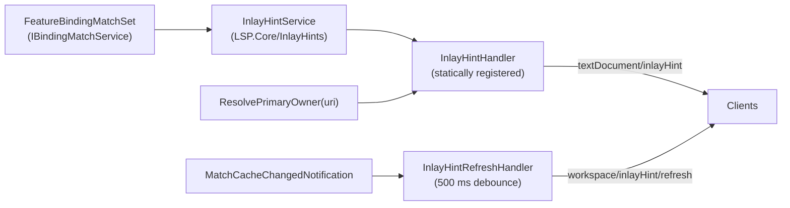
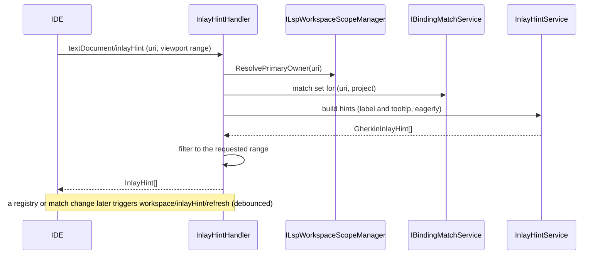

# Inlay Hints (F23)

**Status:** Implemented. Describes the system as it is; verify against the source files named in each section.
**Audience:** Maintainers working on `textDocument/inlayHint` or its per-IDE rendering.

## 1. Purpose and scope

Each defined step in a `.feature` file shows a dimmed, non-editable annotation at the end of the line naming the binding it
resolves to, for example `→ CalculatorSteps.AddNumbers`. An ambiguous step shows `→ {n} matches`. A Scenario Outline or
Background template step whose example rows resolve to more than one distinct binding shows `→ {n} bindings`. Undefined steps
get no hint, since the diagnostic already covers them. Hovering a hint shows the full method signature (and every candidate for
a multi-match hint). The feature is unconditionally on; there is no settings surface and there are no parameter-type hints.

## 2. Overview

## 3. Flows

## 4. Glossary

| Term | Meaning here |
|---|---|
| **Hint kind** | `GherkinInlayHintKind`: `Binding` (one match), `Ambiguous` (several for one row), `Templated` (a template step resolving to several distinct bindings across rows). |
| **Primary owner** | The one project used to key the match set when a file has several owners. |
| **Viewport** | The requested range; hints outside it are filtered out. |
| **Refresh support** | The client capability `workspace.inlayHint.refreshSupport`. |

## 5. Key classes

| Class | Location | Responsibility |
|---|---|---|
| `InlayHintService`, `IInlayHintService`, `GherkinInlayHint` | `src/LSP/…LSP.Core/InlayHints` | Projects a match set into hints. |
| `InlayHintHandler` | `…LSP.Server/Features/InlayHints` | Resolves the owner, builds and filters hints; statically declared (`Program.ConfigureServer`). |
| `InlayHintRefreshHandler` | `…LSP.Server/Pipeline` | Debounces match-cache bursts into one refresh; gated on client refresh support. |
| `ReqnrollFeatureInlayHintsController`, `ReqnrollToggleFeatureInlayHintsAction`, `ReqnrollInlayHintRefreshInterceptor` | `src/Rider` | Rider rendering via `Editor.inlayModel`, toggle, refresh. |

## 6. Behaviour and contracts

`InlayHintService` projects a match set into one hint per step with a `Defined`, `Ambiguous` or `Templated` result. The handler
computes label **and** tooltip eagerly in one pass (a signature string already in the match set, with no I/O), so
`InlayHintProvider.ResolveProvider = false` is declared and there is no resolve support. There is no per-request options object.
The capability is declared statically in `initialize`, because `vscode-languageclient`'s dynamic `client/registerCapability`
round trip for `inlayHint` races VS Code's restore of previously open `.feature` tabs on window load, and a tab that renders
first never gets a provider re-check for the session. Refresh mirrors semantic tokens: bursts of `MatchCacheChangedNotification`
collapse (500 ms) into one `workspace/inlayHint/refresh`.

**Per IDE.** VS Code and Visual Studio use the generic client. Visual Studio additionally requires the user to enable inline hints
in the editor (Tools → Options → Text Editor, or the hold-to-show gesture); the extension does not force that setting on. Rider's
generic client has no rendering consumer for inlay hints, so `ReqnrollFeatureInlayHintsController` is an `EditorFactoryListener`
that calls the standard request directly and renders through `Editor.inlayModel` (not a declarative provider, which dispatches by
PSI language and `.feature` has none), with a "Show Feature Inlay Hints" toggle.

## 7. Pitfalls and design decisions

1. **Declare the capability statically.** Dynamic registration races the VS Code tab restore.
2. **Key by the primary owner.** A linked feature has several owners; the match set is keyed `(uri, project)`.
3. **Do not use a declarative provider in Rider.** It was silently never invoked for a language with no PSI.
4. **No conflict with Visual Studio.** It has no built-in hint provider for `.feature`, so there is nothing to clash with.
5. **Hold off on parameter-type hints** until the offset-mapping question (a placeholder `<amount>` versus its expanded value) is
   answered; see open question O7 in the [register](../LSP-IDE-Support-Open-Questions.md#1-open-questions).

## 8. Known limitations

- No parameter-type hints and no settings surface. Adding them needs a second projection pass over each step's capture groups
  and options threaded from configuration into the handler.

## 9. Testing

| Layer | Where |
|---|---|
| Service | `tests/LSP/Reqnroll.IdeSupport.LSP.Core.Tests/InlayHints` |
| Handler, refresh | `tests/LSP/Reqnroll.IdeSupport.LSP.Server.Tests/Features/InlayHints`, `…/Pipeline` |
| End to end | `tests/LSP/Reqnroll.IdeSupport.LSP.Server.Specs/Features/Editor/InlayHints.feature` |
