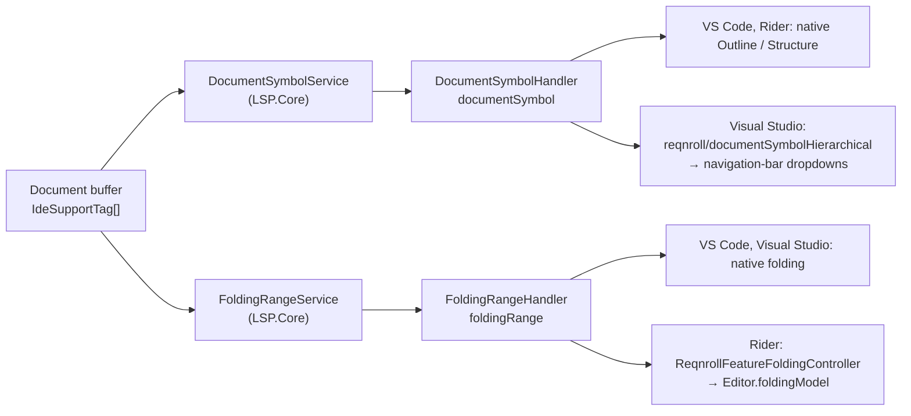
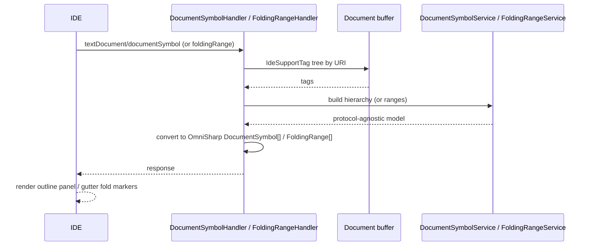

# Document Outline and Code Folding (F9, F10)

**Status:** Implemented. Describes the system as it is; verify against the source files named in each section.
**Audience:** Maintainers working on `documentSymbol`, folding ranges, or their per-IDE rendering.

## 1. Purpose and scope

- **Outline (F9).** The IDE's Outline or Structure view shows Feature → Background / Rule → Scenario / Scenario Outline →
  Step; clicking a node navigates. In Visual Studio it feeds the navigation-bar dropdowns above the editor.
- **Folding (F10).** Scenarios, Backgrounds, Rules, doc strings and data tables collapse in the gutter and update as the
  document is edited.

Both are computed from the cached tag tree, the same one semantic tokens read.

## 2. Overview

## 3. Flows

## 4. Glossary

| Term | Meaning here |
|---|---|
| **Document symbol** | One node of the outline; hierarchical `DocumentSymbol` form. |
| **Navigation bar** | Visual Studio's dropdown bar above the editor (`IVsDropdownBarClient`). |
| **Folding range** | A start/end line pair the IDE may collapse. |
| **Foldable regions** | Scenario, Background, Rule, doc string and table nodes. |
| **Structure view** | Rider's name for its outline tool window. |

## 5. Key classes

| Class | Location | Responsibility |
|---|---|---|
| `DocumentSymbolService`, `GherkinDocumentSymbol`, `IDocumentSymbolService` | `src/LSP/…LSP.Core/DocumentOutline` | Walks the tag tree to a protocol-agnostic hierarchy. |
| `DocumentSymbolHandler` | `…LSP.Server/Features/DocumentOutline` | Converts to OmniSharp `DocumentSymbol[]`. |
| `FoldingRangeService`, `GherkinFoldingRange`, `IFoldingRangeService` | `…LSP.Core/Folding` | Computes ranges. |
| `FoldingRangeHandler` | `…LSP.Server/Features/Folding` | Statically registered handler. |
| `GherkinNavigationBarSymbolService`, `GherkinDropdownBarClient` | `src/VisualStudio/…Extension/NavigationBar`, `…VSSDKIntegration/NavigationBar` | Visual Studio navigation bar. |
| `ReqnrollFeatureFoldingController` | `src/Rider/…/folding` | Rider rendering. |

## 6. Behaviour and contracts

**Symbol kinds:** Feature→Module, Background→Constructor, Rule→Namespace, Scenario / Scenario Outline→Method,
Step→Field, Examples→Array. `DocumentSymbol.Children` is `init`-only, so children are wrapped in
`Container<DocumentSymbol>` in the object initializer. The `Range` of a container symbol is its full body (not its header
line) so clients can resolve things "inside" it; the `SelectionRange` is the header.

**Visual Studio outline.** Visual Studio registers the `documentSymbol` capability but never sends the request: its
Document Outline window (Ctrl+Alt+T) uses COM / `IVsHierarchy`. It does consume symbol information for the navigation bar
and Go to Member, but those need content-type plumbing for `.feature`. The client therefore uses a custom
`reqnroll/documentSymbolHierarchical` request and drives the dropdown bar itself. The Document Outline window is not
populated (open question O2 in the [register](../LSP-IDE-Support-Open-Questions.md#1-open-questions)). The navigation-bar
listener attaches by `[ContentType("Gherkin")]`, so it depends on the activation work in
[../VS-LSP-Activation.md](../VS-LSP-Activation.md), and is gated off in diff views.

**Rider.** The native Structure view renders the standard `documentSymbol` response on current Rider; older Rider has no
outline. Folding has no rendering consumer in Rider's generic client, so `ReqnrollFeatureFoldingController` is an
`EditorFactoryListener` (not a PSI `FoldingBuilder`, since `.feature` has no `ParserDefinition`) that calls the standard
request directly and renders against `Editor.foldingModel`, debounced on edits. Fold regions are tagged through
`FoldRegion`'s `UserDataHolder`, so a rebuild touches only Reqnroll-owned regions and restores each one's expand/collapse
state by `(startOffset, endOffset)`.

**VS Code and Visual Studio** render folding purely through the generic LSP client.

## 7. Pitfalls and design decisions

1. **Rider rebuilds must preserve user fold state.** Otherwise every keystroke silently re-expands everything the user
   collapsed.
2. **Do not use PSI-based folding or outline in Rider.** There is no PSI tree for `.feature`.
3. **Do not expect Visual Studio to request `documentSymbol`.** Use the custom request for the dropdown bar.
4. **Keep the symbol model protocol-agnostic in Core.** Conversion to OmniSharp types belongs in the handler.

## 8. Known limitations

- Visual Studio's Document Outline window is not populated; the navigation-bar dropdowns are.
- Older Rider versions have no outline.

## 9. Testing

| Layer | Where |
|---|---|
| Symbol and folding services | `tests/LSP/Reqnroll.IdeSupport.LSP.Core.Tests/DocumentOutline`, `…/Folding` |
| Handlers | `tests/LSP/Reqnroll.IdeSupport.LSP.Server.Tests/Features/DocumentOutline`, `…/Folding` |
| End to end | `tests/LSP/Reqnroll.IdeSupport.LSP.Server.Specs/Features/Editor/DocumentOutline.feature`, `CodeFolding.feature` |
