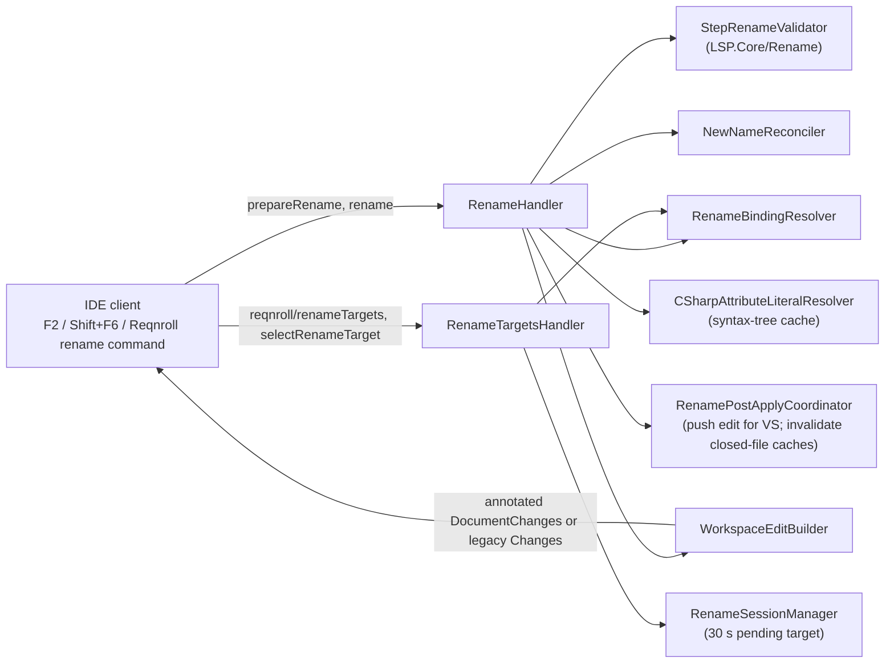
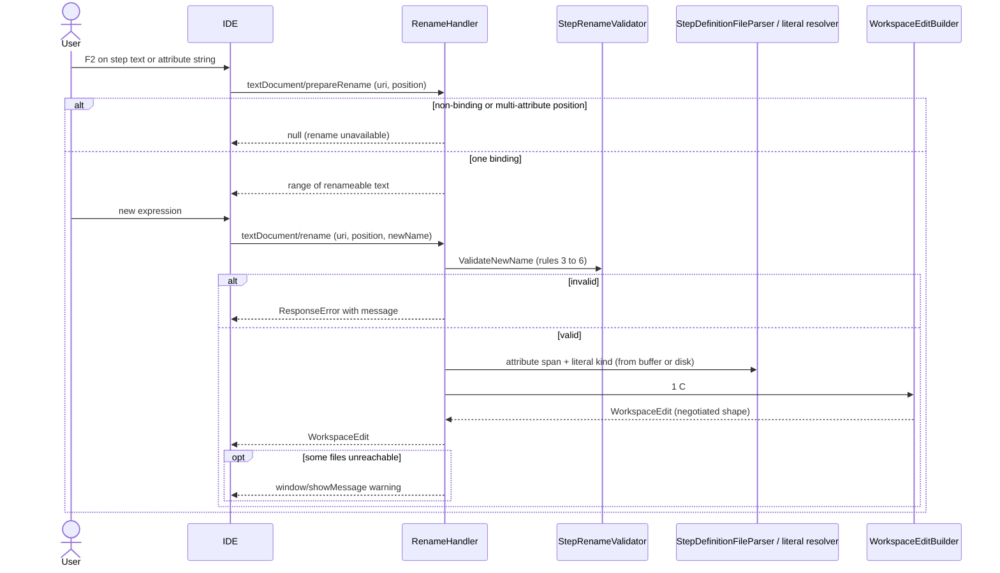

# Step Rename (F16)

**Status:** Implemented. Describes the system as it is; verify against the source files named in each section.
**Audience:** Maintainers working on renaming steps across `.feature` and C# files, rename validation, or rename edit delivery per client.

## 1. Purpose and scope

Renaming a step text, from either a `.feature` step line or a C# `[Given("...")]` attribute string, updates every occurrence
across the workspace: the attribute string in the binding class and every matching step in every `.feature` file. Behaviour:

- **Parameter preservation.** Parameter slots (`(.*)`, `(\d+)`, Cucumber `{param}`) are preserved; only the non-parameter text
  is renamed. Parameter count and expression types must be identical before and after.
- **Scenario Outline blocking.** Steps whose feature text contains `<placeholder>` tokens are not renamed; doing so would
  corrupt the outline's data binding.
- **Derived attributes.** A custom attribute deriving from `[Given]` and friends is supported: the string literal changes and
  the attribute type name is kept.
- **Unambiguous cursor.** In C# the cursor must be inside the target attribute's string literal. On a method with several
  binding attributes, a cursor on the signature or between attributes makes `prepareRename` return null, so the standard rename
  gesture is unavailable and the user uses the Reqnroll rename command, which shows a picker.
- **Scoped duplicates.** Several methods may share one expression with different `[Scope]`s; each is its own picker target,
  disambiguated by a scope suffix such as "Given text [@tag1]".
- **Linked bindings.** A binding linked into several projects renames matching steps in all including projects.

## 2. Overview



## 3. Flows

### 3.1 Single-binding rename



### 3.2 Multi-attribute rename (custom command and picker)

```mermaid
sequenceDiagram
    actor U as User
    participant IDE
    participant T as RenameTargetsHandler
    participant R as RenameHandler

    U->>IDE: Reqnroll "Rename Step" on a multi-attribute method
    IDE->>T: reqnroll/renameTargets (uri, position)
    T-->>IDE: targets (label, attributeRange) per binding attribute
    alt one target
        IDE-->>U: go straight to rename
    else several
        IDE->>U: picker
    end
    IDE->>T: reqnroll/selectRenameTarget {uri, version, attributeRange}
    T-->>IDE: ok (pending session, 30 s)
    U->>IDE: new expression
    IDE->>R: textDocument/rename (uri, position, newName)
    Note over R: position plus pending session identify the binding; the attribute span is re-parsed
    R-->>IDE: WorkspaceEdit
```

## 4. Glossary

| Term | Meaning here |
|---|---|
| **Rename target** | One binding attribute that can be renamed, with a label and the attribute's range. |
| **Pending session** | The target chosen in the picker, accepted for the next `rename` for 30 seconds, keyed by `(uri, version)`. |
| **Change annotation** | LSP 3.16 metadata grouping and labelling edits for a confirmation preview. |
| **`NeedsConfirmation`** | Annotation flag asking the client to confirm before applying. |
| **Literal kind** | Regular `"..."` versus verbatim/raw string, which determines escaping. |
| **Applies natively** | `AppliesRenameResponseEditNatively`: the client applies whatever the rename response carries. |

## 5. Key classes

| Class | Location | Responsibility |
|---|---|---|
| `RenameHandler` | `src/LSP/…LSP.Server/Features/Rename` | `prepareRename` and `rename`; validation, edit assembly, partial-failure messages. |
| `RenameTargetsHandler`, `RenameTargetsParams/Response`, `SelectRenameTargetParams` | same | Candidate enumeration and the pending-session selection. |
| `RenameBindingResolver`, `RenameBindingIdentity`, `NewNameReconciler`, `CSharpAttributeLiteralResolver` | same | Cursor → candidate bindings; reconcile new name with the existing shape; locate the C# literal (shared syntax-tree cache). |
| `WorkspaceEditBuilder`, `RenameChangeAnnotations`, `ChangeAnnotationIdentifierKeySerialization` | same, `…LSP.Core/Rename` | Negotiated edit shape and annotation ids (`reqnroll.rename.feature`, `reqnroll.rename.binding`). |
| `RenamePostApplyCoordinator` | same | Visual Studio push and closed-file cache invalidation. |
| `StepRenameValidator`, `RenameSessionManager`, `FeatureStepTextBuilder`, `StepExpressionParameters` | `…LSP.Core/Rename` | Validation rules, sessions, feature text building. |
| `RenameStepCommand`, `RenameStepService`, `RenameStepState` | `src/VisualStudio/…Extension/RenameStep` | Visual Studio command. |
| `renameStep.ts` | `src/VSCode/src/commands` | VS Code command with targets, picker and selection. |
| `RenameFeatureStepAction`, `RenameCSharpStepAction`, `RenameStepRunner`, `RenameWorkspaceEditApplier` | `src/Rider/…/actions` | Rider. |

## 6. Behaviour and contracts

**Validation rules** (in order; failure returns an error with a human-readable message):

| # | Rule | Message | Scope |
|---|---|---|---|
| 1 | Cursor must resolve to a single binding | "No step definition found at this position" | prepareRename + rename |
| 2 | Expression must be a plain string literal (not constant, concatenation or expression) | "Step definition expression cannot be detected" | prepareRename |
| 3 | Non-parameter parts must not contain operators of the binding's *own* syntax | "The non-parameter parts cannot contain expression operators" | rename |
| 4 | Parameter count must match | "Parameter count mismatch" | rename |
| 5 | Explicit parameter expressions must be compatible (same type and range) | "Parameter expression mismatch" | rename |
| 6 | Matching feature steps must not contain outline placeholders | "Could not rename step with placeholders in scenario outline: {step text}" | rename |
| 7 | Owning project needs a valid registry with membership populated | "The project is not initialized yet" / "No Reqnroll project with feature files found" | prepareRename |
| 8 | For linked bindings, every including project's feature files must be reachable | un-reachable files are logged and the user warned with `window/showMessage` | rename (post-edit) |

*Rule 3.* Cucumber expressions treat only `{ } ( ) \ /` as special, so `?`, `*`, `+`, `[...]`, `^`, `$`, `|` are plain literals
there (a currency amount like `${float}`), while in a regex the full operator set changes matching. `StepRenameValidator`
picks the forbidden set with `CucumberExpressionDetector.IsCucumberExpression` on the original expression (the same
classification discovery uses) and scans each non-parameter segment of the new expression. Escaped operators are excluded.
Parameter slots are found with a regex matching both capture groups and `{param}` placeholders.

**C# attribute resolution.** At rename time the handler reads the `.cs` file (document buffer if open, else disk), parses it
through the shared syntax-tree cache, finds the method matching the registry's recorded location, walks its attributes to the
one whose expression matches, and extracts the literal's span, kind (regular versus verbatim/raw, deciding escaping) and raw
text. This is fast (single file, typically under 50 ms) and always reflects what the user sees, including unsaved edits.

**Edit shape.** `WorkspaceEditBuilder` reads the client's `workspace.workspaceEdit` capabilities once per rename and emits an
annotated `DocumentChanges` edit when the client advertises both `documentChanges` and `changeAnnotationSupport` (VS Code), else
the legacy `Changes` map (Visual Studio never advertises annotation support). The `feature` annotation sets
`NeedsConfirmation = featureFileCount > 1` unconditionally, with no opt-out; the `binding` annotation does not ask. Document
versions are always null (`OptionalVersionedTextDocumentIdentifier` without a version).

**Delivery per client.**

- **VS Code.** `renameStep.ts` queries `reqnroll/renameTargets`; for zero or one candidate it goes straight to the native
  rename; for several it shows a QuickPick and sends `reqnroll/selectRenameTarget`. `vscode-languageclient` applies the
  returned `WorkspaceEdit` natively.
- **Visual Studio.** `RenameStepCommand` (both editor context menus) queries targets, prompts for the new text, and sends
  `textDocument/rename`. Visual Studio's rename request goes through the owned pipe, which swallows the handler's return
  value, so the server sends the real edit with `workspace/applyEdit` (unannotated `DocumentChanges`) and returns an empty
  edit in the response (behaviour `AppliesRenameResponseEditNatively`).
- **Rider.** No native rename bridge exists for LSP, so `RenameStepRunner` runs disambiguate → prompt → `textDocument/rename`
  and `RenameWorkspaceEditApplier` applies the returned edit locally inside one write command. `.feature` rename is bound to
  Shift+F6; the `.cs` side is context-menu only.

**Post-apply.** `RenamePostApplyCoordinator` pushes the edit for Visual Studio only; only when its `ApplyWorkspaceEditResponse`
comes back `Applied = true` does cache invalidation proceed (a reported failure such as a locked file short-circuits before
any cache is touched). It also invalidates the match cache of touched `.feature` files that are **not open**: open files get
this from the `didChange` their edit triggers, but a closed file never does.

**Error handling.**

| Scenario | Behaviour |
|---|---|
| C# file read-only or checked out | The edit fails for that file; `rename` returns a `ResponseError` naming it; no partial rename applied. |
| Membership pending (no `projectFiles` baseline) | Rename proceeds for resolvable files, then `window/showMessage` says the project's steps may not have been updated. |
| Linked project has not sent membership | Same as pending; logged and reported; user advised to reload the project. |
| Registry becomes `Invalid` between prepare and rename | `ResponseError("The binding registry has been invalidated. Please try again after the project finishes loading.")` |
| User edits the `.cs` between prepare and rename | The edit targets the current buffer, which is correct. |

## 7. Pitfalls and design decisions

1. **Parse at rename time; do not store spans in the registry.** Spans and literal kinds are needed only for an infrequent,
   user-invoked operation. Storing three fields per attribute would go stale on every `.cs` keystroke and complicate the
   registry. A dynamic parse is simple and always current.
2. **Visual Studio double-applies if the response carries the edit.** Its pipeline applies a returned edit as well as the pushed
   one; hence the empty response plus `applyEdit` push for the behaviour flag, and no push at all for other clients.
3. **Invalidate closed-file caches explicitly, and only after success.** Invalidating a closed file before the open-file race
   dropped the rebuild entirely (inlay hints vanished for the whole file after a rename).
4. **Return null from `prepareRename` for multi-attribute positions.** The standard gesture cannot express a mid-rename picker,
   so the custom request/selection pair is used instead.
5. **Operators depend on the binding's syntax.** One shared forbidden list would block legitimate Cucumber literals or allow
   regex operators.
6. **Annotated edits need negotiation.** Sending annotations to a client that does not advertise support is a protocol error;
   always read the capability per rename.

## 8. Known limitations

- Whether Visual Studio applies the pushed multi-file edit as one undo transaction or several has not been verified live
  (open question O3 in the [register](../LSP-IDE-Support-Open-Questions.md#1-open-questions)).
- Visual Studio never sees the confirmation preview, because it never advertises change-annotation support.
- `NeedsConfirmation` is set for any multi-`.feature`-file rename, not just cross-project ones, with no way to opt out.
- Document versions are always null; no client has rejected versionless edits so far.

## 9. Testing

| Layer | Where |
|---|---|
| Validator, session manager, feature text building | `tests/LSP/Reqnroll.IdeSupport.LSP.Core.Tests/Rename` |
| Handlers, builder, coordinator | `tests/LSP/Reqnroll.IdeSupport.LSP.Server.Tests/Features/Rename` |
| End to end | `tests/LSP/Reqnroll.IdeSupport.LSP.Server.Specs/Features/Editor/RenameSteps.feature` |
| Clients | `tests/VisualStudio/…Tests`, `src/VSCode/src/test`, `src/Rider/src/test` |
