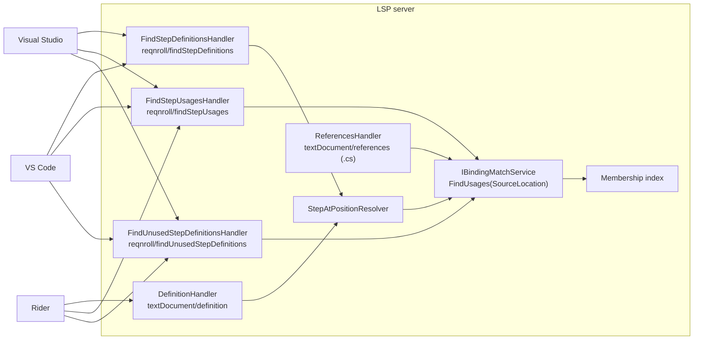
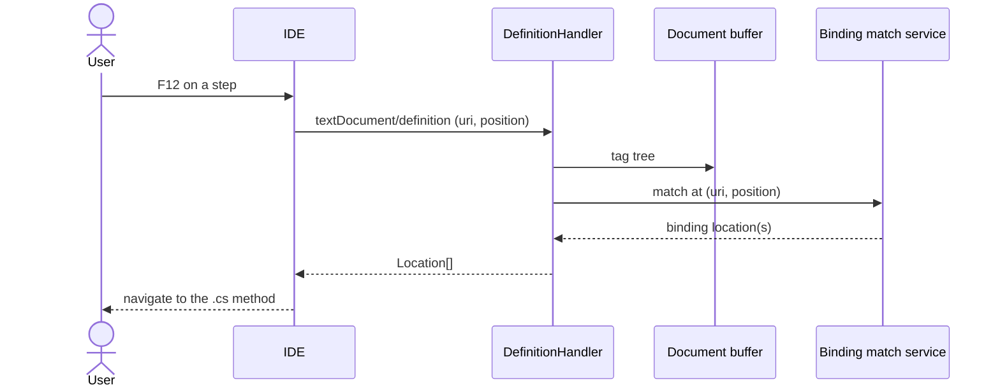
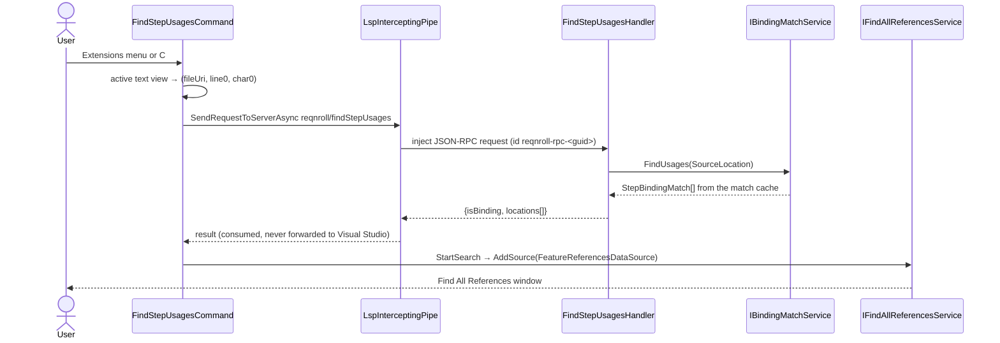

# Step Navigation: Go to Definition, Find Usages, Find Unused (F5, F14, F15)

**Status:** Implemented. Describes the system as it is; verify against the source files named in each section.
**Audience:** Maintainers working on moving between steps and their bindings, in either direction.

## 1. Purpose and scope

- **Go to Step Definition (F5).** F12 / Ctrl+Click on a step in a `.feature` file navigates to the matching `[Given]`,
  `[When]` or `[Then]` method. With several matches (an ambiguous step), a picker or results window is shown.
- **Find Step Usages (F14).** The inverse: on a C# binding method, list every `.feature` step that matches it.
- **Find Unused Step Definitions (F15).** A workspace-wide command listing bindings with zero matched steps.

Hook navigation and lenses are in [hooks-and-lenses.md](hooks-and-lenses.md).

## 2. Overview

## 3. Flows

### 3.1 Go to step definition

### 3.2 Find step usages from Visual Studio

## 4. Glossary

| Term | Meaning here |
|---|---|
| **Three-state response** | `{isBinding:false}` (not on a binding) / `{isBinding:true, locations:[]}` (zero usages) / `{isBinding:true, locations:[...]}`. |
| **Owned pipe** | The server connection the Visual Studio client controls, used to inject its own requests. |
| **Match cache** | The per-feature `FeatureBindingMatchSet` entries held by the match service. |
| **Surface** | A place a command appears: Extensions menu, C# context menu, CodeLens click, command palette. |
| **Incremental update** | A Roslyn edit re-parses only open feature files; closed files keep cached match sets. |
| **Full replacement** | A Connector refresh re-scans every feature file of the project, closed or open. |

## 5. Key classes

| Class | Location | Responsibility |
|---|---|---|
| `DefinitionHandler`, `FindStepDefinitionsHandler`, `StepAtPositionResolver` | `src/LSP/…LSP.Server/Features/Definition` | Step → bindings, via the same resolver. |
| `ReferencesHandler`, `FindStepUsagesHandler`, `FindStepUsagesResponse` | `…Features/References` | Usages of a binding. |
| `FindUnusedStepDefinitionsHandler` | `…Features/FindUnusedStepDefinitions` | Workspace-wide unused analysis. |
| `IBindingMatchService.FindUsages` | `…LSP.Core/Matching` | Returns every `StepBindingMatch` whose `BindingLocations` match a file and line (column ignored; line 1-based). `StepBindingMatch.FeatureDocumentId` carries the feature's URI. |
| `GoToDefinitionCommandFilter`, `GoToDefinitionNavigableSymbolProvider`, `GoToStepDefinitionPresenter` | `src/VisualStudio/…VSSDKIntegration/GoToDefinition`, `…Extension/GoToStepDefinition` | Visual Studio takeover and presentation. |
| `FindStepUsagesCommand`, `FindStepUsagesService`, `FindStepUsagesRenderer`, `FeatureReferencesDataSource`, `FindStepUsagesState` | `src/VisualStudio/…Extension/FindStepUsages` | Visual Studio command and results window. |
| `stepNavigation.ts`, `stepUsages.ts`, `findUnusedStepDefinitions.ts`, `navigationUtils.ts` | `src/VSCode/src` | VS Code commands and `openAndReveal`. |
| `FindStepUsagesAction`, `FindUnusedStepDefinitionsAction`, `ReqnrollResultPopup` | `src/Rider` | Rider actions and popup. |

## 6. Behaviour and contracts

### 6.1 Go to step definition

`textDocument/definition` is the standard path (F12/Peek in VS Code, Ctrl+Click in Visual Studio and Rider). With several
matching bindings, Visual Studio's own results window was titled after the single word under the caret
(`'50' declarations`) and listed bare declaration lines, so the Reqnroll commands use `reqnroll/findStepDefinitions`
instead (the same bindings, through the shared `StepAtPositionResolver`, plus class, method and binding attribute, and
unresolved-source rows):

- **Visual Studio.** `GoToDefinitionCommandFilter` takes over Edit.GoToDefinition and sends `findStepDefinitions`;
  `GoToStepDefinitionPresenter` opens Find All References titled `Reqnroll: N step definitions for '<step>'` with rows such
  as `Steps.GivenX - [Given("the first number is {int}")]`. The Ctrl+hover underline is offered by
  `GoToDefinitionNavigableSymbolProvider` only where a lookup finds a navigable binding.
- **VS Code.** The command picker uses the same request and row format; F12 and Peek stay on `textDocument/definition`.
- **Rider.** The generic Go To Definition works with no custom code (`lspGoToDefinitionSupport = true`), plus the Rider
  2026.2+ shortcut fix described in [../architecture/client-rider.md](../architecture/client-rider.md).

Because Visual Studio's own navigation goes through `findStepDefinitions`, a `textDocument/definition` request there is
almost always the editor's provider falling through on hover; the response is still needed (Peek, the hover underline, F12
before initialization), so the behaviour flag `NavigatesStepsViaFindStepDefinitions` gates only telemetry.

### 6.2 Find step usages

`textDocument/references` is registered statically (`options.OnRequest`, like semantic tokens) to avoid dynamic-registration
ambiguity with the C# server, and serves VS Code, Rider and spec tests as a two-state fallback (empty = no match or not a
binding). The custom `reqnroll/findStepUsages` request delivers the three-state contract; each location carries `stepText`
(from the in-memory snapshot), `keyword`, `scenarioName`, `projectName`. It returns `{isBinding:false}` rather than JSON
null, because OmniSharp sends an error response for a null return from a custom handler.

- **Visual Studio.** `FindStepUsagesCommand` (a `[VisualStudioContribution]` command) appears in the Extensions menu and in
  the C# code-window context menu next to Find All References
  (`CommandPlacement.VsctParent(guidSHLMainMenu, IDG_VS_CODEWIN_NAVIGATETOLOCATION=0x02B1, priority=0x0100)`; no `.vsct`).
  An experimental-instance reset is needed after the first deploy. A Shift+F12 takeover (an `IOleCommandTarget` filter on
  `{1496A755-94DE-11D0-8C3F-00C04FC2AAE2}` ID 97) is not built. Results go to a real Find All References window.
  `FindStepUsagesState` is a DI singleton populated by `ReqnrollLanguageClient`; the command injects only it (and a
  `TraceSource`), because contribution classes are not resolvable as injection targets.
- **VS Code.** Command palette / context menu on `.cs` (`when: editorLangId == csharp`) and CodeLens click. The result is a
  QuickPick (`keyword stepText`, scenario as description, project as detail); selection calls `openAndReveal`. VS Code's
  references panel is not addressable for custom data. A CodeLens item reporting zero usages targets a separate
  `reqnroll.noStepUsages` command, deliberately absent from `contributes.commands`.
- **Rider.** `FindStepUsagesAction` plus the chooser popup.
- **Owned-pipe RPC.** The injected request uses id prefix `reqnroll-rpc-{guid}`; `LspRequestCorrelator.Consume` consumes the
  response so it is never forwarded to Visual Studio. Both directions pass through the interceptors, so the inspector log
  records the pair and its latency. A JSON-RPC error is logged at Warning, every round trip at Debug, and a request with no
  response is abandoned after `DefaultOwnedRequestTimeout` (60 s), also at Warning.

### 6.3 Find unused step definitions

A custom request `reqnroll/findUnusedStepDefinitions` returns bindings whose usage count in the match cache is zero.
VS Code runs it under `withProgress` ("Scanning for unused step definitions…") and lists `$(warning) Class.Method` with
the expression and project; selecting opens the `.cs` method. A deleted `.cs` file's bindings are removed from the
registry (`ICSharpBindingDiscoveryService.RemoveFileAsync`, called by `WatchedFilesHandler` on `Deleted` events from the
`**/*.{feature,cs}` watcher); otherwise navigation threw for stale entries.

### 6.4 Cross-project semantics

See [../architecture/workspace-and-membership.md](../architecture/workspace-and-membership.md). Usages are unioned across
every project that includes the binding; **unused is an intersection**: unused only if unused in every including project.
The analysis considers only files the index attributes to a project, and a binding contributed by the editor-open Roslyn
path in a project that does not own the file must never suppress an "unused" result.

### 6.5 Workspace scan

A full-replacement registry change (`IsFullReplacement = true`, from the Connector) triggers
`BindingRegistryChangedHandler.ScanAllFeatureFilesAsync`, which calls `ScanClosedFileAsync` for each feature the project
includes that is not held in the open-document buffer. Enumeration comes from the membership baseline, not a folder glob, so
linked feature files count and excluded ones do not. A Roslyn edit (`IsFullReplacement = false`) re-parses only open files.

## 7. Pitfalls and design decisions

1. **Do not rely on `textDocument/references` for usages.** The C# server intercepts it unconditionally regardless of
   caret position on all three IDEs. Use the custom message.
2. **Return a sentinel, not null.** OmniSharp turns a null result from a custom handler into an error.
3. **Falsely unused is harmful.** It invites deleting live code, hence the intersection.
4. **Use the `FindStepDefinitions` row format everywhere** so Visual Studio and VS Code present the same text, and so
   labels do not go stale for unsaved edits (the earlier labels came from the target line's source text).
5. **Do not inject `ReqnrollLanguageClient` into a command.** Construction fails silently.
6. **Surface 3 (Shift+F12) is deliberately not taken over**: it would need an editor command filter on a shared command ID.

## 8. Known limitations

- Shift+F12 in Visual Studio still reaches the C# server's Find All References.
- A step whose binding uses a custom-derived attribute is not navigable until the next build (see
  [../architecture/binding-discovery.md](../architecture/binding-discovery.md)).

## 9. Testing

| Layer | Where |
|---|---|
| Handlers, resolver | `tests/LSP/Reqnroll.IdeSupport.LSP.Server.Tests/Features/Definition`, `…/References`, `…/FindUnusedStepDefinitions` |
| Match service | `tests/LSP/Reqnroll.IdeSupport.LSP.Core.Tests/Matching` |
| End to end | `…Server.Specs/Features/Navigation/GoToStepDefinition.feature`, `FindStepDefinitionUsages.feature`, `FindUnusedStepDefinitions.feature` |
| Client wiring | `tests/VisualStudio/Reqnroll.IdeSupport.VisualStudio.Tests`, `src/VSCode/src/test` |
