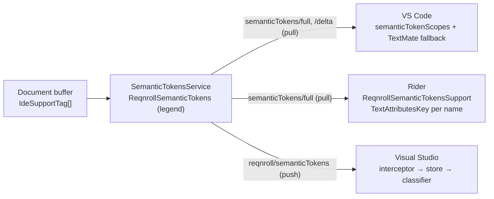
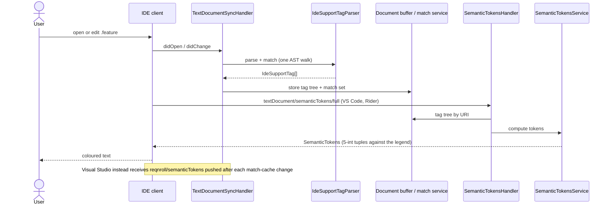

# Syntax Highlighting (F1)

**Status:** Implemented. Describes the system as it is; verify against the source files named in each section.
**Audience:** Maintainers working on semantic tokens, classifications or per-IDE colour mapping.

## 1. Purpose and scope

Keywords, step text, bound step arguments, tags, doc strings, data-table headers and cells, descriptions and comments
each render in a distinct colour from the IDE's own theme, and colours update as the user types, without saving. The
server computes semantic tokens from the cached tag tree; each client maps the token names to colours. VS Code also ships
a TextMate grammar so colouring exists before the first token response.

The transport difference for Visual Studio (server push plus client classifier) is a protocol topic covered in
[../architecture/server-protocol.md](../architecture/server-protocol.md); this document is the feature view.

## 2. Overview

## 3. Flows

## 4. Glossary

| Term | Meaning here |
|---|---|
| **Legend** | The fixed list of token-type names declared at `initialize`; tokens carry an index into it. A cross-client contract. |
| **`IdeSupportClassifications`** | The classification-name constants (and Visual Studio MEF exports) that existing users already see; the legend names mirror them. |
| **Token** | A 5-integer tuple `[deltaLine, deltaStartChar, length, typeIndex, modifiers]`, delta-encoded from the previous token. |
| **Tag tree** | The document buffer's parsed, match-annotated structure from which tokens are derived. |
| **Dialect** | The Gherkin keyword language for a project or file. |

## 5. Key classes

| Class | Location | Responsibility |
|---|---|---|
| `SemanticTokensHandler`, `SemanticTokensService`, `ReqnrollSemanticTokens` | `src/LSP/…LSP.Server/Features/SemanticTokens` | Legend, tag-to-token mapping, pull handler. |
| `SemanticTokensPushHandler` | `…LSP.Server/Pipeline` | Visual Studio push. |
| `IdeSupportTagParser`, `GherkinDocumentTaggerService` | `…LSP.Core/Parsing`, server `Tagging` | Fused parse and match. |
| `IdeSupportClassifications` | `src/VisualStudio/…VSSDKIntegration/Editor` | Classification definitions and default formats, reused verbatim from the legacy extension. |
| `SemanticTokensClassificationInterceptor`, `SemanticTokenClassificationStore`, `GherkinSemanticClassifier` | `src/VisualStudio/…Extension/Classification` | Visual Studio capture and rendering. |
| `package.json` `semanticTokenScopes`, `syntaxes/gherkin.tmLanguage.json`, `tableHighlightService.ts` | `src/VSCode` | VS Code mapping, fallback grammar, per-pipe table decoration. |
| `ReqnrollSemanticTokensSupport` | `src/Rider` | One `TextAttributesKey` per legend name. |

## 6. Behaviour and contracts

**Token types (the legend).** Custom Reqnroll names instead of generic LSP types, matching the legacy classification
names:

| Legend name | Gherkin element |
|---|---|
| `reqnroll.keyword` | `Feature:`, `Scenario:`, `Given`/`When`/`Then`/`And`/`But`, `Background:`, `Rule:`, `Examples:`, `Scenario Outline:` |
| `reqnroll.tag` | `@tag` |
| `reqnroll.description` | Free-text description lines |
| `reqnroll.comment` | `#` comments |
| `reqnroll.doc_string` | Doc string content |
| `reqnroll.data_table` | Table cell content (non-header rows) |
| `reqnroll.data_table_header` | Table header row |
| `reqnroll.step_parameter` | Bound step argument values |
| `reqnroll.scenario_outline_placeholder` | `<param>` placeholders |
| `reqnroll.undefined_step` | Step text with no matching binding (appears once discovery has completed) |
| `reqnroll.ambiguous_step` | Step text matching more than one binding |

**Dialects.** The service reads the active dialect from the project's `reqnroll.json` (default `en`), with a per-file
`# language:` override. Non-English keywords tokenize as `keyword` exactly like English ones. The dialect must be
resolved before the first token request for the project.

**Client mapping.**

- **Visual Studio** reuses `IdeSupportClassifications` verbatim, including its MEF exports and default formats (italic
  description, the `#887DBA` undefined-step foreground), so users keep their Fonts and Colors customisations. The
  classifier resolves each legend name to the classification of the same name through `IClassificationTypeRegistryService`.
  Structural colouring is fully covered; `undefined_step` appears only once discovery is active.
- **VS Code** associates each `reqnroll.*` type with TextMate scopes via `semanticTokenScopes`, so existing themes
  light up; defaults can also be supplied through `editor.semanticTokenColorCustomizations`. Table cell and header
  per-pipe colouring is refined by `TableHighlightService` decorations.
- **Rider** registers a `TextAttributesKey` per legend name (default colours mirror the classifications) and overrides
  the descriptor's semantic-token customisation to return them. Keys are registered on a colour-settings page so users can
  recolour them under Settings → Editor → Color Scheme.

## 7. Pitfalls and design decisions

1. **The legend is append-only.** Adding, removing or reordering entries breaks all three client mappings at once. New
   types are appended, and the legend ships with server and clients as a unit.
2. **Custom names move the mapping decision to the client.** The cost is that a client that does not map a name gets no
   colour for it, with no generic fallback. Each client must ship a complete mapping.
3. **Reserve names early.** `undefined_step` and `ambiguous_step` depend on discovery, but they are in the legend from the
   start so the legend never changes when discovery arrives.
4. **Visual Studio cannot use the standard flow.** Its colorizer maps by a fixed internal switch and its pull is
   unreliable; hence the push path (see [../architecture/server-protocol.md](../architecture/server-protocol.md)). Visual
   Studio's own colorizer may still pull and produce harmless plain-text tags for the same spans; the derived
   classifications take precedence.
5. **Always re-parse the whole file.** Gherkin nodes carry absolute locations, so partial re-parse is impractical even
   though `didChange` can be incremental.
6. **Static registration for Visual Studio.** The server advertises semantic tokens statically when launched for Visual
   Studio, because dynamic registration is unreliable there.

## 8. Known limitations

- A TextMate fallback exists only in VS Code; other clients show no semantic colour until the first response.

## 9. Testing

| Layer | Where |
|---|---|
| Token service, legend, mapping | `tests/LSP/Reqnroll.IdeSupport.LSP.Server.Tests/Features/SemanticTokens` |
| End to end | `…LSP.Server.Specs/Features/Protocol/SemanticTokens.feature`, `SemanticTokensPush.feature`, `Features/Editor/StepAnalysis.feature` |
| VS Code grammar and token-scope validation | `src/VSCode/src/test/grammar.test.ts`, `scripts/validate-semantic-token-scopes.mjs` |
