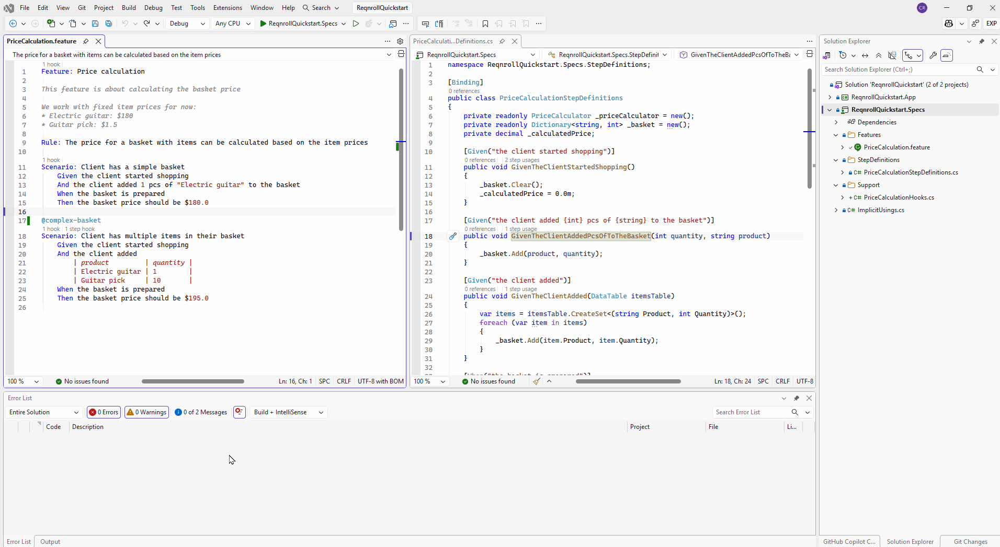
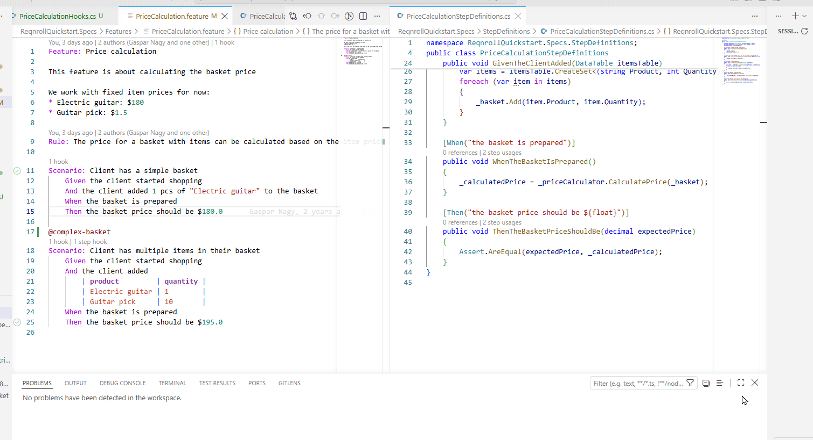
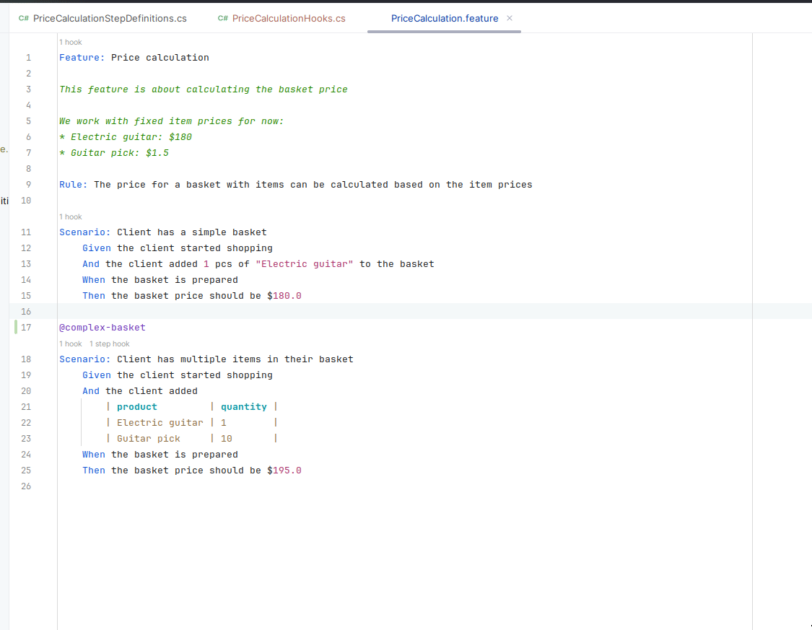

# Defining Steps

When a step in a `.feature` file has no matching binding, a quick-fix /
code action **"Define missing step"** (or **"Define all missing steps in
file"** when more than one step is undefined) appears — the lightbulb in
VS Code and Visual Studio, Alt+Enter in Rider. Activating it generates stub
binding methods with method signatures and parameter types inferred from
the step text.

## Where the generated method goes

If any existing step definition file in the project already has bindings
matched to steps in the same feature, that's offered as the default
target — the new method is **appended** to that file. When more than one
existing file already covers steps in the feature (or none do), each
option is offered as a separate action, with the target file named in the
action title (e.g. *"Define missing step → CalculatorSteps.cs"*), plus a
*"→ new file"* option that scaffolds a fresh `<FeatureName>StepDefinitions.cs`
alongside the best-matching existing file (or next to the feature file
itself, if nothing else in the project has any bindings for it yet).

## Copying the step definition to the clipboard

If you'd rather paste the generated code yourself, each group of options
ends with a copy action that puts the generated method on the clipboard
instead of changing any file:

* **"Copy missing step definition to clipboard"**, when one step is undefined
* **"Copy step definition to clipboard: \<step text\>"**, for the step under
  the cursor
* **"Copy all missing step definitions to clipboard"**, for every undefined
  step in the file

Only the method is copied: its attribute, signature and body, indented to sit
inside a class, with a blank line between methods when there is more than one.
No class, namespace or `using` lines are included, and no file is created or
changed. Paste it into whichever step definition class you choose.

## Sync vs. async skeleton style

The generated method's sync/async style — and whether it uses a regular
expression or a Cucumber Expression attribute — comes from the project's
configured
[`trace.stepDefinitionSkeletonStyle`](https://docs.reqnroll.net/latest/installation/configuration.html#trace)
setting in `reqnroll.json` (`CucumberExpressionAttribute` by default; see
also the
[step-matching styles reference](https://docs.reqnroll.net/latest/automation/step-definitions.html#step-matching-styles-rules)
for what each value produces). The LSP does not infer style from the
sync/async convention already used by sibling bindings in the target
class or file — it always follows this one project-wide setting.

```{admonition} Order of the offered options
:class: note

In every IDE the default option (appending to an existing step definition
file, when there is one) is listed first and the copy-to-clipboard options
last. In Visual Studio any other options between them are listed
alphabetically by title.
```

:::{tab-set}

```{tab-item} Visual Studio
:sync: vs


```

```{tab-item} VS Code
:sync: vscode


```

```{tab-item} Rider
:sync: rider


```

:::


See also [New Project / Item Templates](../new-project-templates.md) for
scaffolding a brand-new `.feature` file or step definitions class (as
opposed to a single missing step).
