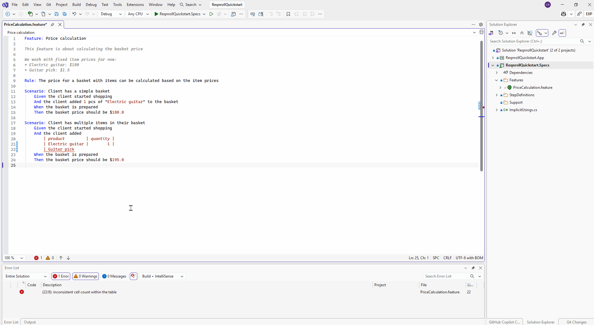

# Document & Table Formatting

## Format Document

Formatting the whole document (Shift+Alt+F, or your IDE's equivalent
shortcut) re-indents the entire `.feature` file: consistent indentation per
nesting level, normalized spacing around keywords, and blank lines between
scenarios. Formatting rules are read from `.editorconfig` — see
[Gherkin Formatting with EditorConfig](../editorconfig.md) for the full
settings reference.

## Table formatting

Typing `|` or pressing Enter inside a Gherkin data table or `Examples:`
table pads the columns so the pipes stay aligned as you type. A table can
also be re-aligned by running Format Document. A row missing its trailing
`|` gets one appended automatically.

:::{tab-set}

```{tab-item} Visual Studio
:sync: vs


```

```{tab-item} VS Code
:sync: vscode


```

```{tab-item} Rider
:sync: rider


```

:::

```{admonition} Visual Studio — on-type table alignment can lag
:class: warning

In Visual Studio, something other than this extension can insert a space
after a table row a fraction of a second after the extension has aligned it.
Visual Studio then treats the extension's edit as out of date, so on-type
table alignment can lag or appear not to happen. If a table isn't aligned as
you type, run Format Document to re-align it.
```

```{admonition} Rider table formatting
:class: note

Both whole-document Format and on-type `|` table-column realignment are
implemented in Rider — Format Document works through the platform's
built-in formatting service, and on-type table realignment through
dedicated plugin code, matching the behavior described above. Live
cross-IDE confirmation (including whether Rider's Enter/Tab-triggered
realignment works, not just `|`) is tracked in
[#415](https://github.com/reqnroll/Reqnroll.IdeSupport/issues/415).
```
