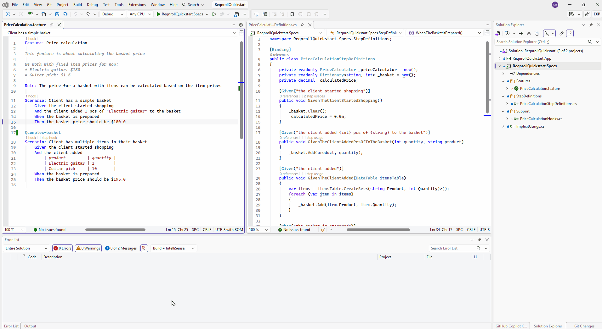
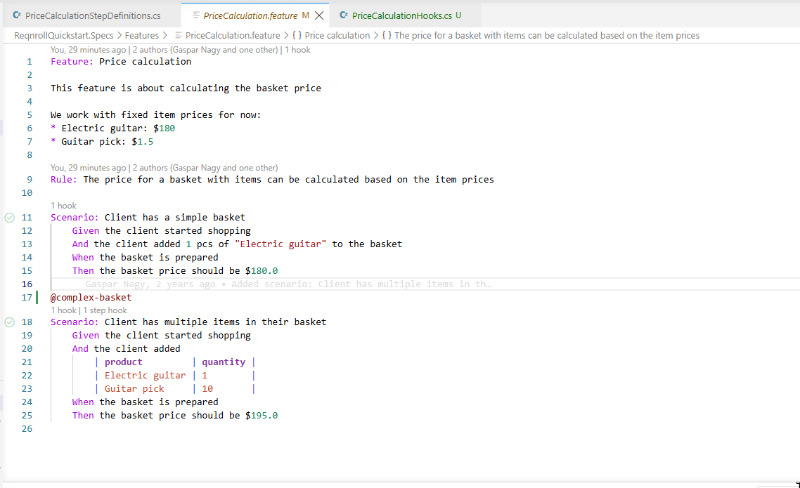
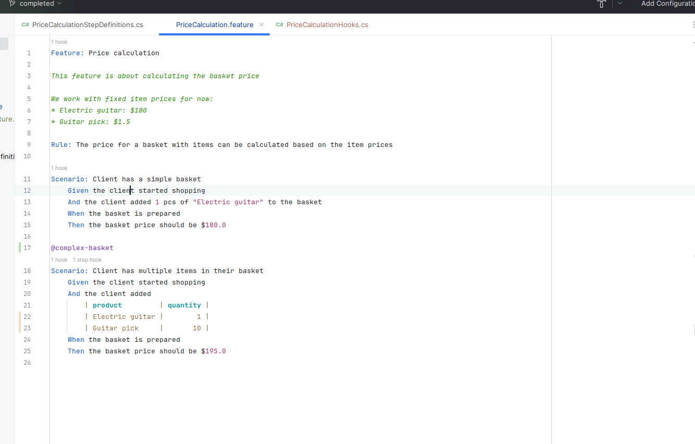

# Go to Step Definition

With the cursor on a step in a `.feature` file, **Go to Definition** (F12,
or Ctrl+Click / Cmd+Click) jumps to the matching `[Given]`/`[When]`/`[Then]`
method in the C# binding class. If more than one binding matches
(ambiguous), a picker lists the candidates.

```{note}
While you edit a `.cs` file, binding attributes are read from the source text alone, and only
string-literal arguments are understood. A binding written as `[Given(Texts.Login)]` is not
matched on the constant's value, so steps can link to the wrong binding or to none. See
[Bindings that use constants or other non-literal arguments](../troubleshooting.md#bindings-that-use-constants-or-other-non-literal-arguments).
```

:::{tab-set}

```{tab-item} Visual Studio
:sync: vs


```

```{tab-item} VS Code
:sync: vscode


```

```{tab-item} Rider
:sync: rider


```

:::
