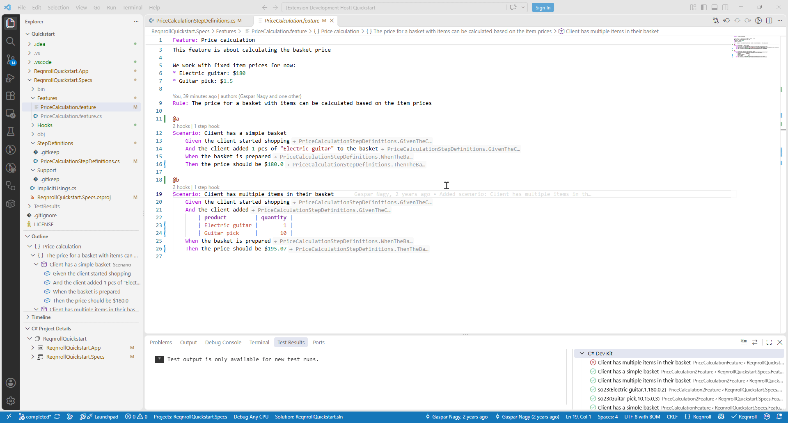
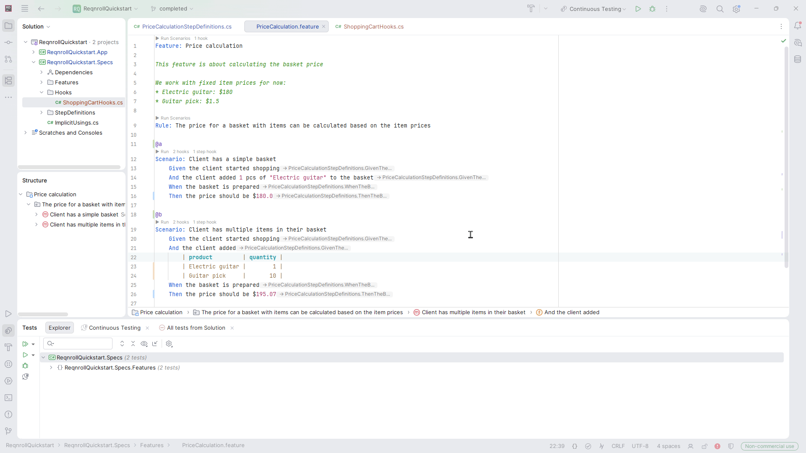

# Hook Navigation

**Find Hooks** lists the hook bindings that apply to a `.feature` file location,
filtered by the tags and `[Scope]` expressions that apply there:

* For a `Feature:` or `Scenario:` line: `[BeforeFeature]`/`[AfterFeature]`
  or `[BeforeScenario]`/`[AfterScenario]` hooks that apply.
* For a step: additionally `[BeforeStep]`/`[AfterStep]` and
  `[BeforeStepBlock]`/`[AfterStepBlock]` hooks.

Selecting an entry navigates to the C# hook method.

There is no menu entry for this command. Open it by clicking a hook-match
[Code Lens](../editing-features/code-lens.md); in VS Code and Rider you can also run the
command by name.

:::{tab-set}

```{tab-item} Visual Studio
:sync: vs

Click a hook-match Code Lens above a `Feature:` or `Scenario:` line in a
`.feature` file. A popup lists the matching hook methods; double-click an entry to go to it.
Visual Studio has no command for this.


```

```{tab-item} VS Code
:sync: vscode

Either:

- click a hook-match CodeLens above a `Feature:` or `Scenario:` line, or
- with the cursor in a `.feature` file, run **Reqnroll: Find Hooks** from the Command Palette.

No default keybinding.


```

```{tab-item} Rider
:sync: rider

Either:

- click a hook-match Code Vision lens above a `Feature:` or `Scenario:` line, or
- with the caret in a `.feature` file, run **Reqnroll: Find Hooks** from Find Action (Ctrl+Shift+A).

No default keybinding.


```

:::

```{tip}
[Code Lens](../editing-features/code-lens.md) shows hook-match counts inline above
`Feature:`/`Scenario:` lines while you're reading the code. Clicking one opens
the picker filtered to that lens's own hook set, so you can see the count and the
hooks in one place.
```

```{note}
If a `.feature` file is linked into more than one project, the hooks shown here always come from
the file's *home* project (wherever it physically lives on disk) — not necessarily the project
you opened it from. See [Troubleshooting](../troubleshooting.md#a-shared-feature-file-shows-hooks-diagnostics-or-highlighting-from-the-wrong-project).
```
